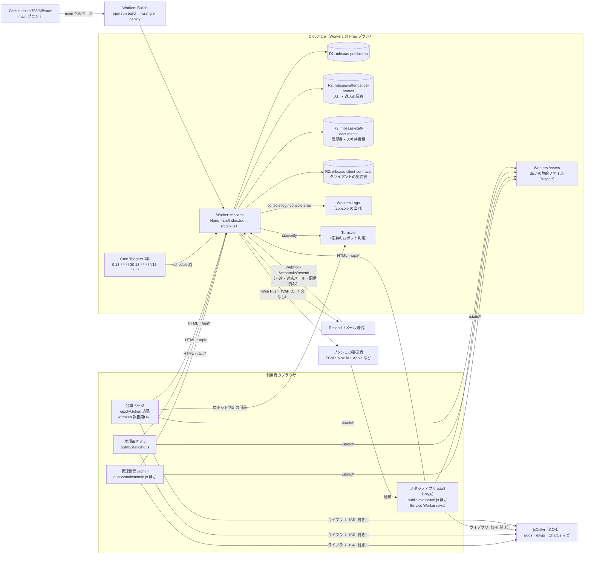
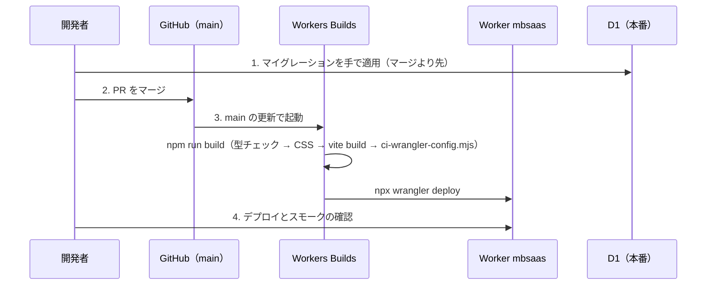

# アーキテクチャ（全体の構成）

この資料は、Field OS を初めて触る開発者（社外の開発会社を含む）が、どこに何があり、どう動いているかをつかむためのものです。
書いてあることは、すべてコードで確かめています。根拠には `ファイル:行` を添えています（行番号は 2026-11-11 時点の `review-fixes` ブランチ、コミット `017cbcc` のもの）。
`scripts/test-w13-docs-arch-ops.mjs` が、ここに書いた行番号・定期処理・設定値がコードと合っているかを確かめます（`npm test -- w13-docs-arch-ops`）。

関連する資料:

| 資料 | 中身 |
|---|---|
| [operations.md](operations.md) | 運用手順書（ローカル開発・テスト・リリース・復元・ログ・障害対応・シークレット・データの定期削除） |
| [decisions.md](decisions.md) | これまでの決定事項とその理由 |
| [glossary.md](glossary.md) | 用語集（画面の言葉と、テーブル・コードの名前の対応） |
| [db.md](db.md) | DB 設計書（全テーブルの定義・ER 図・個人情報の場所）。コードから生成 |
| [api.md](api.md) | API 一覧（全エンドポイントと権限）。コードから生成 |
| [screens.md](screens.md) | 画面一覧・画面遷移。コードから生成 |
| [backup.md](backup.md) / [monitoring.md](monitoring.md) | 本番データの自動バックアップ / 障害の記録と通知 |
| `spec_*.md` | 機能ごとの初期の仕様（[打刻修正](spec_attendance_correction.md)・[案件掲示板](spec_board.md)・[企業間のスタッフ連携](spec_multi_company_staff.md)・[常勤・スポットのシフト](spec_spot_shift.md)） |

---

## 1. このシステムは何か

Field OS は、通信系の人材会社（携帯ショップ・家電量販店・催事・光回線などへスタッフを出す会社）向けの業務システムです。
1つのシステムを複数の会社が使う、マルチテナントの SaaS です。使う人は4種類です。

| 使う人 | 画面 | 主な用途 |
|---|---|---|
| 会社の管理者（導入企業の社員） | 管理画面 `/admin`（PC 向け） | シフト・勤怠・日報・スタッフ・案件・クライアント・精算・募集・お知らせ |
| スタッフ（導入企業から現場に出る人） | スタッフアプリ `/staff`（スマホ向け。ホーム画面に追加できる PWA） | 勤怠の報告（起床〜退店）・日報・シフトの確認・出勤可能日の提出・お知らせ |
| 本部（Field OS を運営する側） | 本部画面 `/hq` | 導入企業の登録・停止、テンプレートの配信、定期処理とデータ保持の監視、メール送信の状況、解約企業のデータの書き出しと削除 |
| ログインしない人 | 公開ページ `/apply/:token`（募集への応募）・`/r/:token`（シフト専用の報告用URL）など | 応募・ログインを持たない人の勤怠報告 |

画面の URL と権限の詳細は [screens.md](screens.md) を見てください。

## 2. 構成図



## 3. 構成要素

| 要素 | 役割 | 設定・コード |
|---|---|---|
| Worker `mbsaas` | 画面の HTML・API・Webhook・Service Worker・定期処理を1つの Worker で返す | `wrangler.jsonc:5`（名前）、`src/index.tsx:891`（`fetch` と `scheduled` の入口） |
| Hono | ルーティングとミドルウェア。`/api/*` は `src/api.ts` にまとめ、機能ごとのファイルを `api.route()` でつなぐ | `src/index.tsx:86`、`src/api.ts:1259`〜`1304` |
| Workers Assets | `dist/` の静的ファイル（`public/` の中身が `vite build` で `dist/` に入る）を配信する | `wrangler.jsonc:8` |
| D1 | すべての業務データ（SQLite 互換）。バインディング名 `DB` | `wrangler.jsonc:17`、`migrations/*.sql` |
| R2 | 写真・書類のファイル。バケットは非公開で、ファイルは必ずログイン確認付きの API から返す | `wrangler.jsonc:24`（`PHOTOS`・`DOCUMENTS`・`CONTRACTS`） |
| Cron Triggers | 毎日 3:00・3:30（日本時間）と15分おきに定期処理を起動する | `wrangler.jsonc:39`、`src/index.tsx:815`（`CRON_JOBS`） |
| Workers Logs | `console.log` / `console.error` の出力を本番で後から検索できる（本番だけ有効） | `wrangler.jsonc:90` |
| Resend | メールの送信。不達などの結果は Webhook で受け取る | `src/services/email.ts`、`src/index.tsx:130` |
| Web Push | スタッフアプリと本部画面へのプッシュ通知（VAPID の署名だけ・本文なし。本部は障害の通知） | `src/lib/web-push.ts`、`src/index.tsx:92`（`/sw.js`） |
| Turnstile | 公開の応募ページのロボット判定（鍵を2つとも設定したときだけ） | `src/recruit.ts:268`・`278` |
| jsDelivr | 画面のライブラリ（axios・dayjs・Chart.js・flatpickr・FontAwesome など）。版を固定し、SRI（integrity）を付けて読む | `src/index.tsx:143`〜`159` |
| Workers Builds | GitHub の `main` に入ると、ビルドして本番にデプロイする | `scripts/ci-wrangler-config.mjs:1`〜`5` |

## 4. リクエストの流れ

### 4.1 画面

画面は SPA（1枚の HTML の中で `#` 以降で切り替える）です。HTML はサーバー（`src/index.tsx`）が返し、中身は `public/static/*.js` がブラウザで描きます。

1. ブラウザが `/admin` などを開くと、Worker がセッションを確かめ（`src/index.tsx:167` の `currentUser`）、ロールに合う HTML を返す。未ログインなら `/login?next=...` へ移す（`src/index.tsx:188`）。
2. HTML の `<head>` で、CDN のライブラリ（SRI 付き）・`/static/common.js`（共通部品）・`/static/style.css`（Tailwind をビルドしたもの）を読む（`src/index.tsx:154`〜`164`）。
3. 画面の JS が `/api/...` を axios で呼んで描く。

| パス | 返すもの | コード |
|---|---|---|
| `/` | ロールに合う画面へ移す | `src/index.tsx:173` |
| `/login` | ログイン（会社コード・ID・パスワード → 必要なら二段階認証） | `src/index.tsx:193` |
| `/reset-password` `/verify-email` `/notice-ack` | メールのリンクから開く画面（ログイン不要） | `src/index.tsx:422`・`503`・`551` |
| `/r/:token` | シフト専用の報告用URL（ログイン不要） | `src/index.tsx:609`、`public/static/report-link.js` |
| `/apply/:token` | 公開の募集ページ（ログイン不要） | `src/index.tsx:623`、`public/static/apply.js` |
| `/staff` | スタッフアプリ（ロール `staff` だけ） | `src/index.tsx:637` |
| `/admin` | 管理画面（会社の管理系ロール。本部は許可された閲覧のときだけ） | `src/index.tsx:677` |
| `/hq` | 本部画面（ロール `system_admin` だけ） | `src/index.tsx:769` |
| `/sw.js` | スタッフアプリ（scope `/staff`）と本部画面（scope `/hq`）の Service Worker（プッシュ通知の表示だけ。オフライン用の保存はしない） | `src/index.tsx:92`〜`126` |
| `/webhooks/resend` | Resend の Webhook（署名を確かめる） | `src/index.tsx:130` |

Worker が返すすべての応答に `X-Content-Type-Options: nosniff` を、HTML には CSP を付けます（`src/index.tsx:27`〜`55`）。CSP の jsDelivr は、画面で読み込んでいるファイルのパスだけを許します。静的ファイル（`/static/*`・`/manifest.webmanifest`）は Workers Assets が Worker を通さずに返すので、`public/_headers` で nosniff と最小の CSP を付けます。

### 4.2 API

`/api/*` の処理の順番は次のとおりです（`src/api.ts`）。

1. ログイン不要の API を先に登録する: `/api/auth/login` など（`src/api.ts:446`〜）、`/api/public/report`（報告用URL）・`/api/public/recruit`（募集ページ）・`/api/public/notice-ack`・`/api/public/calendar`（`src/api.ts:712`〜`730`）。
2. 認証ミドルウェア（`src/api.ts:738`）: Cookie `session` のトークンから利用者を引き、期限切れ・退職・停止中の企業と、連携が終わった会社に企業切替で入ったままのスタッフ（401 `link_ended`。D-53）を止める（`src/lib/auth.ts:126` の `loadSessionUser`）。あわせて、別のアカウントへの切り替え（`X-Expected-User-Id` が違えば 409）・接続元 IP の制限・二段階認証の登録待ちを確かめ、セッションを延ばす。
3. ロールの確認: `/api/admin/*` は会社の管理系ロール（`src/api.ts:843`〜`846`）、`/api/admin/employees*` は会社管理者と事務担当だけ（`src/api.ts:853`）、`/api/hq/*` は本部だけ（`src/api.ts:855`）、`/api/staff/*` はスタッフだけ（`src/api.ts:882`）。
4. 各機能の処理。会社の境界はここで確かめる（「8. マルチテナント」）。
5. 書き込み（GET 以外）の後に、積まれたプッシュ通知を送る（`src/index.tsx:80`〜`84`）。

エンドポイントの一覧と権限は [api.md](api.md) を見てください。

### 4.3 予期しないエラー

例外が起きると `app.onError`（`src/index.tsx:54`）が、次の1行の JSON を `console.error` で Workers Logs に残し、利用者には8文字の参照番号を返します（API は `{ error, ref }` と 500、画面はエラーのページ）。

```json
{"level":"error","event":"unhandled_error","ref":"1a2b3c4d","method":"POST","path":"/api/admin/...","company_id":1,"user_id":2,"role":"company_admin","message":"...","stack":"..."}
```

参照番号は `newErrorRef()`（`src/lib/error-log.ts:54`〜`56`）が作ります。パスに入るトークン（20文字以上で、数字か大文字を含む英数字）は `maskPath()` が `***` に伏せます（`src/lib/error-log.ts:63`〜`65`）。利用者から参照番号を聞いたら、Workers Logs で `ref` を検索します（[operations.md](operations.md) の「ログの見方」）。

あわせて、エラーの要約を D1 の `error_logs` に応答の後で残し（`src/index.tsx:66`〜`67`）、本部画面の「障害」で見られるようにしています。定期処理の失敗も `withErrorLog` で同じ表に残します（`src/index.tsx:872`〜`889`）。件数が目安を超えると本部の管理者に通知します。仕組みと設定は [monitoring.md](monitoring.md) を見てください。

## 5. 定期処理（Cron Trigger）

起動の式は `wrangler.jsonc:39`（`triggers.crons`）、実行する処理の一覧は `src/index.tsx:815` の `CRON_JOBS` です。時刻は UTC で書くので、日本時間は +9 時間です。
起動した式に合う処理を、一覧の上から順に実行します。1つが失敗しても次へ進み、処理ごとの結果を `cron_runs` テーブルに残して本部画面の「データ保持・定期処理」に出します（`src/services/cron.ts:51`〜`87`）。失敗した処理と、目安（15分おきの処理は1時間、毎日の処理は25時間）を過ぎても動いていない処理は、本部画面の上に警告を出します（`src/services/cron.ts:100`）。

| 式（UTC） | 日本時間 | 処理名（`name`） | 内容 | 関数 |
|---|---|---|---|---|
| `*/15 * * * *` | 15分おき | `reminders` | 本人あての自動リマインド（起床・出発・入店の未報告、日報の未提出。会社の設定で ON の会社だけ） | `src/services/reminders.ts` の `runReminders` |
| `*/15 * * * *` | 15分おき | `push_queue` | プッシュ通知のうち、API の応答の後に送れなかった分を送る | `src/notifications.ts` の `runPushQueueJob` |
| `*/15 * * * *` | 15分おき | `notification_digest` | 打刻修正の承認依頼のまとめメール（毎朝8時以降の最初の起動で1回） | `src/notifications.ts` の `runNotificationDigests` |
| `0 18 * * *` | 毎日 3:00 | `auth_purge` | 期限切れのセッション・ログイン試行・1年より古いログイン履歴の削除 | `src/lib/auth.ts:191` |
| `0 18 * * *` | 毎日 3:00 | `token_purge` | 期限切れ・使用済みのトークン（パスワード再設定・報告用URL）の削除 | `src/services/retention.ts:1079` |
| `0 18 * * *` | 毎日 3:00 | `recruit_applications_purge` | スタッフに紐づかない応募の削除（180日） | `src/recruit.ts:1034` |
| `0 18 * * *` | 毎日 3:00 | `retention` | データ保持の定期削除（日報3年・退職後7年など）。`RETENTION_ENABLED` が `'true'` のときだけ実際に消す | `src/services/retention.ts:938` |
| `0 18 * * *` | 毎日 3:00 | `retirements` | 退職予定日を過ぎたスタッフを退職（ログイン停止）に切り替える | `src/services/retention.ts:193` |
| `0 18 * * *` | 毎日 3:00 | `affiliation_schedules` | 予約した所属区分の変更を適用する | `src/staff-lifecycle.ts` の `applyDueAffiliationSchedules` |
| `0 18 * * *` | 毎日 3:00 | `notice_reads_purge` | お知らせの既読の記録の削除（2年） | `src/api.ts:349` |
| `0 18 * * *` | 毎日 3:00 | `board_saved_search` | 案件掲示板の保存した検索条件に合う新着の知らせ | `src/board.ts` の `notifySavedSearchMatches` |
| `0 18 * * *` | 毎日 3:00 | `billing_close` | 本部から導入企業への利用料の、前月分の記録（`company_billing_months`。毎月1〜3日） | `src/api.ts:7979` |
| `30 18 * * *` | 毎日 3:30 | `retention_in_service` | 在職中の保存期間による削除（位置情報・写真・相談・フォロー記録など） | `src/services/retention.ts:982` |
| `30 18 * * *` | 毎日 3:30 | `notice_read_reports` | 既読率レポートの集計 | `src/api.ts:312` |
| `*/15 * * * *` | 15分おき | `notice_scheduled_publish` | 予約したお知らせのメール配信 | `src/api.ts:6837` |
| `*/15 * * * *` | 15分おき | `doc_expiry_notice` | 書類の有効期限（30日以内・期限切れ）を管理者に知らせる | `src/notifications.ts` の `notifyExpiringDocuments` |

- 処理を足すときは `CRON_JOBS` に1行足し、この表と README の表にも足します（`src/index.tsx:896`）。新しい式を使うなら `wrangler.jsonc` の `triggers.crons` にも足します（トップレベルと `env.production` の両方）。
- 毎日の処理を 3:00 と 3:30 に分けているのは、1回の起動で D1 に投げられる問い合わせの数に上限があるためです（`src/index.tsx:809`、`src/services/cron.ts:5`〜`6`）。
- 何もしなかった実行（`idle: true`）は、直前の記録も idle ならその行を消してから記録します。15分おきの処理で記録が埋まらないようにするためです（`src/services/cron.ts:68`〜`71`）。

## 6. 外部サービス

### 6.1 Resend（メール）

- 送信は `src/services/email.ts` の `sendEmail` / `sendEmailBatch` に集めています。メールの文面は `src/email-templates/` にあります。
- 送るかどうか（`src/services/email.ts:110` の `mailMode`）: `MAIL_ENABLED` が `'false'` なら送らずに記録だけ残す（`skipped`）。`RESEND_API_KEY` か `MAIL_FROM` がなければ `not_configured`（送信失敗として記録）。
- 送信の記録は `email_logs` テーブル（本文と API キーは残さない）。本部画面の「メール送信」と、管理画面の「通知」の中のメール送信状況で見られます。
- 不達・迷惑メールの報告・配信済みは、Resend の Webhook（`POST /webhooks/resend`）で受け取ります。`RESEND_WEBHOOK_SECRET` で Svix 形式の署名を確かめ、未設定なら 503、署名が違えば 401 を返します（`src/services/email.ts:290`〜`298`）。不達・迷惑メールの報告があったアドレスは `email_suppressions` に入れ、以後は送りません。
- 現在の本番: `RESEND_API_KEY` を登録していないため、本番からメールは送られません（[decisions.md](decisions.md) の D-31）。

### 6.2 Web Push（プッシュ通知）

- 本文を送らない方式です。プッシュを受けた端末の Service Worker（`/sw.js`）が、スタッフは `/api/staff/push/latest`、本部は `/api/hq/push/latest`、会社管理者は `/api/admin/push/latest` から最新の未読を取りに来て表示します（`src/index.tsx:88`〜`126`）。購読の API はスタッフ・本部・管理画面で同じ関数 `pushDeviceRoutes` から作ります（`src/notifications.ts:1948`・`2008`・`2040`・`2062`）。管理画面で受け取るのは会社管理者だけで、今はログインの失敗が続いたときの知らせ（`login_failures`）だけです（[decisions.md](decisions.md) の D-43）。暗号化を省けるので、Free プランの CPU 時間に収まります（`src/lib/web-push.ts:3`〜`4`）。
- 鍵: シークレット `VAPID_PUBLIC_KEY`・`VAPID_PRIVATE_KEY` があればそれを使い、なければ初回に作って D1 の `push_vapid_keys` に保存します（`src/lib/web-push.ts:41`〜`58`）。
- アプリ内の通知（`user_notifications`）が入ると、トリガー（`migrations/0081_push.sql` の `trg_user_notifications_push`）で `push_queue` に積まれ、API の応答の後と15分おきの cron で送ります。送り先が 404・410 を返した購読は消します（`src/lib/web-push.ts:110`）。

### 6.3 Turnstile（応募のロボット判定）

- `TURNSTILE_SITE_KEY` と `TURNSTILE_SECRET_KEY` の両方があるときだけ使います（`src/recruit.ts:268`）。
- Cloudflare への問い合わせ（siteverify）が失敗・5秒でタイムアウトしたときは、応募を受け付けて「要確認」の印（`recruit_applications.turnstile_unverified = 1`）を付けます。判定に落ちた応募は受け付けません（`src/recruit.ts:302`〜`309`。[decisions.md](decisions.md) の D-01）。
- そのほかの機械的な送信の対策: 見えない入力欄・表示から短時間の送信は保存しない、同じ接続元から1時間あたり・同じ電話番号から1日あたりの件数の上限（`src/recruit.ts:298`〜`337`）。接続元 IP はそのまま保存せず、`RATE_LIMIT_SALT`（なければ `TURNSTILE_SECRET_KEY`）を塩にしたハッシュにします（`src/recruit.ts:371`〜`381`）。

### 6.4 jsDelivr（画面のライブラリ）

- 版を固定し、SRI のハッシュを付けて読みます（`src/index.tsx:143`〜`159`）。版を上げるときはハッシュも計算し直します（計算方法は `src/index.tsx:142` のコメント）。CSP（`script-src`・`style-src`）はこの一覧のファイルのパスだけを許すので、ファイルを足したら一覧にも足します。
- CDN を読めないとき（店舗の Wi-Fi のフィルタなど）は、白い画面のままにせず理由を出します（`src/index.tsx:161`）。

## 7. デプロイの仕組み



- `npm run build`（`package.json:6`）は、最初に型チェック（`typecheck`。型のエラーがあるとここで止まり、デプロイされない。Sprint 21 #9944）を行い、Tailwind の CSS を作り（`build:css`）、`vite build` で `dist/_worker.js` と静的ファイルを作り、最後に `scripts/ci-wrangler-config.mjs` を動かします。
- `wrangler.jsonc` のトップレベルはローカル開発用（メールを送らない・デモの案内を出すなど）で、本番の設定は `env.production` にあります（`wrangler.jsonc:3`〜`4`）。Workers Builds は `--env` を付けずに `wrangler deploy` するので、CI のとき（`WORKERS_CI=1` か `CI=true` など）だけ、`env.production` をトップレベルに展開した `wrangler.json` を作ります。作れなかったとき・中身が本番の値（`DEMO_MODE=false` など）でないときは、ビルドを止めます。wrangler は `wrangler.json` を `wrangler.jsonc` より先に読みます（`scripts/ci-wrangler-config.mjs:1`〜`42`）。`wrangler.json` は `.gitignore` に入っています。
- **マイグレーションは自動では適用されません**。新しい列・テーブルを使うコードが先に出ると、その API が 500 になるので、マージより先に手で本番に適用します（手順は [operations.md](operations.md) の「本番リリース」）。
- 手元から `npm run deploy`（`wrangler deploy --env production`）でも出せますが、ふだんは GitHub 経由で出します。

## 8. ソースの構成

```
src/                      サーバー（Worker）。TypeScript
  index.tsx               入口。画面の HTML・セキュリティヘッダー・エラー処理・Service Worker・Webhook・定期処理の一覧
  api.ts                  /api/* の本体。認証・権限のミドルウェアと、機能のファイルに分けていない API（約8,200行）
  <機能>.ts               機能ごとの API（Hono のサブアプリ。api.ts から api.route() でつなぐ）
  lib/                    共通部品（認証・会社の境界・入力の検証・D1 の上限への対策・操作履歴など）
  services/               定期処理の実行・メール送信・リマインド・データ保持の削除
  email-templates/        メールの文面
  input.css               Tailwind の元の CSS（npm run build:css で public/static/style.css を作る）
public/                   ブラウザに配る静的ファイル（vite build で dist/ に入る）
  manifest.webmanifest    ホーム画面に追加したときの名前・アイコン
  static/*.js             画面の JS（Vanilla JS。ビルドしない）
  static/style.css        Tailwind の出力（ビルドで作る。直接編集しない）
migrations/               D1 のスキーマの変更（0001〜。番号順に適用。適用済みは d1_migrations に記録される）
scripts/                  テスト・ビルド・DB の準備のスクリプト
seed.sql                  ローカル用のデモデータ（本番には入れない）
wrangler.jsonc            Worker・D1・R2・cron・環境変数の設定
docs/                     この資料と機能ごとの仕様
```

### 8.1 サーバーの主なファイル

| ファイル | 責務 |
|---|---|
| `src/index.tsx` | 画面の HTML、CSP、`app.onError`、`/sw.js`、`/webhooks/resend`、`CRON_JOBS` と `scheduled` |
| `src/api.ts` | 認証（ログイン・二段階認証・再設定）、認証と権限のミドルウェア、ダッシュボード・スタッフ・案件・クライアント・シフト・日報・お知らせ・実績分析・本部の API |
| `src/accounts.ts` | 管理者アカウント・本部による企業のユーザーの管理、本人のアカウント設定 |
| `src/roster.ts` | スタッフマスタの新規作成（4つのルート）、企業間のスタッフ連携と同意、協力会社とクライアントのつながり |
| `src/roster-chat.ts` / `src/roster-import.ts` | 企業間チャット / スタッフマスタ・従業員の CSV 一括登録 |
| `src/staff-lifecycle.ts` | 所属区分の変更・仮登録・勤怠と日報の提出設定・報告用URL・代理入力 |
| `src/staff-merge.ts` | 仮登録スタッフと既存スタッフの統合 |
| `src/shift-board.ts` | シフト管理（常勤・スポット）、募集枠、単価（請求・支払）の決定と引き継ぎ、まとめて保存・まとめて削除 |
| `src/settlement.ts` | 実績の確定、請求・支払の集計、CSV |
| `src/recruit.ts` | 募集ページ・公開の応募・承認（シフトの確定と仮登録） |
| `src/report-settings.ts` | 案件報告管理（勤怠の報告8種類の ON/OFF・一括変更・変更履歴） |
| `src/corrections.ts` | 打刻修正の申請と承認 |
| `src/notifications.ts` | アプリ内通知・通知メール・プッシュ通知・本部のメール送信状況 |
| `src/board.ts` | 案件掲示板（企業どうしの掲載・問い合わせ・人材提案・取り込み） |
| `src/hq-support.ts` | 伴走支援の依頼・本部から企業へのお知らせ・本部による管理画面の閲覧 |
| `src/staff-pay.ts` / `src/staff-schedule.ts` / `src/staff-self-service.ts` | スタッフ本人の支払の確認と申請 / 出勤可能日とカレンダー / 本人の手続き（登録情報の変更申請など） |
| `src/csv.ts` | CSV の共通処理（BOM 付き UTF-8・CRLF・数式の無害化） |
| `src/lib/auth.ts` | パスワードのハッシュ、セッション、ログイン試行の制限 |
| `src/lib/login-security.ts` | ログイン履歴・二段階認証・接続元 IP の制限 |
| `src/lib/tenant.ts` | 自社の行かを確かめる関数（`ownProject` など）と、他社に返すメールアドレスを伏せる処理 |
| `src/lib/validate.ts` / `src/lib/update-builder.ts` | 入力の検証 / 送られた項目だけを更新する UPDATE の組み立て |
| `src/lib/d1-chunk.ts` / `src/lib/bulk-write.ts` | D1 のバインド上限（1文100個）と問い合わせ数への対策 |
| `src/lib/operation-log.ts` / `src/lib/change-log.ts` | シフト・枠・精算の操作履歴 / 従業員データとスタッフ基本情報の変更履歴 |
| `src/lib/web-push.ts` | Web Push の送信 |
| `src/services/cron.ts` | 定期処理の実行と記録、本部画面向けの状態と警告 |
| `src/services/email.ts` | メール送信・送信記録・Resend の Webhook |
| `src/services/retention.ts` | データ保持の定期削除・退職の適用・解約企業のデータの書き出しと削除 |
| `src/services/reminders.ts` | 本人あての自動リマインド |

### 8.2 画面の主なファイル（`public/static/`）

| ファイル | 読む画面 | 責務 |
|---|---|---|
| `common.js` | すべて | 共通部品: `esc`（HTML のエスケープ）、`delegate`（`data-action` のクリックを関数に振り分ける）、`withSubmitLock`（二度押しの防止）、モーダルの閉じ方 |
| `admin.js` | `/admin` | 管理画面の本体（ルーティング・ダッシュボード・スタッフ・案件・クライアント・日報・お知らせ・分析など） |
| `shift-board.js` / `settlement.js` / `recruit.js` / `roster.js` / `roster-chat.js` / `staff-lifecycle.js` / `report-settings.js` / `corrections.js` / `notifications.js` / `attendance-history.js` / `board.js` / `security.js` / `hq-support.js` | `/admin` | 機能ごとの画面（ファイル名はサーバーの同名のファイルに対応） |
| `staff.js` / `staff-attendance.js` / `staff-profile.js` | `/staff` | スタッフアプリ |
| `hq.js`（と `security.js`） | `/hq` | 本部画面 |
| `apply.js` / `report-link.js` | `/apply/:token` / `/r/:token` | 公開ページ |

画面を書くときの決まり: 値は必ず `esc` を通して HTML に入れる。`onclick` などのイベント属性の文字列に値を埋め込まず、`data-*` と `delegate` を使う（古い画面には `onclick` などのイベント属性が残っているため、CSP の `script-src` の `'unsafe-inline'` はまだ外せません。`src/index.tsx:25`〜`26`）。

### 8.3 スクリプト（`scripts/`）

| ファイル | 用途 |
|---|---|
| `run-tests.mjs` | `npm test`。テストごとにローカルの D1 を複製して `wrangler dev --local` を起動し、テストを流す |
| `setup-test-db.sh` | テスト用のローカル D1 を作る（マイグレーション → seed.sql の順） |
| `test-*.mjs` | 統合テスト（API を呼んで確かめる）。約100本 |
| `reset-local-db.mjs` | `npm run db:reset:local`。ローカルの D1 を作り直す |
| `gen_seed.cjs` | `seed.sql` を今日の日付に合わせて作り直す |
| `check-migrations.mjs` | 本番（または `--local`）の D1 に未適用のマイグレーションがないかを確かめる（`npm run predeploy` から呼ぶ） |
| `ci-wrangler-config.mjs` | Workers Builds のときに、本番の設定の `wrangler.json` を作る |

## 9. 認証とセッション

| 項目 | 内容 | 根拠 |
|---|---|---|
| ログイン | 会社コード＋ID（スタッフ番号）＋パスワード。本部は会社コードなし。全角は半角にそろえ、大文字・小文字を区別せずに照合 | `src/api.ts:446`、`src/index.tsx:273` |
| パスワードの保存 | PBKDF2（SHA-256・ソルト16バイト）`pbkdf2$回数$ソルト$ハッシュ`。作るときは 10,000 回、照合は 100,000 回まで受け付ける。回数の少ないハッシュ・旧形式はログイン成功時に作り直す | `src/lib/auth.ts:13`〜`14`、`44`〜`71` |
| パスワードの条件 | 8〜128文字、空白だけは不可（全経路で `validatePassword`） | `src/lib/auth.ts:82` |
| セッション | ランダムなトークンを httpOnly の Cookie `session`（https では Secure、SameSite=Lax）に入れ、DB（`sessions`）には SHA-256 のハッシュだけを保存 | `src/lib/auth.ts:9`、`148`〜`151` |
| 有効期限 | 操作のたびに延ばす。操作のない時間の上限は 12 時間（スタッフは 72 時間）、ログインからの最長は 7 日（スタッフは 30 日）。バッジの更新などの定期の取得（`X-Background: 1`）では延ばさない | `src/lib/auth.ts:10`、`src/api.ts:792`〜`817` |
| 止める条件 | 期限切れ・退職（`users.status` が `active` 以外）・ログインできないロール（`roster_only`）・本部で停止した企業（本部ユーザーは除く） | `src/lib/auth.ts:126`〜`140` |
| ログイン試行の制限 | 15分間に、会社コード＋ID ごとに10回、IP ごとに50回の失敗で一時的に止める。ID・IP はハッシュで保存 | `src/lib/auth.ts:18`〜`21`、`154`〜`187` |
| 二段階認証 | 認証アプリ（TOTP）と予備コード。管理系ロールと本部が使える（スタッフは対象外）。会社の設定で必須にできる。必須なのに未登録の人は、登録の画面だけを使える | `src/api.ts:733`、`764`〜`767`、`src/lib/login-security.ts` |
| 接続元 IP の制限 | 会社の設定で、管理系ロールの接続元を制限できる（スタッフは対象外） | `src/api.ts:760`、`src/lib/login-security.ts:101` |
| 同じブラウザでの別アカウント | 画面は自分の `user_id` を `X-Expected-User-Id` で送り、違えば 409 で止める | `src/api.ts:752`〜`757` |
| パスワードの再設定 | メールのリンク（1時間）。ただし本番はメールを送れないため、当面は管理者が仮パスワードを再発行する（`POST /api/admin/users/:id/reset-password`。`src/accounts.ts:325`） | `src/api.ts:594`・`646` |

## 10. ロール（権限）

`users.role` の値です。画面の表示名は `public/static/hq.js:466` などにあります。

| 値 | 画面の名前 | 使える画面・API |
|---|---|---|
| `company_admin` | 会社管理者 | `/admin`。従業員管理（給与・口座など）も可。セキュリティの設定も可 |
| `office_staff` | 事務担当 | `/admin`。従業員管理も可 |
| `sales_manager` | 営業管理者 | `/admin`。従業員管理は不可 |
| `field_manager` | 現場管理者 | `/admin`。従業員管理は不可 |
| `staff` | スタッフ | `/staff` と `/api/staff/*` だけ |
| `roster_only` | ログインなし（名簿のみ） | ログインできない（スタッフマスタ・仮登録の行） |
| `system_admin` | 本部（システム管理者） | `/hq` と `/api/hq/*`。各社の `/admin` は、企業が許可した期限付きの閲覧（読み取り専用）のときだけ |

根拠: `src/api.ts:170`〜`174`（`ADMIN_ROLES`・`HR_ROLES`）、`src/lib/auth.ts:17`、`src/lib/auth.ts:143`（ロールごとの最初の画面）。

## 11. マルチテナント（会社ごとのデータの分離）

- **導入企業 = `companies` の1行**です。業務データのテーブルは `company_id` を持ち、API はログイン中の利用者の `company_id` で絞ります。
- 画面や API から受け取った ID は、必ず自社の行かを確かめてから使います。共通の関数は `src/lib/tenant.ts`（`ownProject`・`ownClient`・`ownStaff`・`ownShift` など。見つからなければ 404 にする）。
- **本部**: 本部ユーザー（`system_admin`）は、本部専用の企業行（`companies.active_status = 'internal'`）に所属します（`migrations/0033_account_admin.sql:7`〜`16`）。本部が各社の管理画面を見るのは、企業が許可したときだけで、期限付き・読み取り専用です。開始・終了と開いた画面を記録します（`src/hq-support.ts:4`、`199` の `hqViewAdminGuard`、Cookie `hq_view`）。本部の書き込みは `hq_audit_logs` に残します（`src/api.ts:859`〜`872`）。
- **企業の停止**: 本部で停止にすると（`companies.active_status = 'inactive'`）、その企業の利用者はログイン・API が使えなくなり（`src/lib/auth.ts:96`、`137`）、セッションも消します（`src/lib/auth.ts:112`）。
- **企業間のスタッフ連携**（会社をまたいで同じ人を使う仕組み）: 所属元のスタッフを、連携用のコード（自社雇用は人物の恒久 ID `FS…`、連携で受けた人をさらに渡すときは `RL…`）で連携先に登録します。連携先には自社の行（`staff_profiles.affiliation_type = 'linked_external'`、ユーザーコード `LK-…`。照合できないパスワード）が作られ（`src/roster.ts:1345`）、基本項目は所属元の行をその場で読みます。共有する項目と共有しない項目は `src/roster.ts:222`〜`236`（同意の版 v3）で決まり、同意は `roster_consents` に残します。詳細は [decisions.md](decisions.md) の D-03・D-04 と [spec_multi_company_staff.md](spec_multi_company_staff.md)。
- **同じ人の複数の会社**: 同じ人物（`persons`。`person_id`）が複数の会社に登録されているとき、ログインは所属元のアカウント1つで、スタッフアプリで会社を切り替えます（`src/roster.ts:1622`）。勤怠・日報はシフトを持つ会社の行に記録します（`src/api.ts:180` の `resolvePersonShift`）。

## 12. 設定値（環境変数・シークレット）

値そのものはここに書きません。

### 12.1 `vars`（`wrangler.jsonc` に書く。デプロイのたびにこの値になる）

| 名前 | ローカル（`wrangler.jsonc:43`） | 本番（`wrangler.jsonc:81`） | 意味 |
|---|---|---|---|
| `MAIL_FROM` | Resend のテスト用アドレス | 同じ（独自ドメインに変える予定） | メールの送信元。`resend.dev` のテスト用アドレスは Resend のアカウント所有者にしか届かない（`src/services/email.ts:123`〜`126`） |
| `APP_BASE_URL` | `http://localhost:8787` | 本番の URL | メールの中のリンク、VAPID の連絡先の既定 |
| `MAIL_ENABLED` | `false` | `true` | `'false'` ならメールを送らず記録だけ（`src/services/email.ts:111`） |
| `RETENTION_ENABLED` | `false` | `true` | `'true'` のときだけデータ保持の削除を実際に行う。それ以外は dry-run（`src/index.tsx:832`） |
| `DEMO_MODE` | `true` | `false` | `'true'` のときだけ、ログイン画面にデモアカウントの案内を出す（`src/index.tsx:263`） |

次の `vars` は省略できます（`wrangler.jsonc` に書かなければ既定の値。`src/lib/error-log.ts:40`〜`46`）。変え方は [monitoring.md](monitoring.md) の「通知の目安を変える」にあります。

| 名前（省略できる） | 既定 | 意味 |
|---|---|---|
| `ERROR_ALERT_THRESHOLD` | `10` | 障害の通知を出す件数 |
| `ERROR_ALERT_WINDOW_MINUTES` | `10` | 件数を数える期間（分） |
| `ERROR_ALERT_COOLDOWN_MINUTES` | `60` | 同じ通知を次に出すまでの間隔（分） |
| `TEST_HOOKS` | なし | テスト用。`'true'` のときだけ、打刻の API に D1 の回数のヘッダーと過負荷のまねを付ける（`src/lib/d1-retry.ts:33`。ローカルの `wrangler dev --var TEST_HOOKS:true` だけで使い、`wrangler.jsonc` と本番には入れない） |
| `DB_CALL_COUNT` | なし | テスト用。`'true'` のときだけ、打刻修正のまとめて承認の応答に、その要求の D1 の呼び出しの回数 `d1_calls` を付ける（`src/corrections.ts:1037`。ローカルの `wrangler dev --var DB_CALL_COUNT:true` だけで使い、`wrangler.jsonc` と本番には入れない） |

ダッシュボードで `vars` を変えても、次のデプロイで `wrangler.jsonc` の値に戻ります。変えるときは `wrangler.jsonc`（トップレベルと `env.production` の両方）を直してマージします。

### 12.2 シークレット（`npx wrangler secret put <名前> --env production` で登録。コードと `wrangler.jsonc` には書かない）

| 名前 | 使う所 | 未設定のときの動き |
|---|---|---|
| `RESEND_API_KEY` | メール送信（`src/services/email.ts:112`・`165`） | メールを送らず、送信失敗（`mail_not_configured`）として記録する。**本番は未登録**（D-31） |
| `RESEND_WEBHOOK_SECRET` | Resend の Webhook の署名の確認（`src/services/email.ts:292`） | Webhook に 503 を返す（不達の記録が更新されない） |
| `TURNSTILE_SITE_KEY` | 募集ページに Turnstile を出す（`src/recruit.ts:259`） | 2つそろわなければ Turnstile を使わない。片方だけのときは管理画面に状態を出す（`src/recruit.ts:269`〜`272`） |
| `TURNSTILE_SECRET_KEY` | Turnstile の判定（`src/recruit.ts:306`） | 同上 |
| `RATE_LIMIT_SALT` | 応募の回数の制限に使う IP のハッシュの塩（`src/recruit.ts:377`） | `TURNSTILE_SECRET_KEY` を塩にする。どちらもなければ短いハッシュ（4桁）にし、ログに警告を出す |
| `VAPID_PUBLIC_KEY` / `VAPID_PRIVATE_KEY` | Web Push の署名（`src/lib/web-push.ts:42`） | 初回に鍵を作って D1 の `push_vapid_keys` に保存して使う |
| `VAPID_SUBJECT` | Web Push の連絡先（`https://` か `mailto:`。`src/lib/web-push.ts:62`） | `APP_BASE_URL` が https ならそれ、なければ仮のアドレス |

どのシークレットが本番に登録されているかは `npx wrangler secret list --env production` で確かめます（値は表示されません）。

### 12.3 バインディング

| 名前 | 種類 | 本番の名前 |
|---|---|---|
| `DB` | D1 | `mbsaas-production`（`wrangler.jsonc:17`〜`23`。ローカルも同じ名前で、`--local` で手元の SQLite を使う） |
| `PHOTOS` | R2 | `mbsaas-attendance-photos` |
| `DOCUMENTS` | R2 | `mbsaas-staff-documents` |
| `CONTRACTS` | R2 | `mbsaas-client-contracts` |

## 13. 無料プラン（Workers Free）の制約と、コードでの対策

| 制約 | 対策 | 根拠 |
|---|---|---|
| CPU 時間が1リクエストあたり 10ms | PBKDF2 を 10,000 回にする。Web Push は本文の暗号化をせず署名だけにする。重い集計は D1 の SQL の中で行う（Worker の CPU を使わない） | `src/lib/auth.ts:11`〜`13`、`src/lib/web-push.ts:4`、`src/lib/operation-log.ts:7` |
| D1 の1文あたりのバインドは100個まで | ID の一覧は `json_each(?)` で1つにまとめる。並べるときは90件ずつに分ける | `src/lib/d1-chunk.ts:1`〜`13` |
| D1 の SQL 関数の引数は本番で32個まで（ローカルは127個まで通る） | `json_object` を16項目ずつに分ける。**ローカルのテストでは見つからない**ので注意 | `src/lib/operation-log.ts:15`〜`17` |
| 1回の起動あたりの D1 の問い合わせ数に上限がある | 多くの行は `INSERT ... SELECT FROM json_each(?)` で1文100行ずつ書く。毎日の定期処理を2つの起動に分け、個人情報の削除を先に実行する | `src/lib/bulk-write.ts:1`〜`7`、`src/index.tsx:814` |
| `shifts` にはトリガーがあり、D1 の `meta.changes` はトリガーの中の更新も数える | `shifts` を更新した文の `meta.changes` を件数として使わない（先に数えるか、前後の状態から数える） | `src/lib/bulk-write.ts:49`、`src/shift-board.ts:1924`、`migrations/0086_followups_a.sql:20` |

まとめて保存・まとめて削除・CSV のような件数の多い処理が CPU の上限を超えないかの計測は、まだしていません（Sprint 13 の時点）。

## 14. この資料の更新

- Sprint の終わりに、変えた所に合わせてこの資料を直します（[decisions.md](decisions.md) の D-40）。
- `npm test -- w13-docs-arch-ops` を流すと、行番号がずれた参照・定期処理の表の過不足・`vars` の過不足を知らせます。行番号は、冒頭に書いた基準のコミットからコードの行が動いたかを `git diff` で調べて確かめます。
- コードを変えて行番号がずれたら、コードをコミットしてから `node scripts/test-w13-docs-arch-ops.mjs --fix-refs` を流します。動いただけの参照を今の行番号に直し、基準のコミットと日付を今の HEAD にします。行が書き換わった・消えた参照は一覧に出るので、中身を確かめて手で直します（`--fix-refs` の後はこのテストで出なくなるので、一覧を必ず片付けます）。
