# DB 設計書（Cloudflare D1）

Field OS のデータベース（Cloudflare D1。中身は SQLite）の設計資料です。新しく加わる開発者や外部の開発会社が、前提知識なしで読めるように書いています。

- 関連する資料: [API 一覧](api.md)・[画面一覧](screens.md)
- 置き場所: リポジトリの `docs/`。コードと一緒に変更し、Sprint の終わりに作り直します。

## この資料の作り方

この資料には「人が書いた説明」と「コードから生成した部分」があります。

| 部分 | 見分け方 | 更新のしかた |
|---|---|---|
| 人が書いた説明 | 生成の印の外 | 手で直す。コードの名前は [`名前`](../scripts/gen-docs.mjs) の形のリンクで書く（生成のときに、その名前がファイルにあるかを確かめ、末尾の表に今の行番号を出す） |
| 生成した部分 | `<!-- BEGIN GENERATED: … -->` と `<!-- END GENERATED: … -->` の間 | 手で直さない。`npm run docs` で作り直す |

生成は、リポジトリの中のファイルだけで行います。本番のデータベースには接続しません。

1. `migrations/*.sql` を番号の順に、Node.js の組み込みの SQLite（`node:sqlite`。メモリの上）に当てます。
2. 当て終わった最終形を `sqlite_master` と `PRAGMA table_xinfo`・`foreign_key_list`・`index_list` で読みます。
3. 「用途」「説明」の列には、その表・列を作ったマイグレーションのコメントをそのまま出します。作った当時のコメントなので、後で意味が変わった列では古いことがあります。判断に迷ったら、その列を使っているコードを確かめてください。
4. 削除・匿名化・解約の扱いは、[`OFFBOARDING_TABLES`](../src/services/retention.ts) などの定数を読んで出します。

```sh
npm run docs          # docs/db.md・api.md・screens.md の生成部分を作り直す
npm run docs:check    # 作り直さずに、今のコードと合っているかだけを確かめる（合っていなければ終了コード 1）
```

本番の D1 にも同じマイグレーションを順に当てる運用です（`package.json` の `db:migrate:remote`）。本番にどこまで当たっているかは、この資料では確かめていません。手順は運用手順書（`docs/operations.md`）を見てください。

## 1. 全体の要約

<!-- BEGIN GENERATED: db-summary -->
- マイグレーション: 103 本（0001_initial_schema.sql 〜 0103_drop_migration_backups.sql）
- 表: 129・索引: 314・トリガー: 14・ビュー: 0
- REFERENCES（外部キー）で宣言した関係: 92・宣言のない `*_id` の列で、ほかの表の主キーと同じ名前のもの: 141
- 主キーが INTEGER の1列（ROWID。AUTOINCREMENT を含む）の表: 99・それ以外の主キーの表: 30
- company_id の列がある表: 104
<!-- END GENERATED: db-summary -->

## 2. 全体に共通する決まり

コードで確かめたものだけを書いています。

### 2.1 会社ごとのデータの分け方（マルチテナント）

- 1つのデータベースに、すべての導入企業のデータが入っています。会社は `companies` の1行です。
- 多くの表に `company_id` の列があり、API はログインした利用者の会社の行だけを読み書きします。ID で1行を取るときは、その行が自社のものかを [`ownStaff`](../src/lib/tenant.ts)・[`ownProject`](../src/lib/tenant.ts)・[`ownShift`](../src/lib/tenant.ts) などで確かめます。
- `company_id` がない表は、親の表を通して会社が決まります（例: `notice_reads` は `notices` を通す）。
- 本部の利用者（`users.role` が `system_admin`）も `users` の行です。会社の管理画面は、企業が許可した期限付きの閲覧（`hq_view_sessions`）の間だけ、読み取り専用で開けます（[`hqViewAdminGuard`](../src/hq-support.ts)）。

### 2.2 人を表す表

スタッフ1人に、いくつかの表がかかわります。

| 表 | 何の単位か |
|---|---|
| `users` | ログインのアカウント（氏名・メール・電話・パスワードのハッシュ・ロール）。スタッフの氏名は `users.name` にあります |
| `staff_profiles` | 会社ごとのスタッフマスタの1行。`staff_profiles.user_id` で `users` の1行を指します |
| `persons` | 会社をまたいで同じ人を結ぶ人物マスタ（`persons.global_staff_code`） |
| `employee_records` | 自社で雇用している人の労務情報（住所・口座・給与・保険番号など）。会社管理者・事務担当だけが扱えます |
| `staff_affiliations` | 協力会社（スタッフの所属先の会社）。会社ごとの台帳です |

`staff_profiles.affiliation_type` で、所属の区分を分けます（[`AFFILIATION_TYPES`](../src/roster.ts)）。

- `own_employee`（自社雇用）・`daily_worker`（自社の日雇い）・`freelance`（個人事業主）
- `partner_manual`（協力会社の人を自社で登録）・`skillsheet_only`（スキルシートだけ）
- `linked_external`（他社のスタッフを企業間連携で登録した行。下の「5. 他社と共有される範囲」）

ロールは `users.role` に入ります。ログインできるロールは `system_admin`（本部）・`company_admin`（会社管理者）・`sales_manager`（営業）・`field_manager`（現場責任者）・`office_staff`（事務）・`staff`（スタッフ）です。`roster_only` はログインできません（[`NO_LOGIN_ROLES`](../src/lib/auth.ts)）。ロールごとの API の権限は [API 一覧](api.md) にあります。

### 2.3 日時の書き方

列によって書き方が違います。比べるときは、同じ書き方どうしで比べてください。新しく書くコードは、その列に今入っている値の書き方に合わせます。

| 書き方 | 例 | どこで作るか |
|---|---|---|
| 日本時間の `YYYY-MM-DD HH:MM:SS` | `2026-11-02 09:30:00` | コードの `nowJST()`（[`nowJST`](../src/lib/time.ts)。日付は `todayJST()`。どのファイルもここから import します） |
| UTC の `YYYY-MM-DD HH:MM:SS` | `2026-11-02 00:30:00` | 列の既定値 `DEFAULT CURRENT_TIMESTAMP`（値を渡さずに INSERT したとき） |
| UTC の ISO 8601 | `2026-11-02T00:30:00.000Z` | `sessions.expires_at` など（[`loadSessionUser`](../src/lib/auth.ts) は `new Date().toISOString()` と比べます） |
| 日付だけ `YYYY-MM-DD`・時刻だけ `HH:MM` | `shifts.work_date`・`shifts.start_time` | 画面の入力をそのまま保存 |

### 2.4 秘密の値の持ち方

- パスワードは PBKDF2-SHA256 のハッシュ（`pbkdf2$回数$salt$hash`）で `users.password_hash` に入れます（[`hashPassword`](../src/lib/auth.ts)）。
- ログインのセッション・パスワード再設定などのトークンは、SHA-256 のハッシュで保存し、届いた値をハッシュにして照合します（[`hashToken`](../src/lib/auth.ts)。`sessions.token`・`password_reset_tokens.token_hash` など）。
- 写真・書類のファイルは D1 に入れず、R2（`PHOTOS`・`DOCUMENTS`・`CONTRACTS` のバケット。`wrangler.jsonc`）に置き、D1 にはキー（`attendance_reports.photo_key`・`staff_documents.storage_key` など）だけを持ちます。

### 2.5 トリガーと件数の数え方

- トリガーが下の「8. トリガー」の数だけあります。たとえば `shifts` には、担当が変わった日時を記録するトリガー（`trg_shifts_staff_changed_at`）と、取消の記録を消すトリガー（`trg_shift_cancellations_clear`）があります。
- D1 の `meta.changes` は、トリガーの中で変わった行も数えます。トリガーのある表（`shifts` など）を更新した文の `meta.changes` を、更新した件数として使わないでください。件数が必要なときは `RETURNING` の行数で数えます（[`RETURNING_COUNTED`](../src/services/retention.ts)）。

### 2.6 表を足すとき・変えるときの決まり

- マイグレーションは `migrations/` に、4桁の番号を付けたファイルで足します（例: `0093_xxx.sql`）。番号は重ねません。
- 既存のデータを壊す変更（列・表の削除、型の変更）は書きません。列・表の追加と、安全なデータの移行だけにします。
  - 例外: 移行の控えの表3つ（`attendance_reports_duplicates_0036`・`daily_report_duplicates`・`roster_value_fixes`）は、利用者の決定で `0103` で消しました（[decisions.md](decisions.md) の D-54）。
- 同じ名前の索引を別の定義で `CREATE INDEX IF NOT EXISTS` しても、何も起きません（前の索引が残ります）。索引の名前は重ねません（`scripts/test-w22-migrations.mjs` で確かめます。`0049` の `idx_board_proposals_imported` は作られず、`0102` で `idx_board_proposals_dup_check` として作り直しました）。
- 会社のデータを持つ表を足したら、[`OFFBOARDING_TABLES`](../src/services/retention.ts)（解約のときに書き出して消す表）か [`OFFBOARDING_KEPT_TABLES`](../src/services/retention.ts)（解約しても残す表）に入れます。スタッフ個人のデータなら、退職後の削除（[`RETIRED_TARGETS`](../src/services/retention.ts)）にも入れます。どちらにも入っていない表は、下の「6. 削除・匿名化・解約」に名前が出ます。
- 足したら `npm run docs` でこの資料を作り直します。

### 2.7 使っていない列

列は消さずに残していますが、コードは読み書きしません。新しいコードでも使わないでください。

| 列 | 理由 |
|---|---|
| `projects.location_lat`・`projects.location_lng` | 書く経路がありません（案件ごとの位置は作らない。`docs/decisions.md` の D-42）。入店の位置と比べる現場の位置は、シフトの開催場所（`sites.lat`・`sites.lng`）だけです（[`sitePosition`](../src/lib/site-location.ts)） |

`staff_profiles.person_id` は、スタッフの行を作るどの経路でも入れます（[`createPerson`](../src/roster.ts) で人物を作ってから INSERT する。`seed.sql` も入れる）。NULL の行を後から埋める [`ensureRosterIdentity`](../src/roster.ts) は、スタッフ一覧などの一部の API だけが呼び、`/api/admin/roster/*` のリクエストのたびには呼びません。

## 3. ER 図

`*` の付いた線は、REFERENCES（外部キー）の宣言がなく、列の名前がほかの表の主キーと同じもの（例: `staff_id` → `staff_profiles`）です。D1 の外部キーの制約は、宣言したものだけにかかります。`company_id`（ほぼ全部の表にあります）と、操作した人を記録する列（`*_by`・`actor_user_id` など）の線は、図が読めなくなるので省いています（列は下の「7. 表の一覧と定義」に出ています）。

### 3.1 中心の表

中心の表は [`CORE_TABLES`](../scripts/gen-docs.mjs) で決めています。

<!-- BEGIN GENERATED: db-core -->
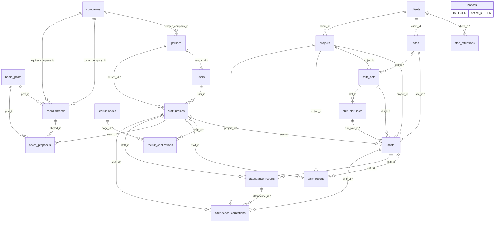
<!-- END GENERATED: db-core -->

### 3.2 分類ごと

分類は人が決めたものです（[`TABLE_GROUPS`](../scripts/gen-docs.mjs)）。どれにも当たらない表は「その他」に入ります。

<!-- BEGIN GENERATED: db-er -->
### 企業・利用者・ログイン

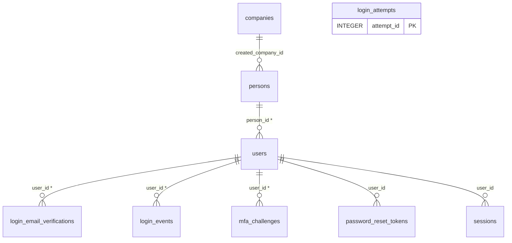

### スタッフ（名簿・人事・所属）

```mermaid
erDiagram
  consultations ||--o{ consultation_attachments : "consultation_id *"
  consultations ||--o{ consultation_messages : "consultation_id *"
  staff_profiles ||--o{ consultations : "staff_id"
  staff_profiles ||--o{ employee_change_logs : "staff_id *"
  staff_profiles ||--o{ employee_documents : "staff_id"
  staff_profiles ||--o{ employee_records : "staff_id"
  staff_profiles ||--o{ employment_periods : "staff_id"
  staff_profiles ||--o{ evaluations : "staff_id"
  staff_profiles ||--o{ follow_logs : "staff_id"
  staff_profiles ||--o{ leave_requests : "staff_id *"
  staff_profiles ||--o{ payout_accounts : "staff_id"
  staff_profiles ||--o{ profile_change_requests : "staff_id *"
  staff_profiles ||--o{ roster_comments : "thread_staff_id"
  users ||--o{ roster_consents : "user_id"
  staff_profiles ||--o{ roster_consents : "staff_id *"
  staff_profiles ||--o{ roster_host_note_history : "staff_id *"
  staff_profiles ||--o{ roster_link_events : "staff_id *"
  staff_profiles ||--o{ staff_affiliation_history : "staff_id"
  staff_profiles ||--o{ staff_affiliation_schedules : "staff_id"
  staff_profiles ||--o{ staff_documents : "staff_id"
  users ||--o{ staff_profiles : "user_id"
  staff_profiles ||--o{ staff_quick_locks : "staff_id *"
  staff_profiles ||--o{ staff_transport_defaults : "staff_id"
  roster_comment_reads {
    INTEGER thread_staff_id PK
  }
  roster_comment_user_reads {
    INTEGER thread_staff_id PK
  }
  roster_field_requirements {
    INTEGER company_id PK
  }
  roster_host_note_seen {
    INTEGER user_id PK
  }
  staff_affiliations {
    INTEGER affiliation_id PK
  }
  staff_merges {
    INTEGER merge_id PK
  }
```

### クライアント・案件・シフト

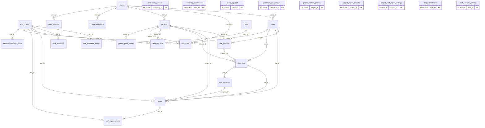

### 勤怠・日報・報告の設定

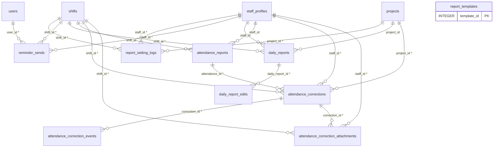

### 精算・支払

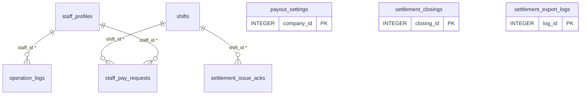

### お知らせ・通知・メール

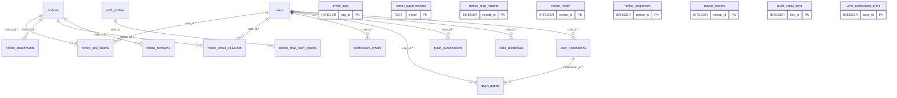

### 募集・応募

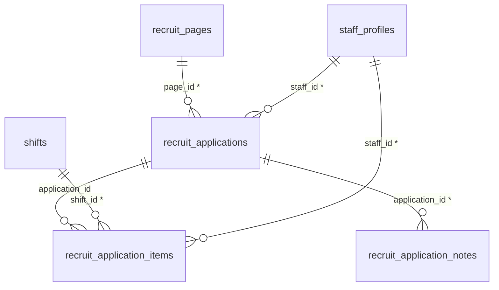

### 案件掲示板

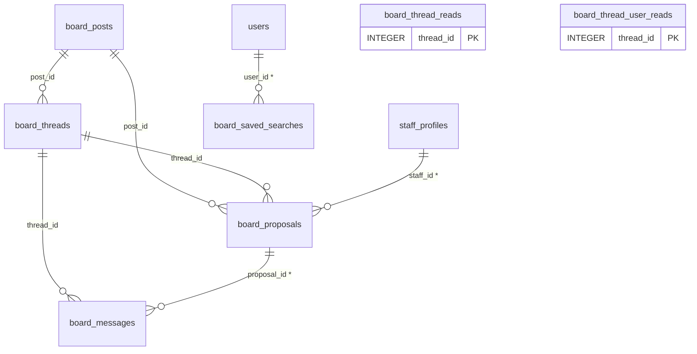

### 本部・運用

```mermaid
erDiagram
  company_offboardings ||--o{ company_offboarding_events : "offboarding_id *"
  hq_view_sessions ||--o{ hq_view_logs : "view_id *"
  company_offboardings ||--o{ offboarding_pending_r2 : "offboarding_id *"
  staff_profiles ||--o{ retention_pending_r2 : "staff_id *"
  users ||--o{ support_requests : "user_id *"
  company_billing_months {
    INTEGER billing_id PK
  }
  company_support_logs {
    INTEGER log_id PK
  }
  cron_runs {
    INTEGER run_id PK
  }
  hq_announcement_companies {
    INTEGER announcement_id PK
  }
  hq_announcement_reads {
    INTEGER announcement_id PK
  }
  hq_announcements {
    INTEGER announcement_id PK
  }
  hq_audit_logs {
    INTEGER log_id PK
  }
  hq_plan_prices {
    TEXT plan PK
  }
  retention_logs {
    INTEGER log_id PK
  }
  retention_settings {
    TEXT key PK
  }
```

### その他

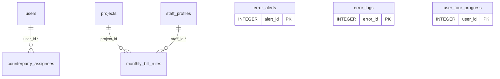
<!-- END GENERATED: db-er -->

## 4. 個人情報を含む列

列の名前と、その列を読み書きしているコードを見て分類しました。生成のときに、ここに書いた `表.列` が今の DB にあるかを確かめます（ない列を書くとエラーになります）。新しく個人情報の列を足したら、ここにも足してください。

| 種類 | 表.列 | 備考 |
|---|---|---|
| 氏名・ふりがな | `users.name`・`staff_profiles.kana`・`recruit_applications.name`・`recruit_applications.kana`・`client_contacts.contact_name`・`clients.contact_name`・`clients.representative_name`・`staff_affiliations.contact_name`・`employee_records.emergency_name`・`payout_accounts.holder_kana`・`staff_merges.source_name`・`staff_merges.target_name` | 操作した人の名前を残す列（`attendance_corrections.requested_by_name` など `*_name`）もあります |
| 連絡先 | `users.email`・`users.phone`・`staff_profiles.unverified_email`・`recruit_applications.phone`・`recruit_applications.email`・`employee_records.personal_email`・`employee_records.phone_main`・`employee_records.phone_work`・`employee_records.emergency_phone`・`client_contacts.phone`・`client_contacts.email`・`staff_affiliations.phone`・`staff_affiliations.email`・`email_logs.to_email`・`notification_emails.to_email`・`email_suppressions.email`・`board_saved_searches.notify_email`・`staff_quick_locks.phone_norm` | |
| 住所 | `employee_records.postal_code`・`employee_records.prefecture`・`employee_records.city`・`employee_records.town`・`employee_records.address_detail`・`employee_records.emergency_address` | |
| 生年月日・性別・年代 | `staff_profiles.date_of_birth`・`staff_profiles.gender`・`staff_profiles.age_group` | 企業間連携では生年月日を渡さず、年代だけにします（下の 5.1） |
| 経歴・スキル・評価・メモ | `staff_profiles.career`・`staff_profiles.career_rows`・`staff_profiles.skills`・`staff_profiles.pr_points`・`staff_profiles.remarks`・`staff_profiles.memo`・`staff_profiles.site_evaluation`・`staff_profiles.work_memo`・`evaluations.comment`・`follow_logs.content`・`client_ng_staff.reason` | |
| 労務・お金 | `employee_records.base_salary`・`employee_records.dependents_info`・`employee_records.employment_insurance_no`・`employee_records.social_insurance_no`・`employee_records.bank_name`・`employee_records.account_number`・`payout_accounts.bank_name`・`payout_accounts.account_number` | 従業員管理の API（`/api/admin/employees`）は会社管理者・事務担当だけ |
| 位置・端末・写真 | `attendance_reports.latitude`・`attendance_reports.longitude`・`attendance_reports.address`・`attendance_reports.device_info`・`attendance_reports.device_id`・`attendance_reports.photo_key`・`attendance_correction_attachments.photo_key`・`staff_pay_requests.receipt_key` | 位置情報と写真は、在職中でも保存期間で消します（下の 6） |
| 相談・やり取りの本文 | `consultations.body`・`consultation_messages.body`・`roster_comments.body`・`board_messages.body`・`recruit_application_notes.body`・`daily_reports.incident_memo` | |
| 書類のファイル | `staff_documents.storage_key`・`employee_documents.storage_key`・`client_documents.storage_key` | 中身は R2 にあります |
| ログイン・接続の記録 | `sessions.ip`・`sessions.user_agent`・`login_events.ip`・`login_events.user_agent`・`roster_consents.ip_address`・`roster_consents.user_agent`・`push_subscriptions.endpoint` | 応募の IP はハッシュ（`recruit_applications.ip_hash`）で持ちます |
| 他社に渡す人材の情報 | `board_proposals.snapshot`・`board_proposals.disclosed` | 下の 5.3 |

## 5. 他社と共有される範囲

会社をまたいでデータが見えるのは、次の 3 つの機能です。他社のデータを読み書きできるのは、管理画面の API（管理系の4ロール）だけです。スタッフ本人には、自分の情報を共有した会社の名前を知らせます（連携のときのアプリ内の通知）。

### 5.1 企業間連携（スタッフマスタ）

- 所属元の会社のスタッフを、稼働先の会社が「連携用ID（QR）」で自社のスタッフマスタに登録します。稼働先には `affiliation_type = 'linked_external'` の行ができ、`staff_profiles.source_staff_id`（直接の連携元）・`staff_profiles.root_staff_id`（いちばん上の所属元）で元の行を指します。
- 稼働先が見る基本項目は、コピーせずに、所属元の行を読んで出します（[`loadRoster`](../src/roster.ts) が `COALESCE(root_staff_id, source_staff_id)` の行を JOIN します）。所属元が連携を終える（`staff_profiles.link_revoked_at`）と、読まなくなります。
- 共有する項目・しない項目は、連携のときの同意の画面と同じ定数で決まっています（同意の版は [`CONSENT_VERSION`](../src/roster.ts)）。
  - 共有する: [`SHARED_SCOPE`](../src/roster.ts)（氏名・フリガナ・性別・年代・所属会社名と担当者名・最寄駅・通勤可能時間・稼働開始可能日・稼働可能エリア・スキル・経歴・PRポイントなど）
  - 共有しない: [`NOT_SHARED_SCOPE`](../src/roster.ts)（従業員管理の情報・電話とメール・生年月日・備考・書類のファイル・所属元の社内メモと評価とフォロー履歴）
  - 基本項目のうち稼働先に返さない列: [`ROSTER_OWNER_ONLY_FIELDS`](../src/roster.ts)（`date_of_birth`・`remarks`）。年代は生年月日から計算して返します。
- 逆向きに、稼働先が書いた現場評価・稼働メモ（[`ROSTER_SHARED_HOST_FIELDS`](../src/roster.ts)）は所属元が読めます。変更の履歴は `roster_host_note_history` に残ります。
- 同意の記録（同意した版・範囲・IP・ブラウザ）は `roster_consents` に残し、解約のときも消しません。

### 5.2 企業間チャット

- 所属元と稼働先の管理者どうしのチャットで、`roster_comments` に入ります（`roster_comments.owner_company_id`・`roster_comments.host_company_id` の2社）。API は `/api/admin/roster-chat` だけで、スタッフ本人には見せません。
- 既読と未読の件数は、利用者ごとの `roster_comment_user_reads` で数えます。会社ごとの `roster_comment_reads`（自社で最後に読んだ人）は、既読にするたびに書きますが、画面・API では読みません（解約・退職後の削除で消すだけです）。
- `roster_comment_reads` の行を消すと、トリガー `trg_roster_comment_reads_delete` が、同じスレッドの**同じ会社の**利用者の既読を消します。相手の会社の既読は消しません（`0102`。#9949。それまでは解約した会社の行を消すと、相手の会社の利用者にも過去のメッセージがまた未読で出ていました）。

### 5.3 案件掲示板

- 掲載（`board_posts`）は、ほかの会社にも一覧で見えます。返す列は [`PUBLIC_COLS`](../src/board.ts) だけです（社内の項目は自社のときだけ返します）。
- やり取り（`board_threads`・`board_messages`）は、掲載した会社（`board_threads.poster_company_id`）と問い合わせた会社（`board_threads.inquirer_company_id`）の2社の間だけです。
- 人材の提案（`board_proposals`）では、提案のときに匿名のスキルシート（`board_proposals.snapshot`。中身は [`buildSnapshot`](../src/board.ts)。イニシャル・年代・性別・提案元の会社名・最寄駅・通勤時間・稼働開始可能日・エリア・スキル・経歴・PRポイント）を送ります。氏名とふりがな（`board_proposals.disclosed`）は「採用」になったときだけ相手に返します（[`shapeProposal`](../src/board.ts)）。
- 上流の経路（`board_proposals.upstream_chain`）は DB にだけ残し、API と画面には出しません。

## 6. 削除・匿名化・解約

データを消す・匿名化する処理は [`runRetentionCleanup`](../src/services/retention.ts) などにまとまっていて、毎日の定期処理（[`CRON_JOBS`](../src/index.tsx)）で動きます。環境変数 `RETENTION_ENABLED` が `true` になるまでは、消さずに件数だけを数えます（dry-run）。

- 日報（`daily_reports`）: 稼働日から3年で削除
- 退職したスタッフのデータ: 退職日と最後の稼働日の遅いほうから7年で削除。本人の行（`users`・`staff_profiles`）は請求の集計などから参照されるので消さずに匿名化します（氏名を「退職者#番号」にし、連絡先・生年月日・経歴などを空にします）
- 在職中でも保存期間で消すもの: 位置情報と写真・対応済みの相談・完了したフォロー記録・決着した人材提案（期間の既定値は [`RETENTION_SETTING_DEFS`](../src/services/retention.ts)。本部画面で変えられます）と、区分変更で雇用を終えた人の労務情報（雇用終了日から7年）
- 削除の保留: `staff_profiles.retention_hold_at`・`companies.retention_hold_at` が入っている人・会社のデータは消しません
- 期限切れのトークン（パスワード再設定・報告用URL）は、別の定期処理（[`purgeExpiredTokens`](../src/services/retention.ts)）で消します

対象の一覧（コードから生成）:

<!-- BEGIN GENERATED: db-retention -->
| 対象（`RETIRED_TARGETS`・[services/retention.ts:87](../src/services/retention.ts#L87)） | 種類 |
|---|---|
| `retired_staff` | 表ではない対象（人数・R2 のファイル・匿名化など） |
| `attendance_reports` | 表 |
| `shifts` | 表 |
| `evaluations` | 表 |
| `follow_logs` | 表 |
| `consultations` | 表 |
| `shift_report_tokens` | 表 |
| `r2_photos` | 表ではない対象（人数・R2 のファイル・匿名化など） |
| `retired_staff_deferred` | 表ではない対象（人数・R2 のファイル・匿名化など） |
| `r2_pending` | 表ではない対象（人数・R2 のファイル・匿名化など） |

在職中の保存期間で消すもの（`IN_SERVICE_TARGETS`・[services/retention.ts:791](../src/services/retention.ts#L791)）: `attendance_location`・`attendance_photos`・`consultations_done`・`follow_logs_done`・`board_proposals_settled`・`ended_employee_records`・`ended_employee_documents`・`ended_employment_periods`

退職後7年の匿名化で空にする `staff_profiles` の列（`ANONYMIZE_PROFILE_COLUMNS`・[services/retention.ts:97](../src/services/retention.ts#L97)）: `career`・`skills`・`work_area`・`age_group`・`memo`・`affiliation_contact`・`kana`・`gender`・`date_of_birth`・`nearest_station_line`・`nearest_station`・`commute_minutes`・`available_from`・`site_evaluation`・`work_memo`・`career_rows`・`pr_points`・`remarks`・`unverified_email`・`skill_sheet_comment`・`reference_pay_unit`・`reference_pay_amount`・`age_entered`・`age_entered_on`

作成からの期間で消す表: `user_notifications`（2年・[services/retention.ts:425](../src/services/retention.ts#L425)）・`email_logs`（1年・[services/retention.ts:429](../src/services/retention.ts#L429)）・`error_logs`（90日・[services/retention.ts:433](../src/services/retention.ts#L433)）・`error_alerts`（90日・[services/retention.ts:436](../src/services/retention.ts#L436)）・`operation_logs`（7年・[services/retention.ts:440](../src/services/retention.ts#L440)）

R2 に置くファイル（解約時の書き出しの対象。`OFFBOARDING_FILE_SOURCES`）: `attendance_reports`→photos・`staff_documents`→documents・`employee_documents`→documents・`attendance_correction_attachments`→photos・`consultation_attachments`→photos・`notice_attachments`→documents・`client_documents`→contracts・`staff_pay_requests`→photos
<!-- END GENERATED: db-retention -->

### 解約のとき

本部画面の「解約・データ」から、企業のデータを CSV で書き出し、猶予の日数（既定は [`OFFBOARDING_GRACE_DAYS`](../src/services/retention.ts)）の後に消します（記録は `company_offboardings`）。

<!-- BEGIN GENERATED: db-offboarding -->
解約（企業のデータの書き出しと削除）の対象は `OFFBOARDING_TABLES`（102 表）、残す表は `OFFBOARDING_KEPT_TABLES`（[services/retention.ts:1252](../src/services/retention.ts#L1252)）。

company_id の列がある表は、すべてどちらかに入っています。
<!-- END GENERATED: db-offboarding -->

## 7. 表の一覧と定義

「名前」は [`OFFBOARDING_TABLES`](../src/services/retention.ts) の `label` です（解約の対象でない表は空）。「作成」「追加」は、その表・列を足したマイグレーションの番号です。「キー・参照」の `→` は REFERENCES の宣言、括弧の中の表名は、列の名前が同じ主キーの表（宣言なし）です。

<!-- BEGIN GENERATED: db-tables -->
### 企業・利用者・ログイン

| 表 | 名前（retention.ts） | 用途（作ったマイグレーションのコメント） | 作成 | 行の扱い |
|---|---|---|---|---|
| [`companies`](#companies) | 企業 | 導入企業 | 0001 | 解約時: 書き出しのみ（行は残す） |
| [`login_attempts`](#login_attempts) |  | ログインの失敗の記録（会社コード＋ID 単位と IP 単位で、15分間の失敗回数を数える）。 生の会社コード・ID・IP は保存せず、SHA-256 のハッシュだけを保存する。成功すると ID 単位の記録は消し、 1日より古い記録は Cr… | 0030 |  |
| [`login_email_verifications`](#login_email_verifications) | メールアドレスの確認 | ログイン・アカウントの情報（作業単位 w3-account-profile: #207 #396） 1. ログイン用メールアドレスの確認（#207） 管理者がスタッフのログイン用メール（users.email: パスワード再設定・通知の宛… | 0047 | 解約時: 削除（書き出さない） |
| [`login_events`](#login_events) |  | ログイン履歴・ログイン中の端末・二段階認証（作業単位 w4-auth-features: #552 #453 #544） 1. ログインの履歴（#552） ログインの成功・失敗、二段階認証の失敗、パスワードの再設定、管理者による強制ログア… | 0062 | 解約時も残す（`OFFBOARDING_KEPT_TABLES`） |
| [`mfa_challenges`](#mfa_challenges) | 二段階認証の確認中 | パスワードを確かめた後、認証アプリのコードを待つ間の一時的な記録（5分で期限切れ。token_hash は一時トークンの SHA-256）。 attempt_key はログイン試行の制限（login_attempts の account）… | 0062 | 解約時: 削除（書き出さない） |
| [`password_reset_tokens`](#password_reset_tokens) | パスワード再設定のトークン | リセットURLに使う生トークンはDBへ保存しない。ハッシュ値のみ保存し、 受信時にハッシュ化して照合する。1回使用したら used_at を立てて無効化する。 | 0008 | 解約時: 削除（書き出さない） |
| [`persons`](#persons) |  | 人物マスタ（企業に非依存） | 0012 |  |
| [`sessions`](#sessions) | ログイン中のセッション | セッション (ログイン状態保持) | 0001 | 解約時: 削除（書き出さない） |
| [`users`](#users) | 利用者（パスワード・二段階認証の情報を除く） | ユーザー | 0001 | 退職後7年で匿名化（行は残す）<br>解約時: 書き出しのみ（行は残す） |

### スタッフ（名簿・人事・所属）

| 表 | 名前（retention.ts） | 用途（作ったマイグレーションのコメント） | 作成 | 行の扱い |
|---|---|---|---|---|
| [`consultation_attachments`](#consultation_attachments) | 相談の添付 | 3. 相談の写真（#429）。R2 の PHOTOS に consultations/{company_id}/{consultation_id}/... のキーで保存する。 message_id は追加の連絡に付けた写真（NULL は最… | 0064 | 解約時: 書き出して削除<br>R2 のファイル（photos） |
| [`consultation_messages`](#consultation_messages) | 相談のやり取り | 2. 相談のやり取り（#154） 最初の相談の本文は consultations.body のまま。その後の管理者の返信とスタッフの追加の連絡を時系列で残す。 consultations.manager_reply は最新の管理者の返信と… | 0064 | 解約時: 書き出して削除 |
| [`consultations`](#consultations) | 相談 | 相談・連絡 | 0001 | 退職後7年の削除の対象（`RETIRED_TARGETS`）<br>解約時: 書き出して削除 |
| [`employee_change_logs`](#employee_change_logs) | 従業員データの変更履歴 | 従業員データの変更履歴と、スタッフの CSV 一括登録（w5-audit-import: #464 #430） #464 従業員管理（employee_records: 口座・給与・住所・保険番号など）と、スタッフ基本情報（氏名・生年月日… | 0075 | 解約時: 書き出して削除 |
| [`employee_documents`](#employee_documents) | 入社時書類 | 入社時書類（履歴書・契約書と同じ設計パターン。既存DOCUMENTSバケットを別キー接頭辞で再利用） | 0010 | 解約時: 書き出して削除<br>R2 のファイル（documents） |
| [`employee_records`](#employee_records) | 従業員データ（口座・住所・給与・保険番号など） | 社員名簿（自社社員の人事・労務情報。staff_profilesと1対1） | 0010 | 解約時: 書き出して削除 |
| [`employment_periods`](#employment_periods) | 雇用期間 | 自社雇用に戻す（再雇用）ときに、employee_records の入社日・雇用終了日を上書きする前の値を残す。7年保存の対象 | 0039 | 解約時: 書き出して削除 |
| [`evaluations`](#evaluations) | 評価 | 評価 | 0001 | 退職後7年の削除の対象（`RETIRED_TARGETS`）<br>解約時: 書き出して削除 |
| [`follow_logs`](#follow_logs) | フォロー記録 | フォロー履歴 | 0001 | 退職後7年の削除の対象（`RETIRED_TARGETS`）<br>解約時: 書き出して削除 |
| [`leave_requests`](#leave_requests) | 休暇の申請 | 4. 休暇の申請（#289）。自社雇用の社員（従業員管理の対象）だけが出せる leave_type: paid（有給。承認で employee_records.paid_leave_remaining を減らす）/ other（その他の休… | 0071 | 解約時: 書き出して削除 |
| [`payout_accounts`](#payout_accounts) | 振込先の口座 | 従業員管理（employee_records）の口座より優先して振込データに使う。名義は全銀の受取人名（カナ） | 0069 | 解約時: 書き出して削除 |
| [`profile_change_requests`](#profile_change_requests) | 登録情報の変更申請 | 1. 登録情報の変更申請（#272） スタッフ本人が最寄駅・稼働エリア・稼働開始可能日・スキル・通勤可能時間・ログイン用メールの変更を申請し、管理者が承認したときだけ反映する。 company_id・staff_id は申請先（承認して反… | 0071 | 解約時: 書き出して削除 |
| [`roster_comment_reads`](#roster_comment_reads) | 企業間チャットの既読（会社） | 既読位置（企業単位で管理。自社の誰かが開けば自社として既読） | 0014 | 解約時: 削除（書き出さない） |
| [`roster_comment_user_reads`](#roster_comment_user_reads) | 企業間チャットの既読（利用者） | 企業間連携の共有情報（w4-roster-share: #462 #538） #462 企業間チャットの既読を、会社単位からユーザー単位にする。 roster_comment_reads（会社単位）は「自社で最後に読んだ人」の記録として残… | 0058 | 解約時: 削除（書き出さない） |
| [`roster_comments`](#roster_comments) |  | 企業間チャット（所属元企業の担当者 ⇔ 稼働先企業の担当者）（フェーズG） ・スレッドは「稼働先側の連携スタッフマスタ行（linked_external の staff_id）」単位 = 所属元1社 × 稼働先1社 × 対象スタッフ1名。… | 0014 |  |
| [`roster_consents`](#roster_consents) |  | 連携時の同意履歴（誰が・いつ・どの連携に対して同意したか） | 0012 | 解約時も残す（`OFFBOARDING_KEPT_TABLES`） |
| [`roster_field_requirements`](#roster_field_requirements) | 名簿の必須項目 | スタッフマスタ項目の必須/任意を企業ごとに設定する（フェーズD） ・絶対必須項目（氏名・性別）はこのテーブルの対象外で、常に必須（アプリ側で固定チェック）。 ・レコードが無い項目は「任意」扱い（既定値）。既存企業の挙動は変わらない。 ・適… | 0013 | 解約時: 書き出して削除 |
| [`roster_host_note_history`](#roster_host_note_history) | 稼働先メモの履歴 | #538 稼働先が書く現場評価・稼働メモ（所属元と共有する追記項目）の履歴。 staff_profiles の site_evaluation / work_memo は最新の値として残し、保存のたびに変わった内容をここに追記する。 so… | 0058 | 解約時: 書き出して削除 |
| [`roster_host_note_seen`](#roster_host_note_seen) | 稼働先メモの既読 | 所属元のユーザーが「連携先からの追記」の一覧で、どこまで確認したか（ユーザー単位）。 移行の時点の履歴は、今の管理系ユーザー全員が確認済みとして始める（移行で入れた行が一斉に未確認にならないように） | 0058 | 解約時: 削除（書き出さない） |
| [`roster_link_events`](#roster_link_events) | 連携の成立・終了の記録（稼働先） | 連携の記録（成立・終了・再開）。所属元・稼働先の画面と、スタッフ本人の「共有中の会社」に使う | 0070 | 解約時: 書き出して削除 |
| [`staff_affiliation_history`](#staff_affiliation_history) | 所属区分の変更履歴 |  | 0017 | 解約時: 書き出して削除 |
| [`staff_affiliation_schedules`](#staff_affiliation_schedules) | 所属区分の変更の予約 | status: pending（予約中）/ applied（適用済み）/ canceled（取消）/ failed（適用できなかった。error に理由） | 0039 | 解約時: 書き出して削除 |
| [`staff_affiliations`](#staff_affiliations) | 所属先（協力会社） | 所属会社マスタ（テナント内。既存の会社横断マスタが無いため今回新設。自由入力の表記ゆれ防止用） | 0010 | 解約時: 書き出して削除 |
| [`staff_documents`](#staff_documents) | スタッフの書類 | スタッフ履歴書・職務経歴書等のファイル管理 ファイル本体はD1へ保存しない（R2のみ）。ここにはメタデータのみ保持する。 同一スタッフ・同名ファイルでも別レコード（別storage_key）として複数保存できる。 | 0005 | 解約時: 書き出して削除<br>R2 のファイル（documents） |
| [`staff_merges`](#staff_merges) | スタッフの統合の記録 | 統合の記録（何をいくつ移したか。移したシフトIDも保持して、問い合わせ時に追えるようにする） | 0020 | 解約時: 書き出して削除 |
| [`staff_profiles`](#staff_profiles) | スタッフ | スタッフ詳細プロフィール | 0001 | 退職後7年で匿名化（行は残す）<br>解約時: 書き出しのみ（行は残す） |
| [`staff_quick_locks`](#staff_quick_locks) | スタッフ登録の重複防止 | 3. 仮登録の二度押し・同時送信の防止（#568） 同じ会社・同じ電話番号（数字のみに正規化）の仮登録は、処理中と直後の一定時間は1件だけにする。 request_key は画面を開くたびに作る値で、同じ画面からの再送には作成済みのスタッ… | 0038 | 解約時: 削除（書き出さない） |
| [`staff_transport_defaults`](#staff_transport_defaults) | 交通費の標準（スタッフ・開催場所） | 3. 交通費の標準（スタッフ × 開催場所。往復・円）。site_id = 0 はそのスタッフのすべての開催場所に使う標準。 シフトボードの割り当て・一括登録と募集の承認で、交通費の入力がなければこの値を実費（transportation… | 0082 | 解約時: 書き出して削除 |

### クライアント・案件・シフト

| 表 | 名前（retention.ts） | 用途（作ったマイグレーションのコメント） | 作成 | 行の扱い |
|---|---|---|---|---|
| [`affiliation_excluded_shifts`](#affiliation_excluded_shifts) | 所属区分の対象外シフト | 勤務済み（勤怠報告・実績・日報のどれかがある）のため支払先・単価を置き換えなかったシフトと、そのときの変更後の支払先。 精算で、支払先がこの値と違う未確定のシフトを確認事項『区分変更の対象外』として出す | 0046 | 解約時: 書き出して削除 |
| [`availability_periods`](#availability_periods) | 出勤可能日の締切 | 会社が月ごとに決める提出の締切と、スタッフへの案内文。未提出者へ通知した日時も残す | 0076 | 解約時: 書き出して削除 |
| [`availability_submissions`](#availability_submissions) | 出勤可能日の提出 | 月ごとの提出の記録（未提出者の一覧と、締切後の提出の判定に使う）。 submitted_at は最初に提出した日時、updated_at は最後に出し直した日時（日本時間） | 0076 | 解約時: 書き出して削除 |
| [`client_contacts`](#client_contacts) | クライアントの担当者 |  | 0011 | 解約時: 書き出して削除 |
| [`client_documents`](#client_documents) | クライアントの契約書類 | クライアント（発注元企業）契約書ファイル管理 ファイル本体はD1へ保存しない（R2のみ）。ここにはメタデータのみ保持する。 同一クライアント・同名ファイルでも別レコード（別storage_key）として複数保存できる。 staff_doc… | 0006 | 解約時: 書き出して削除<br>R2 のファイル（contracts） |
| [`client_ng_staff`](#client_ng_staff) | クライアントの NG スタッフ | #204 クライアントのNGスタッフの理由・登録日・登録者。 NG の判定は従来どおり clients.ng_staff_ids（カンマ区切り）を正とし、この表は画面に出す補足情報だけを持つ （PUT /api/admin/clients… | 0051 | 解約時: 書き出して削除 |
| [`clients`](#clients) | クライアント | クライアント | 0001 | 解約時: 書き出して削除 |
| [`premium_pay_settings`](#premium_pay_settings) | 深夜・時間外・休日の割増の設定 | 深夜・時間外・休日の割増の自動計算と、交通費の標準（作業単位 w6-premium-pay: #167 #564） 1. 割増の設定（企業ごと。行がなければ割増を計算しない）。 対象は支払先が自社給与・日雇い給与（payee_type が… | 0082 | 解約時: 書き出して削除 |
| [`project_cancel_policies`](#project_cancel_policies) | 案件のキャンセル規定 | 案件ごとのキャンセル料の規定（率は %。NULL = 規定なし）。 クライアント都合の中止: 請求 = 予定の請求基本額 × 前日／当日の率、支払 = 予定の支払基本額 × 補償率 | 0061 | 解約時: 書き出して削除 |
| [`project_price_history`](#project_price_history) | 案件の単価の履歴 |  | 0045 | 解約時: 書き出して削除 |
| [`project_report_defaults`](#project_report_defaults) | 報告設定（案件） | 案件の標準設定（新しく所属したスタッフに引き継ぐ値） | 0027 | 解約時: 書き出して削除 |
| [`project_staff_report_settings`](#project_staff_report_settings) | 報告設定（スタッフ別） | 案件 × スタッフ別の設定（実際に適用する値。行がなければ案件の標準設定） source: default（標準設定の引き継ぎ）/ individual（個別変更）/ bulk（一括変更）/ migration（導入時の移行） | 0027 | 解約時: 書き出して削除 |
| [`projects`](#projects) | 案件 | 案件 | 0001 | 解約時: 書き出して削除 |
| [`rate_rules`](#rate_rules) | 単価ルール |  | 0016 | 解約時: 書き出して削除 |
| [`shift_cancellations`](#shift_cancellations) | シフトの取消 | 欠勤（status = 'absent'）のシフトのうち、この表に行のあるものを精算の対象にする（金額はこの表の値。確定は shifts.settle_status）。 金額はスタッフ向けの API に出さないよう、shifts の列では… | 0061 | 解約時: 書き出して削除 |
| [`shift_report_tokens`](#shift_report_tokens) | 報告用URLのトークン |  | 0017 | 退職後7年の削除の対象（`RETIRED_TARGETS`）<br>解約時: 削除（書き出さない） |
| [`shift_requests`](#shift_requests) | シフト希望 | w2-shift-request（#12 #59 #353 #411） 1) スタッフが出すシフト希望は shifts と分けて持つ（#12）。 shifts.project_id は NOT NULL で projects への外部キー… | 0034 | 解約時: 書き出して削除 |
| [`shift_slot_roles`](#shift_slot_roles) | 募集枠の役割 |  | 0016 | 解約時: 書き出して削除 |
| [`shift_slots`](#shift_slots) | 募集枠 |  | 0016 | 解約時: 書き出して削除 |
| [`shifts`](#shifts) | シフト | シフト | 0001 | 退職後7年の削除の対象（`RETIRED_TARGETS`）<br>解約時: 書き出して削除 |
| [`sites`](#sites) | 開催場所 |  | 0016 | 解約時: 書き出して削除 |
| [`slot_patterns`](#slot_patterns) | 募集枠のパターン |  | 0016 | 解約時: 書き出して削除 |
| [`staff_availability`](#staff_availability) | 出勤可能日 | スタッフが月のカレンダーで付けた日ごとの出勤可否（1人1日1行）。 | 0076 | 解約時: 書き出して削除 |
| [`staff_calendar_tokens`](#staff_calendar_tokens) | カレンダー購読のトークン | シフトをカレンダーアプリで購読する URL のトークン（1人1つ。ハッシュで保存し、発行し直すと前の URL は使えない）。 本人（user_id）が停止・退職になったり、会社が停止になったりしたら、URL があっても返さない | 0076 | 解約時: 削除（書き出さない） |
| [`staff_schedule_tokens`](#staff_schedule_tokens) | シフト確認用URLのトークン | #442 予定確認URL（スタッフ単位。ログインのない人が、今日から2週間の確定シフトを見られる）。 トークンそのものは保存せず、SHA-256 のハッシュだけを持つ（URL は発行したときに一度だけ画面に出す）。 1人に有効なものは1つ… | 0072 | 解約時: 削除（書き出さない） |

### 勤怠・日報・報告の設定

| 表 | 名前（retention.ts） | 用途（作ったマイグレーションのコメント） | 作成 | 行の扱い |
|---|---|---|---|---|
| [`attendance_correction_attachments`](#attendance_correction_attachments) | 打刻修正の添付写真 | 画像は R2（PHOTOS）の attendance/{会社}/{スタッフ}/{シフト}/correction_{申請ID}_*.jpg に置く。1申請につき3枚まで。 承認した入店・退店の報告に写真がなければ、1枚目のキーを atten… | 0073 | 解約時: 書き出して削除<br>R2 のファイル（photos） |
| [`attendance_correction_events`](#attendance_correction_events) | 打刻修正の操作履歴 | 申請の操作履歴（追記のみ） event: submitted / resubmitted / approved / approved_exception / rejected / cancelled | 0028 | 解約時: 書き出して削除 |
| [`attendance_corrections`](#attendance_corrections) | 打刻修正の申請 |  | 0028 | 解約時: 書き出して削除 |
| [`attendance_reports`](#attendance_reports) | 出退勤記録 | 勤怠報告 (起床/出発/入店/退店) | 0001 | 退職後7年の削除の対象（`RETIRED_TARGETS`）<br>解約時: 書き出して削除<br>R2 のファイル（photos） |
| [`daily_report_edits`](#daily_report_edits) | 日報の実績の修正の履歴 | 日報の値の修正の履歴。1回の修正・出し直しで1行。 | 0097 | 解約時: 書き出して削除 |
| [`daily_reports`](#daily_reports) | 日報 | 日報 | 0001 | 解約時: 書き出して削除 |
| [`reminder_sends`](#reminder_sends) | 報告のリマインドの送信記録 | 本人あての自動リマインド（作業単位 w5-reminders: #160） 起床・出発・入店の報告がない人と、日報を出していない人に、本人あてのアプリ内通知（とメール）を自動で送る（15分おきの cron。src/services/rem… | 0077 | 解約時: 削除（書き出さない） |
| [`report_setting_logs`](#report_setting_logs) | 報告設定の変更履歴 | 設定変更の履歴（追記のみ。更新・削除の API は作らない） staff_id が NULL の行は案件の標準設定の変更 action: project_default / individual / bulk / migration | 0027 | 解約時: 書き出して削除 |
| [`report_templates`](#report_templates) | 日報テンプレート（企業） | 日報テンプレート | 0001 | 解約時: 書き出して削除 |

### 精算・支払

| 表 | 名前（retention.ts） | 用途（作ったマイグレーションのコメント） | 作成 | 行の扱い |
|---|---|---|---|---|
| [`operation_logs`](#operation_logs) | シフト・精算の操作履歴 | シフト・募集枠・精算の操作履歴（w6-audit-log: #159） 管理者は全員が自社の全案件を扱うため、シフトの編集・削除、精算の確定・取り消し、金額・実績の変更などを 「だれが・いつ・何を・前後の値」で残す。1件の操作で変わった行… | 0084 | 作成から7年で削除（[services/retention.ts:440](../src/services/retention.ts#L440)）<br>解約時: 書き出して削除 |
| [`payout_settings`](#payout_settings) | 振込元（依頼人）の設定 |  | 0069 | 解約時: 書き出して削除 |
| [`settlement_closings`](#settlement_closings) | 精算の締め | reopened_at が NULL の行が有効な締め。締めた期間（period_from〜period_to。稼働日）のシフトは、 確定・取り消し、実績・金額の変更、報告・打刻修正の実績への反映、シフトの追加・変更・削除を受け付けない。… | 0061 | 解約時: 書き出して削除 |
| [`settlement_export_logs`](#settlement_export_logs) | 精算の出力の記録 | CSV・明細書を出力した記録（いつ・だれが・どの期間を出したか） | 0061 | 解約時: 書き出して削除 |
| [`settlement_issue_acks`](#settlement_issue_acks) | 精算の確認済みの印 | issue は精算画面に出す確認事項の文言そのもの。文言が変われば（実働の差が変わった等）確認済みではなくなる。 確定後に起きる項目（確定後に打刻修正あり など）は、acked_at より後に新しい修正・報告があれば再び確認が必要になる | 0046 | 解約時: 書き出して削除 |
| [`staff_pay_requests`](#staff_pay_requests) | スタッフからの交通費・延長の申請 | kind: transport（交通費の実費）/ overtime（残業・延長） status: pending（承認待ち）/ approved / rejected / cancelled（本人の取り消し） 承認すると、transpor… | 0068 | 解約時: 書き出して削除<br>R2 のファイル（photos） |

### お知らせ・通知・メール

| 表 | 名前（retention.ts） | 用途（作ったマイグレーションのコメント） | 作成 | 行の扱い |
|---|---|---|---|---|
| [`email_logs`](#email_logs) | メールの送信記録 | 送信種別(type)ごとの成否を追跡する。本文・トークン・パスワードは記録しない。 | 0008 | 作成から1年で削除（[services/retention.ts:429](../src/services/retention.ts#L429)）<br>解約時: 書き出して削除 |
| [`email_suppressions`](#email_suppressions) |  | 宛先不明などで戻ってきた（ハードバウンス）・迷惑メールと報告されたアドレス。 Resend の Webhook（/webhooks/resend）で記録し、以後このアドレスには送らない（services/email.ts）。 アドレスは小… | 0060 |  |
| [`notice_ack_tokens`](#notice_ack_tokens) | お知らせの確認用トークン | お知らせメールの「確認しました」のリンク（1人1通ずつのワンタイムのトークン。ハッシュで保存）。 リンクを開いてボタンを押すと、notice_reads に既読を記録し used_at を入れる。期限は expires_at（日本時間） | 0060 | 解約時: 削除（書き出さない） |
| [`notice_attachments`](#notice_attachments) | お知らせの添付 | お知らせの添付（画像・PDF。本体は R2 の DOCUMENTS に置く） | 0066 | 解約時: 書き出して削除<br>R2 のファイル（documents） |
| [`notice_email_deliveries`](#notice_email_deliveries) | お知らせのメール送信 | 3) お知らせメールの送信結果（#24）。対象者ごとに1行。メールアドレスは保存しない（連携スタッフの所属元のアドレスを連携先に見せないため） status: pending（送信前）/ sent / failed / no_email（… | 0032 | 解約時: 書き出して削除 |
| [`notice_read_reports`](#notice_read_reports) | 既読率レポート |  | 0007 | 解約時: 書き出して削除 |
| [`notice_read_staff_reports`](#notice_read_staff_reports) | 既読率（スタッフ別） |  | 0007 | 解約時: 書き出して削除 |
| [`notice_reads`](#notice_reads) | お知らせの既読 | お知らせ既読 | 0001 | 解約時: 書き出して削除 |
| [`notice_responses`](#notice_responses) | お知らせへの回答 | お知らせへの回答（1人1行。答え直したら上書きする）。choice は選択肢の文字列 | 0066 | 解約時: 書き出して削除 |
| [`notice_revisions`](#notice_revisions) | お知らせの変更履歴 | 修正・取消の前の内容（誰がいつ何を変えたかを残す） | 0066 | 解約時: 書き出して削除 |
| [`notice_targets`](#notice_targets) | お知らせの配信対象 | 案件あて・個人あてのお知らせの配信先（notices.target_ids のカンマ区切り）を1行ずつに展開した表。 対象者の判定（一覧・ホーム・既読数・メールの宛先・既読率レポート）は、これまでの 「',' \|\| target_ids … | 0052 | 解約時: 書き出して削除 |
| [`notices`](#notices) | お知らせ | お知らせ | 0001 | 解約時: 書き出して削除 |
| [`notification_emails`](#notification_emails) | 打刻修正の通知メール | メール通知の送信状態（本文は保存しない。再送時は申請データから作り直す） status: pending（送信前）/ sent / failed | 0029 | 解約時: 書き出して削除 |
| [`push_queue`](#push_queue) | プッシュ通知の送信待ち | 送る前のプッシュ。アプリ内の通知（未読）が登録されたら、購読のある人の分だけトリガーで積む。 API の書き込みの応答の後と15分おきの cron で送り、送ったら消す（claimed_at: 送る処理が取った日時。二重に送らないため） | 0081 | 解約時: 削除（書き出さない） |
| [`push_subscriptions`](#push_subscriptions) | プッシュ通知の購読（端末） | 端末（ブラウザ）ごとのプッシュの購読。endpoint は端末ごとに1つ。 | 0081 | 解約時: 削除（書き出さない） |
| [`push_vapid_keys`](#push_vapid_keys) |  | VAPID の鍵（アプリで1組）。Secret の VAPID_PUBLIC_KEY・VAPID_PRIVATE_KEY があればそちらを使い、なければ初回に作ってここに保存する | 0081 |  |
| [`todo_dismissals`](#todo_dismissals) | ToDo の非表示 | #487 ToDo を『対応済み』『あとで』にした記録。ToDo は毎回ルールから作るので、ここには非表示にしたキーだけを持つ。 todo_key: ToDo ごとの安定したキー（例: late:{staff_id}:{月}、consul… | 0053 | 解約時: 削除（書き出さない） |
| [`user_notification_prefs`](#user_notification_prefs) | 通知の受け取り設定 | ユーザーごと・通知のまとまり（pref_key。src/notifications.ts の NOTIFY_PREF_GROUPS）ごとの受け取り設定。 email / push: 1 = 受け取る、0 = 受け取らない、NULL = 既… | 0081 | 解約時: 書き出して削除 |
| [`user_notifications`](#user_notifications) | アプリ内の通知 | 個人あての通知（受信者ごとに 1 行。既読は read_at） kind: correction_submitted（管理者への承認依頼）/ correction_received（申請者への受付）/ correction_approve… | 0029 | 作成から2年で削除（[services/retention.ts:425](../src/services/retention.ts#L425)）<br>解約時: 書き出して削除 |

### 募集・応募

| 表 | 名前（retention.ts） | 用途（作ったマイグレーションのコメント） | 作成 | 行の扱い |
|---|---|---|---|---|
| [`recruit_application_items`](#recruit_application_items) | 応募の明細 | 応募した枠（1件の応募で複数の日・枠を選べる） | 0019 | 解約時: 書き出して削除 |
| [`recruit_application_notes`](#recruit_application_notes) | 応募の対応メモ | 2. 応募の対応メモ（#478）。電話済み・不在・面談予定など、管理者どうしで対応を共有する | 0085 | 解約時: 書き出して削除 |
| [`recruit_applications`](#recruit_applications) | 応募 | 応募（公開ページから、またはスタッフアプリから） | 0019 | 解約時: 書き出して削除 |
| [`recruit_pages`](#recruit_pages) | 募集ページ | 募集ページ（URL・QRで公開。案件・期間の範囲にある募集枠を表示する） | 0019 | 解約時: 書き出して削除 |

### 案件掲示板

| 表 | 名前（retention.ts） | 用途（作ったマイグレーションのコメント） | 作成 | 行の扱い |
|---|---|---|---|---|
| [`board_messages`](#board_messages) |  |  | 0024 |  |
| [`board_posts`](#board_posts) |  | 案件掲示板 第1段階: 掲載（docs/spec_board.md） 利用企業どうしが案件を掲載・閲覧する。掲載企業名は公開、公開範囲は全利用企業 | 0023 | 解約時も残す（`OFFBOARDING_KEPT_TABLES`） |
| [`board_proposals`](#board_proposals) |  | 案件掲示板 第3段階: 人材提案（docs/spec_board.md 4・5章） 提案時点のスキルシートを匿名スナップショット（snapshot）として保存し、採用時に氏名（disclosed）を開示する 提案相手からの見え方は区分にか… | 0025 |  |
| [`board_saved_searches`](#board_saved_searches) | 掲示板の保存した検索条件 | 3. 案件掲示板の保存した検索条件（#479）。利用者ごと。 条件は一覧の検索と同じ項目（NULL は条件なし）。notify: 新着をアプリ内通知で知らせる / notify_email: メールでも知らせる（1日1通にまとめる） la… | 0085 | 解約時: 書き出して削除 |
| [`board_thread_reads`](#board_thread_reads) | 掲示板の既読（会社） | 既読位置（企業単位。自社の誰かが開けば自社として既読） | 0024 | 解約時: 削除（書き出さない） |
| [`board_thread_user_reads`](#board_thread_user_reads) | 掲示板の既読（利用者） | 1. 既読位置をユーザー単位でも記録する（#250） これまでは企業単位（board_thread_reads）で、画面を開いたままにしておくだけで自社全員の未読が消えていた。 未読は「自分の既読位置」と「自社が最後に返信した位置（boa… | 0055 | 解約時: 削除（書き出さない） |
| [`board_threads`](#board_threads) |  | 案件掲示板 第2段階: 案件チャット（docs/spec_board.md） スレッド = 掲載1件 × 問い合わせ企業1社（1対1）。参加できるのは掲載企業と問い合わせ企業の管理系ユーザーのみ 履歴は削除しない。システムメッセージ（ki… | 0024 |  |

### 本部・運用

| 表 | 名前（retention.ts） | 用途（作ったマイグレーションのコメント） | 作成 | 行の扱い |
|---|---|---|---|---|
| [`company_billing_months`](#company_billing_months) |  | #295 月ごとの請求記録。締めた時点の課金対象の人数・プラン・金額を残す（後から人数が変わっても記録は変わらない）。 status: issued（請求済み・入金待ち）/ paid（入金済み）/ overdue（滞納）/ waived（… | 0078 | 解約時も残す（`OFFBOARDING_KEPT_TABLES`） |
| [`company_offboarding_events`](#company_offboarding_events) |  | 2. 操作の記録（契約終了の登録・取消・書き出し・ファイルの取得・削除の開始と完了・失敗）。 offboarding_id は契約終了の登録前の書き出しでは NULL。detail は JSON | 0080 | 解約時も残す（`OFFBOARDING_KEPT_TABLES`） |
| [`company_offboardings`](#company_offboardings) |  | 解約・停止した企業のデータの書き出しと削除（作業単位 w5-hq-offboarding: #177） 1. 解約の処理（企業ごと）。本部が「契約終了」を登録すると猶予中（scheduled）になり、 契約終了日＋猶予日数（delete_… | 0080 | 解約時も残す（`OFFBOARDING_KEPT_TABLES`） |
| [`company_support_logs`](#company_support_logs) |  | #296 伴走支援の履歴（上書きの support_memo とは別に、追記で残す）。next_action_date は次回の予定日（YYYY-MM-DD） | 0078 | 解約時も残す（`OFFBOARDING_KEPT_TABLES`） |
| [`cron_runs`](#cron_runs) |  | 定期削除の対象の追加と、定期処理（cron）の実行記録（w3-retention-a: #192 #193 #198 #228 #234 #480） 1. 定期処理の実行記録（#192） 毎日の cron の処理ごとに1行。本部画面「デー… | 0048 |  |
| [`hq_announcement_companies`](#hq_announcement_companies) |  |  | 0079 | 解約時も残す（`OFFBOARDING_KEPT_TABLES`） |
| [`hq_announcement_reads`](#hq_announcement_reads) | 本部のお知らせの既読 | 管理者ごとの「確認しました」。企業別の既読状況は company_id で数える | 0079 | 解約時: 削除（書き出さない） |
| [`hq_announcements`](#hq_announcements) |  | 2. 本部から導入企業の管理者へのお知らせ（#516） importance: normal（通常）/ important（重要）/ maintenance（メンテナンス）。 target: all（全企業）/ companies（選んだ… | 0079 |  |
| [`hq_audit_logs`](#hq_audit_logs) |  | #542 本部の操作の履歴。だれが・いつ・何を（変更前と変更後）・なぜ（停止・再開の理由）。 action は操作の名前（company.update など）。詳しく記録しない本部の書き込みは、メソッドとパスを action に残す | 0078 | 解約時も残す（`OFFBOARDING_KEPT_TABLES`） |
| [`hq_plan_prices`](#hq_plan_prices) |  | #295 プランごとの料金（基本料金・基本料金に含む人数・追加1人あたり）。 これまでの料金（990円で3人まで、追加1人300円）を3つのプランに入れておく（金額は変わらない）。本部の画面で変更する | 0078 |  |
| [`hq_view_logs`](#hq_view_logs) |  | 閲覧中に開いた画面（API のパス）の記録。定期の取得（X-Background）は残さない | 0079 |  |
| [`hq_view_sessions`](#hq_view_sessions) |  | 3. 本部による管理画面の閲覧（読み取り専用。#293） 企業が許可したとき（companies.settings_json の hq_view_allowed）だけ、本部ユーザーが期限付きで閲覧できる。 token_hash: 閲覧用 … | 0079 | 解約時も残す（`OFFBOARDING_KEPT_TABLES`） |
| [`offboarding_pending_r2`](#offboarding_pending_r2) |  | 3. 削除する R2 のファイル。D1 の行を消す前にキーを控え、D1 の削除が済んでから R2 を消す（消せたものから行を消す）。 bucket は photos（PHOTOS）/ documents（DOCUMENTS）/ contr… | 0080 |  |
| [`retention_logs`](#retention_logs) |  | 削除処理の実行ログ（対象/削除/失敗件数、dry-runかどうかを記録） | 0009 |  |
| [`retention_pending_r2`](#retention_pending_r2) |  | 2. D1 の削除が済んだ後に消せなかった R2 の写真キー（次回の定期削除で再試行する） | 0031 |  |
| [`retention_settings`](#retention_settings) |  | 2. 保存期間の設定（#420 #511 #350）。本部画面で変えられる。行がなければ src/services/retention.ts の既定値を使う key: location_photo_days（入店の位置情報・端末情報と写真… | 0063 |  |
| [`support_requests`](#support_requests) | 本部への支援の依頼 | 本部の支援機能（作業単位 w5-hq-support: #179 #516 #293）。テーブルの追加のみで、既存のデータは変えない 1. 伴走支援の依頼（#179） 管理画面の「伴走支援を依頼する」から送られた依頼。会社と依頼した人を付… | 0079 | 解約時: 書き出して削除 |

### その他

| 表 | 名前（retention.ts） | 用途（作ったマイグレーションのコメント） | 作成 | 行の扱い |
|---|---|---|---|---|
| [`counterparty_assignees`](#counterparty_assignees) | クライアント・協力会社の社内担当者 | 1. 社内担当者（#9910。利用者の決定: 主担当1人＋副担当（複数））。 target_type: 'client'（clients.client_id）/ 'partner'（staff_affiliations.affiliati… | 0100 | 解約時: 書き出して削除 |
| [`error_alerts`](#error_alerts) |  | 直近のエラーが閾値を超えたときに、本部の管理者へ送った通知の記録。 同じ通知を繰り返さないための判定（最後の通知から一定時間は送らない）に使う。created_at から90日で消す | 0093 | 作成から90日で削除（[services/retention.ts:436](../src/services/retention.ts#L436)） |
| [`error_logs`](#error_logs) | 障害の記録 | サーバーの予期しないエラー（index.tsx の app.onError。利用者には参照番号を返している #230）と、 定期処理（cron）の失敗を1件ずつ残す。書き込みは src/lib/error-log.ts の recordE… | 0093 | 作成から90日で削除（[services/retention.ts:433](../src/services/retention.ts#L433)）<br>解約時: 削除（書き出さない） |
| [`monthly_bill_rules`](#monthly_bill_rules) | 月額（固定）の請求のルール | 案件の月額の請求。その月に確定・代打のシフトが1件以上ある案件について、月に1回だけ請求する （staff_id のあるルールは、そのスタッフのその案件のシフトが1件以上ある月に1回）。シフトの数・時間には左右されない。 金額はシフトの請… | 0096 | 解約時: 書き出して削除 |
| [`user_tour_progress`](#user_tour_progress) | 案内（チュートリアル）の進み具合 | 人（users の行）ごと・案内（tour_key）ごとに、見終わった・スキップした・途中まで進んだかを残す。 別の端末で開いても同じ状態になるよう、端末ではなくサーバーに残す。書き込みは src/tours.ts だけ。 | 0094 | 解約時: 削除（書き出さない） |
<!-- END GENERATED: db-tables -->

### 表の定義

<!-- BEGIN GENERATED: db-definitions -->
### 企業・利用者・ログイン

<a id="companies"></a>
#### companies — 企業

> 導入企業

作成: [migrations/0001_initial_schema.sql:1](../migrations/0001_initial_schema.sql#L1)　／　解約時: 書き出しのみ（行は残す）

| 列 | 型 | NULL | 既定値 | キー・参照 | 追加 | 説明（マイグレーションのコメント） |
|---|---|---|---|---|---|---|
| `company_id` | INTEGER |  |  | PK |  |  |
| `company_code` | TEXT |  |  |  |  | ログイン用会社コード |
| `company_name` | TEXT |  |  |  |  |  |
| `logo_url` | TEXT | 可 |  |  |  |  |
| `plan` | TEXT | 可 | 'basic' |  |  | basic / standard / premium |
| `billing_status` | TEXT | 可 | 'active' |  |  | active / overdue / suspended |
| `user_limit` | INTEGER | 可 | 3 |  |  |  |
| `active_status` | TEXT | 可 | 'active' |  |  | active / trial / inactive |
| `settings_json` | TEXT | 可 | '{}' |  |  | ランキング表示可否等の企業設定 |
| `maturity_level` | INTEGER | 可 | 1 |  |  | 運営成熟度 1-5 |
| `support_memo` | TEXT | 可 |  |  |  | 伴走支援メモ |
| `created_at` | DATETIME | 可 | CURRENT_TIMESTAMP |  |  |  |
| `retention_hold_at` | TEXT | 可 |  |  | 0063 |  |
| `retention_hold_reason` | TEXT | 可 |  |  | 0063 |  |
| `retention_hold_by` | INTEGER | 可 |  |  | 0063 |  |
| `emergency_phone` | TEXT | 可 |  |  | 0074 | 会社の緊急連絡先と、入店位置と現場の距離（作業単位 w5-site-contact: #173 #277） 1. 会社の緊急連絡先（#173）。スタッフアプリの「その他」と報告用URLに、タップで発信できる電話番号として出す。 emergency_phone は電話番号（20文字まで）、emergency_note … |
| `emergency_note` | TEXT | 可 |  |  | 0074 | 会社の緊急連絡先と、入店位置と現場の距離（作業単位 w5-site-contact: #173 #277） 1. 会社の緊急連絡先（#173）。スタッフアプリの「その他」と報告用URLに、タップで発信できる電話番号として出す。 emergency_phone は電話番号（20文字まで）、emergency_note … |
| `trial_ends_at` | TEXT | 可 |  |  | 0078 | 本部の契約管理（w5-hq-contracts: #295 #296 #558 #542 #491） #296 契約の期日: トライアルの終了日・契約開始日・次回レビュー日（いずれも YYYY-MM-DD。未設定は NULL） |
| `contract_start_at` | TEXT | 可 |  |  | 0078 | 本部の契約管理（w5-hq-contracts: #295 #296 #558 #542 #491） #296 契約の期日: トライアルの終了日・契約開始日・次回レビュー日（いずれも YYYY-MM-DD。未設定は NULL） |
| `next_review_at` | TEXT | 可 |  |  | 0078 | 本部の契約管理（w5-hq-contracts: #295 #296 #558 #542 #491） #296 契約の期日: トライアルの終了日・契約開始日・次回レビュー日（いずれも YYYY-MM-DD。未設定は NULL） |
| `contact_name` | TEXT | 可 |  |  | 0078 | #558 企業の連絡先（担当者・電話・メール・請求先の住所）。本部の企業詳細で編集する |
| `contact_phone` | TEXT | 可 |  |  | 0078 | #558 企業の連絡先（担当者・電話・メール・請求先の住所）。本部の企業詳細で編集する |
| `contact_email` | TEXT | 可 |  |  | 0078 | #558 企業の連絡先（担当者・電話・メール・請求先の住所）。本部の企業詳細で編集する |
| `billing_address` | TEXT | 可 |  |  | 0078 | #558 企業の連絡先（担当者・電話・メール・請求先の住所）。本部の企業詳細で編集する |
| `shift_notify_default` | INTEGER |  | 1 |  | 0098 | シフトの確定・削除の通知の切り替え（利用者の決定 Sprint 17。#9906。w17-shift-notify） 列の追加のみ（既存の表・列・値は変えない）。 1. companies.shift_notify_default: シフト管理でシフトを登録・確定・変更・削除・欠勤にしたときに、スタッフに通知を送るか… |
| `shift_notify_updated_at` | TEXT | 可 |  |  | 0098 | シフトの確定・削除の通知の切り替え（利用者の決定 Sprint 17。#9906。w17-shift-notify） 列の追加のみ（既存の表・列・値は変えない）。 1. companies.shift_notify_default: シフト管理でシフトを登録・確定・変更・削除・欠勤にしたときに、スタッフに通知を送るか… |
| `shift_notify_updated_by` | INTEGER | 可 |  |  | 0098 | シフトの確定・削除の通知の切り替え（利用者の決定 Sprint 17。#9906。w17-shift-notify） 列の追加のみ（既存の表・列・値は変えない）。 1. companies.shift_notify_default: シフト管理でシフトを登録・確定・変更・削除・欠勤にしたときに、スタッフに通知を送るか… |

UNIQUE 制約: (company_code)

<a id="login_attempts"></a>
#### login_attempts

> ログインの失敗の記録（会社コード＋ID 単位と IP 単位で、15分間の失敗回数を数える）。 生の会社コード・ID・IP は保存せず、SHA-256 のハッシュだけを保存する。成功すると ID 単位の記録は消し、 1日より古い記録は Cron で消す。attempted_at は ISO 8601（UTC）の文字列。

作成: [migrations/0030_auth_session.sql:1](../migrations/0030_auth_session.sql#L1)

| 列 | 型 | NULL | 既定値 | キー・参照 | 追加 | 説明（マイグレーションのコメント） |
|---|---|---|---|---|---|---|
| `attempt_id` | INTEGER |  |  | PK |  |  |
| `scope` | TEXT |  |  |  |  | account / ip |
| `key_hash` | TEXT |  |  |  |  |  |
| `attempted_at` | TEXT |  |  |  |  |  |

索引:

- `idx_login_attempts_time`: (attempted_at)
- `idx_login_attempts_key`: (scope, key_hash, attempted_at)

<a id="login_email_verifications"></a>
#### login_email_verifications — メールアドレスの確認

> ログイン・アカウントの情報（作業単位 w3-account-profile: #207 #396） 1. ログイン用メールアドレスの確認（#207） 管理者がスタッフのログイン用メール（users.email: パスワード再設定・通知の宛先）を追加・変更するときは、 すぐには users.email を書き換えず、この表に確認待ちとして保存し、新しいアドレスに確認用のリンクを送る。 本人がリンクを開いて確認したときだけ users.email に移す（入力の誤りや他人のアドレスに通知が届くのを防ぐ）。 token_hash はリンクのトークンの SHA-256。expires_at は ISO 8601（UTC）。確認・取消の済んだ行と古い行は、新しい依頼のときに消す。

作成: [migrations/0047_account_profile.sql:1](../migrations/0047_account_profile.sql#L1)　／　解約時: 削除（書き出さない）

| 列 | 型 | NULL | 既定値 | キー・参照 | 追加 | 説明（マイグレーションのコメント） |
|---|---|---|---|---|---|---|
| `verification_id` | INTEGER |  |  | PK |  |  |
| `user_id` | INTEGER |  |  | （users） |  |  |
| `company_id` | INTEGER |  |  |  |  |  |
| `email` | TEXT |  |  |  |  |  |
| `token_hash` | TEXT |  |  |  |  |  |
| `expires_at` | TEXT |  |  |  |  |  |
| `requested_by` | INTEGER | 可 |  |  |  |  |
| `created_at` | TEXT |  |  |  |  |  |
| `verified_at` | TEXT | 可 |  |  |  |  |
| `canceled_at` | TEXT | 可 |  |  |  |  |

索引:

- `idx_login_email_verifications_user`: (user_id, created_at)
- `idx_login_email_verifications_token`: (token_hash)

<a id="login_events"></a>
#### login_events

> ログイン履歴・ログイン中の端末・二段階認証（作業単位 w4-auth-features: #552 #453 #544） 1. ログインの履歴（#552） ログインの成功・失敗、二段階認証の失敗、パスワードの再設定、管理者による強制ログアウト、本人の「すべての端末からログアウト」を1行ずつ残す。 company_id・user_id は分かったときだけ入れる（会社コードの誤りなどは NULL。本部だけが見られる）。 company_code・user_code は入力された値（各40文字まで）。ip は CF-Connecting-IP、user_agent は先頭300文字。 actor_user_id は強制ログアウトを行った管理者。created_at は ISO 8601（UTC）。1年より古い行は Cron で消す（lib/auth の purgeExpiredAuthRows…

作成: [migrations/0062_auth_features.sql:1](../migrations/0062_auth_features.sql#L1)　／　解約時も残す（`OFFBOARDING_KEPT_TABLES`）

| 列 | 型 | NULL | 既定値 | キー・参照 | 追加 | 説明（マイグレーションのコメント） |
|---|---|---|---|---|---|---|
| `event_id` | INTEGER |  |  | PK |  |  |
| `company_id` | INTEGER | 可 |  |  |  |  |
| `user_id` | INTEGER | 可 |  | （users） |  |  |
| `company_code` | TEXT | 可 |  |  |  |  |
| `user_code` | TEXT | 可 |  |  |  |  |
| `event_type` | TEXT |  | 'login' |  |  | login / password_reset / logout_all / forced_logout |
| `result` | TEXT |  |  |  |  | success / bad_password / locked / inactive / company_inactive / ip_denied / mfa_failed |
| `method` | TEXT | 可 |  |  |  | password / totp / recovery（ログインの成功で、どの方法で確かめたか） |
| `ip` | TEXT | 可 |  |  |  |  |
| `user_agent` | TEXT | 可 |  |  |  |  |
| `actor_user_id` | INTEGER | 可 |  |  |  |  |
| `created_at` | TEXT |  |  |  |  |  |

索引:

- `idx_login_events_time`: (created_at)
- `idx_login_events_user`: (user_id, created_at)
- `idx_login_events_company`: (company_id, created_at)

<a id="mfa_challenges"></a>
#### mfa_challenges — 二段階認証の確認中

> パスワードを確かめた後、認証アプリのコードを待つ間の一時的な記録（5分で期限切れ。token_hash は一時トークンの SHA-256）。 attempt_key はログイン試行の制限（login_attempts の account）のキー。失敗は5回まで

作成: [migrations/0062_auth_features.sql:1](../migrations/0062_auth_features.sql#L1)　／　解約時: 削除（書き出さない）

| 列 | 型 | NULL | 既定値 | キー・参照 | 追加 | 説明（マイグレーションのコメント） |
|---|---|---|---|---|---|---|
| `token_hash` | TEXT |  |  | PK |  |  |
| `user_id` | INTEGER |  |  | （users） |  |  |
| `attempt_key` | TEXT |  |  |  |  |  |
| `attempts` | INTEGER |  | 0 |  |  |  |
| `expires_at` | TEXT |  |  |  |  |  |
| `created_at` | TEXT |  |  |  |  |  |

索引:

- `idx_mfa_challenges_expires`: (expires_at)

<a id="password_reset_tokens"></a>
#### password_reset_tokens — パスワード再設定のトークン

> リセットURLに使う生トークンはDBへ保存しない。ハッシュ値のみ保存し、 受信時にハッシュ化して照合する。1回使用したら used_at を立てて無効化する。

作成: [migrations/0008_add_password_reset_and_email_logs.sql:1](../migrations/0008_add_password_reset_and_email_logs.sql#L1)　／　解約時: 削除（書き出さない）

| 列 | 型 | NULL | 既定値 | キー・参照 | 追加 | 説明（マイグレーションのコメント） |
|---|---|---|---|---|---|---|
| `token_id` | INTEGER |  |  | PK |  |  |
| `user_id` | INTEGER |  |  | → users.user_id |  |  |
| `token_hash` | TEXT |  |  |  |  |  |
| `expires_at` | DATETIME |  |  |  |  |  |
| `used_at` | DATETIME | 可 |  |  |  |  |
| `created_at` | DATETIME | 可 | CURRENT_TIMESTAMP |  |  |  |

索引:

- `idx_password_reset_tokens_hash`: (token_hash)
- `idx_password_reset_tokens_user`: (user_id)

<a id="persons"></a>
#### persons

> 人物マスタ（企業に非依存）

作成: [migrations/0012_add_persons_and_staff_master.sql:1](../migrations/0012_add_persons_and_staff_master.sql#L1)

| 列 | 型 | NULL | 既定値 | キー・参照 | 追加 | 説明（マイグレーションのコメント） |
|---|---|---|---|---|---|---|
| `person_id` | TEXT |  |  | PK |  | 32桁hex（UUID相当） |
| `global_staff_code` | TEXT |  |  |  |  | QR/ID連携用の恒久固定コード（再発行・期限なし） |
| `created_company_id` | INTEGER | 可 |  | → companies.company_id |  | 最初に登録した企業（参考情報） |
| `created_at` | DATETIME | 可 | CURRENT_TIMESTAMP |  |  |  |

UNIQUE 制約: (global_staff_code)

<a id="sessions"></a>
#### sessions — ログイン中のセッション

> セッション (ログイン状態保持)

作成: [migrations/0001_initial_schema.sql:1](../migrations/0001_initial_schema.sql#L1)　／　解約時: 削除（書き出さない）

| 列 | 型 | NULL | 既定値 | キー・参照 | 追加 | 説明（マイグレーションのコメント） |
|---|---|---|---|---|---|---|
| `token` | TEXT |  |  | PK |  |  |
| `user_id` | INTEGER |  |  | → users.user_id |  |  |
| `company_id` | INTEGER |  |  |  |  |  |
| `created_at` | DATETIME | 可 | CURRENT_TIMESTAMP |  |  |  |
| `expires_at` | DATETIME |  |  |  |  |  |
| `ip` | TEXT | 可 |  |  | 0062 | 2. ログイン中の端末（#453）。この版から発行するセッションに、接続元と端末（User-Agent）を残す。 利用者ごとに一覧・削除できるよう user_id にインデックスを足す（以前の行は NULL のまま） |
| `user_agent` | TEXT | 可 |  |  | 0062 | 2. ログイン中の端末（#453）。この版から発行するセッションに、接続元と端末（User-Agent）を残す。 利用者ごとに一覧・削除できるよう user_id にインデックスを足す（以前の行は NULL のまま） |

索引:

- `idx_sessions_user`: (user_id)
- `idx_sessions_expires`: (expires_at)

<a id="users"></a>
#### users — 利用者（パスワード・二段階認証の情報を除く）

> ユーザー

作成: [migrations/0001_initial_schema.sql:1](../migrations/0001_initial_schema.sql#L1)　／　退職後7年で匿名化（行は残す）　／　解約時: 書き出しのみ（行は残す）

| 列 | 型 | NULL | 既定値 | キー・参照 | 追加 | 説明（マイグレーションのコメント） |
|---|---|---|---|---|---|---|
| `user_id` | INTEGER |  |  | PK |  |  |
| `company_id` | INTEGER |  |  | → companies.company_id |  |  |
| `user_code` | TEXT |  |  |  |  | スタッフ番号 / ユーザーID |
| `name` | TEXT |  |  |  |  |  |
| `role` | TEXT |  | 'staff' |  |  | system_admin / company_admin / sales_manager / field_manager / office_staff / staff / client_viewer |
| `password_hash` | TEXT |  |  |  |  |  |
| `email` | TEXT | 可 |  |  |  |  |
| `phone` | TEXT | 可 |  |  |  |  |
| `status` | TEXT | 可 | 'active' |  |  | active / suspended |
| `last_login_at` | DATETIME | 可 |  |  |  |  |
| `created_at` | DATETIME | 可 | CURRENT_TIMESTAMP |  |  |  |
| `retired_at` | DATE | 可 |  |  | 0009 | 定期削除機能: 退職日情報 + 削除実行ログ users.retired_at: 既存に退職日を保持する仕組みがなかったため、今回の定期削除のために追加する。 NULL（未設定・退職日不明）の場合は「退職後7年」ルールの削除対象に一切含めない（安全側に倒す）。 |
| `person_id` | TEXT | 可 |  | （persons） | 0012 | 統合ログイン（フェーズH）に向けた人物IDの紐付け |
| `must_change_password` | INTEGER |  | 0 |  | 0033 | 管理者アカウントの管理・パスワードの変更と再発行・本部ユーザーの切り離し（作業単位 w2-account-admin。#25 #43 #44 #45 #372） users.must_change_password: 管理者・本部が決めた仮パスワード（再発行・管理者アカウントの追加）のときに 1。 本人がパスワードを… |
| `totp_secret` | TEXT | 可 |  |  | 0062 | 3. 二段階認証（#544）。本部ユーザーと管理画面のアカウントが、認証アプリ（TOTP）を登録できる。 totp_pending_secret: 登録の途中（コードを確かめる前）の秘密鍵。totp_secret: 確かめた後の秘密鍵（Base32）。 totp_last_step: 最後に使ったコードの時刻の区切り… |
| `totp_pending_secret` | TEXT | 可 |  |  | 0062 | 3. 二段階認証（#544）。本部ユーザーと管理画面のアカウントが、認証アプリ（TOTP）を登録できる。 totp_pending_secret: 登録の途中（コードを確かめる前）の秘密鍵。totp_secret: 確かめた後の秘密鍵（Base32）。 totp_last_step: 最後に使ったコードの時刻の区切り… |
| `totp_enabled_at` | TEXT | 可 |  |  | 0062 | 3. 二段階認証（#544）。本部ユーザーと管理画面のアカウントが、認証アプリ（TOTP）を登録できる。 totp_pending_secret: 登録の途中（コードを確かめる前）の秘密鍵。totp_secret: 確かめた後の秘密鍵（Base32）。 totp_last_step: 最後に使ったコードの時刻の区切り… |
| `totp_last_step` | INTEGER | 可 |  |  | 0062 | 3. 二段階認証（#544）。本部ユーザーと管理画面のアカウントが、認証アプリ（TOTP）を登録できる。 totp_pending_secret: 登録の途中（コードを確かめる前）の秘密鍵。totp_secret: 確かめた後の秘密鍵（Base32）。 totp_last_step: 最後に使ったコードの時刻の区切り… |
| `mfa_recovery_codes` | TEXT | 可 |  |  | 0062 | 3. 二段階認証（#544）。本部ユーザーと管理画面のアカウントが、認証アプリ（TOTP）を登録できる。 totp_pending_secret: 登録の途中（コードを確かめる前）の秘密鍵。totp_secret: 確かめた後の秘密鍵（Base32）。 totp_last_step: 最後に使ったコードの時刻の区切り… |
| `last_seen_at` | TEXT | 可 |  |  | 0078 | #491 最後にアプリを使った日時（日本時間の文字列。last_login_at と同じ書式）。 ログインのほか、セッションでの操作（1時間に1回まで）と企業切替の後の操作でも更新する。週次アクティブの集計に使う |

UNIQUE 制約: (company_id, user_code)

索引:

- `idx_users_email_norm`: ((式))
- `idx_users_person`: (person_id)
- `idx_users_retired_at`: (retired_at)
- `idx_users_company`: (company_id)

### スタッフ（名簿・人事・所属）

<a id="consultation_attachments"></a>
#### consultation_attachments — 相談の添付

> 3. 相談の写真（#429）。R2 の PHOTOS に consultations/{company_id}/{consultation_id}/... のキーで保存する。 message_id は追加の連絡に付けた写真（NULL は最初の相談の写真）

作成: [migrations/0064_notify_admin.sql:1](../migrations/0064_notify_admin.sql#L1)　／　解約時: 書き出して削除　／　R2 のファイル（photos）

| 列 | 型 | NULL | 既定値 | キー・参照 | 追加 | 説明（マイグレーションのコメント） |
|---|---|---|---|---|---|---|
| `attachment_id` | INTEGER |  |  | PK |  |  |
| `consultation_id` | INTEGER |  |  | （consultations） |  |  |
| `company_id` | INTEGER |  |  |  |  |  |
| `message_id` | INTEGER | 可 |  |  |  |  |
| `storage_key` | TEXT |  |  |  |  |  |
| `content_type` | TEXT |  |  |  |  |  |
| `size_bytes` | INTEGER | 可 |  |  |  |  |
| `uploaded_by` | INTEGER | 可 |  |  |  |  |
| `created_at` | TEXT | 可 | datetime('now', '+9 hours') |  |  |  |

UNIQUE 制約: (storage_key)

索引:

- `idx_consultation_attachments_consult`: (consultation_id)

<a id="consultation_messages"></a>
#### consultation_messages — 相談のやり取り

> 2. 相談のやり取り（#154） 最初の相談の本文は consultations.body のまま。その後の管理者の返信とスタッフの追加の連絡を時系列で残す。 consultations.manager_reply は最新の管理者の返信として残す（これまでの画面・API の互換のため） author_side: staff（スタッフ本人）/ admin（管理者）

作成: [migrations/0064_notify_admin.sql:1](../migrations/0064_notify_admin.sql#L1)　／　解約時: 書き出して削除

| 列 | 型 | NULL | 既定値 | キー・参照 | 追加 | 説明（マイグレーションのコメント） |
|---|---|---|---|---|---|---|
| `message_id` | INTEGER |  |  | PK |  |  |
| `consultation_id` | INTEGER |  |  | （consultations） |  |  |
| `company_id` | INTEGER |  |  |  |  |  |
| `author_side` | TEXT |  |  |  |  |  |
| `author_user_id` | INTEGER | 可 |  |  |  |  |
| `body` | TEXT |  |  |  |  |  |
| `created_at` | TEXT | 可 | datetime('now', '+9 hours') |  |  |  |

索引:

- `idx_consultation_messages_consult`: (consultation_id, message_id)

<a id="consultations"></a>
#### consultations — 相談

> 相談・連絡

作成: [migrations/0001_initial_schema.sql:1](../migrations/0001_initial_schema.sql#L1)　／　退職後7年の削除の対象（`RETIRED_TARGETS`）　／　解約時: 書き出して削除

| 列 | 型 | NULL | 既定値 | キー・参照 | 追加 | 説明（マイグレーションのコメント） |
|---|---|---|---|---|---|---|
| `consultation_id` | INTEGER |  |  | PK |  |  |
| `company_id` | INTEGER |  |  | → companies.company_id |  |  |
| `staff_id` | INTEGER |  |  | → staff_profiles.staff_id |  |  |
| `category` | TEXT |  |  |  |  | health / absence / store_trouble / claim / relationship / shift / question / other |
| `body` | TEXT |  |  |  |  |  |
| `urgency` | TEXT | 可 | 'normal' |  |  | low / normal / high |
| `target_project_id` | INTEGER | 可 |  |  |  |  |
| `target_date` | DATE | 可 |  |  |  |  |
| `manager_reply` | TEXT | 可 |  |  |  |  |
| `status` | TEXT | 可 | 'open' |  |  | open / in_progress / done |
| `created_at` | DATETIME | 可 | CURRENT_TIMESTAMP |  |  |  |
| `entry_method` | TEXT | 可 |  |  | 0072 | #163 報告用URL・予定確認URLから届いた連絡（遅刻・欠勤・トラブル）。NULL はアプリから（これまでの行）、'link' は URL から |

索引:

- `idx_consultations_company_target`: (company_id, target_date)
- `idx_consultations_company_status`: (company_id, status, created_at)
- `idx_consultations_staff`: (staff_id)

トリガー: [`trg_consultations_delete_children`](#trigger-trg_consultations_delete_children)

<a id="employee_change_logs"></a>
#### employee_change_logs — 従業員データの変更履歴

> 従業員データの変更履歴と、スタッフの CSV 一括登録（w5-audit-import: #464 #430） #464 従業員管理（employee_records: 口座・給与・住所・保険番号など）と、スタッフ基本情報（氏名・生年月日・在籍状況・退職日など）の 変更履歴。保存のたびに、変わった項目だけを1行ずつ残す（誰が・いつ・前の値・新しい値）。 口座番号・雇用保険番号・社会保険番号は下4桁だけを残す（アプリ側でマスクしてから入れる）。 source: employee（従業員管理の項目）/ profile（スタッフ基本情報。スタッフマスタ画面からの変更を含む） 本人の匿名化（退職後7年の定期削除）と、スタッフの行の削除で、その人の履歴も消す（トリガー）。 #430 の CSV 一括登録は既存の表（users・staff_profiles・employee_records・staf…

作成: [migrations/0075_audit_import.sql:1](../migrations/0075_audit_import.sql#L1)　／　解約時: 書き出して削除

| 列 | 型 | NULL | 既定値 | キー・参照 | 追加 | 説明（マイグレーションのコメント） |
|---|---|---|---|---|---|---|
| `log_id` | INTEGER |  |  | PK |  |  |
| `company_id` | INTEGER |  |  |  |  |  |
| `staff_id` | INTEGER |  |  | （staff_profiles） |  |  |
| `source` | TEXT |  |  |  |  | employee / profile |
| `field` | TEXT |  |  |  |  | 列名（employee_records・staff_profiles・users の列） |
| `old_value` | TEXT | 可 |  |  |  |  |
| `new_value` | TEXT | 可 |  |  |  |  |
| `changed_by` | INTEGER | 可 |  |  |  | 変更したユーザー |
| `changed_at` | TEXT |  |  |  |  | 日本時間 |

索引:

- `idx_employee_change_logs_company`: (company_id, changed_at)
- `idx_employee_change_logs_staff`: (staff_id, log_id)

<a id="employee_documents"></a>
#### employee_documents — 入社時書類

> 入社時書類（履歴書・契約書と同じ設計パターン。既存DOCUMENTSバケットを別キー接頭辞で再利用）

作成: [migrations/0010_add_staff_extended_and_employee_roster.sql:1](../migrations/0010_add_staff_extended_and_employee_roster.sql#L1)　／　解約時: 書き出して削除　／　R2 のファイル（documents）

| 列 | 型 | NULL | 既定値 | キー・参照 | 追加 | 説明（マイグレーションのコメント） |
|---|---|---|---|---|---|---|
| `document_id` | INTEGER |  |  | PK |  |  |
| `company_id` | INTEGER |  |  | → companies.company_id |  |  |
| `staff_id` | INTEGER |  |  | → staff_profiles.staff_id |  |  |
| `original_file_name` | TEXT |  |  |  |  |  |
| `storage_key` | TEXT |  |  |  |  |  |
| `mime_type` | TEXT |  |  |  |  |  |
| `file_size` | INTEGER |  |  |  |  |  |
| `uploaded_by` | INTEGER | 可 |  | → users.user_id |  |  |
| `uploaded_at` | DATETIME | 可 | CURRENT_TIMESTAMP |  |  |  |
| `doc_type` | TEXT | 可 |  |  | 0071 | 2. 書類の種類と有効期限（#297）。3つの書類の表に足す（既存の行は NULL＝未設定） doc_type: resume（履歴書）/ qualification（資格証）/ id_card（身分証）/ residence_card（在留カード）/ bank（口座の確認書類）/ onboarding（入社書類）/… |
| `valid_until` | TEXT | 可 |  |  | 0071 | 2. 書類の種類と有効期限（#297）。3つの書類の表に足す（既存の行は NULL＝未設定） doc_type: resume（履歴書）/ qualification（資格証）/ id_card（身分証）/ residence_card（在留カード）/ bank（口座の確認書類）/ onboarding（入社書類）/… |
| `expiry_notified` | TEXT | 可 |  |  | 0088 | 2. 書類の有効期限を管理者に知らせた記録（#297）。'有効期限:段階'（段階は soon = 30日以内 / expired = 期限切れ）。 同じ期限の同じ段階は二度知らせない（期限を更新すれば、新しい期限で改めて知らせる） |

索引:

- `idx_employee_documents_valid_until`: (company_id, valid_until)
- `idx_employee_documents_company`: (company_id)
- `idx_employee_documents_staff`: (staff_id)

<a id="employee_records"></a>
#### employee_records — 従業員データ（口座・住所・給与・保険番号など）

> 社員名簿（自社社員の人事・労務情報。staff_profilesと1対1）

作成: [migrations/0010_add_staff_extended_and_employee_roster.sql:1](../migrations/0010_add_staff_extended_and_employee_roster.sql#L1)　／　解約時: 書き出して削除

| 列 | 型 | NULL | 既定値 | キー・参照 | 追加 | 説明（マイグレーションのコメント） |
|---|---|---|---|---|---|---|
| `employee_record_id` | INTEGER |  |  | PK |  |  |
| `staff_id` | INTEGER |  |  | → staff_profiles.staff_id |  |  |
| `company_id` | INTEGER |  |  | → companies.company_id |  |  |
| `employee_number` | TEXT | 可 |  |  |  | 社員番号（会社内で一意） |
| `hire_date` | DATE | 可 |  |  |  | 入社年月日 在籍・雇用情報 |
| `base_location` | TEXT | 可 |  |  |  | 拠点 |
| `department` | TEXT | 可 |  |  |  | 所属（部署、所属会社とは別項目） |
| `job_title` | TEXT | 可 |  |  |  | 役職 |
| `contract_type` | TEXT | 可 |  |  |  | 契約形態 |
| `work_style` | TEXT | 可 |  |  |  | 勤務形態 |
| `scheduled_hours` | REAL | 可 |  |  |  | 所定労働時間 |
| `scheduled_days_week` | REAL | 可 |  |  |  | 所定労働日数（週） |
| `scheduled_days_month` | REAL | 可 |  |  |  | 所定労働日数（月） |
| `hr_staff_user_id` | INTEGER | 可 |  | → users.user_id |  | 人材担当者（usersを参照） |
| `postal_code` | TEXT | 可 |  |  |  | 個人情報 |
| `prefecture` | TEXT | 可 |  |  |  |  |
| `city` | TEXT | 可 |  |  |  |  |
| `town` | TEXT | 可 |  |  |  |  |
| `address_detail` | TEXT | 可 |  |  |  |  |
| `personal_email` | TEXT | 可 |  |  |  |  |
| `phone_main` | TEXT | 可 |  |  |  |  |
| `phone_work` | TEXT | 可 |  |  |  |  |
| `dependents_info` | TEXT | 可 |  |  |  |  |
| `dependents_count` | INTEGER | 可 |  |  |  |  |
| `emergency_name` | TEXT | 可 |  |  |  | 緊急連絡先 |
| `emergency_kana` | TEXT | 可 |  |  |  |  |
| `emergency_relationship` | TEXT | 可 |  |  |  |  |
| `emergency_phone` | TEXT | 可 |  |  |  |  |
| `emergency_postal_code` | TEXT | 可 |  |  |  |  |
| `emergency_prefecture` | TEXT | 可 |  |  |  |  |
| `emergency_city` | TEXT | 可 |  |  |  |  |
| `emergency_town` | TEXT | 可 |  |  |  |  |
| `emergency_address` | TEXT | 可 |  |  |  |  |
| `bank_code` | TEXT | 可 |  |  |  | 給与振込口座 |
| `bank_name` | TEXT | 可 |  |  |  |  |
| `branch_name` | TEXT | 可 |  |  |  |  |
| `branch_code` | TEXT | 可 |  |  |  |  |
| `account_type` | TEXT | 可 |  |  |  |  |
| `account_number` | TEXT | 可 |  |  |  |  |
| `contract_start` | DATE | 可 |  |  |  | 契約情報 |
| `contract_end` | DATE | 可 |  |  |  |  |
| `base_salary_type` | TEXT | 可 |  |  |  | 給与情報（現在値のみ。改定履歴は別途「給与支払履歴」として今後拡張する前提で今回は作らない） |
| `base_salary` | REAL | 可 |  |  |  |  |
| `fixed_overtime_hours` | REAL | 可 |  |  |  |  |
| `fixed_overtime_pay` | REAL | 可 |  |  |  |  |
| `gross_pay` | REAL | 可 |  |  |  |  |
| `position_allowance_note` | TEXT | 可 |  |  |  |  |
| `position_allowance` | REAL | 可 |  |  |  |  |
| `sales_allowance_note` | TEXT | 可 |  |  |  |  |
| `sales_allowance` | REAL | 可 |  |  |  |  |
| `other_deduction_note` | TEXT | 可 |  |  |  |  |
| `other_deduction` | REAL | 可 |  |  |  |  |
| `employment_insurance_no` | TEXT | 可 |  |  |  | 保険情報 |
| `social_insurance_no` | TEXT | 可 |  |  |  |  |
| `paid_leave_granted_at` | DATE | 可 |  |  |  | 有給情報（現在値のみ） |
| `paid_leave_remaining` | REAL | 可 |  |  |  |  |
| `telework_remaining_this_month` | INTEGER | 可 |  |  |  | テレワーク残数（月次自動リセットはしない。手動更新のみ） |
| `created_at` | DATETIME | 可 | CURRENT_TIMESTAMP |  |  |  |
| `updated_at` | DATETIME | 可 | CURRENT_TIMESTAMP |  |  |  |
| `employment_ended_at` | DATE | 可 |  |  | 0017 | 雇用終了日（自社雇用 → 他区分へ移行した日の前日） |
| `ended_reason` | TEXT | 可 |  |  | 0017 |  |

UNIQUE 制約: (company_id, employee_number)・(staff_id)

索引:

- `idx_employee_records_ended`: (employment_ended_at) WHERE `employment_ended_at IS NOT NULL`
- `idx_employee_records_company`: (company_id)

<a id="employment_periods"></a>
#### employment_periods — 雇用期間

> 自社雇用に戻す（再雇用）ときに、employee_records の入社日・雇用終了日を上書きする前の値を残す。7年保存の対象

作成: [migrations/0039_status_change.sql:1](../migrations/0039_status_change.sql#L1)　／　解約時: 書き出して削除

| 列 | 型 | NULL | 既定値 | キー・参照 | 追加 | 説明（マイグレーションのコメント） |
|---|---|---|---|---|---|---|
| `period_id` | INTEGER |  |  | PK |  |  |
| `company_id` | INTEGER |  |  | → companies.company_id |  |  |
| `staff_id` | INTEGER |  |  | → staff_profiles.staff_id |  |  |
| `hire_date` | DATE | 可 |  |  |  |  |
| `employment_ended_at` | DATE | 可 |  |  |  |  |
| `ended_reason` | TEXT | 可 |  |  |  |  |
| `contract_type` | TEXT | 可 |  |  |  |  |
| `recorded_by` | INTEGER | 可 |  |  |  |  |
| `recorded_at` | DATETIME | 可 | CURRENT_TIMESTAMP |  |  |  |

索引:

- `idx_employment_periods_staff`: (staff_id)

<a id="evaluations"></a>
#### evaluations — 評価

> 評価

作成: [migrations/0001_initial_schema.sql:1](../migrations/0001_initial_schema.sql#L1)　／　退職後7年の削除の対象（`RETIRED_TARGETS`）　／　解約時: 書き出して削除

| 列 | 型 | NULL | 既定値 | キー・参照 | 追加 | 説明（マイグレーションのコメント） |
|---|---|---|---|---|---|---|
| `evaluation_id` | INTEGER |  |  | PK |  |  |
| `company_id` | INTEGER |  |  | → companies.company_id |  |  |
| `staff_id` | INTEGER |  |  | → staff_profiles.staff_id |  |  |
| `evaluator_id` | INTEGER | 可 |  |  |  |  |
| `evaluation_period` | TEXT | 可 |  |  |  | 例: 2026-06 |
| `attendance_score` | INTEGER | 可 | 3 |  |  |  |
| `report_score` | INTEGER | 可 | 3 |  |  |  |
| `performance_score` | INTEGER | 可 | 3 |  |  |  |
| `client_score` | INTEGER | 可 | 3 |  |  |  |
| `growth_score` | INTEGER | 可 | 3 |  |  |  |
| `retention_score` | INTEGER | 可 | 3 |  |  |  |
| `comment` | TEXT | 可 |  |  |  |  |
| `created_at` | DATETIME | 可 | CURRENT_TIMESTAMP |  |  |  |
| `updated_at` | DATETIME | 可 |  |  | 0065 | 同じ会社・スタッフ・期間（YYYY-MM）は1件にする（登録は上書き）。既存の重複に備えて一意制約にはしない |

索引:

- `idx_evaluations_company_staff_period`: (company_id, staff_id, evaluation_period)
- `idx_evaluations_staff`: (staff_id)

<a id="follow_logs"></a>
#### follow_logs — フォロー記録

> フォロー履歴

作成: [migrations/0001_initial_schema.sql:1](../migrations/0001_initial_schema.sql#L1)　／　退職後7年の削除の対象（`RETIRED_TARGETS`）　／　解約時: 書き出して削除

| 列 | 型 | NULL | 既定値 | キー・参照 | 追加 | 説明（マイグレーションのコメント） |
|---|---|---|---|---|---|---|
| `follow_id` | INTEGER |  |  | PK |  |  |
| `company_id` | INTEGER |  |  | → companies.company_id |  |  |
| `staff_id` | INTEGER |  |  | → staff_profiles.staff_id |  |  |
| `manager_id` | INTEGER | 可 |  |  |  |  |
| `follow_type` | TEXT |  |  |  |  | interview / phone / line / warning / praise / training / claim / health / shift / career / round |
| `content` | TEXT | 可 |  |  |  |  |
| `next_action` | TEXT | 可 |  |  |  |  |
| `status` | TEXT | 可 | 'open' |  |  | open / done |
| `related_project_id` | INTEGER | 可 |  |  |  |  |
| `created_at` | DATETIME | 可 | CURRENT_TIMESTAMP |  |  |  |
| `next_action_date` | DATE | 可 |  |  | 0053 | #385 フォロー記録の次回対応日と、完了にした日時 |
| `done_at` | DATETIME | 可 |  |  | 0053 | #385 フォロー記録の次回対応日と、完了にした日時 |

索引:

- `idx_follow_logs_company_status`: (company_id, status, next_action_date)
- `idx_follow_logs_company`: (company_id, created_at)
- `idx_follow_logs_staff`: (staff_id)

<a id="leave_requests"></a>
#### leave_requests — 休暇の申請

> 4. 休暇の申請（#289）。自社雇用の社員（従業員管理の対象）だけが出せる leave_type: paid（有給。承認で employee_records.paid_leave_remaining を減らす）/ other（その他の休暇。残数は変えない） leave_unit: full（全日）/ am（午前半休）/ pm（午後半休）。days は 1 または 0.5 deducted_days は承認のときに実際に有給残数から引いた日数（承認の取り消しで戻す） status: pending / approved / rejected / cancelled（本人が承認前に取り消した、または管理者が承認を取り消した）

作成: [migrations/0071_staff_self_service.sql:1](../migrations/0071_staff_self_service.sql#L1)　／　解約時: 書き出して削除

| 列 | 型 | NULL | 既定値 | キー・参照 | 追加 | 説明（マイグレーションのコメント） |
|---|---|---|---|---|---|---|
| `leave_id` | INTEGER |  |  | PK |  |  |
| `company_id` | INTEGER |  |  |  |  |  |
| `staff_id` | INTEGER |  |  | （staff_profiles） |  |  |
| `requester_user_id` | INTEGER |  |  |  |  |  |
| `leave_date` | TEXT |  |  |  |  |  |
| `leave_type` | TEXT |  | 'paid' |  |  |  |
| `leave_unit` | TEXT |  | 'full' |  |  |  |
| `days` | REAL |  | 1 |  |  |  |
| `reason` | TEXT | 可 |  |  |  |  |
| `status` | TEXT |  | 'pending' |  |  |  |
| `deducted_days` | REAL |  | 0 |  |  |  |
| `reviewed_by` | INTEGER | 可 |  |  |  |  |
| `reviewed_by_name` | TEXT | 可 |  |  |  |  |
| `review_comment` | TEXT | 可 |  |  |  |  |
| `reviewed_at` | TEXT | 可 |  |  |  |  |
| `created_at` | TEXT |  |  |  |  |  |

索引:

- `idx_leave_requests_staff`: (staff_id, leave_date)
- `idx_leave_requests_company`: (company_id, status, leave_date)

<a id="payout_accounts"></a>
#### payout_accounts — 振込先の口座

> 従業員管理（employee_records）の口座より優先して振込データに使う。名義は全銀の受取人名（カナ）

作成: [migrations/0069_payout_export.sql:1](../migrations/0069_payout_export.sql#L1)　／　解約時: 書き出して削除

| 列 | 型 | NULL | 既定値 | キー・参照 | 追加 | 説明（マイグレーションのコメント） |
|---|---|---|---|---|---|---|
| `account_id` | INTEGER |  |  | PK |  |  |
| `company_id` | INTEGER |  |  | → companies.company_id |  |  |
| `staff_id` | INTEGER |  |  | → staff_profiles.staff_id |  |  |
| `bank_code` | TEXT |  |  |  |  | 金融機関コード（4桁） |
| `bank_name` | TEXT | 可 |  |  |  |  |
| `branch_code` | TEXT |  |  |  |  | 支店コード（3桁） |
| `branch_name` | TEXT | 可 |  |  |  |  |
| `account_type` | TEXT |  |  |  |  | 1 普通 / 2 当座 / 4 貯蓄 |
| `account_number` | TEXT |  |  |  |  | 口座番号（7桁） |
| `holder_kana` | TEXT |  |  |  |  | 口座名義（カナ） |
| `updated_by` | INTEGER | 可 |  |  |  |  |
| `updated_at` | DATETIME | 可 |  |  |  |  |
| `created_at` | DATETIME | 可 | CURRENT_TIMESTAMP |  |  |  |

索引:

- `idx_payout_accounts_staff`（UNIQUE）: (company_id, staff_id)

<a id="profile_change_requests"></a>
#### profile_change_requests — 登録情報の変更申請

> 1. 登録情報の変更申請（#272） スタッフ本人が最寄駅・稼働エリア・稼働開始可能日・スキル・通勤可能時間・ログイン用メールの変更を申請し、管理者が承認したときだけ反映する。 company_id・staff_id は申請先（承認して反映する会社と、その会社のスタッフマスタの行）。 他社から連携された行（linked_external）で申請したときは、基本項目を持つ所属元（雇用元）の行と会社が申請先になる。 requester_user_id は申請したログインのユーザー（企業を切り替えていれば連携先のユーザー行）、person_id は本人の一覧の取得に使う。 changes_json は {項目: 新しい値}、before_json は申請した時点の値（承認画面で今の値と比べる）。 status: pending（承認待ち）/ approved / rejected / canc…

作成: [migrations/0071_staff_self_service.sql:1](../migrations/0071_staff_self_service.sql#L1)　／　解約時: 書き出して削除

| 列 | 型 | NULL | 既定値 | キー・参照 | 追加 | 説明（マイグレーションのコメント） |
|---|---|---|---|---|---|---|
| `request_id` | INTEGER |  |  | PK |  |  |
| `company_id` | INTEGER |  |  |  |  |  |
| `staff_id` | INTEGER |  |  | （staff_profiles） |  |  |
| `requester_user_id` | INTEGER |  |  |  |  |  |
| `requester_company_id` | INTEGER |  |  |  |  |  |
| `person_id` | TEXT | 可 |  | （persons） |  |  |
| `changes_json` | TEXT |  |  |  |  |  |
| `before_json` | TEXT | 可 |  |  |  |  |
| `note` | TEXT | 可 |  |  |  |  |
| `status` | TEXT |  | 'pending' |  |  |  |
| `reviewed_by` | INTEGER | 可 |  |  |  |  |
| `reviewed_by_name` | TEXT | 可 |  |  |  |  |
| `review_comment` | TEXT | 可 |  |  |  |  |
| `reviewed_at` | TEXT | 可 |  |  |  |  |
| `created_at` | TEXT |  |  |  |  |  |

索引:

- `idx_profile_change_requests_requester`: (requester_user_id)
- `idx_profile_change_requests_person`: (person_id)
- `idx_profile_change_requests_staff`: (staff_id, status)
- `idx_profile_change_requests_company`: (company_id, status, request_id)

<a id="roster_comment_reads"></a>
#### roster_comment_reads — 企業間チャットの既読（会社）

> 既読位置（企業単位で管理。自社の誰かが開けば自社として既読）

作成: [migrations/0014_add_roster_comments.sql:1](../migrations/0014_add_roster_comments.sql#L1)　／　解約時: 削除（書き出さない）

| 列 | 型 | NULL | 既定値 | キー・参照 | 追加 | 説明（マイグレーションのコメント） |
|---|---|---|---|---|---|---|
| `thread_staff_id` | INTEGER |  |  | PK |  |  |
| `company_id` | INTEGER |  |  | PK → companies.company_id |  |  |
| `last_read_comment_id` | INTEGER |  | 0 |  |  |  |
| `read_by` | INTEGER | 可 |  |  |  |  |
| `read_at` | DATETIME | 可 | CURRENT_TIMESTAMP |  |  |  |

トリガー: [`trg_roster_comment_reads_delete`](#trigger-trg_roster_comment_reads_delete)

<a id="roster_comment_user_reads"></a>
#### roster_comment_user_reads — 企業間チャットの既読（利用者）

> 企業間連携の共有情報（w4-roster-share: #462 #538） #462 企業間チャットの既読を、会社単位からユーザー単位にする。 roster_comment_reads（会社単位）は「自社で最後に読んだ人」の記録として残し、未読件数はこの表で数える。 既存の会社単位の既読位置は、その会社の管理系ユーザー全員の既読位置として引き継ぐ（移行直後に未読が増えないように）。 読んだ日時（read_at）は実際に読んだ人（read_by）の分だけ残し、ほかの人は NULL にする（「自社の既読」に読んでいない人を出さない）。 定期削除で roster_comment_reads（スレッドの既読位置）を消したら、この表の同じスレッドの行も消す（トリガー）。

作成: [migrations/0058_roster_share.sql:1](../migrations/0058_roster_share.sql#L1)　／　解約時: 削除（書き出さない）

| 列 | 型 | NULL | 既定値 | キー・参照 | 追加 | 説明（マイグレーションのコメント） |
|---|---|---|---|---|---|---|
| `thread_staff_id` | INTEGER |  |  | PK |  | 稼働先側の連携行の staff_id（roster_comments.thread_staff_id） |
| `user_id` | INTEGER |  |  | PK |  |  |
| `company_id` | INTEGER |  |  |  |  |  |
| `last_read_comment_id` | INTEGER |  | 0 |  |  |  |
| `read_at` | TEXT | 可 |  |  |  | 日本時間 |

索引:

- `idx_roster_comment_user_reads_user`: (user_id, thread_staff_id)

<a id="roster_comments"></a>
#### roster_comments

> 企業間チャット（所属元企業の担当者 ⇔ 稼働先企業の担当者）（フェーズG） ・スレッドは「稼働先側の連携スタッフマスタ行（linked_external の staff_id）」単位 = 所属元1社 × 稼働先1社 × 対象スタッフ1名。 参加できるのは thread の owner_company_id（所属元）と host_company_id（稼働先）の管理系ロールのみ。 ・スタッフ本人（role='staff'）は閲覧・投稿とも不可。API は /api/admin/* 配下にのみ存在し、/api/staff/* には一切公開しない。 ・会話履歴は削除しない（論理削除も持たない）。

作成: [migrations/0014_add_roster_comments.sql:1](../migrations/0014_add_roster_comments.sql#L1)

| 列 | 型 | NULL | 既定値 | キー・参照 | 追加 | 説明（マイグレーションのコメント） |
|---|---|---|---|---|---|---|
| `comment_id` | INTEGER |  |  | PK |  |  |
| `thread_staff_id` | INTEGER |  |  | → staff_profiles.staff_id |  | 稼働先側の staff_profiles.staff_id（affiliation_type='linked_external'） |
| `owner_company_id` | INTEGER |  |  | → companies.company_id |  | 所属元企業 |
| `host_company_id` | INTEGER |  |  | → companies.company_id |  | 稼働先企業 |
| `author_company_id` | INTEGER |  |  |  |  | 投稿した企業（owner or host） |
| `author_user_id` | INTEGER |  |  | → users.user_id |  |  |
| `body` | TEXT |  |  |  |  |  |
| `created_at` | DATETIME | 可 | CURRENT_TIMESTAMP |  |  |  |

索引:

- `idx_roster_comments_host`: (host_company_id, comment_id)
- `idx_roster_comments_owner`: (owner_company_id, comment_id)
- `idx_roster_comments_thread`: (thread_staff_id, comment_id)

<a id="roster_consents"></a>
#### roster_consents

> 連携時の同意履歴（誰が・いつ・どの連携に対して同意したか）

作成: [migrations/0012_add_persons_and_staff_master.sql:1](../migrations/0012_add_persons_and_staff_master.sql#L1)　／　解約時も残す（`OFFBOARDING_KEPT_TABLES`）

| 列 | 型 | NULL | 既定値 | キー・参照 | 追加 | 説明（マイグレーションのコメント） |
|---|---|---|---|---|---|---|
| `consent_id` | INTEGER |  |  | PK |  |  |
| `company_id` | INTEGER |  |  | → companies.company_id |  | 連携登録した企業（稼働先） |
| `user_id` | INTEGER |  |  | → users.user_id |  | 同意操作をした担当者 |
| `person_id` | TEXT |  |  | （persons） |  |  |
| `source_staff_id` | INTEGER |  |  |  |  | 連携元（所属元企業）の staff_id |
| `source_company_id` | INTEGER |  |  | → companies.company_id |  | 所属元企業 |
| `staff_id` | INTEGER | 可 |  | （staff_profiles） |  | 作成された稼働先側の staff_id |
| `consent_version` | TEXT |  |  |  |  | 表示した同意文面のバージョン |
| `shared_scope` | TEXT |  |  |  |  | 共有される情報範囲（表示した項目一覧） |
| `agreed` | INTEGER |  | 1 |  |  |  |
| `ip_address` | TEXT | 可 |  |  |  |  |
| `user_agent` | TEXT | 可 |  |  |  |  |
| `created_at` | DATETIME | 可 | CURRENT_TIMESTAMP |  |  |  |

索引:

- `idx_roster_consents_staff`: (staff_id)
- `idx_roster_consents_person`: (person_id)
- `idx_roster_consents_company`: (company_id)

<a id="roster_field_requirements"></a>
#### roster_field_requirements — 名簿の必須項目

> スタッフマスタ項目の必須/任意を企業ごとに設定する（フェーズD） ・絶対必須項目（氏名・性別）はこのテーブルの対象外で、常に必須（アプリ側で固定チェック）。 ・レコードが無い項目は「任意」扱い（既定値）。既存企業の挙動は変わらない。 ・適用対象: スタッフマスタの新規作成（②③④ルート）と、所属元による基本項目の更新。 ①QR/ID連携は基本項目を所属元が管理するため、稼働先の必須設定は適用しない。

作成: [migrations/0013_add_roster_field_requirements.sql:1](../migrations/0013_add_roster_field_requirements.sql#L1)　／　解約時: 書き出して削除

| 列 | 型 | NULL | 既定値 | キー・参照 | 追加 | 説明（マイグレーションのコメント） |
|---|---|---|---|---|---|---|
| `company_id` | INTEGER |  |  | PK → companies.company_id |  |  |
| `field_code` | TEXT |  |  | PK |  | kana / date_of_birth / skills / career / work_area 等（src/roster.ts の ROSTER_CONFIGURABLE_FIELDS） |
| `is_required` | INTEGER |  | 0 |  |  |  |
| `updated_by` | INTEGER | 可 |  | → users.user_id |  |  |
| `updated_at` | DATETIME | 可 | CURRENT_TIMESTAMP |  |  |  |

<a id="roster_host_note_history"></a>
#### roster_host_note_history — 稼働先メモの履歴

> #538 稼働先が書く現場評価・稼働メモ（所属元と共有する追記項目）の履歴。 staff_profiles の site_evaluation / work_memo は最新の値として残し、保存のたびに変わった内容をここに追記する。 source_staff_id・owner_company_id は書いた時点の所属元（直接連携した1つ前の企業）の行と企業。所属元の一覧はこれで引く。 本人の匿名化（定期削除）で、稼働先の行・所属元の行のどちらかが匿名化されたら、その人の履歴を消す（トリガー）。

作成: [migrations/0058_roster_share.sql:1](../migrations/0058_roster_share.sql#L1)　／　解約時: 書き出して削除

| 列 | 型 | NULL | 既定値 | キー・参照 | 追加 | 説明（マイグレーションのコメント） |
|---|---|---|---|---|---|---|
| `history_id` | INTEGER |  |  | PK |  |  |
| `staff_id` | INTEGER |  |  | （staff_profiles） |  | 稼働先の連携行（linked_external） |
| `company_id` | INTEGER |  |  |  |  | 稼働先の企業（書いた企業） |
| `source_staff_id` | INTEGER | 可 |  |  |  | 所属元の行 |
| `owner_company_id` | INTEGER | 可 |  |  |  | 所属元の企業（閲覧する企業） |
| `site_evaluation` | TEXT | 可 |  |  |  |  |
| `work_memo` | TEXT | 可 |  |  |  |  |
| `written_by` | INTEGER | 可 |  |  |  | 書いた稼働先のユーザー（移行で作った行は NULL） |
| `created_at` | TEXT |  |  |  |  | 日本時間 |

索引:

- `idx_roster_host_note_history_staff`: (staff_id, history_id)
- `idx_roster_host_note_history_owner`: (owner_company_id, history_id)

<a id="roster_host_note_seen"></a>
#### roster_host_note_seen — 稼働先メモの既読

> 所属元のユーザーが「連携先からの追記」の一覧で、どこまで確認したか（ユーザー単位）。 移行の時点の履歴は、今の管理系ユーザー全員が確認済みとして始める（移行で入れた行が一斉に未確認にならないように）

作成: [migrations/0058_roster_share.sql:1](../migrations/0058_roster_share.sql#L1)　／　解約時: 削除（書き出さない）

| 列 | 型 | NULL | 既定値 | キー・参照 | 追加 | 説明（マイグレーションのコメント） |
|---|---|---|---|---|---|---|
| `user_id` | INTEGER |  |  | PK |  |  |
| `last_seen_history_id` | INTEGER |  | 0 |  |  |  |
| `seen_at` | TEXT | 可 |  |  |  |  |

<a id="roster_link_events"></a>
#### roster_link_events — 連携の成立・終了の記録（稼働先）

> 連携の記録（成立・終了・再開）。所属元・稼働先の画面と、スタッフ本人の「共有中の会社」に使う

作成: [migrations/0070_roster_features.sql:1](../migrations/0070_roster_features.sql#L1)　／　解約時: 書き出して削除

| 列 | 型 | NULL | 既定値 | キー・参照 | 追加 | 説明（マイグレーションのコメント） |
|---|---|---|---|---|---|---|
| `event_id` | INTEGER |  |  | PK |  |  |
| `staff_id` | INTEGER |  |  | （staff_profiles） |  | 稼働先の連携行（linked_external） |
| `company_id` | INTEGER |  |  |  |  | 稼働先の企業 |
| `source_staff_id` | INTEGER | 可 |  |  |  | 所属元の行（直接連携した1つ前の企業の行） |
| `owner_company_id` | INTEGER | 可 |  |  |  | 所属元の企業 |
| `event` | TEXT |  |  |  |  | linked（成立）/ ended（所属元が終了）/ resumed（所属元が再開） |
| `via_staff_id` | INTEGER | 可 |  |  |  | 多段連携で、1つ前の連携の終了に合わせて終了したときの、その連携行 |
| `actor_user_id` | INTEGER | 可 |  |  |  |  |
| `actor_company_id` | INTEGER | 可 |  |  |  |  |
| `created_at` | TEXT |  |  |  |  | 日本時間 |

索引:

- `idx_roster_link_events_source`: (source_staff_id, event_id)
- `idx_roster_link_events_staff`: (staff_id, event_id)

<a id="staff_affiliation_history"></a>
#### staff_affiliation_history — 所属区分の変更履歴

作成: [migrations/0017_add_staff_lifecycle_and_report_settings.sql:1](../migrations/0017_add_staff_lifecycle_and_report_settings.sql#L1)　／　解約時: 書き出して削除

| 列 | 型 | NULL | 既定値 | キー・参照 | 追加 | 説明（マイグレーションのコメント） |
|---|---|---|---|---|---|---|
| `history_id` | INTEGER |  |  | PK |  |  |
| `company_id` | INTEGER |  |  | → companies.company_id |  |  |
| `staff_id` | INTEGER |  |  | → staff_profiles.staff_id |  |  |
| `from_type` | TEXT |  |  |  |  |  |
| `to_type` | TEXT |  |  |  |  |  |
| `effective_date` | DATE |  |  |  |  | この日以降のシフトは to_type として扱う |
| `from_affiliation` | TEXT | 可 |  |  |  |  |
| `to_affiliation` | TEXT | 可 |  |  |  |  |
| `partner_affiliation_id` | INTEGER | 可 |  |  |  |  |
| `affected_shifts` | INTEGER | 可 | 0 |  |  |  |
| `note` | TEXT | 可 |  |  |  |  |
| `changed_by` | INTEGER | 可 |  |  |  |  |
| `created_at` | DATETIME | 可 | CURRENT_TIMESTAMP |  |  |  |
| `from_payee_type` | TEXT | 可 |  |  | 0039 | 適用日より前のシフトの単価を計算し直したときに、変更前の支払先を使う（shift-board.ts の resolvePayee）。 この列が空の履歴（このマイグレーションより前の変更・統合の記録）は、従来どおり今の区分から支払先を決める |
| `from_payee_affiliation_id` | INTEGER | 可 |  |  | 0039 | 適用日より前のシフトの単価を計算し直したときに、変更前の支払先を使う（shift-board.ts の resolvePayee）。 この列が空の履歴（このマイグレーションより前の変更・統合の記録）は、従来どおり今の区分から支払先を決める |
| `from_payee_company_id` | INTEGER | 可 |  |  | 0039 | 適用日より前のシフトの単価を計算し直したときに、変更前の支払先を使う（shift-board.ts の resolvePayee）。 この列が空の履歴（このマイグレーションより前の変更・統合の記録）は、従来どおり今の区分から支払先を決める |
| `excluded_shifts` | INTEGER | 可 | 0 |  | 0039 | 勤務済み（報告・実績・日報あり）で置き換えなかった件数 |

索引:

- `idx_aff_history_staff`: (staff_id, effective_date)

<a id="staff_affiliation_schedules"></a>
#### staff_affiliation_schedules — 所属区分の変更の予約

> status: pending（予約中）/ applied（適用済み）/ canceled（取消）/ failed（適用できなかった。error に理由）

作成: [migrations/0039_status_change.sql:1](../migrations/0039_status_change.sql#L1)　／　解約時: 書き出して削除

| 列 | 型 | NULL | 既定値 | キー・参照 | 追加 | 説明（マイグレーションのコメント） |
|---|---|---|---|---|---|---|
| `schedule_id` | INTEGER |  |  | PK |  |  |
| `company_id` | INTEGER |  |  | → companies.company_id |  |  |
| `staff_id` | INTEGER |  |  | → staff_profiles.staff_id |  |  |
| `from_type` | TEXT |  |  |  |  | 予約した時点の区分（参考） |
| `to_type` | TEXT |  |  |  |  |  |
| `effective_date` | DATE |  |  |  |  |  |
| `to_affiliation` | TEXT | 可 |  |  |  |  |
| `partner_affiliation_id` | INTEGER | 可 |  |  |  | 取引先所属への変更のときの取引先（予約時に取引先マスタへ登録済み） |
| `request_json` | TEXT |  | '{}' |  |  | 予約した内容（屋号・入社日・雇用形態・メモ） |
| `status` | TEXT |  | 'pending' |  |  |  |
| `error` | TEXT | 可 |  |  |  |  |
| `history_id` | INTEGER | 可 |  |  |  | 適用したときの staff_affiliation_history |
| `created_by` | INTEGER | 可 |  |  |  |  |
| `created_at` | DATETIME | 可 | CURRENT_TIMESTAMP |  |  |  |
| `applied_at` | DATETIME | 可 |  |  |  |  |
| `canceled_by` | INTEGER | 可 |  |  |  |  |
| `canceled_at` | DATETIME | 可 |  |  |  |  |

索引:

- `idx_aff_schedules_due`: (status, effective_date)
- `idx_aff_schedules_pending`（UNIQUE）: (staff_id) WHERE `status = 'pending'`

<a id="staff_affiliations"></a>
#### staff_affiliations — 所属先（協力会社）

> 所属会社マスタ（テナント内。既存の会社横断マスタが無いため今回新設。自由入力の表記ゆれ防止用）

作成: [migrations/0010_add_staff_extended_and_employee_roster.sql:1](../migrations/0010_add_staff_extended_and_employee_roster.sql#L1)　／　解約時: 書き出して削除

| 列 | 型 | NULL | 既定値 | キー・参照 | 追加 | 説明（マイグレーションのコメント） |
|---|---|---|---|---|---|---|
| `affiliation_id` | INTEGER |  |  | PK |  |  |
| `company_id` | INTEGER |  |  | → companies.company_id |  |  |
| `affiliation_name` | TEXT |  |  |  |  |  |
| `created_at` | DATETIME | 可 | CURRENT_TIMESTAMP |  |  |  |
| `contact_name` | TEXT | 可 |  |  | 0012 | 取引先マスタとしての拡張（staff_affiliations） |
| `phone` | TEXT | 可 |  |  | 0012 | 取引先マスタとしての拡張（staff_affiliations） |
| `email` | TEXT | 可 |  |  | 0012 | 取引先マスタとしての拡張（staff_affiliations） |
| `memo` | TEXT | 可 |  |  | 0012 | 取引先マスタとしての拡張（staff_affiliations） |
| `merged_into_id` | INTEGER | 可 |  |  | 0070 | #161 取引先の統合。確定済みの精算で参照されている取引先は消さずに、統合先を記録して一覧・選択肢から外す |
| `updated_at` | TEXT | 可 |  |  | 0070 | #161 取引先の統合。確定済みの精算で参照されている取引先は消さずに、統合先を記録して一覧・選択肢から外す |
| `client_id` | INTEGER | 可 |  | （clients） | 0091 | 協力会社（staff_affiliations）とクライアント（clients）をつなぐ（利用者の要望 Sprint 10。#9302。w10-partners） 列の追加と索引のみ（既存の列・値は変えない。新しい表はないので、退職後の削除・解約企業の書き出しと削除の対象の表は増えない）。 client_id: この… |
| `postal_code` | TEXT | 可 |  |  | 0095 | 2. 協力会社（staff_affiliations）の項目をクライアントにそろえる（#9709）。 これまでの contact_name・phone・email は、先方の担当者の名前・電話・メールとして使い続ける（画面の見出しだけ変える） postal_code / address: 会社の郵便番号・住所 com… |
| `address` | TEXT | 可 |  |  | 0095 | 2. 協力会社（staff_affiliations）の項目をクライアントにそろえる（#9709）。 これまでの contact_name・phone・email は、先方の担当者の名前・電話・メールとして使い続ける（画面の見出しだけ変える） postal_code / address: 会社の郵便番号・住所 com… |
| `company_phone` | TEXT | 可 |  |  | 0095 | 2. 協力会社（staff_affiliations）の項目をクライアントにそろえる（#9709）。 これまでの contact_name・phone・email は、先方の担当者の名前・電話・メールとして使い続ける（画面の見出しだけ変える） postal_code / address: 会社の郵便番号・住所 com… |
| `website_url` | TEXT | 可 |  |  | 0095 | 2. 協力会社（staff_affiliations）の項目をクライアントにそろえる（#9709）。 これまでの contact_name・phone・email は、先方の担当者の名前・電話・メールとして使い続ける（画面の見出しだけ変える） postal_code / address: 会社の郵便番号・住所 com… |
| `representative_name` | TEXT | 可 |  |  | 0095 | 2. 協力会社（staff_affiliations）の項目をクライアントにそろえる（#9709）。 これまでの contact_name・phone・email は、先方の担当者の名前・電話・メールとして使い続ける（画面の見出しだけ変える） postal_code / address: 会社の郵便番号・住所 com… |
| `invoice_number` | TEXT | 可 |  |  | 0095 | 2. 協力会社（staff_affiliations）の項目をクライアントにそろえる（#9709）。 これまでの contact_name・phone・email は、先方の担当者の名前・電話・メールとして使い続ける（画面の見出しだけ変える） postal_code / address: 会社の郵便番号・住所 com… |
| `internal_contact_name` | TEXT | 可 |  |  | 0095 | 2. 協力会社（staff_affiliations）の項目をクライアントにそろえる（#9709）。 これまでの contact_name・phone・email は、先方の担当者の名前・電話・メールとして使い続ける（画面の見出しだけ変える） postal_code / address: 会社の郵便番号・住所 com… |
| `contact_department` | TEXT | 可 |  |  | 0095 | 2. 協力会社（staff_affiliations）の項目をクライアントにそろえる（#9709）。 これまでの contact_name・phone・email は、先方の担当者の名前・電話・メールとして使い続ける（画面の見出しだけ変える） postal_code / address: 会社の郵便番号・住所 com… |
| `partner_kind` | TEXT | 可 |  |  | 0100 | 2. 協力会社（staff_affiliations）の項目をクライアントにそろえる（#9909）。 partner_kind: 種別（corporation = 法人 / sole_proprietor = 個人事業主 / other = その他。クライアントの client_kind と同じ値） branch_n… |
| `branch_name` | TEXT | 可 |  |  | 0100 | 2. 協力会社（staff_affiliations）の項目をクライアントにそろえる（#9909）。 partner_kind: 種別（corporation = 法人 / sole_proprietor = 個人事業主 / other = その他。クライアントの client_kind と同じ値） branch_n… |
| `department_name` | TEXT | 可 |  |  | 0100 | 2. 協力会社（staff_affiliations）の項目をクライアントにそろえる（#9909）。 partner_kind: 種別（corporation = 法人 / sole_proprietor = 個人事業主 / other = その他。クライアントの client_kind と同じ値） branch_n… |
| `company_email` | TEXT | 可 |  |  | 0100 | 2. 協力会社（staff_affiliations）の項目をクライアントにそろえる（#9909）。 partner_kind: 種別（corporation = 法人 / sole_proprietor = 個人事業主 / other = その他。クライアントの client_kind と同じ値） branch_n… |
| `payment_rule` | TEXT | 可 |  |  | 0100 | 2. 協力会社（staff_affiliations）の項目をクライアントにそろえる（#9909）。 partner_kind: 種別（corporation = 法人 / sole_proprietor = 個人事業主 / other = その他。クライアントの client_kind と同じ値） branch_n… |
| `partner_rating` | INTEGER | 可 |  |  | 0100 | 2. 協力会社（staff_affiliations）の項目をクライアントにそろえる（#9909）。 partner_kind: 種別（corporation = 法人 / sole_proprietor = 個人事業主 / other = その他。クライアントの client_kind と同じ値） branch_n… |

UNIQUE 制約: (company_id, affiliation_name)

索引:

- `idx_staff_affiliations_client`（UNIQUE）: (client_id) WHERE `client_id IS NOT NULL`
- `idx_staff_affiliations_company`: (company_id)

<a id="staff_documents"></a>
#### staff_documents — スタッフの書類

> スタッフ履歴書・職務経歴書等のファイル管理 ファイル本体はD1へ保存しない（R2のみ）。ここにはメタデータのみ保持する。 同一スタッフ・同名ファイルでも別レコード（別storage_key）として複数保存できる。

作成: [migrations/0005_add_staff_documents.sql:1](../migrations/0005_add_staff_documents.sql#L1)　／　解約時: 書き出して削除　／　R2 のファイル（documents）

| 列 | 型 | NULL | 既定値 | キー・参照 | 追加 | 説明（マイグレーションのコメント） |
|---|---|---|---|---|---|---|
| `document_id` | INTEGER |  |  | PK |  |  |
| `company_id` | INTEGER |  |  | → companies.company_id |  |  |
| `staff_id` | INTEGER |  |  | → staff_profiles.staff_id |  |  |
| `original_file_name` | TEXT |  |  |  |  | ダウンロード時に復元する元のファイル名 |
| `storage_key` | TEXT |  |  |  |  | R2オブジェクトキー（UUID込みで一意） |
| `mime_type` | TEXT |  |  |  |  |  |
| `file_size` | INTEGER |  |  |  |  |  |
| `uploaded_by` | INTEGER | 可 |  | → users.user_id |  | アップロードした管理者ユーザー |
| `uploaded_at` | DATETIME | 可 | CURRENT_TIMESTAMP |  |  |  |
| `created_at` | DATETIME | 可 | CURRENT_TIMESTAMP |  |  |  |
| `updated_at` | DATETIME | 可 | CURRENT_TIMESTAMP |  |  |  |
| `doc_type` | TEXT | 可 |  |  | 0071 | 2. 書類の種類と有効期限（#297）。3つの書類の表に足す（既存の行は NULL＝未設定） doc_type: resume（履歴書）/ qualification（資格証）/ id_card（身分証）/ residence_card（在留カード）/ bank（口座の確認書類）/ onboarding（入社書類）/… |
| `valid_until` | TEXT | 可 |  |  | 0071 | 2. 書類の種類と有効期限（#297）。3つの書類の表に足す（既存の行は NULL＝未設定） doc_type: resume（履歴書）/ qualification（資格証）/ id_card（身分証）/ residence_card（在留カード）/ bank（口座の確認書類）/ onboarding（入社書類）/… |
| `submitted_by_staff` | INTEGER |  | 0 |  | 0071 | 3. スタッフ本人が提出した書類（#288）。保存先は既存の staff_documents（R2 の DOCUMENTS） submitted_by_staff = 1 は本人がスマホから提出した書類。uploaded_by には本人の user_id が入る。 confirmed_at・confirmed_by … |
| `confirmed_at` | TEXT | 可 |  |  | 0071 | 3. スタッフ本人が提出した書類（#288）。保存先は既存の staff_documents（R2 の DOCUMENTS） submitted_by_staff = 1 は本人がスマホから提出した書類。uploaded_by には本人の user_id が入る。 confirmed_at・confirmed_by … |
| `confirmed_by` | INTEGER | 可 |  |  | 0071 | 3. スタッフ本人が提出した書類（#288）。保存先は既存の staff_documents（R2 の DOCUMENTS） submitted_by_staff = 1 は本人がスマホから提出した書類。uploaded_by には本人の user_id が入る。 confirmed_at・confirmed_by … |
| `expiry_notified` | TEXT | 可 |  |  | 0088 | 2. 書類の有効期限を管理者に知らせた記録（#297）。'有効期限:段階'（段階は soon = 30日以内 / expired = 期限切れ）。 同じ期限の同じ段階は二度知らせない（期限を更新すれば、新しい期限で改めて知らせる） |

索引:

- `idx_staff_documents_unconfirmed`: (company_id, submitted_by_staff, confirmed_at)
- `idx_staff_documents_valid_until`: (company_id, valid_until)
- `idx_staff_documents_company`: (company_id)
- `idx_staff_documents_staff`: (staff_id)

<a id="staff_merges"></a>
#### staff_merges — スタッフの統合の記録

> 統合の記録（何をいくつ移したか。移したシフトIDも保持して、問い合わせ時に追えるようにする）

作成: [migrations/0020_add_staff_merge.sql:1](../migrations/0020_add_staff_merge.sql#L1)　／　解約時: 書き出して削除

| 列 | 型 | NULL | 既定値 | キー・参照 | 追加 | 説明（マイグレーションのコメント） |
|---|---|---|---|---|---|---|
| `merge_id` | INTEGER |  |  | PK |  |  |
| `company_id` | INTEGER |  |  | → companies.company_id |  |  |
| `source_staff_id` | INTEGER |  |  |  |  | 統合元（仮登録） |
| `target_staff_id` | INTEGER |  |  |  |  | 統合先 |
| `source_name` | TEXT | 可 |  |  |  |  |
| `target_name` | TEXT | 可 |  |  |  |  |
| `moved_json` | TEXT | 可 |  |  |  | 移した件数（テーブルごと）とシフトID |
| `repriced_shifts` | INTEGER | 可 | 0 |  |  | 支払先・単価を置き換えた予定シフト数 |
| `note` | TEXT | 可 |  |  |  |  |
| `merged_by` | INTEGER | 可 |  |  |  |  |
| `created_at` | DATETIME | 可 | CURRENT_TIMESTAMP |  |  |  |
| `source_lock` | INTEGER | 可 |  |  | 0057 | スタッフの新規登録・本登録・統合の残り（w4-roster-registration: #461 #40） #461 統合は1回の db.batch（トランザクション）にまとめた。統合の記録（staff_merges）を batch の最初に入れ、 source_lock（統合元の staff_id）の一意インデック… |

索引:

- `idx_staff_merges_source_lock`（UNIQUE）: (source_lock)
- `idx_staff_merges_company`: (company_id, created_at)

<a id="staff_profiles"></a>
#### staff_profiles — スタッフ

> スタッフ詳細プロフィール

作成: [migrations/0001_initial_schema.sql:1](../migrations/0001_initial_schema.sql#L1)　／　退職後7年で匿名化（行は残す）　／　解約時: 書き出しのみ（行は残す）

| 列 | 型 | NULL | 既定値 | キー・参照 | 追加 | 説明（マイグレーションのコメント） |
|---|---|---|---|---|---|---|
| `staff_id` | INTEGER |  |  | PK |  |  |
| `user_id` | INTEGER |  |  | → users.user_id |  |  |
| `company_id` | INTEGER |  |  | → companies.company_id |  |  |
| `affiliation` | TEXT | 可 |  |  |  | 所属会社 |
| `career` | TEXT | 可 |  |  |  | 経歴 |
| `skills` | TEXT | 可 |  |  |  | スキル (カンマ区切り) |
| `work_area` | TEXT | 可 |  |  |  | 稼働可能エリア |
| `age_group` | TEXT | 可 |  |  |  | 年代 |
| `evaluation_score` | REAL | 可 | 0 |  |  | 総合評価 0-5 |
| `retention_risk` | TEXT | 可 | 'low' |  |  | low / mid / high |
| `follow_flag` | INTEGER | 可 | 0 |  |  | 要フォロー |
| `memo` | TEXT | 可 |  |  |  |  |
| `created_at` | DATETIME | 可 | CURRENT_TIMESTAMP |  |  |  |
| `affiliation_contact` | TEXT | 可 |  |  | 0010 | 所属先担当者名 |
| `kana` | TEXT | 可 |  |  | 0010 | フリガナ |
| `gender` | TEXT | 可 |  |  | 0010 | male / female / other / unspecified |
| `date_of_birth` | DATE | 可 |  |  | 0010 | 生年月日（年齢はここから自動計算） |
| `nearest_station_line` | TEXT | 可 |  |  | 0010 | 最寄駅（路線） |
| `nearest_station` | TEXT | 可 |  |  | 0010 | 最寄駅（駅） |
| `commute_minutes` | INTEGER | 可 |  |  | 0010 | 通勤可能時間（分） |
| `available_from` | DATE | 可 |  |  | 0010 | 稼働開始可能日 |
| `employment_status` | TEXT | 可 | 'working' |  | 0010 | working/leave/retired/preboarding |
| `person_id` | TEXT | 可 |  | （persons） | 0012 | persons.person_id |
| `owner_company_id` | INTEGER | 可 |  |  | 0012 | 基本項目の編集権限を持つField OS企業（所属元） |
| `affiliation_type` | TEXT | 可 | 'own_employee' |  | 0012 | スタッフマスタ（staff_profiles）拡張 |
| `source_staff_id` | INTEGER | 可 |  |  | 0012 | linked_external のとき、所属元企業側の staff_id |
| `partner_affiliation_id` | INTEGER | 可 |  |  | 0012 | partner_manual 等のとき、staff_affiliations.affiliation_id |
| `site_evaluation` | TEXT | 可 |  |  | 0013 | 現場評価（稼働先が記入） |
| `work_memo` | TEXT | 可 |  |  | 0013 | 稼働メモ（稼働先が記入） |
| `host_note_updated_at` | DATETIME | 可 |  |  | 0013 | 稼働先追記項目（フェーズF） 指示書の権限表「スタッフマスタ追記項目（現場評価・稼働メモ）: 所属元=閲覧可 / 稼働先=編集可 / 本人=不可」に対応する専用列。 既存の memo（管理者メモ）は各社の社内メモのまま他社へは一切公開しない。これらの列だけが所属元に共有される。 |
| `is_provisional` | INTEGER | 可 | 0 |  | 0017 | 1 = 仮登録（氏名・電話のみで稼働可） |
| `attendance_mode` | TEXT | 可 |  |  | 0017 | NULL=案件の設定に従う / none / in_out / full |
| `daily_report_mode` | TEXT | 可 |  |  | 0017 | NULL=案件の設定に従う / none / required |
| `merged_into_staff_id` | INTEGER | 可 |  |  | 0020 | 統合先の staff_id（統合済みの行のみ） |
| `merged_at` | DATETIME | 可 |  |  | 0020 | 第5段階: 仮登録スタッフと既存スタッフ（他社連携など）の統合 統合元（仮登録）のシフト・勤怠・日報・評価などを統合先へ移し、統合元は「統合済み」として残す（削除しない） |
| `career_rows` | TEXT | 可 |  |  | 0021 | スタッフマスタ（業務側情報）の拡充 career_rows: 経歴テーブル（JSON配列 [{from:'YYYY-MM', to:'YYYY-MM', company:'勤務', work:'業務内容', note:'備考'}]） ※ 従来の career（テキスト）は経歴テーブルから自動生成した要約を保存し、既存… |
| `pr_points` | TEXT | 可 |  |  | 0021 | スタッフマスタ（業務側情報）の拡充 career_rows: 経歴テーブル（JSON配列 [{from:'YYYY-MM', to:'YYYY-MM', company:'勤務', work:'業務内容', note:'備考'}]） ※ 従来の career（テキスト）は経歴テーブルから自動生成した要約を保存し、既存… |
| `remarks` | TEXT | 可 |  |  | 0021 | スタッフマスタ（業務側情報）の拡充 career_rows: 経歴テーブル（JSON配列 [{from:'YYYY-MM', to:'YYYY-MM', company:'勤務', work:'業務内容', note:'備考'}]） ※ 従来の career（テキスト）は経歴テーブルから自動生成した要約を保存し、既存… |
| `root_staff_id` | INTEGER | 可 |  |  | 0022 | スタッフマスタの多段連携（2次・3次・4次受け） source_staff_id : 直接連携した1つ前の企業のスタッフ行（表示する所属元・支払先・企業間チャットの相手はこの行の企業） root_staff_id : 雇用元（自社雇用として登録した企業）のスタッフ行。氏名・スキル・経歴などの基本項目はここから解決する… |
| `relink_code` | TEXT | 可 |  |  | 0022 | スタッフマスタの多段連携（2次・3次・4次受け） source_staff_id : 直接連携した1つ前の企業のスタッフ行（表示する所属元・支払先・企業間チャットの相手はこの行の企業） root_staff_id : 雇用元（自社雇用として登録した企業）のスタッフ行。氏名・スキル・経歴などの基本項目はここから解決する… |
| `board_proposal_id` | INTEGER | 可 |  |  | 0026 | 案件掲示板 第4段階: 採用した提案人材を受け手のスタッフマスタへ取り込む（docs/spec_board.md 6章） 取り込んだ行は partner_manual（取引先所属）、所属会社名 = 提案企業名。取り込み元の提案IDだけを記録し、経路は board_proposals.upstream_chain に残す |
| `retention_flagged_at` | TEXT | 可 |  |  | 0031 | 退職日の検証と定期削除の安全策（w1-staff-save-retention: #5 #50 #51） 1. 定期削除の猶予と処理の順番（staff_profiles） retention_flagged_at : 退職後7年の削除対象に初めてなった日（日本時間 YYYY-MM-DD）。 この日から猶予日数が過ぎる… |
| `retention_attempted_at` | TEXT | 可 |  |  | 0031 | 退職日の検証と定期削除の安全策（w1-staff-save-retention: #5 #50 #51） 1. 定期削除の猶予と処理の順番（staff_profiles） retention_flagged_at : 退職後7年の削除対象に初めてなった日（日本時間 YYYY-MM-DD）。 この日から猶予日数が過ぎる… |
| `link_ended_at` | TEXT | 可 |  |  | 0038 | 2. 連携先（稼働先）での取引終了（#249） linked_external の行に、稼働先が「取引終了」にした日時を持たせる。設定した行はシフトの割当候補から外す。 所属元のユーザー状態・退職日・在籍状況は変えない（休職中などは、連携行の employment_status で持つ）。 |
| `unverified_email` | TEXT | 可 |  |  | 0040 | スタッフ統合・本登録と、応募時の未確認メールの扱い（w2-merge-identity: #38 #109 #148） 1. 未確認のメールアドレス（staff_profiles.unverified_email） 公開の募集フォームで応募者が入力したメールは、本人のものか確かめていない。 これを users.ema… |
| `link_key` | TEXT | 可 |  |  | 0041 | 企業間連携（QR/ID連携）の検証（w2-roster-link） #238 同じ人を同じ企業に二重に連携しない link_key: 連携行（linked_external）の「連携先の企業ID:person_id」。一意インデックスで同時送信による二重登録を防ぐ。 既に重複している行があってもインデックスを作れるよ… |
| `anonymized_at` | TEXT | 可 |  |  | 0048 | 3. 退職後7年の本人情報の匿名化（#480） users・staff_profiles の行は請求の集計などから参照されるため消さずに残し、氏名などの個人情報を消す。 匿名化した日時を残し、済んだ人を定期削除の対象に選び直さないようにする |
| `retention_hold_at` | TEXT | 可 |  |  | 0063 | 保存期間の残りと削除の保留（作業単位 w5-retention-c: #350 #417 #420 #425 #511 #543） 1. 削除の保留（#543） 係争中・調査中のスタッフ（または解約手続き中などの企業）のデータを、定期削除の対象から外す。 保留中の人・企業は、退職後7年の削除・在職中の保存期間（位置情… |
| `retention_hold_reason` | TEXT | 可 |  |  | 0063 | 保存期間の残りと削除の保留（作業単位 w5-retention-c: #350 #417 #420 #425 #511 #543） 1. 削除の保留（#543） 係争中・調査中のスタッフ（または解約手続き中などの企業）のデータを、定期削除の対象から外す。 保留中の人・企業は、退職後7年の削除・在職中の保存期間（位置情… |
| `retention_hold_by` | INTEGER | 可 |  |  | 0063 | 保存期間の残りと削除の保留（作業単位 w5-retention-c: #350 #417 #420 #425 #511 #543） 1. 削除の保留（#543） 係争中・調査中のスタッフ（または解約手続き中などの企業）のデータを、定期削除の対象から外す。 保留中の人・企業は、退職後7年の削除・在職中の保存期間（位置情… |
| `link_revoked_at` | TEXT | 可 |  |  | 0070 | 企業間連携の機能追加（w5-roster-features: #161 #162 #285 #539） #162 所属元が、自社スタッフの連携（稼働先の連携行）を終了できるようにする。 link_revoked_at: 所属元が連携を終了した日時（日本時間）。終了した行は所属元の基本項目を参照せず、 取引終了（lin… |
| `link_revoked_by` | INTEGER | 可 |  |  | 0070 | 企業間連携の機能追加（w5-roster-features: #161 #162 #285 #539） #162 所属元が、自社スタッフの連携（稼働先の連携行）を終了できるようにする。 link_revoked_at: 所属元が連携を終了した日時（日本時間）。終了した行は所属元の基本項目を参照せず、 取引終了（lin… |
| `skill_sheet_comment` | TEXT | 可 |  |  | 0087 | 3. スキルシートの推薦コメント（#447）。社内用の管理者メモ（memo）とは別に持ち、スキルシートにだけ印刷する |
| `reference_pay_unit` | TEXT | 可 |  |  | 0090 | 2. スタッフの支払の参考単価（9204）。単位は daily（日給）/ hourly（時給）。計算には使わず、 精算画面の「単価の設定」でスタッフ別の単価を決めるときの目安として出す。他社連携の行（linked_external）では使わない |
| `reference_pay_amount` | INTEGER | 可 |  |  | 0090 | 2. スタッフの支払の参考単価（9204）。単位は daily（日給）/ hourly（時給）。計算には使わず、 精算画面の「単価の設定」でスタッフ別の単価を決めるときの目安として出す。他社連携の行（linked_external）では使わない |
| `age_entered` | INTEGER | 可 |  |  | 0095 | 3. 生年月日が分からないときの年齢（#9710。利用者の決定: 年齢＋入力した日）。 age_entered: 入れた年齢（整数）。age_entered_on: 入力した日（日本時間の 'YYYY-MM-DD'）。 今の年齢は、入れた年齢に入力した日からの満年数を足して推定する（src/roster.ts の e… |
| `age_entered_on` | TEXT | 可 |  |  | 0095 | 3. 生年月日が分からないときの年齢（#9710。利用者の決定: 年齢＋入力した日）。 age_entered: 入れた年齢（整数）。age_entered_on: 入力した日（日本時間の 'YYYY-MM-DD'）。 今の年齢は、入れた年齢に入力した日からの満年数を足して推定する（src/roster.ts の e… |
| `availability_exempt` | INTEGER |  | 0 |  | 0099 | シフト希望（出勤可能日）の回収の対象をスタッフごとに選ぶ（利用者の決定 Sprint 17。#9907。w17-shift-collect） 列の追加のみ（既存の表・列・値は変えない）。 staff_profiles.availability_exempt: 1 = 回収の対象外（スポットの人など）。既定の 0 は今… |

UNIQUE 制約: (user_id)

索引:

- `idx_staff_profiles_retention_hold`: (retention_hold_at) WHERE `retention_hold_at IS NOT NULL`
- `idx_staff_profiles_link_key`（UNIQUE）: (link_key) WHERE `link_key IS NOT NULL`
- `idx_staff_profiles_retention_flagged`: (retention_flagged_at)
- `idx_staff_profiles_board_proposal`: (board_proposal_id)
- `idx_staff_profiles_root`: (root_staff_id)
- `idx_staff_profiles_relink_code`（UNIQUE）: (relink_code) WHERE `relink_code IS NOT NULL`
- `idx_staff_profiles_merged`: (merged_into_staff_id)
- `idx_staff_profiles_company_type`: (company_id, affiliation_type)
- `idx_staff_profiles_source`: (source_staff_id)
- `idx_staff_profiles_person`: (person_id)
- `idx_staff_profiles_company`: (company_id)

トリガー: [`trg_employee_change_logs_anonymize`](#trigger-trg_employee_change_logs_anonymize)・[`trg_employee_change_logs_delete`](#trigger-trg_employee_change_logs_delete)・[`trg_roster_host_note_history_anonymize`](#trigger-trg_roster_host_note_history_anonymize)・[`trg_roster_link_events_anonymize`](#trigger-trg_roster_link_events_anonymize)・[`trg_staff_schedule_tokens_anonymized`](#trigger-trg_staff_schedule_tokens_anonymized)・[`trg_staff_schedule_tokens_staff_delete`](#trigger-trg_staff_schedule_tokens_staff_delete)

<a id="staff_quick_locks"></a>
#### staff_quick_locks — スタッフ登録の重複防止

> 3. 仮登録の二度押し・同時送信の防止（#568） 同じ会社・同じ電話番号（数字のみに正規化）の仮登録は、処理中と直後の一定時間は1件だけにする。 request_key は画面を開くたびに作る値で、同じ画面からの再送には作成済みのスタッフを返す。

作成: [migrations/0038_assign_guards.sql:1](../migrations/0038_assign_guards.sql#L1)　／　解約時: 削除（書き出さない）

| 列 | 型 | NULL | 既定値 | キー・参照 | 追加 | 説明（マイグレーションのコメント） |
|---|---|---|---|---|---|---|
| `company_id` | INTEGER |  |  | PK |  |  |
| `phone_norm` | TEXT |  |  | PK |  |  |
| `request_key` | TEXT | 可 |  |  |  |  |
| `staff_id` | INTEGER | 可 |  | （staff_profiles） |  | 作成済みのスタッフ（処理中は NULL） |
| `created_at` | INTEGER |  |  |  |  | Date.now()（ミリ秒） |

<a id="staff_transport_defaults"></a>
#### staff_transport_defaults — 交通費の標準（スタッフ・開催場所）

> 3. 交通費の標準（スタッフ × 開催場所。往復・円）。site_id = 0 はそのスタッフのすべての開催場所に使う標準。 シフトボードの割り当て・一括登録と募集の承認で、交通費の入力がなければこの値を実費（transportation_fee）に入れる。 開催場所の標準があればそれを、なければ site_id = 0 の標準を使う

作成: [migrations/0082_premium_pay.sql:1](../migrations/0082_premium_pay.sql#L1)　／　解約時: 書き出して削除

| 列 | 型 | NULL | 既定値 | キー・参照 | 追加 | 説明（マイグレーションのコメント） |
|---|---|---|---|---|---|---|
| `default_id` | INTEGER |  |  | PK |  |  |
| `company_id` | INTEGER |  |  | → companies.company_id |  |  |
| `staff_id` | INTEGER |  |  | → staff_profiles.staff_id |  |  |
| `site_id` | INTEGER |  | 0 | （sites） |  |  |
| `amount` | INTEGER |  |  |  |  |  |
| `note` | TEXT | 可 |  |  |  |  |
| `updated_by` | INTEGER | 可 |  |  |  |  |
| `updated_at` | TEXT | 可 |  |  |  |  |

索引:

- `idx_staff_transport_defaults_staff`: (staff_id)
- `ux_staff_transport_defaults`（UNIQUE）: (company_id, staff_id, site_id)

### クライアント・案件・シフト

<a id="affiliation_excluded_shifts"></a>
#### affiliation_excluded_shifts — 所属区分の対象外シフト

> 勤務済み（勤怠報告・実績・日報のどれかがある）のため支払先・単価を置き換えなかったシフトと、そのときの変更後の支払先。 精算で、支払先がこの値と違う未確定のシフトを確認事項『区分変更の対象外』として出す

作成: [migrations/0046_settlement_checks.sql:1](../migrations/0046_settlement_checks.sql#L1)　／　解約時: 書き出して削除

| 列 | 型 | NULL | 既定値 | キー・参照 | 追加 | 説明（マイグレーションのコメント） |
|---|---|---|---|---|---|---|
| `history_id` | INTEGER |  |  | PK |  | staff_affiliation_history |
| `company_id` | INTEGER |  |  |  |  |  |
| `staff_id` | INTEGER |  |  | （staff_profiles） |  |  |
| `shift_id` | INTEGER |  |  | PK |  |  |
| `to_payee_type` | TEXT |  |  |  |  | 変更後の支払先（payroll / payroll_daily / freelance / partner） |
| `to_payee_affiliation_id` | INTEGER | 可 |  |  |  | 取引先のとき |
| `created_at` | DATETIME | 可 | CURRENT_TIMESTAMP |  |  |  |

索引:

- `idx_aff_excluded_shift`: (shift_id)

<a id="availability_periods"></a>
#### availability_periods — 出勤可能日の締切

> 会社が月ごとに決める提出の締切と、スタッフへの案内文。未提出者へ通知した日時も残す

作成: [migrations/0076_staff_schedule.sql:1](../migrations/0076_staff_schedule.sql#L1)　／　解約時: 書き出して削除

| 列 | 型 | NULL | 既定値 | キー・参照 | 追加 | 説明（マイグレーションのコメント） |
|---|---|---|---|---|---|---|
| `company_id` | INTEGER |  |  | PK |  |  |
| `month` | TEXT |  |  | PK |  | 'YYYY-MM'（どの月の出勤可能日か） |
| `deadline` | TEXT | 可 |  |  |  | 提出の締切日 'YYYY-MM-DD'（その日の終わりまで） |
| `note` | TEXT | 可 |  |  |  |  |
| `last_reminded_at` | TEXT | 可 |  |  |  |  |
| `updated_by` | INTEGER | 可 |  |  |  |  |
| `updated_at` | TEXT | 可 | datetime('now', '+9 hours') |  |  |  |

<a id="availability_submissions"></a>
#### availability_submissions — 出勤可能日の提出

> 月ごとの提出の記録（未提出者の一覧と、締切後の提出の判定に使う）。 submitted_at は最初に提出した日時、updated_at は最後に出し直した日時（日本時間）

作成: [migrations/0076_staff_schedule.sql:1](../migrations/0076_staff_schedule.sql#L1)　／　解約時: 書き出して削除

| 列 | 型 | NULL | 既定値 | キー・参照 | 追加 | 説明（マイグレーションのコメント） |
|---|---|---|---|---|---|---|
| `company_id` | INTEGER |  |  |  |  |  |
| `staff_id` | INTEGER |  |  | PK |  |  |
| `month` | TEXT |  |  | PK |  | 'YYYY-MM' |
| `submitted_at` | TEXT |  |  |  |  |  |
| `updated_at` | TEXT |  |  |  |  |  |

索引:

- `idx_availability_submissions_company`: (company_id, month)

<a id="client_contacts"></a>
#### client_contacts — クライアントの担当者

作成: [migrations/0011_add_client_info_and_contacts.sql:1](../migrations/0011_add_client_info_and_contacts.sql#L1)　／　解約時: 書き出して削除

| 列 | 型 | NULL | 既定値 | キー・参照 | 追加 | 説明（マイグレーションのコメント） |
|---|---|---|---|---|---|---|
| `contact_id` | INTEGER |  |  | PK |  |  |
| `company_id` | INTEGER |  |  | → companies.company_id |  | テナント分離用（clientsと同じ考え方） |
| `client_id` | INTEGER |  |  | → clients.client_id |  |  |
| `contact_name` | TEXT |  |  |  |  | 顧客名（担当者氏名の意） |
| `branch_name` | TEXT | 可 |  |  |  | 支店名（自由入力、マスタ化しない） |
| `department` | TEXT | 可 |  |  |  | 部署名（自由入力、マスタ化しない） |
| `title` | TEXT | 可 |  |  |  | 担当者役職 |
| `phone` | TEXT | 可 |  |  |  |  |
| `email` | TEXT | 可 |  |  |  |  |
| `created_at` | DATETIME | 可 | CURRENT_TIMESTAMP |  |  |  |
| `updated_at` | DATETIME | 可 | CURRENT_TIMESTAMP |  |  |  |

索引:

- `idx_client_contacts_company`: (company_id)
- `idx_client_contacts_client`: (client_id)

<a id="client_documents"></a>
#### client_documents — クライアントの契約書類

> クライアント（発注元企業）契約書ファイル管理 ファイル本体はD1へ保存しない（R2のみ）。ここにはメタデータのみ保持する。 同一クライアント・同名ファイルでも別レコード（別storage_key）として複数保存できる。 staff_documentsと同じ設計パターン（company_idはテナント分離用、client_idが実際の紐付け先）

作成: [migrations/0006_add_client_documents.sql:1](../migrations/0006_add_client_documents.sql#L1)　／　解約時: 書き出して削除　／　R2 のファイル（contracts）

| 列 | 型 | NULL | 既定値 | キー・参照 | 追加 | 説明（マイグレーションのコメント） |
|---|---|---|---|---|---|---|
| `document_id` | INTEGER |  |  | PK |  |  |
| `company_id` | INTEGER |  |  | → companies.company_id |  |  |
| `client_id` | INTEGER |  |  | → clients.client_id |  |  |
| `original_file_name` | TEXT |  |  |  |  | ダウンロード時に復元する元のファイル名 |
| `storage_key` | TEXT |  |  |  |  | R2オブジェクトキー（UUID込みで一意） |
| `mime_type` | TEXT |  |  |  |  |  |
| `file_size` | INTEGER |  |  |  |  |  |
| `uploaded_by` | INTEGER | 可 |  | → users.user_id |  | アップロードした管理者ユーザー |
| `uploaded_at` | DATETIME | 可 | CURRENT_TIMESTAMP |  |  |  |
| `created_at` | DATETIME | 可 | CURRENT_TIMESTAMP |  |  |  |
| `updated_at` | DATETIME | 可 | CURRENT_TIMESTAMP |  |  |  |
| `doc_type` | TEXT | 可 |  |  | 0071 | 2. 書類の種類と有効期限（#297）。3つの書類の表に足す（既存の行は NULL＝未設定） doc_type: resume（履歴書）/ qualification（資格証）/ id_card（身分証）/ residence_card（在留カード）/ bank（口座の確認書類）/ onboarding（入社書類）/… |
| `valid_until` | TEXT | 可 |  |  | 0071 | 2. 書類の種類と有効期限（#297）。3つの書類の表に足す（既存の行は NULL＝未設定） doc_type: resume（履歴書）/ qualification（資格証）/ id_card（身分証）/ residence_card（在留カード）/ bank（口座の確認書類）/ onboarding（入社書類）/… |
| `expiry_notified` | TEXT | 可 |  |  | 0088 | 2. 書類の有効期限を管理者に知らせた記録（#297）。'有効期限:段階'（段階は soon = 30日以内 / expired = 期限切れ）。 同じ期限の同じ段階は二度知らせない（期限を更新すれば、新しい期限で改めて知らせる） |

索引:

- `idx_client_documents_valid_until`: (company_id, valid_until)
- `idx_client_documents_company`: (company_id)
- `idx_client_documents_client`: (client_id)

<a id="client_ng_staff"></a>
#### client_ng_staff — クライアントの NG スタッフ

> #204 クライアントのNGスタッフの理由・登録日・登録者。 NG の判定は従来どおり clients.ng_staff_ids（カンマ区切り）を正とし、この表は画面に出す補足情報だけを持つ （PUT /api/admin/clients/:id/ng-staff が ng_staff_ids と同時に書き換える。スタッフの統合時は統合先へ付け替える）

作成: [migrations/0051_shift_board_ui.sql:1](../migrations/0051_shift_board_ui.sql#L1)　／　解約時: 書き出して削除

| 列 | 型 | NULL | 既定値 | キー・参照 | 追加 | 説明（マイグレーションのコメント） |
|---|---|---|---|---|---|---|
| `client_id` | INTEGER |  |  | PK |  |  |
| `staff_id` | INTEGER |  |  | PK |  |  |
| `company_id` | INTEGER |  |  |  |  |  |
| `reason` | TEXT | 可 |  |  |  |  |
| `created_by` | INTEGER | 可 |  |  |  |  |
| `created_at` | DATETIME | 可 | datetime('now', '+9 hours') |  |  |  |

索引:

- `idx_client_ng_staff_staff`: (company_id, staff_id)

<a id="clients"></a>
#### clients — クライアント

> クライアント

作成: [migrations/0001_initial_schema.sql:1](../migrations/0001_initial_schema.sql#L1)　／　解約時: 書き出して削除

| 列 | 型 | NULL | 既定値 | キー・参照 | 追加 | 説明（マイグレーションのコメント） |
|---|---|---|---|---|---|---|
| `client_id` | INTEGER |  |  | PK |  |  |
| `company_id` | INTEGER |  |  | → companies.company_id |  |  |
| `client_name` | TEXT |  |  |  |  |  |
| `stream_type` | TEXT | 可 | 'upstream' |  |  | upstream(上流) / downstream(下流) |
| `contact_name` | TEXT | 可 |  |  |  |  |
| `email` | TEXT | 可 |  |  |  |  |
| `phone` | TEXT | 可 |  |  |  |  |
| `address` | TEXT | 可 |  |  |  |  |
| `contract_type` | TEXT | 可 |  |  |  | 業務委託 / 派遣 / 請負 / 紹介 |
| `billing_rule` | TEXT | 可 |  |  |  | 請求締め日・支払条件 |
| `ng_staff_ids` | TEXT | 可 | '' |  |  | NGスタッフID (カンマ区切り) |
| `client_rating` | INTEGER | 可 | 3 |  |  | クライアント評価 1-5 |
| `memo` | TEXT | 可 |  |  |  |  |
| `created_at` | DATETIME | 可 | CURRENT_TIMESTAMP |  |  |  |
| `representative_title` | TEXT | 可 |  |  | 0011 | 代表者役職 |
| `representative_name` | TEXT | 可 |  |  | 0011 | 代表者氏名 |
| `representative_kana` | TEXT | 可 |  |  | 0011 | 代表者フリガナ |
| `invoice_number` | TEXT | 可 |  |  | 0011 | インボイス登録番号（T+13桁、サーバー側でも形式チェック） |
| `billing_closing_day` | INTEGER | 可 |  |  | 0061 | 1〜31（31 = 月末。その月にない日は月末として扱う）。NULL = 未設定（暦月） |
| `client_kind` | TEXT | 可 |  |  | 0089 | 1. 種別（#9102）。corporation = 法人 / sole_proprietor = 個人事業主 / other = その他。NULL は未設定。 これまでの契約形態（contract_type）は DB に残すが、画面には出さない |
| `branch_name` | TEXT | 可 |  |  | 0089 | 2. 支店・部門（#9103）。それぞれ1つの自由入力の文字列 |
| `department_name` | TEXT | 可 |  |  | 0089 | 2. 支店・部門（#9103）。それぞれ1つの自由入力の文字列 |
| `postal_code` | TEXT | 可 |  |  | 0095 | 1. クライアントの郵便番号（#9701）とホームページの URL（#9709。似た名前の会社と区別するため、協力会社とそろえる）。 郵便番号は半角の「123-4567」の形で保存する（src/lib/validate.ts の normalizePostalCode）。URL は http/https だけ |
| `website_url` | TEXT | 可 |  |  | 0095 | 1. クライアントの郵便番号（#9701）とホームページの URL（#9709。似た名前の会社と区別するため、協力会社とそろえる）。 郵便番号は半角の「123-4567」の形で保存する（src/lib/validate.ts の normalizePostalCode）。URL は http/https だけ |

索引:

- `idx_clients_company`: (company_id)

<a id="premium_pay_settings"></a>
#### premium_pay_settings — 深夜・時間外・休日の割増の設定

> 深夜・時間外・休日の割増の自動計算と、交通費の標準（作業単位 w6-premium-pay: #167 #564） 1. 割増の設定（企業ごと。行がなければ割増を計算しない）。 対象は支払先が自社給与・日雇い給与（payee_type が payroll / payroll_daily）のシフトだけ。 深夜 = 22:00〜5:00 の勤務、時間外 = 同じスタッフ・同じ稼働日の勤務の合計が daily_limit_minutes を超えた分（後の時間のシフトに付ける）、 休日 = holiday_weekdays の曜日の勤務（休日の勤務には時間外を付けない）。割増率は %（25 = 25%）。 割増額 = 1時間あたりの賃金 ×（深夜の時間 × 深夜の率 ＋ 時間外の時間 × 時間外の率 ＋ 休日の時間 × 休日の率）。 1時間あたりの賃金は、時給はその単価、日額は単価を予定の実働時…

作成: [migrations/0082_premium_pay.sql:1](../migrations/0082_premium_pay.sql#L1)　／　解約時: 書き出して削除

| 列 | 型 | NULL | 既定値 | キー・参照 | 追加 | 説明（マイグレーションのコメント） |
|---|---|---|---|---|---|---|
| `company_id` | INTEGER |  |  | PK → companies.company_id |  |  |
| `enabled` | INTEGER |  | 0 |  |  |  |
| `night_rate` | INTEGER |  | 25 |  |  |  |
| `overtime_rate` | INTEGER |  | 25 |  |  |  |
| `holiday_rate` | INTEGER |  | 35 |  |  |  |
| `holiday_weekdays` | TEXT |  | '' |  |  | 休日の曜日（0 = 日曜 〜 6 = 土曜）をカンマで区切る。空なら休日の割増なし |
| `daily_limit_minutes` | INTEGER |  | 480 |  |  |  |
| `updated_by` | INTEGER | 可 |  |  |  |  |
| `updated_at` | TEXT | 可 |  |  |  |  |

<a id="project_cancel_policies"></a>
#### project_cancel_policies — 案件のキャンセル規定

> 案件ごとのキャンセル料の規定（率は %。NULL = 規定なし）。 クライアント都合の中止: 請求 = 予定の請求基本額 × 前日／当日の率、支払 = 予定の支払基本額 × 補償率

作成: [migrations/0061_settlement_features.sql:1](../migrations/0061_settlement_features.sql#L1)　／　解約時: 書き出して削除

| 列 | 型 | NULL | 既定値 | キー・参照 | 追加 | 説明（マイグレーションのコメント） |
|---|---|---|---|---|---|---|
| `project_id` | INTEGER |  |  | PK |  |  |
| `company_id` | INTEGER |  |  |  |  |  |
| `bill_rate_prev_day` | INTEGER | 可 |  |  |  | 前日の連絡 |
| `bill_rate_same_day` | INTEGER | 可 |  |  |  | 当日の連絡 |
| `pay_rate` | INTEGER | 可 |  |  |  | クライアント都合の中止での補償率 |
| `updated_by` | INTEGER | 可 |  |  |  |  |
| `updated_at` | DATETIME |  |  |  |  |  |

<a id="project_price_history"></a>
#### project_price_history — 案件の単価の履歴

作成: [migrations/0045_pricing.sql:1](../migrations/0045_pricing.sql#L1)　／　解約時: 書き出して削除

| 列 | 型 | NULL | 既定値 | キー・参照 | 追加 | 説明（マイグレーションのコメント） |
|---|---|---|---|---|---|---|
| `history_id` | INTEGER |  |  | PK |  |  |
| `company_id` | INTEGER |  |  | → companies.company_id |  |  |
| `project_id` | INTEGER |  |  | → projects.project_id |  |  |
| `valid_from` | DATE | 可 |  |  |  | NULL = 最初から |
| `valid_to` | DATE |  |  |  |  | この日まで（この日を含む） |
| `unit_price_type` | TEXT | 可 |  |  |  |  |
| `unit_price` | INTEGER | 可 |  |  |  |  |
| `pay_unit_type` | TEXT | 可 |  |  |  |  |
| `pay_rate` | INTEGER | 可 |  |  |  |  |
| `bill_transport_type` | TEXT | 可 |  |  |  |  |
| `bill_transport_amount` | INTEGER | 可 |  |  |  |  |
| `pay_transport_type` | TEXT | 可 |  |  |  |  |
| `pay_transport_amount` | INTEGER | 可 |  |  |  |  |
| `created_by` | INTEGER | 可 |  |  |  |  |
| `created_at` | DATETIME | 可 | CURRENT_TIMESTAMP |  |  |  |

索引:

- `idx_project_price_history`: (company_id, project_id, valid_to)

<a id="project_report_defaults"></a>
#### project_report_defaults — 報告設定（案件）

> 案件の標準設定（新しく所属したスタッフに引き継ぐ値）

作成: [migrations/0027_add_report_settings.sql:1](../migrations/0027_add_report_settings.sql#L1)　／　解約時: 書き出して削除

| 列 | 型 | NULL | 既定値 | キー・参照 | 追加 | 説明（マイグレーションのコメント） |
|---|---|---|---|---|---|---|
| `project_id` | INTEGER |  |  | PK |  |  |
| `company_id` | INTEGER |  |  |  |  |  |
| `report_type` | TEXT |  |  | PK |  |  |
| `enabled` | INTEGER |  | 1 |  |  |  |
| `updated_by` | INTEGER | 可 |  |  |  |  |
| `updated_at` | DATETIME | 可 | datetime('now', '+9 hours') |  |  |  |

索引:

- `idx_project_report_defaults_company`: (company_id)

<a id="project_staff_report_settings"></a>
#### project_staff_report_settings — 報告設定（スタッフ別）

> 案件 × スタッフ別の設定（実際に適用する値。行がなければ案件の標準設定） source: default（標準設定の引き継ぎ）/ individual（個別変更）/ bulk（一括変更）/ migration（導入時の移行）

作成: [migrations/0027_add_report_settings.sql:1](../migrations/0027_add_report_settings.sql#L1)　／　解約時: 書き出して削除

| 列 | 型 | NULL | 既定値 | キー・参照 | 追加 | 説明（マイグレーションのコメント） |
|---|---|---|---|---|---|---|
| `project_id` | INTEGER |  |  | PK |  |  |
| `staff_id` | INTEGER |  |  | PK |  |  |
| `company_id` | INTEGER |  |  |  |  |  |
| `report_type` | TEXT |  |  | PK |  |  |
| `enabled` | INTEGER |  | 1 |  |  |  |
| `source` | TEXT |  | 'individual' |  |  |  |
| `updated_by` | INTEGER | 可 |  |  |  |  |
| `updated_at` | DATETIME | 可 | datetime('now', '+9 hours') |  |  |  |

索引:

- `idx_project_staff_report_settings_off`: (company_id, report_type) WHERE `enabled = 0`
- `idx_project_staff_report_settings_company`: (company_id)
- `idx_project_staff_report_settings_staff`: (staff_id)

<a id="projects"></a>
#### projects — 案件

> 案件

作成: [migrations/0001_initial_schema.sql:1](../migrations/0001_initial_schema.sql#L1)　／　解約時: 書き出して削除

| 列 | 型 | NULL | 既定値 | キー・参照 | 追加 | 説明（マイグレーションのコメント） |
|---|---|---|---|---|---|---|
| `project_id` | INTEGER |  |  | PK |  |  |
| `company_id` | INTEGER |  |  | → companies.company_id |  |  |
| `client_id` | INTEGER | 可 |  | → clients.client_id |  |  |
| `project_name` | TEXT |  |  |  |  |  |
| `project_type` | TEXT | 可 | 'mobile_shop' |  |  | mobile_shop / electronics / event / fiber / fixed_line / callcenter / other |
| `location` | TEXT | 可 |  |  |  |  |
| `location_lat` | REAL | 可 |  |  |  |  |
| `location_lng` | REAL | 可 |  |  |  |  |
| `unit_price_type` | TEXT | 可 | 'daily' |  |  | monthly / daily / hourly / performance |
| `unit_price` | INTEGER | 可 | 0 |  |  |  |
| `required_skills` | TEXT | 可 |  |  |  |  |
| `report_template_id` | INTEGER | 可 |  |  |  |  |
| `show_performance` | INTEGER | 可 | 1 |  |  | スタッフへの実績表示可否 |
| `manual_text` | TEXT | 可 |  |  |  | 案件マニュアル・注意事項 |
| `requirements` | TEXT | 可 |  |  |  | 求められる内容 |
| `status` | TEXT | 可 | 'active' |  |  | active / closed |
| `memo` | TEXT | 可 |  |  |  |  |
| `created_at` | DATETIME | 可 | CURRENT_TIMESTAMP |  |  |  |
| `photo_required_override` | INTEGER | 可 |  |  | 0003 | 案件ごとの入店/退店報告 写真添付オーバーライド NULL = 会社全体の設定(companies.settings_json.photo_required_attendance)に従う 1 = この案件は写真添付を必須にする / 0 = この案件は不要にする |
| `engagement_type` | TEXT | 可 | 'regular' |  | 0016 | regular(常勤) / spot(スポット) |
| `pay_unit_type` | TEXT | 可 | 'daily' |  | 0016 | daily / hourly |
| `pay_rate` | INTEGER | 可 |  |  | 0016 | 支払の標準単価（NULL=未設定） |
| `bill_transport_type` | TEXT | 可 | 'actual' |  | 0016 | actual / fixed / included |
| `bill_transport_amount` | INTEGER | 可 | 0 |  | 0016 |  |
| `pay_transport_type` | TEXT | 可 | 'actual' |  | 0016 | actual / capped / fixed / none |
| `pay_transport_amount` | INTEGER | 可 | 0 |  | 0016 | capped の上限 / fixed の額 |
| `default_break_minutes` | INTEGER | 可 | 60 |  | 0016 |  |
| `attendance_mode` | TEXT | 可 | 'full' |  | 0017 |  |
| `daily_report_mode` | TEXT | 可 | 'required' |  | 0017 |  |
| `hours_basis` | TEXT | 可 | 'clipped' |  | 0018 | 時給の数量の計算方法（案件ごと） clipped: 実績。ただし予定の範囲内（早く来た・遅く残った分は含めない）… 既定 actual : 実績どおり scheduled: 予定どおり（実績は記録のみ） |
| `time_round_minutes` | INTEGER | 可 | 0 |  | 0018 | 丸め（分）。開始は切り上げ、終了は切り捨て。0 または NULL は丸めない |
| `price_valid_from` | DATE | 可 |  |  | 0045 | projects の標準単価は price_valid_from（NULL = すべての期間）以降に使う。それより前の稼働日は project_price_history の期間で選ぶ |
| `pay_time_round` | TEXT | 可 | 'none' |  | 0045 | none: 支払は丸めない（1分単位。新しい案件の既定）/ same: 請求と同じく丸める すでに丸めを設定している案件は、未確定のシフトの金額が黙って変わらないよう same にしておく（画面で none に変えられる） |
| `report_defaults_version` | INTEGER |  | 0 |  | 0056 | 標準設定を保存するたびに 1 進める。画面を開いた時点の版番号と違えば、保存せずに読み込み直しを求める（src/report-settings.ts の setProjectDefaults） |
| `closed_at` | DATETIME | 可 |  |  | 0065 | projects.status は active（稼働中）/ closed（終了）。終了した日時と操作した人を残す（稼働中に戻すと NULL にする） |
| `closed_by` | INTEGER | 可 |  |  | 0065 | projects.status は active（稼働中）/ closed（終了）。終了した日時と操作した人を残す（稼働中に戻すと NULL にする） |
| `updated_at` | DATETIME | 可 |  |  | 0065 | projects.status は active（稼働中）/ closed（終了）。終了した日時と操作した人を残す（稼働中に戻すと NULL にする） |
| `performance_goals_json` | TEXT | 可 |  |  | 0067 | 日報テンプレートの数値項目のキーごとの、スタッフ1人あたりの月間目標（例: {"seiyaku":30,"mnp":10}）。NULL は目標なし |
| `site_contact_name` | TEXT | 可 |  |  | 0087 | 7. 案件ごとの現場責任者の連絡先（#173。任意）。スタッフアプリ・報告用URLの当日のシフトに、会社の緊急連絡先と並べて出す |
| `site_contact_phone` | TEXT | 可 |  |  | 0087 | 7. 案件ごとの現場責任者の連絡先（#173。任意）。スタッフアプリ・報告用URLの当日のシフトに、会社の緊急連絡先と並べて出す |
| `late_grace_minutes` | INTEGER | 可 |  |  | 0088 | 1. 案件ごとの遅刻の猶予（分。#497）。NULL なら会社の設定（companies.settings_json の late_grace_minutes）に従う。 基準はシフトの開始時刻のまま（集合時刻という項目は作らない）。これから記録する報告に効く |
| `remarks` | TEXT | 可 |  |  | 0090 | 1. 案件の備考（9201・9202）。案件詳細で表示・編集する（管理画面のみ。スタッフには出さない） |
| `past_report_fields_json` | TEXT | 可 |  |  | 0092 | 日報テンプレートを差し替えた後も、古い項目を元の表示名で出す（利用者の要望 Sprint 12。#9511。w12-analytics） 列の追加のみ（既存の列・値は変えない。新しい表はないので、退職後の削除・解約企業の書き出しと削除の対象の表は増えない。 案件の行に入るので、解約企業の書き出し・削除は projec… |

索引:

- `idx_projects_template`: (report_template_id)
- `idx_projects_company`: (company_id)

<a id="rate_rules"></a>
#### rate_rules — 単価ルール

作成: [migrations/0016_add_spot_shift_board.sql:1](../migrations/0016_add_spot_shift_board.sql#L1)　／　解約時: 書き出して削除

| 列 | 型 | NULL | 既定値 | キー・参照 | 追加 | 説明（マイグレーションのコメント） |
|---|---|---|---|---|---|---|
| `rule_id` | INTEGER |  |  | PK |  |  |
| `company_id` | INTEGER |  |  | → companies.company_id |  |  |
| `project_id` | INTEGER | 可 |  | （projects） |  |  |
| `site_id` | INTEGER | 可 |  | （sites） |  |  |
| `role_name` | TEXT | 可 |  |  |  |  |
| `staff_id` | INTEGER | 可 |  | （staff_profiles） |  |  |
| `bill_unit_type` | TEXT | 可 |  |  |  |  |
| `bill_rate` | INTEGER | 可 |  |  |  |  |
| `pay_unit_type` | TEXT | 可 |  |  |  |  |
| `pay_rate` | INTEGER | 可 |  |  |  |  |
| `bill_transport_type` | TEXT | 可 |  |  |  |  |
| `bill_transport_amount` | INTEGER | 可 |  |  |  |  |
| `pay_transport_type` | TEXT | 可 |  |  |  |  |
| `pay_transport_amount` | INTEGER | 可 |  |  |  |  |
| `memo` | TEXT | 可 |  |  |  |  |
| `created_at` | DATETIME | 可 | CURRENT_TIMESTAMP |  |  |  |
| `valid_from` | DATE | 可 |  |  | 0045 |  |
| `valid_to` | DATE | 可 |  |  | 0045 |  |
| `client_id` | INTEGER | 可 |  | （clients） | 0069 | 案件を指定しないルールで、そのクライアントの全案件に当てる（NULL = 従来どおり。案件・スタッフのルール）。 具体度は案件より弱い（スタッフ8 役割4 開催場所2 案件1 クライアント0.5） |
| `pay_incentive` | INTEGER | 可 |  |  | 0090 | 3. 単価ルールのインセンティブ（加算額。9203）。記録と表示のためだけの列で、計算には使わない （支払単価 pay_rate に加算後の金額を入れる。pay_rate − pay_incentive が基本の支払単価） |

索引:

- `idx_rate_rules_client`: (company_id, client_id)
- `idx_rate_rules_staff`: (company_id, staff_id)
- `idx_rate_rules_company`: (company_id, project_id)

<a id="shift_cancellations"></a>
#### shift_cancellations — シフトの取消

> 欠勤（status = 'absent'）のシフトのうち、この表に行のあるものを精算の対象にする（金額はこの表の値。確定は shifts.settle_status）。 金額はスタッフ向けの API に出さないよう、shifts の列ではなく別の表に持つ

作成: [migrations/0061_settlement_features.sql:1](../migrations/0061_settlement_features.sql#L1)　／　解約時: 書き出して削除

| 列 | 型 | NULL | 既定値 | キー・参照 | 追加 | 説明（マイグレーションのコメント） |
|---|---|---|---|---|---|---|
| `shift_id` | INTEGER |  |  | PK |  |  |
| `company_id` | INTEGER |  |  |  |  |  |
| `reason` | TEXT |  |  |  |  | staff（スタッフ都合の欠勤） / client（クライアント都合の中止） |
| `notified_on` | DATE | 可 |  |  |  | 欠勤・中止の連絡を受けた日（規定の『前日まで』『当日』の判定に使う） |
| `bill_amount` | INTEGER | 可 |  |  |  | クライアントへのキャンセル料（請求） |
| `pay_amount` | INTEGER | 可 |  |  |  | スタッフ・支払先への補償（負の値は控除） |
| `note` | TEXT | 可 |  |  |  |  |
| `updated_by` | INTEGER | 可 |  |  |  |  |
| `updated_at` | DATETIME |  |  |  |  |  |

索引:

- `idx_shift_cancellations_company`: (company_id)

<a id="shift_report_tokens"></a>
#### shift_report_tokens — 報告用URLのトークン

作成: [migrations/0017_add_staff_lifecycle_and_report_settings.sql:1](../migrations/0017_add_staff_lifecycle_and_report_settings.sql#L1)　／　退職後7年の削除の対象（`RETIRED_TARGETS`）　／　解約時: 削除（書き出さない）

| 列 | 型 | NULL | 既定値 | キー・参照 | 追加 | 説明（マイグレーションのコメント） |
|---|---|---|---|---|---|---|
| `token` | TEXT |  |  | PK |  |  |
| `shift_id` | INTEGER |  |  | → shifts.shift_id（CASCADE） |  |  |
| `company_id` | INTEGER |  |  |  |  |  |
| `staff_id` | INTEGER |  |  | （staff_profiles） |  |  |
| `expires_at` | DATETIME |  |  |  |  | 稼働日の翌日 23:59（日本時間） |
| `revoked` | INTEGER | 可 | 0 |  |  |  |
| `created_by` | INTEGER | 可 |  |  |  |  |
| `created_at` | DATETIME | 可 | CURRENT_TIMESTAMP |  |  |  |
| `last_used_at` | DATETIME | 可 |  |  |  |  |

索引:

- `idx_report_tokens_staff`: (staff_id)
- `idx_report_tokens_shift`: (shift_id)

<a id="shift_requests"></a>
#### shift_requests — シフト希望

> w2-shift-request（#12 #59 #353 #411） 1) スタッフが出すシフト希望は shifts と分けて持つ（#12）。 shifts.project_id は NOT NULL で projects への外部キーがあるため、案件を選ばない希望を入れられなかった。 希望の案件は任意（NULL 可）。管理者の返事（採用・見送り）と本人の取り下げをここに残す（#353）。 定期削除で staff_profiles を消せるよう、外部キーは付けない（会社・スタッフの確認は API で行う）。 status: pending（返事待ち）/ accepted（採用）/ declined（見送り）/ withdrawn（本人が取り下げ） 日時は日本時間の 'YYYY-MM-DD HH:MM:SS'。

作成: [migrations/0034_shift_request.sql:1](../migrations/0034_shift_request.sql#L1)　／　解約時: 書き出して削除

| 列 | 型 | NULL | 既定値 | キー・参照 | 追加 | 説明（マイグレーションのコメント） |
|---|---|---|---|---|---|---|
| `request_id` | INTEGER |  |  | PK |  |  |
| `company_id` | INTEGER |  |  |  |  |  |
| `staff_id` | INTEGER |  |  | （staff_profiles） |  |  |
| `user_id` | INTEGER |  |  | （users） |  | 提出したユーザー（本人） |
| `project_id` | INTEGER | 可 |  | （projects） |  | 希望する案件（任意） |
| `work_date` | TEXT |  |  |  |  |  |
| `start_time` | TEXT |  |  |  |  |  |
| `end_time` | TEXT |  |  |  |  |  |
| `memo` | TEXT | 可 |  |  |  |  |
| `status` | TEXT |  | 'pending' |  |  |  |
| `response_note` | TEXT | 可 |  |  |  | 管理者からの返事（任意） |
| `responded_by` | INTEGER | 可 |  |  |  |  |
| `responded_at` | TEXT | 可 |  |  |  |  |
| `withdrawn_at` | TEXT | 可 |  |  |  |  |
| `legacy_shift_id` | INTEGER | 可 |  |  |  | 0034 で shifts から移した行の元の shift_id |
| `created_at` | TEXT | 可 | datetime('now', '+9 hours') |  |  |  |

索引:

- `uq_shift_requests_pending`（UNIQUE）: (staff_id, work_date, start_time, end_time) WHERE `status = 'pending'`
- `idx_shift_requests_staff`: (staff_id, work_date)
- `idx_shift_requests_company`: (company_id, work_date, status)

<a id="shift_slot_roles"></a>
#### shift_slot_roles — 募集枠の役割

作成: [migrations/0016_add_spot_shift_board.sql:1](../migrations/0016_add_spot_shift_board.sql#L1)　／　解約時: 書き出して削除

| 列 | 型 | NULL | 既定値 | キー・参照 | 追加 | 説明（マイグレーションのコメント） |
|---|---|---|---|---|---|---|
| `slot_role_id` | INTEGER |  |  | PK |  |  |
| `slot_id` | INTEGER |  |  | → shift_slots.slot_id |  |  |
| `role_name` | TEXT |  |  |  |  |  |
| `headcount` | INTEGER |  | 1 |  |  |  |
| `bill_unit_type` | TEXT | 可 |  |  |  | 枠でだけ単価を変える場合（NULL=ルールに従う） |
| `bill_rate` | INTEGER | 可 |  |  |  |  |
| `pay_unit_type` | TEXT | 可 |  |  |  |  |
| `pay_rate` | INTEGER | 可 |  |  |  |  |
| `sort_order` | INTEGER | 可 | 0 |  |  |  |
| `source_slot_role_id` | INTEGER | 可 |  |  | 0037 | コピー元の役割 |
| `rate_role_name` | TEXT | 可 |  |  | 0045 | 枠の役割の名前を変えても、単価ルールを今の役割名のまま当てたいときに、変更前の名前を残す（NULL = role_name で照合） |

索引:

- `idx_shift_slot_roles_source`（UNIQUE）: (slot_id, source_slot_role_id) WHERE `source_slot_role_id IS NOT NULL`
- `idx_shift_slot_roles_slot`: (slot_id)

<a id="shift_slots"></a>
#### shift_slots — 募集枠

作成: [migrations/0016_add_spot_shift_board.sql:1](../migrations/0016_add_spot_shift_board.sql#L1)　／　解約時: 書き出して削除

| 列 | 型 | NULL | 既定値 | キー・参照 | 追加 | 説明（マイグレーションのコメント） |
|---|---|---|---|---|---|---|
| `slot_id` | INTEGER |  |  | PK |  |  |
| `company_id` | INTEGER |  |  | → companies.company_id |  |  |
| `project_id` | INTEGER |  |  | → projects.project_id |  |  |
| `site_id` | INTEGER | 可 |  | （sites） |  |  |
| `location` | TEXT | 可 |  |  |  |  |
| `work_date` | DATE |  |  |  |  |  |
| `start_time` | TEXT |  |  |  |  |  |
| `end_time` | TEXT |  |  |  |  |  |
| `break_minutes` | INTEGER | 可 |  |  |  |  |
| `pattern_id` | INTEGER | 可 |  | （slot_patterns） |  |  |
| `memo` | TEXT | 可 |  |  |  |  |
| `status` | TEXT | 可 | 'open' |  |  | open / closed |
| `created_by` | INTEGER | 可 |  |  |  |  |
| `created_at` | DATETIME | 可 | CURRENT_TIMESTAMP |  |  |  |
| `source_slot_id` | INTEGER | 可 |  |  | 0037 | コピー元の枠 |

索引:

- `idx_shift_slots_project_date`: (project_id, work_date)
- `idx_shift_slots_site`: (site_id)
- `idx_shift_slots_source`（UNIQUE）: (source_slot_id, work_date) WHERE `source_slot_id IS NOT NULL`
- `idx_shift_slots_pattern`: (pattern_id)
- `idx_shift_slots_company_date`: (company_id, work_date)

<a id="shifts"></a>
#### shifts — シフト

> シフト

作成: [migrations/0001_initial_schema.sql:1](../migrations/0001_initial_schema.sql#L1)　／　退職後7年の削除の対象（`RETIRED_TARGETS`）　／　解約時: 書き出して削除

| 列 | 型 | NULL | 既定値 | キー・参照 | 追加 | 説明（マイグレーションのコメント） |
|---|---|---|---|---|---|---|
| `shift_id` | INTEGER |  |  | PK |  |  |
| `company_id` | INTEGER |  |  | → companies.company_id |  |  |
| `staff_id` | INTEGER |  |  | → staff_profiles.staff_id |  | staff_profiles.staff_id |
| `project_id` | INTEGER |  |  | → projects.project_id |  |  |
| `work_date` | DATE |  |  |  |  |  |
| `start_time` | TEXT |  |  |  |  |  |
| `end_time` | TEXT |  |  |  |  |  |
| `location` | TEXT | 可 |  |  |  |  |
| `role` | TEXT | 可 |  |  |  |  |
| `unit_price` | INTEGER | 可 | 0 |  |  |  |
| `transportation_fee` | INTEGER | 可 | 0 |  |  |  |
| `status` | TEXT | 可 | 'confirmed' |  |  | requested(希望) / confirmed(確定) / absent(欠勤) / substitute(代打) |
| `registered_by` | INTEGER | 可 |  |  |  |  |
| `memo` | TEXT | 可 |  |  |  |  |
| `created_at` | DATETIME | 可 | CURRENT_TIMESTAMP |  |  |  |
| `slot_id` | INTEGER | 可 |  | （shift_slots） | 0016 |  |
| `slot_role_id` | INTEGER | 可 |  | （shift_slot_roles） | 0016 |  |
| `site_id` | INTEGER | 可 |  | （sites） | 0016 |  |
| `break_minutes` | INTEGER | 可 |  |  | 0016 |  |
| `bill_unit_type` | TEXT | 可 |  |  | 0016 |  |
| `bill_rate` | INTEGER | 可 |  |  | 0016 |  |
| `bill_qty` | REAL | 可 |  |  | 0016 |  |
| `pay_unit_type` | TEXT | 可 |  |  | 0016 |  |
| `pay_rate` | INTEGER | 可 |  |  | 0016 |  |
| `pay_qty` | REAL | 可 |  |  | 0016 |  |
| `pay_amount` | INTEGER | 可 |  |  | 0016 |  |
| `bill_transport_type` | TEXT | 可 |  |  | 0016 |  |
| `bill_transport_amount` | INTEGER | 可 |  |  | 0016 |  |
| `pay_transport_type` | TEXT | 可 |  |  | 0016 |  |
| `pay_transport_amount` | INTEGER | 可 |  |  | 0016 |  |
| `bill_adjust` | INTEGER | 可 | 0 |  | 0016 |  |
| `pay_adjust` | INTEGER | 可 | 0 |  | 0016 |  |
| `adjust_note` | TEXT | 可 |  |  | 0016 |  |
| `payee_type` | TEXT | 可 |  |  | 0016 | payroll / partner / linked |
| `payee_affiliation_id` | INTEGER | 可 |  |  | 0016 |  |
| `payee_company_id` | INTEGER | 可 |  |  | 0016 |  |
| `price_locked` | INTEGER | 可 | 0 |  | 0016 |  |
| `price_source` | TEXT | 可 |  |  | 0016 |  |
| `attendance_mode` | TEXT | 可 |  |  | 0017 |  |
| `daily_report_mode` | TEXT | 可 |  |  | 0017 |  |
| `actual_start` | TEXT | 可 |  |  | 0018 | 実績の開始 HH:MM |
| `actual_end` | TEXT | 可 |  |  | 0018 | 実績の終了 HH:MM（日をまたぐ場合は開始より小さい値） |
| `actual_break_minutes` | INTEGER | 可 |  |  | 0018 | 実績の休憩（分）。NULL = 予定の休憩 |
| `actual_source` | TEXT | 可 |  |  | 0018 | report（報告から反映）/ manual（管理者が入力） |
| `actual_note` | TEXT | 可 |  |  | 0018 | 実績（入店・退店報告から反映、または管理者が入力） |
| `settle_status` | TEXT | 可 | 'planned' |  | 0018 | planned（未確定）/ confirmed（確定） |
| `settled_at` | DATETIME | 可 |  |  | 0018 | 確定（確定したシフトは金額・時間・スタッフを変更できない。取り消すと再び変更できる） |
| `settled_by` | INTEGER | 可 |  |  | 0018 | 確定（確定したシフトは金額・時間・スタッフを変更できない。取り消すと再び変更できる） |
| `staff_reply` | TEXT | 可 |  |  | 0034 | 3) 管理者が『希望（仮）』で入れたシフト（shifts.status = 'requested'）への本人の返事（#411） staff_reply: ok（入れます）/ ng（入れません）。NULL = 返事なし |
| `staff_reply_note` | TEXT | 可 |  |  | 0034 | 3) 管理者が『希望（仮）』で入れたシフト（shifts.status = 'requested'）への本人の返事（#411） staff_reply: ok（入れます）/ ng（入れません）。NULL = 返事なし |
| `staff_reply_at` | TEXT | 可 |  |  | 0034 | 3) 管理者が『希望（仮）』で入れたシフト（shifts.status = 'requested'）への本人の返事（#411） staff_reply: ok（入れます）/ ng（入れません）。NULL = 返事なし |
| `attendance_types_fixed` | TEXT | 可 |  |  | 0036 | JSON 配列（例: ["check_in","check_out"]）。NULL は今の設定に従う。案件報告管理でスタッフ別の設定を変えたときに、 報告を始めている昨日・今日のシフトにだけ書き込む（src/report-settings.ts の freezeStartedShifts） |
| `source_shift_id` | INTEGER | 可 |  |  | 0037 | コピー元のシフト |
| `legacy_duplicate` | INTEGER | 可 |  |  | 0038 | すべての割当経路で退職者・NG・重複・二度押しを防ぐ（w2-assign-guards: #187 #249 #530 #568） 1. 同じ枠の役割への二重割当の防止（#530） (slot_role_id, staff_id) に、欠勤を除いた部分一意インデックスを付ける。 すでに重複している行があるとインデック… |
| `qty_locked` | INTEGER | 可 |  |  | 0045 | 1 = 数量も手動で固定 / 0 = 単価だけ固定し、時給の数量は実働に合わせる / NULL = 従来の行（price_locked なら数量も固定） |
| `absent_at` | DATETIME | 可 |  |  | 0061 | 欠勤にした日時（管理画面で欠勤にしたとき。連絡日の初期値に使う） |
| `pay_premium` | INTEGER |  | 0 |  | 0082 | 2. 確定した時点の割増（確定済みのシフトはこの値を使い、未確定のシフトは表示のたびに計算する）。 確定を取り消すと 0 / NULL に戻す。既存の行は割増なし（0）のまま |
| `premium_night_minutes` | INTEGER | 可 |  |  | 0082 | 2. 確定した時点の割増（確定済みのシフトはこの値を使い、未確定のシフトは表示のたびに計算する）。 確定を取り消すと 0 / NULL に戻す。既存の行は割増なし（0）のまま |
| `premium_overtime_minutes` | INTEGER | 可 |  |  | 0082 | 2. 確定した時点の割増（確定済みのシフトはこの値を使い、未確定のシフトは表示のたびに計算する）。 確定を取り消すと 0 / NULL に戻す。既存の行は割増なし（0）のまま |
| `premium_holiday_minutes` | INTEGER | 可 |  |  | 0082 | 2. 確定した時点の割増（確定済みのシフトはこの値を使い、未確定のシフトは表示のたびに計算する）。 確定を取り消すと 0 / NULL に戻す。既存の行は割増なし（0）のまま |
| `day_before_confirmed_at` | TEXT | 可 |  |  | 0083 | スタッフアプリの機能追加（作業単位 w6-staff-app-features: #176 #427。#278 はマイグレーション不要） #176 前日確認: スタッフが前日に『明日の稼働を確認しました』を押した日時（JST 'YYYY-MM-DD HH:MM:SS'）。 day_before_confirmed_k… |
| `day_before_confirmed_key` | TEXT | 可 |  |  | 0083 | スタッフアプリの機能追加（作業単位 w6-staff-app-features: #176 #427。#278 はマイグレーション不要） #176 前日確認: スタッフが前日に『明日の稼働を確認しました』を押した日時（JST 'YYYY-MM-DD HH:MM:SS'）。 day_before_confirmed_k… |
| `day_before_confirmed_by` | INTEGER | 可 |  |  | 0083 | スタッフアプリの機能追加（作業単位 w6-staff-app-features: #176 #427。#278 はマイグレーション不要） #176 前日確認: スタッフが前日に『明日の稼働を確認しました』を押した日時（JST 'YYYY-MM-DD HH:MM:SS'）。 day_before_confirmed_k… |
| `staff_changed_at` | TEXT | 可 |  |  | 0086 | #155 スタッフに関係する項目（日時・案件・場所・状態・担当者）が最後に変わった日時（日本時間）。 シフトを書き換える経路が多いため、トリガーで記録する。スタッフのシフト一覧で「変更」の印を出すのに使う |

索引:

- `idx_shifts_absent`: (company_id, work_date) WHERE `status = 'absent'`
- `idx_shifts_project_date`: (project_id, work_date)
- `idx_shifts_attendance_exception`: (company_id, work_date) WHERE `attendance_mode IN ('none', 'in_out')`
- `idx_shifts_staff_project`: (staff_id, project_id, work_date)
- `idx_shifts_site`: (site_id)
- `idx_shifts_slot`: (slot_id)
- `uq_shifts_slot_role_staff`（UNIQUE）: (slot_role_id, staff_id) WHERE `slot_role_id IS NOT NULL AND status != 'absent' AND legacy_duplicate IS NULL`
- `idx_shifts_source`（UNIQUE）: (source_shift_id, work_date) WHERE `source_shift_id IS NOT NULL`
- `idx_shifts_company_date_settle`: (company_id, work_date, settle_status)
- `idx_shifts_slot_role`: (slot_role_id)
- `idx_shifts_project`: (project_id)
- `idx_shifts_staff`: (staff_id, work_date)
- `idx_shifts_company_date`: (company_id, work_date)

トリガー: [`trg_shift_cancellations_clear`](#trigger-trg_shift_cancellations_clear)・[`trg_shifts_staff_changed_at`](#trigger-trg_shifts_staff_changed_at)

<a id="sites"></a>
#### sites — 開催場所

作成: [migrations/0016_add_spot_shift_board.sql:1](../migrations/0016_add_spot_shift_board.sql#L1)　／　解約時: 書き出して削除

| 列 | 型 | NULL | 既定値 | キー・参照 | 追加 | 説明（マイグレーションのコメント） |
|---|---|---|---|---|---|---|
| `site_id` | INTEGER |  |  | PK |  |  |
| `company_id` | INTEGER |  |  | → companies.company_id |  |  |
| `client_id` | INTEGER | 可 |  | → clients.client_id |  |  |
| `site_name` | TEXT |  |  |  |  |  |
| `address` | TEXT | 可 |  |  |  |  |
| `lat` | REAL | 可 |  |  |  |  |
| `lng` | REAL | 可 |  |  |  |  |
| `memo` | TEXT | 可 |  |  |  |  |
| `status` | TEXT | 可 | 'active' |  |  | active / inactive |
| `created_at` | DATETIME | 可 | CURRENT_TIMESTAMP |  |  |  |

索引:

- `idx_sites_company_client`: (company_id, client_id)

<a id="slot_patterns"></a>
#### slot_patterns — 募集枠のパターン

作成: [migrations/0016_add_spot_shift_board.sql:1](../migrations/0016_add_spot_shift_board.sql#L1)　／　解約時: 書き出して削除

| 列 | 型 | NULL | 既定値 | キー・参照 | 追加 | 説明（マイグレーションのコメント） |
|---|---|---|---|---|---|---|
| `pattern_id` | INTEGER |  |  | PK |  |  |
| `company_id` | INTEGER |  |  | → companies.company_id |  |  |
| `project_id` | INTEGER |  |  | → projects.project_id |  |  |
| `site_id` | INTEGER | 可 |  | （sites） |  |  |
| `location` | TEXT | 可 |  |  |  |  |
| `weekdays` | TEXT |  |  |  |  | '0,6'（0=日曜） |
| `date_from` | DATE |  |  |  |  |  |
| `date_to` | DATE |  |  |  |  |  |
| `start_time` | TEXT |  |  |  |  |  |
| `end_time` | TEXT |  |  |  |  |  |
| `break_minutes` | INTEGER | 可 |  |  |  |  |
| `roles_json` | TEXT |  |  |  |  | [{"role_name":"販売","headcount":3}, ...] |
| `memo` | TEXT | 可 |  |  |  |  |
| `created_by` | INTEGER | 可 |  |  |  |  |
| `created_at` | DATETIME | 可 | CURRENT_TIMESTAMP |  |  |  |

<a id="staff_availability"></a>
#### staff_availability — 出勤可能日

> スタッフが月のカレンダーで付けた日ごとの出勤可否（1人1日1行）。

作成: [migrations/0076_staff_schedule.sql:1](../migrations/0076_staff_schedule.sql#L1)　／　解約時: 書き出して削除

| 列 | 型 | NULL | 既定値 | キー・参照 | 追加 | 説明（マイグレーションのコメント） |
|---|---|---|---|---|---|---|
| `availability_id` | INTEGER |  |  | PK |  |  |
| `company_id` | INTEGER |  |  |  |  |  |
| `staff_id` | INTEGER |  |  | （staff_profiles） |  |  |
| `work_date` | TEXT |  |  |  |  |  |
| `status` | TEXT |  |  |  |  |  |
| `start_time` | TEXT | 可 |  |  |  |  |
| `end_time` | TEXT | 可 |  |  |  |  |
| `note` | TEXT | 可 |  |  |  |  |
| `updated_at` | TEXT | 可 | datetime('now', '+9 hours') |  |  |  |

UNIQUE 制約: (staff_id, work_date)

CHECK 制約: `CHECK (status IN ('ok', 'partial', 'ng'))`

索引:

- `idx_staff_availability_company_date`: (company_id, work_date)

<a id="staff_calendar_tokens"></a>
#### staff_calendar_tokens — カレンダー購読のトークン

> シフトをカレンダーアプリで購読する URL のトークン（1人1つ。ハッシュで保存し、発行し直すと前の URL は使えない）。 本人（user_id）が停止・退職になったり、会社が停止になったりしたら、URL があっても返さない

作成: [migrations/0076_staff_schedule.sql:1](../migrations/0076_staff_schedule.sql#L1)　／　解約時: 削除（書き出さない）

| 列 | 型 | NULL | 既定値 | キー・参照 | 追加 | 説明（マイグレーションのコメント） |
|---|---|---|---|---|---|---|
| `user_id` | INTEGER |  |  | PK |  |  |
| `company_id` | INTEGER |  |  |  |  |  |
| `token_hash` | TEXT |  |  |  |  |  |
| `created_at` | TEXT | 可 | datetime('now', '+9 hours') |  |  |  |
| `last_accessed_at` | TEXT | 可 |  |  |  |  |

UNIQUE 制約: (token_hash)

<a id="staff_schedule_tokens"></a>
#### staff_schedule_tokens — シフト確認用URLのトークン

> #442 予定確認URL（スタッフ単位。ログインのない人が、今日から2週間の確定シフトを見られる）。 トークンそのものは保存せず、SHA-256 のハッシュだけを持つ（URL は発行したときに一度だけ画面に出す）。 1人に有効なものは1つ（発行し直すと前のものは revoked_at を入れて使えなくする）。 退職・統合・停止の人のURLは、開いたときの確認で使えなくする（行は残る）。匿名化したら下のトリガーで消す

作成: [migrations/0072_nologin_features.sql:1](../migrations/0072_nologin_features.sql#L1)　／　解約時: 削除（書き出さない）

| 列 | 型 | NULL | 既定値 | キー・参照 | 追加 | 説明（マイグレーションのコメント） |
|---|---|---|---|---|---|---|
| `token_id` | INTEGER |  |  | PK |  |  |
| `token_hash` | TEXT |  |  |  |  |  |
| `company_id` | INTEGER |  |  |  |  |  |
| `staff_id` | INTEGER |  |  | （staff_profiles） |  |  |
| `expires_at` | TEXT |  |  |  |  |  |
| `revoked_at` | TEXT | 可 |  |  |  |  |
| `created_by` | INTEGER | 可 |  |  |  |  |
| `created_at` | TEXT |  |  |  |  |  |
| `last_used_at` | TEXT | 可 |  |  |  |  |

UNIQUE 制約: (token_hash)

索引:

- `idx_staff_schedule_tokens_staff`: (staff_id, revoked_at)

### 勤怠・日報・報告の設定

<a id="attendance_correction_attachments"></a>
#### attendance_correction_attachments — 打刻修正の添付写真

> 画像は R2（PHOTOS）の attendance/{会社}/{スタッフ}/{シフト}/correction_{申請ID}_*.jpg に置く。1申請につき3枚まで。 承認した入店・退店の報告に写真がなければ、1枚目のキーを attendance_reports.photo_key に入れる（同じ R2 のオブジェクトを指す）。 外部キーは張らない（attendance_corrections と同じく、定期削除・シフト削除の処理を止めないため）

作成: [migrations/0073_corrections_features.sql:1](../migrations/0073_corrections_features.sql#L1)　／　解約時: 書き出して削除　／　R2 のファイル（photos）

| 列 | 型 | NULL | 既定値 | キー・参照 | 追加 | 説明（マイグレーションのコメント） |
|---|---|---|---|---|---|---|
| `attachment_id` | INTEGER |  |  | PK |  |  |
| `correction_id` | INTEGER |  |  | （attendance_corrections） |  |  |
| `company_id` | INTEGER |  |  |  |  | シフトの所有企業 |
| `staff_id` | INTEGER |  |  | （staff_profiles） |  |  |
| `shift_id` | INTEGER |  |  | （shifts） |  |  |
| `photo_key` | TEXT |  |  |  |  | R2（PHOTOS）のキー。画面には出さない |
| `content_type` | TEXT | 可 |  |  |  |  |
| `size_bytes` | INTEGER | 可 |  |  |  |  |
| `photo_taken_at` | TEXT | 可 |  |  |  | 端末が付けたファイルの日時（JST） |
| `photo_source` | TEXT | 可 |  |  |  | camera / album |
| `uploaded_by` | INTEGER | 可 |  |  |  |  |
| `uploaded_by_name` | TEXT | 可 |  |  |  |  |
| `created_at` | TEXT | 可 | datetime('now', '+9 hours') |  |  |  |

索引:

- `idx_correction_attachments_key`: (photo_key)
- `idx_correction_attachments_staff`: (staff_id)
- `idx_correction_attachments_correction`: (correction_id)

<a id="attendance_correction_events"></a>
#### attendance_correction_events — 打刻修正の操作履歴

> 申請の操作履歴（追記のみ） event: submitted / resubmitted / approved / approved_exception / rejected / cancelled

作成: [migrations/0028_add_attendance_corrections.sql:1](../migrations/0028_add_attendance_corrections.sql#L1)　／　解約時: 書き出して削除

| 列 | 型 | NULL | 既定値 | キー・参照 | 追加 | 説明（マイグレーションのコメント） |
|---|---|---|---|---|---|---|
| `event_id` | INTEGER |  |  | PK |  |  |
| `correction_id` | INTEGER |  |  | （attendance_corrections） |  |  |
| `company_id` | INTEGER |  |  |  |  |  |
| `event` | TEXT |  |  |  |  |  |
| `actor_user_id` | INTEGER | 可 |  |  |  |  |
| `actor_name` | TEXT | 可 |  |  |  |  |
| `actor_role` | TEXT | 可 |  |  |  |  |
| `detail` | TEXT | 可 |  |  |  | JSON（変更前後の日時・理由・コメント・矛盾内容） |
| `created_at` | TEXT | 可 | datetime('now', '+9 hours') |  |  |  |

索引:

- `idx_attendance_correction_events_company`: (company_id, created_at)
- `idx_attendance_correction_events_correction`: (correction_id, event_id)

<a id="attendance_corrections"></a>
#### attendance_corrections — 打刻修正の申請

作成: [migrations/0028_add_attendance_corrections.sql:1](../migrations/0028_add_attendance_corrections.sql#L1)　／　解約時: 書き出して削除

| 列 | 型 | NULL | 既定値 | キー・参照 | 追加 | 説明（マイグレーションのコメント） |
|---|---|---|---|---|---|---|
| `correction_id` | INTEGER |  |  | PK |  |  |
| `company_id` | INTEGER |  |  |  |  | シフトの所有企業 |
| `project_id` | INTEGER |  |  | （projects） |  |  |
| `shift_id` | INTEGER |  |  | （shifts） |  |  |
| `staff_id` | INTEGER |  |  | （staff_profiles） |  |  |
| `attendance_id` | INTEGER | 可 |  | （attendance_reports） |  | 修正対象の報告（打刻漏れの追加は NULL） |
| `kind` | TEXT |  |  |  |  | modify（時刻修正）/ add（打刻漏れの追加） |
| `report_type` | TEXT |  |  |  |  |  |
| `before_at` | TEXT | 可 |  |  |  | 修正前の日時（add は NULL） |
| `requested_at` | TEXT |  |  |  |  | 修正後の日時 |
| `reason` | TEXT |  |  |  |  |  |
| `order_warnings` | TEXT | 可 |  |  |  | 順序の矛盾（JSON 配列。add で矛盾がある場合のみ） |
| `status` | TEXT |  | 'pending' |  |  | pending / approved / rejected / cancelled |
| `is_exception` | INTEGER |  | 0 |  |  | 1 = 順序の矛盾を承知のうえで承認した |
| `requested_by` | INTEGER |  |  |  |  |  |
| `requested_by_name` | TEXT | 可 |  |  |  |  |
| `requested_by_role` | TEXT | 可 |  |  |  |  |
| `decided_by` | INTEGER | 可 |  |  |  |  |
| `decided_by_name` | TEXT | 可 |  |  |  |  |
| `decided_at` | TEXT | 可 |  |  |  |  |
| `decision_token` | TEXT | 可 |  |  |  | 承認・却下の処理ごとの識別子（同時処理の判定用） |
| `decision_comment` | TEXT | 可 |  |  |  | 承認者コメント |
| `reject_reason` | TEXT | 可 |  |  |  |  |
| `cancelled_at` | TEXT | 可 |  |  |  |  |
| `resubmitted_from` | INTEGER | 可 |  |  |  | 再申請の元の申請 |
| `applied_attendance_id` | INTEGER | 可 |  |  |  | 承認で反映した報告 |
| `applied_while_settled` | INTEGER |  | 0 |  |  | 反映時にシフトが確定済みだった（実績・金額は変えていない） |
| `created_at` | TEXT | 可 | datetime('now', '+9 hours') |  |  |  |
| `updated_at` | TEXT | 可 | datetime('now', '+9 hours') |  |  |  |
| `cancel_reason` | TEXT | 可 |  |  | 0044 |  |
| `batch_key` | TEXT | 可 |  |  | 0087 | 1. まとめて出した打刻修正の申請の束（#392）。同じ申請操作で登録した行に同じ値を入れる（1件だけの申請は NULL）。 承認依頼のメールを1通にまとめる・添付を共有する単位。これまでは同じシフト・申請者・created_at（秒）で束ねていたため、 同じ秒に別々に出した申請が1つにまとまることがあった（NULL… |

索引:

- `idx_attendance_corrections_from`: (resubmitted_from)
- `idx_attendance_corrections_shift`: (shift_id)
- `idx_attendance_corrections_staff`: (staff_id, created_at)
- `idx_attendance_corrections_company`: (company_id, status, created_at)
- `uq_attendance_corrections_pending`（UNIQUE）: (shift_id, report_type) WHERE `status = 'pending'`

<a id="attendance_reports"></a>
#### attendance_reports — 出退勤記録

> 勤怠報告 (起床/出発/入店/退店)

作成: [migrations/0001_initial_schema.sql:1](../migrations/0001_initial_schema.sql#L1)　／　退職後7年の削除の対象（`RETIRED_TARGETS`）　／　解約時: 書き出して削除　／　R2 のファイル（photos）

| 列 | 型 | NULL | 既定値 | キー・参照 | 追加 | 説明（マイグレーションのコメント） |
|---|---|---|---|---|---|---|
| `attendance_id` | INTEGER |  |  | PK |  |  |
| `company_id` | INTEGER |  |  | → companies.company_id |  |  |
| `staff_id` | INTEGER |  |  | → staff_profiles.staff_id |  |  |
| `shift_id` | INTEGER |  |  | → shifts.shift_id |  |  |
| `report_type` | TEXT |  |  |  |  | wake_up / departure / check_in / check_out |
| `reported_at` | DATETIME | 可 | CURRENT_TIMESTAMP |  |  |  |
| `latitude` | REAL | 可 |  |  |  |  |
| `longitude` | REAL | 可 |  |  |  |  |
| `address` | TEXT | 可 |  |  |  |  |
| `device_info` | TEXT | 可 |  |  |  |  |
| `status` | TEXT | 可 | 'normal' |  |  | normal / late / no_location |
| `photo_key` | TEXT | 可 |  |  | 0002 | 入店報告・退店報告への写真添付対応 photo_key: Cloudflare R2 上のオブジェクトキー（画像自体はDBへ保存しない） wake_up / departure は対象外のため NULL のまま運用する |
| `entry_method` | TEXT | 可 | 'app' |  | 0017 | app / link（報告用URL）/ proxy（管理者の代理入力） |
| `entered_by` | INTEGER | 可 |  |  | 0017 | 代理入力した管理者の user_id |
| `late_minutes` | INTEGER | 可 |  |  | 0043 |  |
| `early_leave_minutes` | INTEGER | 可 |  |  | 0043 |  |
| `corrected_by_correction_id` | INTEGER | 可 |  |  | 0044 |  |
| `corrected_at` | TEXT | 可 |  |  | 0044 |  |
| `original_reported_at` | TEXT | 可 |  |  | 0044 |  |
| `photo_taken_at` | TEXT | 可 |  |  | 0059 | 報告用URLと代理入力・写真付きの報告（w4-report-link-proxy: #418 #532 #535） #418 photo_taken_at: 写真のファイルの日時（端末が付けた最終更新日時。JST の 'YYYY-MM-DD HH:MM:SS'）。 報告の日時と 30 分以上ずれていれば、管理画面に「… |
| `photo_source` | TEXT | 可 |  |  | 0059 | 報告用URLと代理入力・写真付きの報告（w4-report-link-proxy: #418 #532 #535） #418 photo_taken_at: 写真のファイルの日時（端末が付けた最終更新日時。JST の 'YYYY-MM-DD HH:MM:SS'）。 報告の日時と 30 分以上ずれていれば、管理画面に「… |
| `no_photo_reason` | TEXT | 可 |  |  | 0059 | 報告用URLと代理入力・写真付きの報告（w4-report-link-proxy: #418 #532 #535） #418 photo_taken_at: 写真のファイルの日時（端末が付けた最終更新日時。JST の 'YYYY-MM-DD HH:MM:SS'）。 報告の日時と 30 分以上ずれていれば、管理画面に「… |
| `device_id` | TEXT | 可 |  |  | 0059 | 報告用URLと代理入力・写真付きの報告（w4-report-link-proxy: #418 #532 #535） #418 photo_taken_at: 写真のファイルの日時（端末が付けた最終更新日時。JST の 'YYYY-MM-DD HH:MM:SS'）。 報告の日時と 30 分以上ずれていれば、管理画面に「… |
| `distance_m` | INTEGER | 可 |  |  | 0074 | 2. 入店の位置と現場の距離（#277）。アプリの入店報告で、シフトの開催場所（なければ案件）の位置との距離（m、整数）を残す。 位置が取れなかった・現場の位置が未登録の報告は NULL。離れているかの基準（m）は会社設定（settings_json の check_in_far_meters）で、 管理画面では表示… |
| `client_request_id` | TEXT | 可 |  |  | 0083 | #427 電波がない場所での報告: 押した時刻を端末に保存し、通信が戻ってから送る（POST /api/staff/attendance・/attendance-photo）。 client_request_id: 画面が押すたびに作る一意キー。同じキーの再送は、記録済みの報告をそのまま返す（二重に記録しない・409… |
| `pressed_at` | TEXT | 可 |  |  | 0083 | #427 電波がない場所での報告: 押した時刻を端末に保存し、通信が戻ってから送る（POST /api/staff/attendance・/attendance-photo）。 client_request_id: 画面が押すたびに作る一意キー。同じキーの再送は、記録済みの報告をそのまま返す（二重に記録しない・409… |
| `received_at` | TEXT | 可 |  |  | 0083 | #427 電波がない場所での報告: 押した時刻を端末に保存し、通信が戻ってから送る（POST /api/staff/attendance・/attendance-photo）。 client_request_id: 画面が押すたびに作る一意キー。同じキーの再送は、記録済みの報告をそのまま返す（二重に記録しない・409… |
| `time_source` | TEXT | 可 |  |  | 0083 | #427 電波がない場所での報告: 押した時刻を端末に保存し、通信が戻ってから送る（POST /api/staff/attendance・/attendance-photo）。 client_request_id: 画面が押すたびに作る一意キー。同じキーの再送は、記録済みの報告をそのまま返す（二重に記録しない・409… |

UNIQUE 制約: (shift_id, report_type)

索引:

- `idx_attendance_late`: (company_id, report_type) WHERE `status = 'late'`
- `idx_attendance_reported_at`: (reported_at)
- `idx_attendance_location_photo`: (reported_at) WHERE `latitude IS NOT NULL OR longitude IS NOT NULL OR address IS NOT NULL OR device_info IS NOT NULL OR device_id IS NOT NULL OR photo_key IS NOT NULL`
- `uq_attendance_shift_type`（UNIQUE）: (shift_id, report_type)
- `idx_attendance_company`: (company_id)
- `idx_attendance_staff`: (staff_id)
- `idx_attendance_photo_key`: (photo_key)
- `idx_attendance_shift`: (shift_id)

<a id="daily_report_edits"></a>
#### daily_report_edits — 日報の実績の修正の履歴

> 日報の値の修正の履歴。1回の修正・出し直しで1行。

作成: [migrations/0097_daily_report_edits.sql:1](../migrations/0097_daily_report_edits.sql#L1)　／　解約時: 書き出して削除

| 列 | 型 | NULL | 既定値 | キー・参照 | 追加 | 説明（マイグレーションのコメント） |
|---|---|---|---|---|---|---|
| `edit_id` | INTEGER |  |  | PK |  |  |
| `company_id` | INTEGER |  |  |  |  |  |
| `daily_report_id` | INTEGER |  |  | （daily_reports） |  |  |
| `kind` | TEXT |  | 'admin_edit' |  |  |  |
| `entry_method` | TEXT | 可 |  |  |  |  |
| `before_values` | TEXT | 可 |  |  |  |  |
| `after_values` | TEXT | 可 |  |  |  |  |
| `changed_keys` | TEXT | 可 |  |  |  |  |
| `reason` | TEXT | 可 |  |  |  |  |
| `edited_by` | INTEGER | 可 |  |  |  |  |
| `edited_at` | TEXT |  |  |  |  |  |

索引:

- `idx_daily_report_edits_company`: (company_id)
- `idx_daily_report_edits_report`: (daily_report_id, edit_id)

<a id="daily_reports"></a>
#### daily_reports — 日報

> 日報

作成: [migrations/0001_initial_schema.sql:1](../migrations/0001_initial_schema.sql#L1)　／　解約時: 書き出して削除

| 列 | 型 | NULL | 既定値 | キー・参照 | 追加 | 説明（マイグレーションのコメント） |
|---|---|---|---|---|---|---|
| `daily_report_id` | INTEGER |  |  | PK |  |  |
| `company_id` | INTEGER |  |  | → companies.company_id |  |  |
| `staff_id` | INTEGER |  |  | → staff_profiles.staff_id |  |  |
| `project_id` | INTEGER |  |  | → projects.project_id |  |  |
| `shift_id` | INTEGER | 可 |  | （shifts） |  |  |
| `work_date` | DATE |  |  |  |  |  |
| `report_values` | TEXT |  | '{}' |  |  | 入力内容JSON |
| `incident_flag` | INTEGER | 可 | 0 |  |  |  |
| `complaint_flag` | INTEGER | 可 | 0 |  |  |  |
| `manager_comment` | TEXT | 可 |  |  |  |  |
| `manager_checked` | INTEGER | 可 | 0 |  |  | 管理者確認済み |
| `submitted_at` | DATETIME | 可 | CURRENT_TIMESTAMP |  |  |  |
| `entry_method` | TEXT | 可 | 'app' |  | 0017 |  |
| `revised_after_check_at` | DATETIME | 可 |  |  | 0035 | 4) 確認済みの後の修正 |
| `manager_comment_by` | INTEGER | 可 |  |  | 0050 | 2) コメント・確認済みを、誰がいつ付けたか（#360） |
| `manager_comment_at` | DATETIME | 可 |  |  | 0050 | 2) コメント・確認済みを、誰がいつ付けたか（#360） |
| `manager_checked_by` | INTEGER | 可 |  |  | 0050 | 2) コメント・確認済みを、誰がいつ付けたか（#360） |
| `manager_checked_at` | DATETIME | 可 |  |  | 0050 | 2) コメント・確認済みを、誰がいつ付けたか（#360） |
| `incident_status` | TEXT | 可 |  |  | 0067 | incident_status: NULL（未対応。印が付いた日報の初期値）/ in_progress（対応中）/ done（対応済み） 対応メモ・最後に更新した人と日時・クライアントに共有した日時を残す（PUT /api/admin/daily-reports/:id/incident） |
| `incident_memo` | TEXT | 可 |  |  | 0067 | incident_status: NULL（未対応。印が付いた日報の初期値）/ in_progress（対応中）/ done（対応済み） 対応メモ・最後に更新した人と日時・クライアントに共有した日時を残す（PUT /api/admin/daily-reports/:id/incident） |
| `incident_updated_by` | INTEGER | 可 |  |  | 0067 | incident_status: NULL（未対応。印が付いた日報の初期値）/ in_progress（対応中）/ done（対応済み） 対応メモ・最後に更新した人と日時・クライアントに共有した日時を残す（PUT /api/admin/daily-reports/:id/incident） |
| `incident_updated_at` | DATETIME | 可 |  |  | 0067 | incident_status: NULL（未対応。印が付いた日報の初期値）/ in_progress（対応中）/ done（対応済み） 対応メモ・最後に更新した人と日時・クライアントに共有した日時を残す（PUT /api/admin/daily-reports/:id/incident） |
| `incident_client_shared_at` | DATETIME | 可 |  |  | 0067 | incident_status: NULL（未対応。印が付いた日報の初期値）/ in_progress（対応中）/ done（対応済み） 対応メモ・最後に更新した人と日時・クライアントに共有した日時を残す（PUT /api/admin/daily-reports/:id/incident） |
| `entered_by` | INTEGER | 可 |  |  | 0072 | #276 日報の代理入力: 管理者が記録した日報は entry_method = 'proxy' とし、入力した管理者を entered_by に残す。 本人がアプリ・報告用URLで出し直したら NULL に戻す（daily_reports の entry_method と同じく、最後に出した人を表す） |
| `comment_read_at` | TEXT | 可 |  |  | 0086 | #158 スタッフが管理者の日報へのコメントを開いた日時（コメントが変わると空に戻す）。管理画面の「スタッフ既読」に使う |
| `admin_edited_at` | TEXT | 可 |  |  | 0097 | 日報の実績を管理者が直す（利用者の決定 Sprint 15。#9707。w15-report-edit） 列と表の追加のみ（既存の表・列・値は変えない）。 1. daily_reports.admin_edited_at / admin_edited_by: 管理者が日報の値（report_values）を最後に直し… |
| `admin_edited_by` | INTEGER | 可 |  |  | 0097 | 日報の実績を管理者が直す（利用者の決定 Sprint 15。#9707。w15-report-edit） 列と表の追加のみ（既存の表・列・値は変えない）。 1. daily_reports.admin_edited_at / admin_edited_by: 管理者が日報の値（report_values）を最後に直し… |

索引:

- `idx_daily_reports_project_flagged`: (project_id, work_date) WHERE `incident_flag = 1 OR complaint_flag = 1`
- `idx_daily_reports_flagged`: (company_id, work_date) WHERE `incident_flag = 1 OR complaint_flag = 1`
- `idx_daily_reports_staff_date`: (staff_id, work_date)
- `idx_daily_reports_incident_open`: (company_id, work_date) WHERE `(incident_flag = 1 OR complaint_flag = 1) AND COALESCE(incident_status, 'open') != 'done'`
- `idx_daily_reports_unchecked`: (company_id, work_date) WHERE `COALESCE(manager_checked, 0) = 0`
- `idx_daily_reports_project_date`: (project_id, work_date)
- `ux_daily_reports_shift`（UNIQUE）: (shift_id)
- `idx_daily_reports_work_date`: (work_date)
- `idx_daily_reports_staff`: (staff_id)
- `idx_daily_reports_company_date`: (company_id, work_date)

<a id="reminder_sends"></a>
#### reminder_sends — 報告のリマインドの送信記録

> 本人あての自動リマインド（作業単位 w5-reminders: #160） 起床・出発・入店の報告がない人と、日報を出していない人に、本人あてのアプリ内通知（とメール）を自動で送る（15分おきの cron。src/services/reminders.ts）。 送った記録を1行ずつ残し、同じシフト・同じ種類のリマインドを二度送らない（ux_reminder_sends_shift_type）。 reminder_type: wake_up / departure / check_in / daily_report due_at: 送る時点（会社の設定で決めた時刻。JST 'YYYY-MM-DD HH:MM:SS'）、created_at: 送った日時（JST） user_id: 通知を送ったユーザー、emailed: メールを送ったか（送信の結果は email_logs に残る） 90日…

作成: [migrations/0077_reminders.sql:1](../migrations/0077_reminders.sql#L1)　／　解約時: 削除（書き出さない）

| 列 | 型 | NULL | 既定値 | キー・参照 | 追加 | 説明（マイグレーションのコメント） |
|---|---|---|---|---|---|---|
| `reminder_id` | INTEGER |  |  | PK |  |  |
| `company_id` | INTEGER |  |  |  |  |  |
| `shift_id` | INTEGER |  |  | （shifts） |  |  |
| `staff_id` | INTEGER |  |  | （staff_profiles） |  |  |
| `user_id` | INTEGER | 可 |  | （users） |  |  |
| `reminder_type` | TEXT |  |  |  |  |  |
| `due_at` | TEXT | 可 |  |  |  |  |
| `emailed` | INTEGER |  | 0 |  |  |  |
| `created_at` | TEXT |  |  |  |  |  |

索引:

- `idx_reminder_sends_created`: (created_at)
- `ux_reminder_sends_shift_type`（UNIQUE）: (shift_id, reminder_type)

<a id="report_setting_logs"></a>
#### report_setting_logs — 報告設定の変更履歴

> 設定変更の履歴（追記のみ。更新・削除の API は作らない） staff_id が NULL の行は案件の標準設定の変更 action: project_default / individual / bulk / migration

作成: [migrations/0027_add_report_settings.sql:1](../migrations/0027_add_report_settings.sql#L1)　／　解約時: 書き出して削除

| 列 | 型 | NULL | 既定値 | キー・参照 | 追加 | 説明（マイグレーションのコメント） |
|---|---|---|---|---|---|---|
| `log_id` | INTEGER |  |  | PK |  |  |
| `company_id` | INTEGER |  |  |  |  |  |
| `project_id` | INTEGER |  |  | （projects） |  |  |
| `staff_id` | INTEGER | 可 |  | （staff_profiles） |  |  |
| `report_type` | TEXT |  |  |  |  |  |
| `old_enabled` | INTEGER | 可 |  |  |  |  |
| `new_enabled` | INTEGER |  |  |  |  |  |
| `action` | TEXT |  |  |  |  |  |
| `batch_id` | TEXT | 可 |  |  |  |  |
| `changed_by` | INTEGER | 可 |  |  |  |  |
| `changed_by_name` | TEXT | 可 |  |  |  |  |
| `changed_by_role` | TEXT | 可 |  |  |  |  |
| `created_at` | DATETIME | 可 | datetime('now', '+9 hours') |  |  | 日本時間（アプリは nowJST() で記録） |
| `shift_id` | INTEGER | 可 |  | （shifts） | 0056 | action='shift_override' の行に、対象のシフトと内容（勤務日・時間・変更前後の例外）を入れる。ほかの操作では NULL |
| `detail` | TEXT | 可 |  |  | 0056 | action='shift_override' の行に、対象のシフトと内容（勤務日・時間・変更前後の例外）を入れる。ほかの操作では NULL |

索引:

- `idx_report_setting_logs_shift`: (shift_id) WHERE `shift_id IS NOT NULL`
- `idx_report_setting_logs_staff`: (staff_id)
- `idx_report_setting_logs_project`: (project_id, created_at)
- `idx_report_setting_logs_company`: (company_id, created_at)

<a id="report_templates"></a>
#### report_templates — 日報テンプレート（企業）

> 日報テンプレート

作成: [migrations/0001_initial_schema.sql:1](../migrations/0001_initial_schema.sql#L1)　／　解約時: 書き出して削除

| 列 | 型 | NULL | 既定値 | キー・参照 | 追加 | 説明（マイグレーションのコメント） |
|---|---|---|---|---|---|---|
| `template_id` | INTEGER |  |  | PK |  |  |
| `company_id` | INTEGER | 可 |  |  |  | NULL = 本部配信の共通テンプレート |
| `template_name` | TEXT |  |  |  |  |  |
| `template_type` | TEXT | 可 | 'custom' |  |  | hq(本部配信) / custom(企業独自) |
| `fields_json` | TEXT |  |  |  |  | 項目定義JSON |
| `created_at` | DATETIME | 可 | CURRENT_TIMESTAMP |  |  |  |
| `status` | TEXT |  | 'active' |  | 0065 | status: active（選べる）/ stopped（配信停止。新しい案件では選べないが、使っている案件はそのまま使える） |
| `updated_at` | DATETIME | 可 |  |  | 0065 | status: active（選べる）/ stopped（配信停止。新しい案件では選べないが、使っている案件はそのまま使える） |
| `updated_by` | INTEGER | 可 |  |  | 0065 | status: active（選べる）/ stopped（配信停止。新しい案件では選べないが、使っている案件はそのまま使える） |

索引:

- `idx_report_templates_company`: (company_id)

### 精算・支払

<a id="operation_logs"></a>
#### operation_logs — シフト・精算の操作履歴

> シフト・募集枠・精算の操作履歴（w6-audit-log: #159） 管理者は全員が自社の全案件を扱うため、シフトの編集・削除、精算の確定・取り消し、金額・実績の変更などを 「だれが・いつ・何を・前後の値」で残す。1件の操作で変わった行ごとに1行（まとめての操作は op_key で束ねる）。 entity : shift（シフト。キャンセル料・補償を含む）/ slot（募集枠と役割） action : create / update / delete / move / confirm / unconfirm / price / actual / cancellation / reprice など before_json: 変更の前の値（作成は NULL）。after_json: 変更の後の値（削除は NULL）。値は src/lib/operation-log.ts の項目だけ sta…

作成: [migrations/0084_audit_log.sql:1](../migrations/0084_audit_log.sql#L1)　／　作成から7年で削除（[services/retention.ts:440](../src/services/retention.ts#L440)）　／　解約時: 書き出して削除

| 列 | 型 | NULL | 既定値 | キー・参照 | 追加 | 説明（マイグレーションのコメント） |
|---|---|---|---|---|---|---|
| `log_id` | INTEGER |  |  | PK |  |  |
| `company_id` | INTEGER |  |  |  |  |  |
| `entity` | TEXT |  |  |  |  |  |
| `entity_id` | INTEGER |  |  |  |  |  |
| `staff_id` | INTEGER | 可 |  | （staff_profiles） |  |  |
| `action` | TEXT |  |  |  |  |  |
| `before_json` | TEXT | 可 |  |  |  |  |
| `after_json` | TEXT | 可 |  |  |  |  |
| `actor_user_id` | INTEGER | 可 |  |  |  | 操作したユーザー |
| `op_key` | TEXT |  |  |  |  | 1回の操作の識別子 |
| `created_at` | TEXT |  |  |  |  |  |
| `notify_off` | INTEGER | 可 |  |  | 0098 | シフトの確定・削除の通知の切り替え（利用者の決定 Sprint 17。#9906。w17-shift-notify） 列の追加のみ（既存の表・列・値は変えない）。 1. companies.shift_notify_default: シフト管理でシフトを登録・確定・変更・削除・欠勤にしたときに、スタッフに通知を送るか… |

索引:

- `idx_operation_logs_op`: (op_key)
- `idx_operation_logs_staff`: (staff_id)
- `idx_operation_logs_company`: (company_id, created_at)
- `idx_operation_logs_entity`: (entity, entity_id, log_id)

<a id="payout_settings"></a>
#### payout_settings — 振込元（依頼人）の設定

作成: [migrations/0069_payout_export.sql:1](../migrations/0069_payout_export.sql#L1)　／　解約時: 書き出して削除

| 列 | 型 | NULL | 既定値 | キー・参照 | 追加 | 説明（マイグレーションのコメント） |
|---|---|---|---|---|---|---|
| `company_id` | INTEGER |  |  | PK → companies.company_id |  |  |
| `requester_code` | TEXT | 可 |  |  |  | 委託者コード（銀行が割り当てる10桁） |
| `requester_kana` | TEXT | 可 |  |  |  | 委託者名（カナ） |
| `bank_code` | TEXT | 可 |  |  |  |  |
| `bank_name` | TEXT | 可 |  |  |  |  |
| `branch_code` | TEXT | 可 |  |  |  |  |
| `branch_name` | TEXT | 可 |  |  |  |  |
| `account_type` | TEXT | 可 |  |  |  |  |
| `account_number` | TEXT | 可 |  |  |  |  |
| `updated_by` | INTEGER | 可 |  |  |  |  |
| `updated_at` | DATETIME | 可 |  |  |  |  |

<a id="settlement_closings"></a>
#### settlement_closings — 精算の締め

> reopened_at が NULL の行が有効な締め。締めた期間（period_from〜period_to。稼働日）のシフトは、 確定・取り消し、実績・金額の変更、報告・打刻修正の実績への反映、シフトの追加・変更・削除を受け付けない。 解除は会社管理者だけが理由を入力して行い、行は消さずに解除の日時・人・理由を残す

作成: [migrations/0061_settlement_features.sql:1](../migrations/0061_settlement_features.sql#L1)　／　解約時: 書き出して削除

| 列 | 型 | NULL | 既定値 | キー・参照 | 追加 | 説明（マイグレーションのコメント） |
|---|---|---|---|---|---|---|
| `closing_id` | INTEGER |  |  | PK |  |  |
| `company_id` | INTEGER |  |  | → companies.company_id |  |  |
| `period_from` | DATE |  |  |  |  |  |
| `period_to` | DATE |  |  |  |  |  |
| `shift_count` | INTEGER |  | 0 |  |  | 締めたときの精算の対象（確定済み）の件数 |
| `bill_total` | INTEGER |  | 0 |  |  | 締めたときの請求合計 |
| `pay_total` | INTEGER |  | 0 |  |  | 締めたときの支払合計 |
| `note` | TEXT | 可 |  |  |  |  |
| `closed_by` | INTEGER | 可 |  |  |  |  |
| `closed_at` | DATETIME |  |  |  |  |  |
| `reopened_by` | INTEGER | 可 |  |  |  |  |
| `reopened_at` | DATETIME | 可 |  |  |  |  |
| `reopen_reason` | TEXT | 可 |  |  |  |  |

索引:

- `idx_settlement_closings_company`: (company_id, period_from, period_to)

<a id="settlement_export_logs"></a>
#### settlement_export_logs — 精算の出力の記録

> CSV・明細書を出力した記録（いつ・だれが・どの期間を出したか）

作成: [migrations/0061_settlement_features.sql:1](../migrations/0061_settlement_features.sql#L1)　／　解約時: 書き出して削除

| 列 | 型 | NULL | 既定値 | キー・参照 | 追加 | 説明（マイグレーションのコメント） |
|---|---|---|---|---|---|---|
| `log_id` | INTEGER |  |  | PK |  |  |
| `company_id` | INTEGER |  |  |  |  |  |
| `kind` | TEXT |  |  |  |  | detail / billing / payment / statement_billing / statement_payment |
| `period_from` | DATE | 可 |  |  |  |  |
| `period_to` | DATE | 可 |  |  |  |  |
| `filters_json` | TEXT | 可 |  |  |  |  |
| `row_count` | INTEGER | 可 |  |  |  |  |
| `exported_by` | INTEGER | 可 |  |  |  |  |
| `exported_at` | DATETIME |  |  |  |  |  |

索引:

- `idx_settlement_export_logs_company`: (company_id, exported_at)

<a id="settlement_issue_acks"></a>
#### settlement_issue_acks — 精算の確認済みの印

> issue は精算画面に出す確認事項の文言そのもの。文言が変われば（実働の差が変わった等）確認済みではなくなる。 確定後に起きる項目（確定後に打刻修正あり など）は、acked_at より後に新しい修正・報告があれば再び確認が必要になる

作成: [migrations/0046_settlement_checks.sql:1](../migrations/0046_settlement_checks.sql#L1)　／　解約時: 書き出して削除

| 列 | 型 | NULL | 既定値 | キー・参照 | 追加 | 説明（マイグレーションのコメント） |
|---|---|---|---|---|---|---|
| `ack_id` | INTEGER |  |  | PK |  |  |
| `company_id` | INTEGER |  |  |  |  |  |
| `shift_id` | INTEGER |  |  | （shifts） |  |  |
| `issue` | TEXT |  |  |  |  |  |
| `acked_by` | INTEGER | 可 |  |  |  |  |
| `acked_at` | DATETIME |  |  |  |  |  |

UNIQUE 制約: (shift_id, issue)

索引:

- `idx_settlement_issue_acks_company`: (company_id, shift_id)

<a id="staff_pay_requests"></a>
#### staff_pay_requests — スタッフからの交通費・延長の申請

> kind: transport（交通費の実費）/ overtime（残業・延長） status: pending（承認待ち）/ approved / rejected / cancelled（本人の取り消し） 承認すると、transport は shifts.transportation_fee を申請の金額に、overtime は shifts.end_time を延長後の終了時刻に変える

作成: [migrations/0068_staff_pay_features.sql:1](../migrations/0068_staff_pay_features.sql#L1)　／　解約時: 書き出して削除　／　R2 のファイル（photos）

| 列 | 型 | NULL | 既定値 | キー・参照 | 追加 | 説明（マイグレーションのコメント） |
|---|---|---|---|---|---|---|
| `request_id` | INTEGER |  |  | PK |  |  |
| `company_id` | INTEGER |  |  |  |  | シフトの所有企業（承認する企業） |
| `shift_id` | INTEGER |  |  | （shifts） |  |  |
| `staff_id` | INTEGER |  |  | （staff_profiles） |  |  |
| `kind` | TEXT |  |  |  |  |  |
| `status` | TEXT |  | 'pending' |  |  |  |
| `amount` | INTEGER | 可 |  |  |  | 申請の金額（円。往復の合計） 交通費（transport） |
| `route` | TEXT | 可 |  |  |  | 区間（例: 新宿〜渋谷） |
| `round_trip` | INTEGER | 可 |  |  |  | 1 = 往復 |
| `before_amount` | INTEGER | 可 |  |  |  | 申請したときのシフトの交通費（実費） |
| `new_end_time` | TEXT | 可 |  |  |  | 延長後の終了時刻（HH:MM） 残業・延長（overtime） |
| `before_end_time` | TEXT | 可 |  |  |  | 申請したときの予定の終了時刻 |
| `instructed_by` | TEXT | 可 |  |  |  | 延長を指示した人 |
| `reason` | TEXT | 可 |  |  |  | 理由・メモ |
| `requested_by` | INTEGER | 可 |  |  |  | 申請したユーザー |
| `created_at` | DATETIME |  |  |  |  |  |
| `decided_by` | INTEGER | 可 |  |  |  |  |
| `decided_by_name` | TEXT | 可 |  |  |  |  |
| `decided_at` | DATETIME | 可 |  |  |  |  |
| `decision_note` | TEXT | 可 |  |  |  | 却下の理由・承認のコメント |
| `approved_amount` | INTEGER | 可 |  |  |  | 承認した金額（管理者が直した場合はその値） |
| `approved_end_time` | TEXT | 可 |  |  |  | 承認した終了時刻（管理者が直した場合はその値） |
| `receipt_key` | TEXT | 可 |  |  | 0088 | 3. 交通費の申請の領収書の写真（#273。任意・1枚）。写真は入店の写真と同じ R2（PHOTOS）の pay-receipts/ 以下に置く。 申請の行と一緒に消える（退職後7年の削除・解約企業の削除で R2 からも消す。services/retention.ts） |
| `receipt_type` | TEXT | 可 |  |  | 0088 | 3. 交通費の申請の領収書の写真（#273。任意・1枚）。写真は入店の写真と同じ R2（PHOTOS）の pay-receipts/ 以下に置く。 申請の行と一緒に消える（退職後7年の削除・解約企業の削除で R2 からも消す。services/retention.ts） |
| `receipt_size` | INTEGER | 可 |  |  | 0088 | 3. 交通費の申請の領収書の写真（#273。任意・1枚）。写真は入店の写真と同じ R2（PHOTOS）の pay-receipts/ 以下に置く。 申請の行と一緒に消える（退職後7年の削除・解約企業の削除で R2 からも消す。services/retention.ts） |
| `receipt_uploaded_at` | TEXT | 可 |  |  | 0088 | 3. 交通費の申請の領収書の写真（#273。任意・1枚）。写真は入店の写真と同じ R2（PHOTOS）の pay-receipts/ 以下に置く。 申請の行と一緒に消える（退職後7年の削除・解約企業の削除で R2 からも消す。services/retention.ts） |

索引:

- `idx_staff_pay_requests_staff`: (staff_id, created_at)
- `idx_staff_pay_requests_shift`: (shift_id, kind, status)
- `idx_staff_pay_requests_company`: (company_id, status, created_at)

### お知らせ・通知・メール

<a id="email_logs"></a>
#### email_logs — メールの送信記録

> 送信種別(type)ごとの成否を追跡する。本文・トークン・パスワードは記録しない。

作成: [migrations/0008_add_password_reset_and_email_logs.sql:1](../migrations/0008_add_password_reset_and_email_logs.sql#L1)　／　作成から1年で削除（[services/retention.ts:429](../src/services/retention.ts#L429)）　／　解約時: 書き出して削除

| 列 | 型 | NULL | 既定値 | キー・参照 | 追加 | 説明（マイグレーションのコメント） |
|---|---|---|---|---|---|---|
| `log_id` | INTEGER |  |  | PK |  |  |
| `company_id` | INTEGER | 可 |  |  |  |  |
| `to_email` | TEXT |  |  |  |  |  |
| `type` | TEXT |  |  |  |  | password_reset / notice |
| `status` | TEXT |  |  |  |  | sent / failed |
| `provider_message_id` | TEXT | 可 |  |  |  |  |
| `error_message` | TEXT | 可 |  |  |  |  |
| `created_at` | DATETIME | 可 | CURRENT_TIMESTAMP |  |  |  |

索引:

- `idx_email_logs_created`: (created_at)
- `idx_email_logs_provider`: (provider_message_id)
- `idx_email_logs_type`: (type)
- `idx_email_logs_company`: (company_id)

<a id="email_suppressions"></a>
#### email_suppressions

> 宛先不明などで戻ってきた（ハードバウンス）・迷惑メールと報告されたアドレス。 Resend の Webhook（/webhooks/resend）で記録し、以後このアドレスには送らない（services/email.ts）。 アドレスは小文字にそろえて保存する。本部画面で解除する（行を消す）。

作成: [migrations/0060_notifications_mail.sql:1](../migrations/0060_notifications_mail.sql#L1)

| 列 | 型 | NULL | 既定値 | キー・参照 | 追加 | 説明（マイグレーションのコメント） |
|---|---|---|---|---|---|---|
| `email` | TEXT |  |  | PK |  |  |
| `reason` | TEXT |  |  |  |  | bounced / complained |
| `detail` | TEXT | 可 |  |  |  | 送信サービスが返した理由（短く切り、アドレスは伏せる） |
| `provider_message_id` | TEXT | 可 |  |  |  |  |
| `created_at` | TEXT | 可 | datetime('now', '+9 hours') |  |  |  |

<a id="notice_ack_tokens"></a>
#### notice_ack_tokens — お知らせの確認用トークン

> お知らせメールの「確認しました」のリンク（1人1通ずつのワンタイムのトークン。ハッシュで保存）。 リンクを開いてボタンを押すと、notice_reads に既読を記録し used_at を入れる。期限は expires_at（日本時間）

作成: [migrations/0060_notifications_mail.sql:1](../migrations/0060_notifications_mail.sql#L1)　／　解約時: 削除（書き出さない）

| 列 | 型 | NULL | 既定値 | キー・参照 | 追加 | 説明（マイグレーションのコメント） |
|---|---|---|---|---|---|---|
| `token_hash` | TEXT |  |  | PK |  |  |
| `notice_id` | INTEGER |  |  | （notices） |  |  |
| `company_id` | INTEGER |  |  |  |  |  |
| `user_id` | INTEGER |  |  | （users） |  |  |
| `expires_at` | TEXT |  |  |  |  |  |
| `used_at` | TEXT | 可 |  |  |  |  |
| `created_at` | TEXT | 可 | datetime('now', '+9 hours') |  |  |  |

索引:

- `idx_notice_ack_tokens_expires`: (expires_at)

<a id="notice_attachments"></a>
#### notice_attachments — お知らせの添付

> お知らせの添付（画像・PDF。本体は R2 の DOCUMENTS に置く）

作成: [migrations/0066_notice_features.sql:1](../migrations/0066_notice_features.sql#L1)　／　解約時: 書き出して削除　／　R2 のファイル（documents）

| 列 | 型 | NULL | 既定値 | キー・参照 | 追加 | 説明（マイグレーションのコメント） |
|---|---|---|---|---|---|---|
| `attachment_id` | INTEGER |  |  | PK |  |  |
| `notice_id` | INTEGER |  |  | （notices） |  |  |
| `company_id` | INTEGER |  |  |  |  |  |
| `storage_key` | TEXT |  |  |  |  |  |
| `file_name` | TEXT |  |  |  |  |  |
| `content_type` | TEXT |  |  |  |  |  |
| `file_size` | INTEGER |  | 0 |  |  |  |
| `uploaded_by` | INTEGER | 可 |  |  |  |  |
| `created_at` | TEXT |  |  |  |  |  |

索引:

- `idx_notice_attachments_notice`: (notice_id)

<a id="notice_email_deliveries"></a>
#### notice_email_deliveries — お知らせのメール送信

> 3) お知らせメールの送信結果（#24）。対象者ごとに1行。メールアドレスは保存しない（連携スタッフの所属元のアドレスを連携先に見せないため） status: pending（送信前）/ sent / failed / no_email（メールアドレス未登録のため送らない）/ skipped（MAIL_ENABLED=false で送らない）

作成: [migrations/0032_mail_env.sql:1](../migrations/0032_mail_env.sql#L1)　／　解約時: 書き出して削除

| 列 | 型 | NULL | 既定値 | キー・参照 | 追加 | 説明（マイグレーションのコメント） |
|---|---|---|---|---|---|---|
| `delivery_id` | INTEGER |  |  | PK |  |  |
| `notice_id` | INTEGER |  |  | （notices） |  |  |
| `company_id` | INTEGER |  |  |  |  |  |
| `user_id` | INTEGER |  |  | （users） |  |  |
| `status` | TEXT |  | 'pending' |  |  |  |
| `error` | TEXT | 可 |  |  |  |  |
| `provider_message_id` | TEXT | 可 |  |  |  |  |
| `created_at` | TEXT | 可 |  |  |  |  |
| `sent_at` | TEXT | 可 |  |  |  |  |

UNIQUE 制約: (notice_id, user_id)

索引:

- `idx_notice_email_deliveries_provider`: (provider_message_id)
- `idx_notice_email_deliveries_notice`: (notice_id, status)

<a id="notice_read_reports"></a>
#### notice_read_reports — 既読率レポート

作成: [migrations/0007_add_notice_read_reports.sql:1](../migrations/0007_add_notice_read_reports.sql#L1)　／　解約時: 書き出して削除

| 列 | 型 | NULL | 既定値 | キー・参照 | 追加 | 説明（マイグレーションのコメント） |
|---|---|---|---|---|---|---|
| `report_id` | INTEGER |  |  | PK |  |  |
| `company_id` | INTEGER |  |  | → companies.company_id |  |  |
| `fiscal_year` | INTEGER |  |  |  |  | 4/1始まりの年度（例: 2025 = 2025/04/01-2026/03/31） |
| `target_notice_count` | INTEGER |  | 0 |  |  |  |
| `target_user_count` | INTEGER |  | 0 |  |  | 延べ対象人数 |
| `read_count` | INTEGER |  | 0 |  |  | 延べ既読人数 |
| `unread_count` | INTEGER |  | 0 |  |  | 延べ未読人数 |
| `read_rate` | REAL | 可 |  |  |  | 既読率(%) 小数1桁目安。対象0人の場合はNULL |
| `calculated_at` | DATETIME | 可 | CURRENT_TIMESTAMP |  |  |  |
| `created_at` | DATETIME | 可 | CURRENT_TIMESTAMP |  |  |  |
| `updated_at` | DATETIME | 可 | CURRENT_TIMESTAMP |  |  |  |
| `finalized_at` | DATETIME | 可 |  |  | 0042 |  |

UNIQUE 制約: (company_id, fiscal_year)

索引:

- `idx_notice_read_reports_company_fy`: (company_id, fiscal_year)

<a id="notice_read_staff_reports"></a>
#### notice_read_staff_reports — 既読率（スタッフ別）

作成: [migrations/0007_add_notice_read_reports.sql:1](../migrations/0007_add_notice_read_reports.sql#L1)　／　解約時: 書き出して削除

| 列 | 型 | NULL | 既定値 | キー・参照 | 追加 | 説明（マイグレーションのコメント） |
|---|---|---|---|---|---|---|
| `report_id` | INTEGER |  |  | PK |  |  |
| `company_id` | INTEGER |  |  | → companies.company_id |  |  |
| `fiscal_year` | INTEGER |  |  |  |  |  |
| `staff_id` | INTEGER |  |  | → staff_profiles.staff_id |  |  |
| `target_count` | INTEGER |  | 0 |  |  |  |
| `read_count` | INTEGER |  | 0 |  |  |  |
| `unread_count` | INTEGER |  | 0 |  |  |  |
| `read_rate` | REAL | 可 |  |  |  | 対象0件の場合はNULL |
| `calculated_at` | DATETIME | 可 | CURRENT_TIMESTAMP |  |  |  |
| `created_at` | DATETIME | 可 | CURRENT_TIMESTAMP |  |  |  |
| `updated_at` | DATETIME | 可 | CURRENT_TIMESTAMP |  |  |  |

UNIQUE 制約: (company_id, fiscal_year, staff_id)

索引:

- `idx_notice_read_staff_reports_staff`: (staff_id)
- `idx_notice_read_staff_reports_company_fy`: (company_id, fiscal_year)

<a id="notice_reads"></a>
#### notice_reads — お知らせの既読

> お知らせ既読

作成: [migrations/0001_initial_schema.sql:1](../migrations/0001_initial_schema.sql#L1)　／　解約時: 書き出して削除

| 列 | 型 | NULL | 既定値 | キー・参照 | 追加 | 説明（マイグレーションのコメント） |
|---|---|---|---|---|---|---|
| `notice_id` | INTEGER |  |  | PK |  |  |
| `user_id` | INTEGER |  |  | PK |  |  |
| `read_at` | DATETIME | 可 | CURRENT_TIMESTAMP |  |  |  |

索引:

- `idx_notice_reads_read_at`: (read_at)
- `idx_notice_reads_user`: (user_id)

<a id="notice_responses"></a>
#### notice_responses — お知らせへの回答

> お知らせへの回答（1人1行。答え直したら上書きする）。choice は選択肢の文字列

作成: [migrations/0066_notice_features.sql:1](../migrations/0066_notice_features.sql#L1)　／　解約時: 書き出して削除

| 列 | 型 | NULL | 既定値 | キー・参照 | 追加 | 説明（マイグレーションのコメント） |
|---|---|---|---|---|---|---|
| `notice_id` | INTEGER |  |  | PK |  |  |
| `user_id` | INTEGER |  |  | PK |  |  |
| `company_id` | INTEGER |  |  |  |  |  |
| `choice` | TEXT | 可 |  |  |  |  |
| `comment` | TEXT | 可 |  |  |  |  |
| `answered_at` | TEXT |  |  |  |  | 日本時間 |
| `updated_at` | TEXT | 可 |  |  |  |  |

索引:

- `idx_notice_responses_user`: (user_id)

<a id="notice_revisions"></a>
#### notice_revisions — お知らせの変更履歴

> 修正・取消の前の内容（誰がいつ何を変えたかを残す）

作成: [migrations/0066_notice_features.sql:1](../migrations/0066_notice_features.sql#L1)　／　解約時: 書き出して削除

| 列 | 型 | NULL | 既定値 | キー・参照 | 追加 | 説明（マイグレーションのコメント） |
|---|---|---|---|---|---|---|
| `revision_id` | INTEGER |  |  | PK |  |  |
| `notice_id` | INTEGER |  |  | （notices） |  |  |
| `company_id` | INTEGER |  |  |  |  |  |
| `action` | TEXT |  |  |  |  | edit / withdraw |
| `title` | TEXT | 可 |  |  |  |  |
| `body` | TEXT | 可 |  |  |  |  |
| `target_type` | TEXT | 可 |  |  |  |  |
| `target_ids` | TEXT | 可 |  |  |  |  |
| `importance` | TEXT | 可 |  |  |  |  |
| `read_required` | INTEGER | 可 |  |  |  |  |
| `expires_at` | TEXT | 可 |  |  |  |  |
| `edited_by` | INTEGER | 可 |  |  |  |  |
| `edited_at` | TEXT |  |  |  |  |  |

索引:

- `idx_notice_revisions_notice`: (notice_id, revision_id)

<a id="notice_targets"></a>
#### notice_targets — お知らせの配信対象

> 案件あて・個人あてのお知らせの配信先（notices.target_ids のカンマ区切り）を1行ずつに展開した表。 対象者の判定（一覧・ホーム・既読数・メールの宛先・既読率レポート）は、これまでの 「',' || target_ids || ',' LIKE '%,' || id || ',%'」の走査をやめ、この表を索引で引く。 target_ids は表示と二重配信の判定のために残し、notices の追加・変更・削除のたびにトリガーで展開し直す （お知らせを書き込むどの経路でも、表とずれないように）。 トリガーでは WITH 句が使えないため、'[' || target_ids || ']' を JSON の配列として展開する （API は target_ids を「1,2,3」の形にそろえて保存する。形が崩れた値は展開しない）。

作成: [migrations/0052_notice_ux.sql:1](../migrations/0052_notice_ux.sql#L1)　／　解約時: 書き出して削除

| 列 | 型 | NULL | 既定値 | キー・参照 | 追加 | 説明（マイグレーションのコメント） |
|---|---|---|---|---|---|---|
| `notice_id` | INTEGER |  |  | PK |  |  |
| `target_type` | TEXT |  |  | PK |  | project / staff |
| `target_id` | INTEGER |  |  | PK |  | project_id / staff_id |

索引:

- `idx_notice_targets_target`: (target_type, target_id, notice_id)

<a id="notices"></a>
#### notices — お知らせ

> お知らせ

作成: [migrations/0001_initial_schema.sql:1](../migrations/0001_initial_schema.sql#L1)　／　解約時: 書き出して削除

| 列 | 型 | NULL | 既定値 | キー・参照 | 追加 | 説明（マイグレーションのコメント） |
|---|---|---|---|---|---|---|
| `notice_id` | INTEGER |  |  | PK |  |  |
| `company_id` | INTEGER |  |  | → companies.company_id |  |  |
| `title` | TEXT |  |  |  |  |  |
| `body` | TEXT | 可 |  |  |  |  |
| `target_type` | TEXT | 可 | 'all' |  |  | all / project / staff |
| `target_ids` | TEXT | 可 | '' |  |  |  |
| `importance` | TEXT | 可 | 'normal' |  |  | normal / important / urgent |
| `read_required` | INTEGER | 可 | 0 |  |  |  |
| `published_at` | DATETIME | 可 | CURRENT_TIMESTAMP |  |  |  |
| `created_by` | INTEGER | 可 |  |  |  |  |
| `client_request_id` | TEXT | 可 |  |  | 0032 | 2) お知らせの二重配信の防止（#105）。画面が発行した一意キーを保存し、同じキーの配信は受け付けない |
| `reads_purged_at` | DATETIME | 可 |  |  | 0042 |  |
| `final_read_count` | INTEGER | 可 |  |  | 0042 |  |
| `final_target_count` | INTEGER | 可 |  |  | 0042 |  |
| `reminded_at` | DATETIME | 可 |  |  | 0052 | #191 未読者への再通知（アプリ内通知とメール）の記録。続けて何度も送らないように、最後に送った日時を残す |
| `remind_count` | INTEGER |  | 0 |  | 0052 | #191 未読者への再通知（アプリ内通知とメール）の記録。続けて何度も送らないように、最後に送った日時を残す |
| `status` | TEXT |  | 'published' |  | 0066 | お知らせの機能追加（w5-notice-features: #157 #291 #294 #554 #555） notices に足す列（既存の行はすべて「配信済み」のまま。値は変えない） status : draft（下書き）/ scheduled（予約。published_at が配信予定日時）/ publish… |
| `expires_at` | TEXT | 可 |  |  | 0066 | お知らせの機能追加（w5-notice-features: #157 #291 #294 #554 #555） notices に足す列（既存の行はすべて「配信済み」のまま。値は変えない） status : draft（下書き）/ scheduled（予約。published_at が配信予定日時）/ publish… |
| `updated_at` | TEXT | 可 |  |  | 0066 | お知らせの機能追加（w5-notice-features: #157 #291 #294 #554 #555） notices に足す列（既存の行はすべて「配信済み」のまま。値は変えない） status : draft（下書き）/ scheduled（予約。published_at が配信予定日時）/ publish… |
| `updated_by` | INTEGER | 可 |  |  | 0066 | お知らせの機能追加（w5-notice-features: #157 #291 #294 #554 #555） notices に足す列（既存の行はすべて「配信済み」のまま。値は変えない） status : draft（下書き）/ scheduled（予約。published_at が配信予定日時）/ publish… |
| `withdrawn_at` | TEXT | 可 |  |  | 0066 | お知らせの機能追加（w5-notice-features: #157 #291 #294 #554 #555） notices に足す列（既存の行はすべて「配信済み」のまま。値は変えない） status : draft（下書き）/ scheduled（予約。published_at が配信予定日時）/ publish… |
| `withdrawn_by` | INTEGER | 可 |  |  | 0066 | お知らせの機能追加（w5-notice-features: #157 #291 #294 #554 #555） notices に足す列（既存の行はすべて「配信済み」のまま。値は変えない） status : draft（下書き）/ scheduled（予約。published_at が配信予定日時）/ publish… |
| `withdraw_reason` | TEXT | 可 |  |  | 0066 | お知らせの機能追加（w5-notice-features: #157 #291 #294 #554 #555） notices に足す列（既存の行はすべて「配信済み」のまま。値は変えない） status : draft（下書き）/ scheduled（予約。published_at が配信予定日時）/ publish… |
| `send_email` | INTEGER |  | 0 |  | 0066 | お知らせの機能追加（w5-notice-features: #157 #291 #294 #554 #555） notices に足す列（既存の行はすべて「配信済み」のまま。値は変えない） status : draft（下書き）/ scheduled（予約。published_at が配信予定日時）/ publish… |
| `response_options` | TEXT | 可 |  |  | 0066 | お知らせの機能追加（w5-notice-features: #157 #291 #294 #554 #555） notices に足す列（既存の行はすべて「配信済み」のまま。値は変えない） status : draft（下書き）/ scheduled（予約。published_at が配信予定日時）/ publish… |
| `response_comment` | INTEGER |  | 0 |  | 0066 | お知らせの機能追加（w5-notice-features: #157 #291 #294 #554 #555） notices に足す列（既存の行はすべて「配信済み」のまま。値は変えない） status : draft（下書き）/ scheduled（予約。published_at が配信予定日時）/ publish… |
| `email_nologin` | INTEGER |  | 0 |  | 0087 | 6. お知らせを、ログインのないスタッフ（報告用URLで稼働する人）にもメールで送るか（#281）。 1 = 配信対象のうちメールアドレスのあるログインのない人にもメールを送る（既読率の対象には含めない） |

索引:

- `idx_notices_status_published`: (status, published_at)
- `idx_notices_reads_purge`: (reads_purged_at, published_at)
- `idx_notices_company_published`: (company_id, published_at)
- `idx_notices_client_request`（UNIQUE）: (company_id, client_request_id) WHERE `client_request_id IS NOT NULL`
- `idx_notices_company`: (company_id)

トリガー: [`trg_notice_targets_delete`](#trigger-trg_notice_targets_delete)・[`trg_notice_targets_insert`](#trigger-trg_notice_targets_insert)・[`trg_notice_targets_update`](#trigger-trg_notice_targets_update)

<a id="notification_emails"></a>
#### notification_emails — 打刻修正の通知メール

> メール通知の送信状態（本文は保存しない。再送時は申請データから作り直す） status: pending（送信前）/ sent / failed

作成: [migrations/0029_add_user_notifications.sql:1](../migrations/0029_add_user_notifications.sql#L1)　／　解約時: 書き出して削除

| 列 | 型 | NULL | 既定値 | キー・参照 | 追加 | 説明（マイグレーションのコメント） |
|---|---|---|---|---|---|---|
| `delivery_id` | INTEGER |  |  | PK |  |  |
| `company_id` | INTEGER |  |  |  |  |  |
| `correction_id` | INTEGER |  |  | （attendance_corrections） |  |  |
| `event` | TEXT |  |  |  |  | submitted / resubmitted / approved / rejected |
| `kind` | TEXT |  |  |  |  | user_notifications.kind と同じ（受信者の立場） |
| `user_id` | INTEGER |  |  | （users） |  |  |
| `to_email` | TEXT |  |  |  |  |  |
| `status` | TEXT |  | 'pending' |  |  |  |
| `error` | TEXT | 可 |  |  |  |  |
| `attempts` | INTEGER |  | 0 |  |  |  |
| `provider_message_id` | TEXT | 可 |  |  |  |  |
| `last_attempt_at` | TEXT | 可 |  |  |  |  |
| `last_attempt_by` | INTEGER | 可 |  |  |  | 再送した管理者（自動送信は NULL） |
| `created_at` | TEXT | 可 | datetime('now', '+9 hours') |  |  |  |

索引:

- `idx_notification_emails_provider`: (provider_message_id)
- `idx_notification_emails_correction`: (correction_id)
- `idx_notification_emails_company`: (company_id, status, delivery_id)

<a id="push_queue"></a>
#### push_queue — プッシュ通知の送信待ち

> 送る前のプッシュ。アプリ内の通知（未読）が登録されたら、購読のある人の分だけトリガーで積む。 API の書き込みの応答の後と15分おきの cron で送り、送ったら消す（claimed_at: 送る処理が取った日時。二重に送らないため）

作成: [migrations/0081_push.sql:1](../migrations/0081_push.sql#L1)　／　解約時: 削除（書き出さない）

| 列 | 型 | NULL | 既定値 | キー・参照 | 追加 | 説明（マイグレーションのコメント） |
|---|---|---|---|---|---|---|
| `queue_id` | INTEGER |  |  | PK |  |  |
| `company_id` | INTEGER |  |  |  |  |  |
| `user_id` | INTEGER |  |  | （users） |  |  |
| `notification_id` | INTEGER | 可 |  | （user_notifications） |  |  |
| `kind` | TEXT | 可 |  |  |  |  |
| `created_at` | TEXT |  |  |  |  |  |
| `claimed_at` | TEXT | 可 |  |  |  |  |

索引:

- `idx_push_queue_company`: (company_id)
- `idx_push_queue_claimed`: (claimed_at, queue_id)

<a id="push_subscriptions"></a>
#### push_subscriptions — プッシュ通知の購読（端末）

> 端末（ブラウザ）ごとのプッシュの購読。endpoint は端末ごとに1つ。

作成: [migrations/0081_push.sql:1](../migrations/0081_push.sql#L1)　／　解約時: 削除（書き出さない）

| 列 | 型 | NULL | 既定値 | キー・参照 | 追加 | 説明（マイグレーションのコメント） |
|---|---|---|---|---|---|---|
| `subscription_id` | INTEGER |  |  | PK |  |  |
| `company_id` | INTEGER |  |  |  |  |  |
| `user_id` | INTEGER |  |  | （users） |  |  |
| `person_id` | TEXT | 可 |  | （persons） |  |  |
| `endpoint` | TEXT |  |  |  |  |  |
| `p256dh` | TEXT | 可 |  |  |  |  |
| `auth` | TEXT | 可 |  |  |  |  |
| `user_agent` | TEXT | 可 |  |  |  |  |
| `created_at` | TEXT |  |  |  |  |  |
| `updated_at` | TEXT |  |  |  |  |  |
| `last_success_at` | TEXT | 可 |  |  |  |  |
| `last_error` | TEXT | 可 |  |  |  |  |
| `failures` | INTEGER |  | 0 |  |  |  |
| `test_requested_at` | TEXT | 可 |  |  |  |  |

UNIQUE 制約: (endpoint)

索引:

- `idx_push_subscriptions_company`: (company_id)
- `idx_push_subscriptions_person`: (person_id)
- `idx_push_subscriptions_user`: (user_id)

<a id="push_vapid_keys"></a>
#### push_vapid_keys

> VAPID の鍵（アプリで1組）。Secret の VAPID_PUBLIC_KEY・VAPID_PRIVATE_KEY があればそちらを使い、なければ初回に作ってここに保存する

作成: [migrations/0081_push.sql:1](../migrations/0081_push.sql#L1)

| 列 | 型 | NULL | 既定値 | キー・参照 | 追加 | 説明（マイグレーションのコメント） |
|---|---|---|---|---|---|---|
| `key_id` | INTEGER |  |  | PK |  |  |
| `public_key` | TEXT |  |  |  |  |  |
| `private_key` | TEXT |  |  |  |  |  |
| `created_at` | TEXT |  |  |  |  |  |

CHECK 制約: `CHECK (key_id = 1)`

<a id="todo_dismissals"></a>
#### todo_dismissals — ToDo の非表示

> #487 ToDo を『対応済み』『あとで』にした記録。ToDo は毎回ルールから作るので、ここには非表示にしたキーだけを持つ。 todo_key: ToDo ごとの安定したキー（例: late:{staff_id}:{月}、consult:{consultation_id}） mark: 非表示にした時点の目印（件数・最新の ID など）。今の値がこれより大きくなったら（新しい遅刻・未提出などが増えたら）もう一度出す action: done（対応済み）/ snooze（あとで。until_at まで出さない）

作成: [migrations/0053_dashboard_todo.sql:1](../migrations/0053_dashboard_todo.sql#L1)　／　解約時: 削除（書き出さない）

| 列 | 型 | NULL | 既定値 | キー・参照 | 追加 | 説明（マイグレーションのコメント） |
|---|---|---|---|---|---|---|
| `company_id` | INTEGER |  |  | PK |  |  |
| `todo_key` | TEXT |  |  | PK |  |  |
| `action` | TEXT |  |  |  |  |  |
| `mark` | INTEGER |  | 0 |  |  |  |
| `until_at` | DATETIME | 可 |  |  |  |  |
| `user_id` | INTEGER | 可 |  | （users） |  |  |
| `created_at` | DATETIME | 可 | datetime('now', '+9 hours') |  |  |  |

<a id="user_notification_prefs"></a>
#### user_notification_prefs — 通知の受け取り設定

> ユーザーごと・通知のまとまり（pref_key。src/notifications.ts の NOTIFY_PREF_GROUPS）ごとの受け取り設定。 email / push: 1 = 受け取る、0 = 受け取らない、NULL = 既定（ロールとまとまりで決まる。承認依頼のメールは会社管理者・現場管理者だけ、処理の控えのメールは送らない など）

作成: [migrations/0081_push.sql:1](../migrations/0081_push.sql#L1)　／　解約時: 書き出して削除

| 列 | 型 | NULL | 既定値 | キー・参照 | 追加 | 説明（マイグレーションのコメント） |
|---|---|---|---|---|---|---|
| `user_id` | INTEGER |  |  | PK |  |  |
| `company_id` | INTEGER |  |  |  |  |  |
| `pref_key` | TEXT |  |  | PK |  |  |
| `email` | INTEGER | 可 |  |  |  |  |
| `push` | INTEGER | 可 |  |  |  |  |
| `digest` | INTEGER |  | 0 |  |  |  |
| `digest_sent_on` | TEXT | 可 |  |  |  |  |
| `updated_at` | TEXT |  |  |  |  |  |

索引:

- `idx_user_notification_prefs_digest`: (pref_key, digest)
- `idx_user_notification_prefs_company`: (company_id)

<a id="user_notifications"></a>
#### user_notifications — アプリ内の通知

> 個人あての通知（受信者ごとに 1 行。既読は read_at） kind: correction_submitted（管理者への承認依頼）/ correction_received（申請者への受付）/ correction_approved・correction_rejected（申請者への結果）/ correction_processed（処理した管理者への控え）

作成: [migrations/0029_add_user_notifications.sql:1](../migrations/0029_add_user_notifications.sql#L1)　／　作成から2年で削除（[services/retention.ts:425](../src/services/retention.ts#L425)）　／　解約時: 書き出して削除

| 列 | 型 | NULL | 既定値 | キー・参照 | 追加 | 説明（マイグレーションのコメント） |
|---|---|---|---|---|---|---|
| `notification_id` | INTEGER |  |  | PK |  |  |
| `company_id` | INTEGER |  |  |  |  |  |
| `user_id` | INTEGER |  |  | （users） |  |  |
| `kind` | TEXT |  |  |  |  |  |
| `title` | TEXT |  |  |  |  |  |
| `body` | TEXT | 可 |  |  |  |  |
| `link` | TEXT | 可 |  |  |  |  |
| `related_id` | INTEGER | 可 |  |  |  | correction_id |
| `created_at` | TEXT | 可 | datetime('now', '+9 hours') |  |  |  |
| `read_at` | TEXT | 可 |  |  |  |  |
| `merged_count` | INTEGER |  | 1 |  | 0064 | 1. 通知のまとめ（#152 #166 #150） 同じやり取り（kind と related_id が同じ）の通知がまだ読まれていなければ、新しい行を作らずにその行を最新の内容に書き換え、件数を数える。 メールは、まとめた通知のメールを送ってから一定の時間（30分）がたつまで送らない（emailed_at が最後に… |
| `emailed_at` | TEXT | 可 |  |  | 0064 | 1. 通知のまとめ（#152 #166 #150） 同じやり取り（kind と related_id が同じ）の通知がまだ読まれていなければ、新しい行を作らずにその行を最新の内容に書き換え、件数を数える。 メールは、まとめた通知のメールを送ってから一定の時間（30分）がたつまで送らない（emailed_at が最後に… |

索引:

- `idx_user_notifications_kind_related`: (kind, related_id, read_at)
- `idx_user_notifications_related`: (related_id, kind)
- `idx_user_notifications_created`: (created_at)
- `idx_user_notifications_user`: (user_id, read_at, notification_id)

トリガー: [`trg_user_notifications_push`](#trigger-trg_user_notifications_push)

### 募集・応募

<a id="recruit_application_items"></a>
#### recruit_application_items — 応募の明細

> 応募した枠（1件の応募で複数の日・枠を選べる）

作成: [migrations/0019_add_recruitment.sql:1](../migrations/0019_add_recruitment.sql#L1)　／　解約時: 書き出して削除

| 列 | 型 | NULL | 既定値 | キー・参照 | 追加 | 説明（マイグレーションのコメント） |
|---|---|---|---|---|---|---|
| `item_id` | INTEGER |  |  | PK |  |  |
| `application_id` | INTEGER |  |  | → recruit_applications.application_id |  |  |
| `slot_role_id` | INTEGER |  |  | （shift_slot_roles） |  |  |
| `status` | TEXT | 可 | 'pending' |  |  | pending / approved / rejected / cancelled |
| `shift_id` | INTEGER | 可 |  | （shifts） |  | 承認して作成したシフト |
| `decided_at` | DATETIME | 可 |  |  |  |  |
| `staff_id` | INTEGER | 可 |  | （staff_profiles） | 0054 | スタッフアプリの募集・応募の使い勝手と性能（w4-recruit-staffapp: #270 #410） 列・インデックスの追加のみ（既存の行の状態は変えない） 1. スタッフアプリからの応募の二重登録の防止（#270） 応募した枠（recruit_application_items）に、応募したスタッフ（スタッフ… |

UNIQUE 制約: (application_id, slot_role_id)

索引:

- `uq_recruit_items_staff_role`（UNIQUE）: (staff_id, slot_role_id) WHERE `staff_id IS NOT NULL AND status IN ('pending', 'processing')`
- `idx_recruit_items_role`: (slot_role_id, status)

<a id="recruit_application_notes"></a>
#### recruit_application_notes — 応募の対応メモ

> 2. 応募の対応メモ（#478）。電話済み・不在・面談予定など、管理者どうしで対応を共有する

作成: [migrations/0085_recruit_features.sql:1](../migrations/0085_recruit_features.sql#L1)　／　解約時: 書き出して削除

| 列 | 型 | NULL | 既定値 | キー・参照 | 追加 | 説明（マイグレーションのコメント） |
|---|---|---|---|---|---|---|
| `note_id` | INTEGER |  |  | PK |  |  |
| `company_id` | INTEGER |  |  |  |  |  |
| `application_id` | INTEGER |  |  | （recruit_applications） |  |  |
| `body` | TEXT |  |  |  |  |  |
| `created_by` | INTEGER | 可 |  |  |  |  |
| `created_at` | TEXT | 可 | datetime('now', '+9 hours') |  |  |  |

索引:

- `idx_recruit_app_notes_app`: (application_id, note_id)

<a id="recruit_applications"></a>
#### recruit_applications — 応募

> 応募（公開ページから、またはスタッフアプリから）

作成: [migrations/0019_add_recruitment.sql:1](../migrations/0019_add_recruitment.sql#L1)　／　解約時: 書き出して削除

| 列 | 型 | NULL | 既定値 | キー・参照 | 追加 | 説明（マイグレーションのコメント） |
|---|---|---|---|---|---|---|
| `application_id` | INTEGER |  |  | PK |  |  |
| `company_id` | INTEGER |  |  | → companies.company_id |  |  |
| `page_id` | INTEGER | 可 |  | （recruit_pages） |  | スタッフアプリからの応募でページ経由でない場合は NULL |
| `source` | TEXT |  | 'public' |  |  | public（公開ページ）/ staff（スタッフアプリ） |
| `staff_id` | INTEGER | 可 |  | （staff_profiles） |  | 登録済みスタッフ / 承認時に紐づけ・仮登録したスタッフ |
| `name` | TEXT |  |  |  |  |  |
| `kana` | TEXT | 可 |  |  |  |  |
| `phone` | TEXT | 可 |  |  |  |  |
| `email` | TEXT | 可 |  |  |  |  |
| `note` | TEXT | 可 |  |  |  |  |
| `status` | TEXT | 可 | 'pending' |  |  | pending（未対応）/ done（対応済み）/ cancelled（取り下げ） |
| `ip_hash` | TEXT | 可 |  |  |  | 送信回数の制限用（IPは保存せずハッシュのみ） |
| `created_at` | DATETIME | 可 | CURRENT_TIMESTAMP |  |  |  |
| `decided_at` | DATETIME | 可 |  |  |  |  |
| `decided_by` | INTEGER | 可 |  |  |  |  |
| `answers` | TEXT | 可 |  |  | 0085 | 1. 募集ページの独自の質問（#300） recruit_pages.questions: [{ key: 'q1', label, type: 'text' \| 'select' \| 'yesno', required: 0/1, options: [..] }]（最大5問。NULL は質問なし） recruit_… |
| `result_mail_status` | TEXT | 可 |  |  | 0086 | #151 応募の結果（承認・見送り）のメールの送信状態。応募一覧で、届いていない応募を見分けて送り直せるようにする result_mail_status: queued（送信待ち）/ sent / failed / disabled（送信を止めている環境）/ off（本人が受け取りを止めている）/ none（宛先なし… |
| `result_mail_at` | TEXT | 可 |  |  | 0086 | #151 応募の結果（承認・見送り）のメールの送信状態。応募一覧で、届いていない応募を見分けて送り直せるようにする result_mail_status: queued（送信待ち）/ sent / failed / disabled（送信を止めている環境）/ off（本人が受け取りを止めている）/ none（宛先なし… |
| `result_mail_error` | TEXT | 可 |  |  | 0086 | #151 応募の結果（承認・見送り）のメールの送信状態。応募一覧で、届いていない応募を見分けて送り直せるようにする result_mail_status: queued（送信待ち）/ sent / failed / disabled（送信を止めている環境）/ off（本人が受け取りを止めている）/ none（宛先なし… |
| `turnstile_unverified` | INTEGER | 可 |  |  | 0087 | 4. 公開の応募で、ロボット判定（Turnstile）の確認サービスに接続できなかったまま受け付けた印（#501。利用者の判断）。 1 = 要確認（ロボット判定できず）。判定に落ちた応募はこれまでどおり受け付けない |

索引:

- `idx_recruit_apps_staff_retention`: (staff_id) WHERE `staff_id IS NOT NULL`
- `idx_recruit_apps_staff`: (company_id, staff_id)
- `idx_recruit_apps_page`: (page_id, phone, created_at)
- `idx_recruit_apps_ip`: (ip_hash, created_at)
- `idx_recruit_apps_company`: (company_id, status, created_at)

<a id="recruit_pages"></a>
#### recruit_pages — 募集ページ

> 募集ページ（URL・QRで公開。案件・期間の範囲にある募集枠を表示する）

作成: [migrations/0019_add_recruitment.sql:1](../migrations/0019_add_recruitment.sql#L1)　／　解約時: 書き出して削除

| 列 | 型 | NULL | 既定値 | キー・参照 | 追加 | 説明（マイグレーションのコメント） |
|---|---|---|---|---|---|---|
| `page_id` | INTEGER |  |  | PK |  |  |
| `company_id` | INTEGER |  |  | → companies.company_id |  |  |
| `token` | TEXT |  |  |  |  | 公開URL /apply/:token（推測できない乱数） |
| `title` | TEXT |  |  |  |  |  |
| `description` | TEXT | 可 |  |  |  | 仕事内容・条件など（応募者に表示） |
| `pay_note` | TEXT | 可 |  |  |  | 給与の表示文言（任意。金額の列は公開しない） |
| `contact_note` | TEXT | 可 |  |  |  | 問い合わせ先の表示文言 |
| `project_ids` | TEXT |  |  |  |  | 対象の案件（カンマ区切り） |
| `date_from` | DATE |  |  |  |  |  |
| `date_to` | DATE |  |  |  |  |  |
| `show_remaining` | INTEGER | 可 | 1 |  |  | 残り人数を表示する |
| `allow_staff` | INTEGER | 可 | 1 |  |  | 登録済みスタッフがアプリから応募できる |
| `status` | TEXT | 可 | 'open' |  |  | open / closed |
| `created_by` | INTEGER | 可 |  |  |  |  |
| `created_at` | DATETIME | 可 | CURRENT_TIMESTAMP |  |  |  |
| `closed_at` | DATETIME | 可 |  |  |  |  |
| `questions` | TEXT | 可 |  |  | 0085 | 1. 募集ページの独自の質問（#300） recruit_pages.questions: [{ key: 'q1', label, type: 'text' \| 'select' \| 'yesno', required: 0/1, options: [..] }]（最大5問。NULL は質問なし） recruit_… |
| `blocked_count` | INTEGER |  | 0 |  | 0086 | #225 公開の応募フォームで、送信回数の制限で止めた件数（募集ページごと）。管理画面の募集ページの一覧に出す |
| `blocked_last_at` | TEXT | 可 |  |  | 0086 | #225 公開の応募フォームで、送信回数の制限で止めた件数（募集ページごと）。管理画面の募集ページの一覧に出す |

UNIQUE 制約: (token)

索引:

- `idx_recruit_pages_company`: (company_id, status)

### 案件掲示板

<a id="board_messages"></a>
#### board_messages

作成: [migrations/0024_add_board_threads.sql:1](../migrations/0024_add_board_threads.sql#L1)

| 列 | 型 | NULL | 既定値 | キー・参照 | 追加 | 説明（マイグレーションのコメント） |
|---|---|---|---|---|---|---|
| `message_id` | INTEGER |  |  | PK |  |  |
| `thread_id` | INTEGER |  |  | → board_threads.thread_id |  |  |
| `author_company_id` | INTEGER |  |  |  |  |  |
| `author_user_id` | INTEGER | 可 |  |  |  | system メッセージは NULL 可 |
| `kind` | TEXT |  | 'text' |  |  | text / system（第3段階で proposal を追加） |
| `body` | TEXT |  |  |  |  |  |
| `created_at` | DATETIME | 可 | CURRENT_TIMESTAMP |  |  |  |
| `proposal_id` | INTEGER | 可 |  | （board_proposals） | 0025 | チャットの提案カード用: メッセージに提案IDを紐づける（kind='proposal'） |
| `notify` | INTEGER |  | 0 |  | 0049 | 1. 相手企業の未読に数えるシステムメッセージ（#124） 提案の状態変更（面談希望・採用・見送り・取り下げ）、やり取りの終了・再開、取り込み、掲載の変更・締切は notify = 1 で記録する。 「問い合わせが開始されました」のように、直後に本文が続くものは 0 のまま（未読に数えない） |

索引:

- `idx_board_messages_thread`: (thread_id, message_id)

<a id="board_posts"></a>
#### board_posts

> 案件掲示板 第1段階: 掲載（docs/spec_board.md） 利用企業どうしが案件を掲載・閲覧する。掲載企業名は公開、公開範囲は全利用企業

作成: [migrations/0023_add_board_posts.sql:1](../migrations/0023_add_board_posts.sql#L1)　／　解約時も残す（`OFFBOARDING_KEPT_TABLES`）

| 列 | 型 | NULL | 既定値 | キー・参照 | 追加 | 説明（マイグレーションのコメント） |
|---|---|---|---|---|---|---|
| `post_id` | INTEGER |  |  | PK |  |  |
| `company_id` | INTEGER |  |  | → companies.company_id |  | 掲載企業 |
| `engagement_type` | TEXT |  |  |  |  | regular（常勤）/ spot（スポット） |
| `title` | TEXT |  |  |  |  |  |
| `description` | TEXT | 可 |  |  |  | 業務内容・詳細 |
| `prefecture` | TEXT | 可 |  |  |  |  |
| `area` | TEXT | 可 |  |  |  | 市区町村・エリア |
| `nearest_station` | TEXT | 可 |  |  |  |  |
| `date_from` | DATE | 可 |  |  |  | 常勤: 開始日 / スポット: 実施日（開始） |
| `date_to` | DATE | 可 |  |  |  | 常勤: 終了予定（空=長期） / スポット: 実施日（終了） |
| `time_from` | TEXT | 可 |  |  |  | HH:MM |
| `time_to` | TEXT | 可 |  |  |  |  |
| `schedule_note` | TEXT | 可 |  |  |  | 「週5・土日含む」等 |
| `headcount` | INTEGER |  | 1 |  |  |  |
| `required_skills` | TEXT | 可 |  |  |  | カンマ区切り |
| `price_amount` | INTEGER |  |  |  |  | 単価（必須） |
| `price_unit` | TEXT |  |  |  |  | hourly / daily / monthly |
| `price_note` | TEXT | 可 |  |  |  | 「スキルにより交渉可能」「応相談」等 |
| `deadline` | DATE | 可 |  |  |  | 締切日（過ぎたら閲覧時に自動で締切扱い） |
| `status` | TEXT |  | 'draft' |  |  | draft / open / closed / filled |
| `source_project_id` | INTEGER | 可 |  |  |  | コピー元の自社案件（自社内のみ参照） |
| `published_at` | DATETIME | 可 |  |  |  |  |
| `created_by` | INTEGER | 可 |  |  |  |  |
| `updated_by` | INTEGER | 可 |  |  |  |  |
| `created_at` | DATETIME | 可 | CURRENT_TIMESTAMP |  |  |  |
| `updated_at` | DATETIME | 可 | CURRENT_TIMESTAMP |  |  |  |

索引:

- `idx_board_posts_company`: (company_id, status)
- `idx_board_posts_open`: (status, engagement_type, published_at)

<a id="board_proposals"></a>
#### board_proposals

> 案件掲示板 第3段階: 人材提案（docs/spec_board.md 4・5章） 提案時点のスキルシートを匿名スナップショット（snapshot）として保存し、採用時に氏名（disclosed）を開示する 提案相手からの見え方は区分にかかわらず「所属: 提案元企業」。upstream_chain（上流の経路）は API・画面に一切出さない

作成: [migrations/0025_add_board_proposals.sql:1](../migrations/0025_add_board_proposals.sql#L1)

| 列 | 型 | NULL | 既定値 | キー・参照 | 追加 | 説明（マイグレーションのコメント） |
|---|---|---|---|---|---|---|
| `proposal_id` | INTEGER |  |  | PK |  |  |
| `thread_id` | INTEGER |  |  | → board_threads.thread_id |  |  |
| `post_id` | INTEGER |  |  | → board_posts.post_id |  |  |
| `proposer_company_id` | INTEGER |  |  |  |  | 提案元（受け手に見える唯一の企業） |
| `receiver_company_id` | INTEGER |  |  |  |  |  |
| `staff_id` | INTEGER |  |  | （staff_profiles） |  | 提案元のスタッフマスタ行（提案元のみ参照） |
| `staff_kind` | TEXT | 可 |  |  |  | 提案時の区分（提案元のみ参照） |
| `snapshot` | TEXT |  |  |  |  | 匿名スキルシート JSON |
| `disclosed` | TEXT | 可 |  |  |  | 採用時に開示する氏名等 JSON（採用までは受け手に返さない） |
| `proposed_price` | INTEGER | 可 |  |  |  |  |
| `price_unit` | TEXT | 可 |  |  |  |  |
| `comment` | TEXT | 可 |  |  |  |  |
| `status` | TEXT |  | 'proposed' |  |  | proposed / interview / adopted / declined / withdrawn |
| `upstream_chain` | TEXT | 可 |  |  |  | 非公開: 上流の経路（JSON）。監査用 |
| `imported_staff_id` | INTEGER | 可 |  |  |  | 第4段階: 受け手が取り込んだスタッフ行 |
| `created_by` | INTEGER | 可 |  |  |  |  |
| `created_at` | DATETIME | 可 | CURRENT_TIMESTAMP |  |  |  |
| `updated_at` | DATETIME | 可 | CURRENT_TIMESTAMP |  |  |  |
| `decided_at` | DATETIME | 可 |  |  |  |  |
| `consent_method` | TEXT | 可 |  |  | 0049 | 2. 人材提案の本人同意と所属元（取引先）の承諾の記録（#502） consent_method: written（書面）/ electronic（メール・チャット等の記録）/ verbal（口頭。記録を残している） upstream_consent_*: 他社連携・取引先所属の人材を提案するときの、所属元（取引先）… |
| `consent_obtained_on` | DATE | 可 |  |  | 0049 | 2. 人材提案の本人同意と所属元（取引先）の承諾の記録（#502） consent_method: written（書面）/ electronic（メール・チャット等の記録）/ verbal（口頭。記録を残している） upstream_consent_*: 他社連携・取引先所属の人材を提案するときの、所属元（取引先）… |
| `consent_note` | TEXT | 可 |  |  | 0049 | 2. 人材提案の本人同意と所属元（取引先）の承諾の記録（#502） consent_method: written（書面）/ electronic（メール・チャット等の記録）/ verbal（口頭。記録を残している） upstream_consent_*: 他社連携・取引先所属の人材を提案するときの、所属元（取引先）… |
| `upstream_consent_on` | DATE | 可 |  |  | 0049 | 2. 人材提案の本人同意と所属元（取引先）の承諾の記録（#502） consent_method: written（書面）/ electronic（メール・チャット等の記録）/ verbal（口頭。記録を残している） upstream_consent_*: 他社連携・取引先所属の人材を提案するときの、所属元（取引先）… |
| `upstream_consent_note` | TEXT | 可 |  |  | 0049 | 2. 人材提案の本人同意と所属元（取引先）の承諾の記録（#502） consent_method: written（書面）/ electronic（メール・チャット等の記録）/ verbal（口頭。記録を残している） upstream_consent_*: 他社連携・取引先所属の人材を提案するときの、所属元（取引先）… |
| `anonymized_at` | TEXT | 可 |  |  | 0063 | 4. 人材提案のスナップショット（氏名・経歴など）を匿名化した日時（#350）。済んだ提案を選び直さない |

索引:

- `idx_board_proposals_dup_check`: (receiver_company_id, proposer_company_id, staff_id)
- `idx_board_proposals_settled`: (status, decided_at) WHERE `anonymized_at IS NULL`
- `uq_board_proposals_pending`（UNIQUE）: (thread_id, staff_id) WHERE `status IN ('proposed', 'interview')`
- `idx_board_proposals_imported`: (imported_staff_id)
- `idx_board_proposals_staff`: (staff_id)
- `idx_board_proposals_receiver`: (receiver_company_id, status)
- `idx_board_proposals_proposer`: (proposer_company_id, status)
- `idx_board_proposals_thread`: (thread_id, proposal_id)

<a id="board_saved_searches"></a>
#### board_saved_searches — 掲示板の保存した検索条件

> 3. 案件掲示板の保存した検索条件（#479）。利用者ごと。 条件は一覧の検索と同じ項目（NULL は条件なし）。notify: 新着をアプリ内通知で知らせる / notify_email: メールでも知らせる（1日1通にまとめる） last_checked_at: 新着を確かめた日時（この日時より後に掲載された案件を新着とみなす）/ prev_checked_at: その前に確かめた日時

作成: [migrations/0085_recruit_features.sql:1](../migrations/0085_recruit_features.sql#L1)　／　解約時: 書き出して削除

| 列 | 型 | NULL | 既定値 | キー・参照 | 追加 | 説明（マイグレーションのコメント） |
|---|---|---|---|---|---|---|
| `search_id` | INTEGER |  |  | PK |  |  |
| `company_id` | INTEGER |  |  |  |  |  |
| `user_id` | INTEGER |  |  | （users） |  |  |
| `name` | TEXT |  |  |  |  |  |
| `engagement_type` | TEXT | 可 |  |  |  |  |
| `prefecture` | TEXT | 可 |  |  |  |  |
| `area` | TEXT | 可 |  |  |  |  |
| `work_date` | TEXT | 可 |  |  |  |  |
| `skill` | TEXT | 可 |  |  |  |  |
| `keyword` | TEXT | 可 |  |  |  |  |
| `notify` | INTEGER |  | 1 |  |  |  |
| `notify_email` | INTEGER |  | 0 |  |  |  |
| `last_checked_at` | TEXT |  |  |  |  |  |
| `prev_checked_at` | TEXT | 可 |  |  |  |  |
| `created_at` | TEXT | 可 | datetime('now', '+9 hours') |  |  |  |

索引:

- `idx_board_saved_searches_due`: (notify, last_checked_at)
- `idx_board_saved_searches_user`: (user_id, search_id)

<a id="board_thread_reads"></a>
#### board_thread_reads — 掲示板の既読（会社）

> 既読位置（企業単位。自社の誰かが開けば自社として既読）

作成: [migrations/0024_add_board_threads.sql:1](../migrations/0024_add_board_threads.sql#L1)　／　解約時: 削除（書き出さない）

| 列 | 型 | NULL | 既定値 | キー・参照 | 追加 | 説明（マイグレーションのコメント） |
|---|---|---|---|---|---|---|
| `thread_id` | INTEGER |  |  | PK |  |  |
| `company_id` | INTEGER |  |  | PK |  |  |
| `last_read_message_id` | INTEGER |  | 0 |  |  |  |
| `read_by` | INTEGER | 可 |  |  |  |  |
| `read_at` | DATETIME | 可 | CURRENT_TIMESTAMP |  |  |  |

<a id="board_thread_user_reads"></a>
#### board_thread_user_reads — 掲示板の既読（利用者）

> 1. 既読位置をユーザー単位でも記録する（#250） これまでは企業単位（board_thread_reads）で、画面を開いたままにしておくだけで自社全員の未読が消えていた。 未読は「自分の既読位置」と「自社が最後に返信した位置（board_thread_reads。自社の投稿でだけ進める）」の大きい方より後を数える。 行のないユーザーは、これまでどおり企業単位の位置で数える（移行直後に未読が増えたり減ったりしない）

作成: [migrations/0055_board_ux.sql:1](../migrations/0055_board_ux.sql#L1)　／　解約時: 削除（書き出さない）

| 列 | 型 | NULL | 既定値 | キー・参照 | 追加 | 説明（マイグレーションのコメント） |
|---|---|---|---|---|---|---|
| `thread_id` | INTEGER |  |  | PK |  |  |
| `user_id` | INTEGER |  |  | PK |  |  |
| `last_read_message_id` | INTEGER |  | 0 |  |  |  |
| `read_at` | DATETIME | 可 | CURRENT_TIMESTAMP |  |  |  |

<a id="board_threads"></a>
#### board_threads

> 案件掲示板 第2段階: 案件チャット（docs/spec_board.md） スレッド = 掲載1件 × 問い合わせ企業1社（1対1）。参加できるのは掲載企業と問い合わせ企業の管理系ユーザーのみ 履歴は削除しない。システムメッセージ（kind='system'）も同じ時系列に記録する

作成: [migrations/0024_add_board_threads.sql:1](../migrations/0024_add_board_threads.sql#L1)

| 列 | 型 | NULL | 既定値 | キー・参照 | 追加 | 説明（マイグレーションのコメント） |
|---|---|---|---|---|---|---|
| `thread_id` | INTEGER |  |  | PK |  |  |
| `post_id` | INTEGER |  |  | → board_posts.post_id |  |  |
| `poster_company_id` | INTEGER |  |  | → companies.company_id |  | 掲載企業 |
| `inquirer_company_id` | INTEGER |  |  | → companies.company_id |  | 問い合わせ企業 |
| `status` | TEXT |  | 'open' |  |  | open / closed（どちらかが終了したスレッド） |
| `last_message_id` | INTEGER | 可 |  |  |  |  |
| `last_message_at` | DATETIME | 可 |  |  |  |  |
| `created_by` | INTEGER | 可 |  |  |  |  |
| `created_at` | DATETIME | 可 | CURRENT_TIMESTAMP |  |  |  |

UNIQUE 制約: (post_id, inquirer_company_id)

索引:

- `idx_board_threads_inquirer`: (inquirer_company_id, last_message_at)
- `idx_board_threads_poster`: (poster_company_id, last_message_at)

### 本部・運用

<a id="company_billing_months"></a>
#### company_billing_months

> #295 月ごとの請求記録。締めた時点の課金対象の人数・プラン・金額を残す（後から人数が変わっても記録は変わらない）。 status: issued（請求済み・入金待ち）/ paid（入金済み）/ overdue（滞納）/ waived（請求しない） recorded_at は人数を数えた日時（日本時間）

作成: [migrations/0078_hq_contracts.sql:1](../migrations/0078_hq_contracts.sql#L1)　／　解約時も残す（`OFFBOARDING_KEPT_TABLES`）

| 列 | 型 | NULL | 既定値 | キー・参照 | 追加 | 説明（マイグレーションのコメント） |
|---|---|---|---|---|---|---|
| `billing_id` | INTEGER |  |  | PK |  |  |
| `company_id` | INTEGER |  |  |  |  |  |
| `month` | TEXT |  |  |  |  | YYYY-MM |
| `plan` | TEXT | 可 |  |  |  |  |
| `user_count` | INTEGER |  | 0 |  |  |  |
| `amount` | INTEGER |  | 0 |  |  |  |
| `status` | TEXT |  | 'issued' |  |  |  |
| `issued_at` | TEXT | 可 |  |  |  |  |
| `paid_at` | TEXT | 可 |  |  |  |  |
| `note` | TEXT | 可 |  |  |  |  |
| `recorded_at` | TEXT | 可 | datetime('now', '+9 hours') |  |  |  |
| `recorded_by` | INTEGER | 可 |  |  |  |  |
| `updated_at` | TEXT | 可 |  |  |  |  |

UNIQUE 制約: (company_id, month)

索引:

- `idx_company_billing_months_month`: (month)

<a id="company_offboarding_events"></a>
#### company_offboarding_events

> 2. 操作の記録（契約終了の登録・取消・書き出し・ファイルの取得・削除の開始と完了・失敗）。 offboarding_id は契約終了の登録前の書き出しでは NULL。detail は JSON

作成: [migrations/0080_hq_offboarding.sql:1](../migrations/0080_hq_offboarding.sql#L1)　／　解約時も残す（`OFFBOARDING_KEPT_TABLES`）

| 列 | 型 | NULL | 既定値 | キー・参照 | 追加 | 説明（マイグレーションのコメント） |
|---|---|---|---|---|---|---|
| `event_id` | INTEGER |  |  | PK |  |  |
| `offboarding_id` | INTEGER | 可 |  | （company_offboardings） |  |  |
| `company_id` | INTEGER |  |  |  |  |  |
| `action` | TEXT |  |  |  |  | start / cancel / export / file / delete_start / delete_error / complete |
| `actor_user_id` | INTEGER | 可 |  |  |  |  |
| `detail` | TEXT | 可 |  |  |  |  |
| `created_at` | TEXT |  |  |  |  |  |

索引:

- `idx_company_offboarding_events_company`: (company_id, event_id)

<a id="company_offboardings"></a>
#### company_offboardings

> 解約・停止した企業のデータの書き出しと削除（作業単位 w5-hq-offboarding: #177） 1. 解約の処理（企業ごと）。本部が「契約終了」を登録すると猶予中（scheduled）になり、 契約終了日＋猶予日数（delete_after）を過ぎると、本部の二重の確認のうえで削除できる（deleting → completed）。 削除は1回の要求で処理できる量に区切って進める（delete_step は次に処理する段階の番号）。 取り消した記録（cancelled）・削除が済んだ記録（completed）は残し、削除の証明に使う。 日時は ISO 8601（UTC）、日付は YYYY-MM-DD（日本時間）。

作成: [migrations/0080_hq_offboarding.sql:1](../migrations/0080_hq_offboarding.sql#L1)　／　解約時も残す（`OFFBOARDING_KEPT_TABLES`）

| 列 | 型 | NULL | 既定値 | キー・参照 | 追加 | 説明（マイグレーションのコメント） |
|---|---|---|---|---|---|---|
| `offboarding_id` | INTEGER |  |  | PK |  |  |
| `company_id` | INTEGER |  |  | → companies.company_id |  |  |
| `status` | TEXT |  | 'scheduled' |  |  | scheduled（猶予中）/ deleting（削除中）/ completed（削除済み）/ cancelled（取消） |
| `contract_end_date` | TEXT |  |  |  |  |  |
| `grace_days` | INTEGER |  |  |  |  |  |
| `delete_after` | TEXT |  |  |  |  | この日から削除できる（契約終了日＋猶予日数） |
| `reason` | TEXT | 可 |  |  |  |  |
| `requested_by` | INTEGER | 可 |  |  |  |  |
| `requested_at` | TEXT |  |  |  |  |  |
| `export_skip_reason` | TEXT | 可 |  |  |  | 書き出しをせずに削除した理由（企業が不要と回答した など） |
| `cancelled_by` | INTEGER | 可 |  |  |  |  |
| `cancelled_at` | TEXT | 可 |  |  |  |  |
| `delete_started_by` | INTEGER | 可 |  |  |  |  |
| `delete_started_at` | TEXT | 可 |  |  |  |  |
| `delete_step` | INTEGER |  | 0 |  |  |  |
| `deleted_json` | TEXT | 可 |  |  |  | 対象ごとの削除・匿名化の件数（JSON） |
| `completed_at` | TEXT | 可 |  |  |  |  |
| `last_error` | TEXT | 可 |  |  |  |  |

索引:

- `uq_company_offboardings_open`（UNIQUE）: (company_id) WHERE `status IN ('scheduled', 'deleting')`
- `idx_company_offboardings_company`: (company_id, offboarding_id)

<a id="company_support_logs"></a>
#### company_support_logs

> #296 伴走支援の履歴（上書きの support_memo とは別に、追記で残す）。next_action_date は次回の予定日（YYYY-MM-DD）

作成: [migrations/0078_hq_contracts.sql:1](../migrations/0078_hq_contracts.sql#L1)　／　解約時も残す（`OFFBOARDING_KEPT_TABLES`）

| 列 | 型 | NULL | 既定値 | キー・参照 | 追加 | 説明（マイグレーションのコメント） |
|---|---|---|---|---|---|---|
| `log_id` | INTEGER |  |  | PK |  |  |
| `company_id` | INTEGER |  |  |  |  |  |
| `actor_user_id` | INTEGER | 可 |  |  |  |  |
| `body` | TEXT |  |  |  |  |  |
| `next_action_date` | TEXT | 可 |  |  |  |  |
| `created_at` | TEXT | 可 | datetime('now', '+9 hours') |  |  |  |

索引:

- `idx_company_support_logs_company`: (company_id, created_at)

<a id="cron_runs"></a>
#### cron_runs

> 定期削除の対象の追加と、定期処理（cron）の実行記録（w3-retention-a: #192 #193 #198 #228 #234 #480） 1. 定期処理の実行記録（#192） 毎日の cron の処理ごとに1行。本部画面「データ保持・定期処理」に最終実行・成否・エラーを出し、 失敗したときと、24時間以上実行されていないときに本部画面の上部に警告を出す。 started_at / finished_at は ISO 8601（UTC）。result_json は処理が返した件数など

作成: [migrations/0048_retention_a.sql:1](../migrations/0048_retention_a.sql#L1)

| 列 | 型 | NULL | 既定値 | キー・参照 | 追加 | 説明（マイグレーションのコメント） |
|---|---|---|---|---|---|---|
| `run_id` | INTEGER |  |  | PK |  |  |
| `cron` | TEXT | 可 |  |  |  | 起動した cron の式（手動・テストの実行では空） |
| `job` | TEXT |  |  |  |  | 処理名（index.tsx の CRON_JOBS の name） |
| `label` | TEXT | 可 |  |  |  | 画面に出す処理の名前 |
| `status` | TEXT |  |  |  |  | ok / failed |
| `result_json` | TEXT | 可 |  |  |  |  |
| `error_message` | TEXT | 可 |  |  |  |  |
| `duration_ms` | INTEGER | 可 |  |  |  |  |
| `started_at` | TEXT |  |  |  |  |  |
| `finished_at` | TEXT | 可 |  |  |  |  |
| `created_at` | DATETIME | 可 | CURRENT_TIMESTAMP |  |  |  |

索引:

- `idx_cron_runs_started`: (started_at)
- `idx_cron_runs_job`: (job, run_id)

<a id="hq_announcement_companies"></a>
#### hq_announcement_companies

作成: [migrations/0079_hq_support.sql:1](../migrations/0079_hq_support.sql#L1)　／　解約時も残す（`OFFBOARDING_KEPT_TABLES`）

| 列 | 型 | NULL | 既定値 | キー・参照 | 追加 | 説明（マイグレーションのコメント） |
|---|---|---|---|---|---|---|
| `announcement_id` | INTEGER |  |  | PK |  |  |
| `company_id` | INTEGER |  |  | PK |  |  |

索引:

- `idx_hq_announcement_companies_company`: (company_id)

<a id="hq_announcement_reads"></a>
#### hq_announcement_reads — 本部のお知らせの既読

> 管理者ごとの「確認しました」。企業別の既読状況は company_id で数える

作成: [migrations/0079_hq_support.sql:1](../migrations/0079_hq_support.sql#L1)　／　解約時: 削除（書き出さない）

| 列 | 型 | NULL | 既定値 | キー・参照 | 追加 | 説明（マイグレーションのコメント） |
|---|---|---|---|---|---|---|
| `announcement_id` | INTEGER |  |  | PK |  |  |
| `user_id` | INTEGER |  |  | PK |  |  |
| `company_id` | INTEGER |  |  |  |  |  |
| `read_at` | DATETIME | 可 | CURRENT_TIMESTAMP |  |  |  |

索引:

- `idx_hq_announcement_reads_company`: (announcement_id, company_id)

<a id="hq_announcements"></a>
#### hq_announcements

> 2. 本部から導入企業の管理者へのお知らせ（#516） importance: normal（通常）/ important（重要）/ maintenance（メンテナンス）。 target: all（全企業）/ companies（選んだ企業。hq_announcement_companies）/ plan（target_plan のプランの企業）。 starts_at・ends_at: 掲載期間（日本時間 'YYYY-MM-DD HH:MM'。ends_at を過ぎると管理画面に出さない）。 withdrawn_at: 本部が取り消した日時（取り消したお知らせは管理画面に出さない）

作成: [migrations/0079_hq_support.sql:1](../migrations/0079_hq_support.sql#L1)

| 列 | 型 | NULL | 既定値 | キー・参照 | 追加 | 説明（マイグレーションのコメント） |
|---|---|---|---|---|---|---|
| `announcement_id` | INTEGER |  |  | PK |  |  |
| `title` | TEXT |  |  |  |  |  |
| `body` | TEXT |  |  |  |  |  |
| `importance` | TEXT |  | 'normal' |  |  |  |
| `target` | TEXT |  | 'all' |  |  |  |
| `target_plan` | TEXT | 可 |  |  |  |  |
| `starts_at` | TEXT |  |  |  |  |  |
| `ends_at` | TEXT | 可 |  |  |  |  |
| `created_by` | INTEGER | 可 |  |  |  |  |
| `withdrawn_at` | DATETIME | 可 |  |  |  |  |
| `created_at` | DATETIME | 可 | CURRENT_TIMESTAMP |  |  |  |
| `updated_at` | DATETIME | 可 | CURRENT_TIMESTAMP |  |  |  |

索引:

- `idx_hq_announcements_period`: (starts_at, ends_at)

<a id="hq_audit_logs"></a>
#### hq_audit_logs

> #542 本部の操作の履歴。だれが・いつ・何を（変更前と変更後）・なぜ（停止・再開の理由）。 action は操作の名前（company.update など）。詳しく記録しない本部の書き込みは、メソッドとパスを action に残す

作成: [migrations/0078_hq_contracts.sql:1](../migrations/0078_hq_contracts.sql#L1)　／　解約時も残す（`OFFBOARDING_KEPT_TABLES`）

| 列 | 型 | NULL | 既定値 | キー・参照 | 追加 | 説明（マイグレーションのコメント） |
|---|---|---|---|---|---|---|
| `log_id` | INTEGER |  |  | PK |  |  |
| `actor_user_id` | INTEGER | 可 |  |  |  |  |
| `action` | TEXT |  |  |  |  |  |
| `company_id` | INTEGER | 可 |  |  |  |  |
| `target` | TEXT | 可 |  |  |  |  |
| `before_json` | TEXT | 可 |  |  |  |  |
| `after_json` | TEXT | 可 |  |  |  |  |
| `reason` | TEXT | 可 |  |  |  |  |
| `created_at` | TEXT | 可 | datetime('now', '+9 hours') |  |  |  |

索引:

- `idx_hq_audit_logs_created`: (created_at)
- `idx_hq_audit_logs_company`: (company_id, created_at)

<a id="hq_plan_prices"></a>
#### hq_plan_prices

> #295 プランごとの料金（基本料金・基本料金に含む人数・追加1人あたり）。 これまでの料金（990円で3人まで、追加1人300円）を3つのプランに入れておく（金額は変わらない）。本部の画面で変更する

作成: [migrations/0078_hq_contracts.sql:1](../migrations/0078_hq_contracts.sql#L1)

| 列 | 型 | NULL | 既定値 | キー・参照 | 追加 | 説明（マイグレーションのコメント） |
|---|---|---|---|---|---|---|
| `plan` | TEXT |  |  | PK |  | basic / standard / premium |
| `base_fee` | INTEGER |  |  |  |  |  |
| `included_users` | INTEGER |  |  |  |  |  |
| `per_user_fee` | INTEGER |  |  |  |  |  |
| `updated_by` | INTEGER | 可 |  |  |  |  |
| `updated_at` | TEXT | 可 | datetime('now', '+9 hours') |  |  |  |

<a id="hq_view_logs"></a>
#### hq_view_logs

> 閲覧中に開いた画面（API のパス）の記録。定期の取得（X-Background）は残さない

作成: [migrations/0079_hq_support.sql:1](../migrations/0079_hq_support.sql#L1)

| 列 | 型 | NULL | 既定値 | キー・参照 | 追加 | 説明（マイグレーションのコメント） |
|---|---|---|---|---|---|---|
| `log_id` | INTEGER |  |  | PK |  |  |
| `view_id` | INTEGER |  |  | （hq_view_sessions） |  |  |
| `method` | TEXT |  |  |  |  |  |
| `path` | TEXT |  |  |  |  |  |
| `created_at` | TEXT |  |  |  |  |  |

索引:

- `idx_hq_view_logs_view`: (view_id, created_at)

<a id="hq_view_sessions"></a>
#### hq_view_sessions

> 3. 本部による管理画面の閲覧（読み取り専用。#293） 企業が許可したとき（companies.settings_json の hq_view_allowed）だけ、本部ユーザーが期限付きで閲覧できる。 token_hash: 閲覧用 Cookie のトークンの SHA-256。started_at・expires_at・ended_at は ISO 8601（UTC）。 end_reason: hq（本部が終了）/ replaced（別の企業の閲覧を始めた）/ revoked（企業が許可を取り消した）

作成: [migrations/0079_hq_support.sql:1](../migrations/0079_hq_support.sql#L1)　／　解約時も残す（`OFFBOARDING_KEPT_TABLES`）

| 列 | 型 | NULL | 既定値 | キー・参照 | 追加 | 説明（マイグレーションのコメント） |
|---|---|---|---|---|---|---|
| `view_id` | INTEGER |  |  | PK |  |  |
| `token_hash` | TEXT |  |  |  |  |  |
| `hq_user_id` | INTEGER |  |  |  |  |  |
| `company_id` | INTEGER |  |  |  |  |  |
| `reason` | TEXT |  |  |  |  |  |
| `support_request_id` | INTEGER | 可 |  |  |  |  |
| `started_at` | TEXT |  |  |  |  |  |
| `expires_at` | TEXT |  |  |  |  |  |
| `ended_at` | TEXT | 可 |  |  |  |  |
| `end_reason` | TEXT | 可 |  |  |  |  |

UNIQUE 制約: (token_hash)

索引:

- `idx_hq_view_sessions_user`: (hq_user_id, started_at)
- `idx_hq_view_sessions_company`: (company_id, started_at)

<a id="offboarding_pending_r2"></a>
#### offboarding_pending_r2

> 3. 削除する R2 のファイル。D1 の行を消す前にキーを控え、D1 の削除が済んでから R2 を消す（消せたものから行を消す）。 bucket は photos（PHOTOS）/ documents（DOCUMENTS）/ contracts（CONTRACTS）

作成: [migrations/0080_hq_offboarding.sql:1](../migrations/0080_hq_offboarding.sql#L1)

| 列 | 型 | NULL | 既定値 | キー・参照 | 追加 | 説明（マイグレーションのコメント） |
|---|---|---|---|---|---|---|
| `bucket` | TEXT |  |  | PK |  |  |
| `r2_key` | TEXT |  |  | PK |  |  |
| `offboarding_id` | INTEGER |  |  | （company_offboardings） |  |  |
| `created_at` | TEXT | 可 | CURRENT_TIMESTAMP |  |  |  |

索引:

- `idx_offboarding_pending_r2`: (offboarding_id)

<a id="retention_logs"></a>
#### retention_logs

> 削除処理の実行ログ（対象/削除/失敗件数、dry-runかどうかを記録）

作成: [migrations/0009_add_retention_cleanup.sql:1](../migrations/0009_add_retention_cleanup.sql#L1)

| 列 | 型 | NULL | 既定値 | キー・参照 | 追加 | 説明（マイグレーションのコメント） |
|---|---|---|---|---|---|---|
| `log_id` | INTEGER |  |  | PK |  |  |
| `target` | TEXT |  |  |  |  | daily_reports / attendance_reports / shifts / evaluations / follow_logs / consultations / r2_photos |
| `dry_run` | INTEGER |  | 0 |  |  |  |
| `target_count` | INTEGER |  | 0 |  |  |  |
| `deleted_count` | INTEGER |  | 0 |  |  |  |
| `failed_count` | INTEGER |  | 0 |  |  |  |
| `error_message` | TEXT | 可 |  |  |  |  |
| `duration_ms` | INTEGER | 可 |  |  |  |  |
| `started_at` | DATETIME | 可 |  |  |  |  |
| `finished_at` | DATETIME | 可 |  |  |  |  |
| `created_at` | DATETIME | 可 | CURRENT_TIMESTAMP |  |  |  |
| `trigger_source` | TEXT | 可 |  |  | 0048 | 2. データ保持の実行ログに実行元を残す（#234） trigger_source: cron（毎日の定期処理）/ manual（本部画面の dry-run）。この列ができる前の行は NULL triggered_by : 手動で実行した本部ユーザー |
| `triggered_by` | INTEGER | 可 |  |  | 0048 | 2. データ保持の実行ログに実行元を残す（#234） trigger_source: cron（毎日の定期処理）/ manual（本部画面の dry-run）。この列ができる前の行は NULL triggered_by : 手動で実行した本部ユーザー |

索引:

- `idx_retention_logs_target`: (target)
- `idx_retention_logs_started`: (started_at)

<a id="retention_pending_r2"></a>
#### retention_pending_r2

> 2. D1 の削除が済んだ後に消せなかった R2 の写真キー（次回の定期削除で再試行する）

作成: [migrations/0031_staff_save_retention.sql:1](../migrations/0031_staff_save_retention.sql#L1)

| 列 | 型 | NULL | 既定値 | キー・参照 | 追加 | 説明（マイグレーションのコメント） |
|---|---|---|---|---|---|---|
| `photo_key` | TEXT |  |  | PK |  |  |
| `staff_id` | INTEGER | 可 |  | （staff_profiles） |  |  |
| `created_at` | DATETIME | 可 | CURRENT_TIMESTAMP |  |  |  |
| `bucket` | TEXT | 可 |  |  | 0048 | 4. 書類のファイル（R2 の DOCUMENTS バケット）も、写真と同じく D1 の削除の後に消し、失敗したら次回に再試行する（#193） bucket: NULL / 'photos' = 勤怠写真（PHOTOS）、'documents' = 履歴書・入社時書類（DOCUMENTS） |

<a id="retention_settings"></a>
#### retention_settings

> 2. 保存期間の設定（#420 #511 #350）。本部画面で変えられる。行がなければ src/services/retention.ts の既定値を使う key: location_photo_days（入店の位置情報・端末情報と写真。報告から N 日） consultation_years（対応済みの相談。相談の日から N 年） follow_log_years（完了したフォロー記録。完了日（なければ作成日）から N 年） proposal_days（決着した人材提案（見送り・取り下げ）のスナップショット。決着から N 日）

作成: [migrations/0063_retention_c.sql:1](../migrations/0063_retention_c.sql#L1)

| 列 | 型 | NULL | 既定値 | キー・参照 | 追加 | 説明（マイグレーションのコメント） |
|---|---|---|---|---|---|---|
| `key` | TEXT |  |  | PK |  |  |
| `value` | INTEGER |  |  |  |  |  |
| `updated_by` | INTEGER | 可 |  |  |  |  |
| `updated_at` | TEXT | 可 |  |  |  |  |

<a id="support_requests"></a>
#### support_requests — 本部への支援の依頼

> 本部の支援機能（作業単位 w5-hq-support: #179 #516 #293）。テーブルの追加のみで、既存のデータは変えない 1. 伴走支援の依頼（#179） 管理画面の「伴走支援を依頼する」から送られた依頼。会社と依頼した人を付けて残し、本部の「伴走支援」タブで対応状況を管理する。 menu: 依頼のメニュー（初期設定代行・日報項目設計など。画面の選択肢の値）。preferred_at: 希望日時（自由入力）。 status: open（未対応）/ in_progress（対応中）/ done（完了）。hq_note: 本部の対応メモ。handled_by: 最後に状況を変えた本部ユーザー

作成: [migrations/0079_hq_support.sql:1](../migrations/0079_hq_support.sql#L1)　／　解約時: 書き出して削除

| 列 | 型 | NULL | 既定値 | キー・参照 | 追加 | 説明（マイグレーションのコメント） |
|---|---|---|---|---|---|---|
| `request_id` | INTEGER |  |  | PK |  |  |
| `company_id` | INTEGER |  |  |  |  |  |
| `user_id` | INTEGER | 可 |  | （users） |  |  |
| `requester_name` | TEXT | 可 |  |  |  |  |
| `menu` | TEXT |  |  |  |  |  |
| `detail` | TEXT |  |  |  |  |  |
| `preferred_at` | TEXT | 可 |  |  |  |  |
| `contact` | TEXT | 可 |  |  |  |  |
| `status` | TEXT |  | 'open' |  |  |  |
| `hq_note` | TEXT | 可 |  |  |  |  |
| `handled_by` | INTEGER | 可 |  |  |  |  |
| `created_at` | DATETIME | 可 | CURRENT_TIMESTAMP |  |  |  |
| `updated_at` | DATETIME | 可 | CURRENT_TIMESTAMP |  |  |  |

索引:

- `idx_support_requests_company`: (company_id, created_at)
- `idx_support_requests_status`: (status, created_at)

### その他

<a id="counterparty_assignees"></a>
#### counterparty_assignees — クライアント・協力会社の社内担当者

> 1. 社内担当者（#9910。利用者の決定: 主担当1人＋副担当（複数））。 target_type: 'client'（clients.client_id）/ 'partner'（staff_affiliations.affiliation_id）。target_id はその ID。 user_id: 担当の自社の管理者のアカウント（users.user_id。company_admin・sales_manager・field_manager・office_staff）。 is_primary: 1 = 主担当（会社ごとに1人まで）/ 0 = 副担当。 アカウントを止めた・消したときも行は残し、画面で「担当から外れた」ことを出す（編集して保存すると外れる）。 これまでの文字の社内担当者（staff_affiliations.internal_contact_name）は消さずに「旧」と…

作成: [migrations/0100_counterparty_assignees.sql:1](../migrations/0100_counterparty_assignees.sql#L1)　／　解約時: 書き出して削除

| 列 | 型 | NULL | 既定値 | キー・参照 | 追加 | 説明（マイグレーションのコメント） |
|---|---|---|---|---|---|---|
| `assignee_id` | INTEGER |  |  | PK |  |  |
| `company_id` | INTEGER |  |  | → companies.company_id |  |  |
| `target_type` | TEXT |  |  |  |  |  |
| `target_id` | INTEGER |  |  |  |  |  |
| `user_id` | INTEGER |  |  | （users） |  |  |
| `is_primary` | INTEGER |  | 0 |  |  |  |
| `created_by` | INTEGER | 可 |  |  |  |  |
| `created_at` | TEXT | 可 |  |  |  |  |

索引:

- `idx_counterparty_assignees_company`: (company_id, user_id)
- `idx_counterparty_assignees_primary`（UNIQUE）: (target_type, target_id) WHERE `is_primary = 1`
- `idx_counterparty_assignees_user`（UNIQUE）: (target_type, target_id, user_id)

<a id="error_alerts"></a>
#### error_alerts

> 直近のエラーが閾値を超えたときに、本部の管理者へ送った通知の記録。 同じ通知を繰り返さないための判定（最後の通知から一定時間は送らない）に使う。created_at から90日で消す

作成: [migrations/0093_error_logs.sql:1](../migrations/0093_error_logs.sql#L1)　／　作成から90日で削除（[services/retention.ts:436](../src/services/retention.ts#L436)）

| 列 | 型 | NULL | 既定値 | キー・参照 | 追加 | 説明（マイグレーションのコメント） |
|---|---|---|---|---|---|---|
| `alert_id` | INTEGER |  |  | PK |  |  |
| `window_minutes` | INTEGER |  |  |  |  |  |
| `error_count` | INTEGER |  |  |  |  |  |
| `threshold` | INTEGER |  |  |  |  |  |
| `notified` | INTEGER |  | 0 |  |  |  |
| `created_at` | TEXT |  |  |  |  |  |

索引:

- `idx_error_alerts_created`: (created_at)

<a id="error_logs"></a>
#### error_logs — 障害の記録

> サーバーの予期しないエラー（index.tsx の app.onError。利用者には参照番号を返している #230）と、 定期処理（cron）の失敗を1件ずつ残す。書き込みは src/lib/error-log.ts の recordError だけ。 残すのは参照番号・時刻・パス（トークンは伏せる）・メソッド・会社・ロール・エラーの要約だけで、 利用者の ID・入力値・SQL の値・スタックの全文は残さない（要約の中の引用・メールアドレス・長い英数字も伏せる）。 同じエラー（fingerprint）が続くときは、10分あたり一定の行数を超えた分を新しい行にせず、 最後の行の repeat_count に数える（行が増えすぎないように）。 created_at から90日で消す（src/services/retention.ts の error_logs）。 company_id を持…

作成: [migrations/0093_error_logs.sql:1](../migrations/0093_error_logs.sql#L1)　／　作成から90日で削除（[services/retention.ts:433](../src/services/retention.ts#L433)）　／　解約時: 削除（書き出さない）

| 列 | 型 | NULL | 既定値 | キー・参照 | 追加 | 説明（マイグレーションのコメント） |
|---|---|---|---|---|---|---|
| `error_id` | INTEGER |  |  | PK |  |  |
| `ref` | TEXT |  |  |  |  |  |
| `source` | TEXT |  |  |  |  |  |
| `method` | TEXT | 可 |  |  |  |  |
| `path` | TEXT | 可 |  |  |  |  |
| `company_id` | INTEGER | 可 |  |  |  |  |
| `role` | TEXT | 可 |  |  |  |  |
| `error_name` | TEXT | 可 |  |  |  |  |
| `message` | TEXT | 可 |  |  |  |  |
| `location` | TEXT | 可 |  |  |  |  |
| `fingerprint` | TEXT |  |  |  |  |  |
| `repeat_count` | INTEGER |  | 0 |  |  |  |
| `last_repeat_at` | TEXT | 可 |  |  |  |  |
| `created_at` | TEXT |  |  |  |  |  |

索引:

- `idx_error_logs_repeat`: (last_repeat_at)
- `idx_error_logs_company`: (company_id)
- `idx_error_logs_ref`: (ref)
- `idx_error_logs_fingerprint`: (fingerprint, created_at)
- `idx_error_logs_created`: (created_at)

<a id="monthly_bill_rules"></a>
#### monthly_bill_rules — 月額（固定）の請求のルール

> 案件の月額の請求。その月に確定・代打のシフトが1件以上ある案件について、月に1回だけ請求する （staff_id のあるルールは、そのスタッフのその案件のシフトが1件以上ある月に1回）。シフトの数・時間には左右されない。 金額はシフトの請求額（shifts.unit_price）には入れず、精算・請求前確認・請求の CSV・明細書・案件とクライアントの売上に 「月額」の行として足す（src/lib/monthly-billing.ts）。支払（スタッフへの給与）には使わない。

作成: [migrations/0096_monthly_billing.sql:1](../migrations/0096_monthly_billing.sql#L1)　／　解約時: 書き出して削除

| 列 | 型 | NULL | 既定値 | キー・参照 | 追加 | 説明（マイグレーションのコメント） |
|---|---|---|---|---|---|---|
| `rule_id` | INTEGER |  |  | PK |  |  |
| `company_id` | INTEGER |  |  | → companies.company_id |  |  |
| `project_id` | INTEGER |  |  | → projects.project_id |  |  |
| `staff_id` | INTEGER | 可 |  | （staff_profiles） |  |  |
| `amount` | INTEGER |  |  |  |  |  |
| `valid_from` | TEXT | 可 |  |  |  |  |
| `valid_to` | TEXT | 可 |  |  |  |  |
| `memo` | TEXT | 可 |  |  |  |  |
| `created_by` | INTEGER | 可 |  |  |  |  |
| `created_at` | DATETIME | 可 | CURRENT_TIMESTAMP |  |  |  |
| `updated_by` | INTEGER | 可 |  |  |  |  |
| `updated_at` | DATETIME | 可 |  |  |  |  |

索引:

- `idx_monthly_bill_rules_staff`: (staff_id)
- `idx_monthly_bill_rules_project`: (company_id, project_id)

<a id="user_tour_progress"></a>
#### user_tour_progress — 案内（チュートリアル）の進み具合

> 人（users の行）ごと・案内（tour_key）ごとに、見終わった・スキップした・途中まで進んだかを残す。 別の端末で開いても同じ状態になるよう、端末ではなくサーバーに残す。書き込みは src/tours.ts だけ。

作成: [migrations/0094_tour_progress.sql:1](../migrations/0094_tour_progress.sql#L1)　／　解約時: 削除（書き出さない）

| 列 | 型 | NULL | 既定値 | キー・参照 | 追加 | 説明（マイグレーションのコメント） |
|---|---|---|---|---|---|---|
| `user_id` | INTEGER |  |  | PK |  |  |
| `company_id` | INTEGER |  |  |  |  |  |
| `tour_key` | TEXT |  |  | PK |  |  |
| `status` | TEXT |  |  |  |  |  |
| `step` | INTEGER |  | 0 |  |  |  |
| `updated_at` | TEXT |  |  |  |  |  |

CHECK 制約: `CHECK (status IN ('in_progress', 'done', 'skipped'))`

索引:

- `idx_user_tour_progress_company`: (company_id, tour_key)
<!-- END GENERATED: db-definitions -->

## 8. トリガー

<!-- BEGIN GENERATED: db-triggers -->
<a id="trigger-trg_consultations_delete_children"></a>
#### trg_consultations_delete_children（consultations・AFTER DELETE）

```sql
CREATE TRIGGER trg_consultations_delete_children AFTER DELETE ON consultations
BEGIN
  INSERT OR IGNORE INTO retention_pending_r2 (photo_key, staff_id, bucket)
    SELECT storage_key, OLD.staff_id, 'photos' FROM consultation_attachments WHERE consultation_id = OLD.consultation_id;
  DELETE FROM consultation_attachments WHERE consultation_id = OLD.consultation_id;
  DELETE FROM consultation_messages WHERE consultation_id = OLD.consultation_id;
END
```

<a id="trigger-trg_employee_change_logs_anonymize"></a>
#### trg_employee_change_logs_anonymize（staff_profiles・AFTER UPDATE OF anonymized_at）

```sql
CREATE TRIGGER trg_employee_change_logs_anonymize AFTER UPDATE OF anonymized_at ON staff_profiles
WHEN NEW.anonymized_at IS NOT NULL
BEGIN
  DELETE FROM employee_change_logs WHERE staff_id = NEW.staff_id;
END
```

<a id="trigger-trg_employee_change_logs_delete"></a>
#### trg_employee_change_logs_delete（staff_profiles・AFTER DELETE）

```sql
CREATE TRIGGER trg_employee_change_logs_delete AFTER DELETE ON staff_profiles
BEGIN
  DELETE FROM employee_change_logs WHERE staff_id = OLD.staff_id;
END
```

<a id="trigger-trg_notice_targets_delete"></a>
#### trg_notice_targets_delete（notices・AFTER DELETE）

```sql
CREATE TRIGGER trg_notice_targets_delete AFTER DELETE ON notices
BEGIN
  DELETE FROM notice_targets WHERE notice_id = OLD.notice_id;
END
```

<a id="trigger-trg_notice_targets_insert"></a>
#### trg_notice_targets_insert（notices・AFTER INSERT）

```sql
CREATE TRIGGER trg_notice_targets_insert AFTER INSERT ON notices
WHEN NEW.target_type IN ('project', 'staff')
BEGIN
  INSERT OR IGNORE INTO notice_targets (notice_id, target_type, target_id)
  SELECT NEW.notice_id, NEW.target_type, CAST(value AS INTEGER)
  FROM json_each(CASE WHEN json_valid('[' || REPLACE(COALESCE(NEW.target_ids, ''), ' ', '') || ']')
    THEN '[' || REPLACE(COALESCE(NEW.target_ids, ''), ' ', '') || ']' ELSE '[]' END)
  WHERE type = 'integer';
END
```

<a id="trigger-trg_notice_targets_update"></a>
#### trg_notice_targets_update（notices・AFTER UPDATE OF target_type, target_ids）

```sql
CREATE TRIGGER trg_notice_targets_update AFTER UPDATE OF target_type, target_ids ON notices
BEGIN
  DELETE FROM notice_targets WHERE notice_id = NEW.notice_id;
  INSERT OR IGNORE INTO notice_targets (notice_id, target_type, target_id)
  SELECT NEW.notice_id, NEW.target_type, CAST(value AS INTEGER)
  FROM json_each(CASE WHEN NEW.target_type IN ('project', 'staff') AND json_valid('[' || REPLACE(COALESCE(NEW.target_ids, ''), ' ', '') || ']')
    THEN '[' || REPLACE(COALESCE(NEW.target_ids, ''), ' ', '') || ']' ELSE '[]' END)
  WHERE type = 'integer';
END
```

<a id="trigger-trg_roster_comment_reads_delete"></a>
#### trg_roster_comment_reads_delete（roster_comment_reads・AFTER DELETE）

```sql
CREATE TRIGGER trg_roster_comment_reads_delete AFTER DELETE ON roster_comment_reads
BEGIN
  DELETE FROM roster_comment_user_reads WHERE thread_staff_id = OLD.thread_staff_id AND company_id = OLD.company_id;
END
```

<a id="trigger-trg_roster_host_note_history_anonymize"></a>
#### trg_roster_host_note_history_anonymize（staff_profiles・AFTER UPDATE OF anonymized_at）

```sql
CREATE TRIGGER trg_roster_host_note_history_anonymize AFTER UPDATE OF anonymized_at ON staff_profiles
WHEN NEW.anonymized_at IS NOT NULL
BEGIN
  DELETE FROM roster_host_note_history WHERE staff_id = NEW.staff_id OR source_staff_id = NEW.staff_id;
END
```

<a id="trigger-trg_roster_link_events_anonymize"></a>
#### trg_roster_link_events_anonymize（staff_profiles・AFTER UPDATE OF anonymized_at）

```sql
CREATE TRIGGER trg_roster_link_events_anonymize AFTER UPDATE OF anonymized_at ON staff_profiles
WHEN NEW.anonymized_at IS NOT NULL
BEGIN
  DELETE FROM roster_link_events WHERE staff_id = NEW.staff_id OR source_staff_id = NEW.staff_id;
END
```

<a id="trigger-trg_shift_cancellations_clear"></a>
#### trg_shift_cancellations_clear（shifts・AFTER UPDATE OF status）

```sql
CREATE TRIGGER trg_shift_cancellations_clear AFTER UPDATE OF status ON shifts
WHEN OLD.status = 'absent' AND NEW.status IS NOT 'absent'
BEGIN
  DELETE FROM shift_cancellations WHERE shift_id = NEW.shift_id;
END
```

<a id="trigger-trg_shifts_staff_changed_at"></a>
#### trg_shifts_staff_changed_at（shifts・AFTER UPDATE OF work_date, start_time, end_time, project_id, site_id, location, status, staff_id）

```sql
CREATE TRIGGER trg_shifts_staff_changed_at
AFTER UPDATE OF work_date, start_time, end_time, project_id, site_id, location, status, staff_id ON shifts
WHEN OLD.work_date IS NOT NEW.work_date OR OLD.start_time IS NOT NEW.start_time OR OLD.end_time IS NOT NEW.end_time
  OR OLD.project_id IS NOT NEW.project_id OR OLD.site_id IS NOT NEW.site_id OR OLD.location IS NOT NEW.location
  OR OLD.status IS NOT NEW.status OR OLD.staff_id IS NOT NEW.staff_id
BEGIN
  UPDATE shifts SET staff_changed_at = datetime('now', '+9 hours') WHERE shift_id = NEW.shift_id;
END
```

<a id="trigger-trg_staff_schedule_tokens_anonymized"></a>
#### trg_staff_schedule_tokens_anonymized（staff_profiles・AFTER UPDATE OF anonymized_at）

```sql
CREATE TRIGGER trg_staff_schedule_tokens_anonymized AFTER UPDATE OF anonymized_at ON staff_profiles
WHEN NEW.anonymized_at IS NOT NULL
BEGIN
  DELETE FROM staff_schedule_tokens WHERE staff_id = NEW.staff_id;
END
```

<a id="trigger-trg_staff_schedule_tokens_staff_delete"></a>
#### trg_staff_schedule_tokens_staff_delete（staff_profiles・AFTER DELETE）

```sql
CREATE TRIGGER trg_staff_schedule_tokens_staff_delete AFTER DELETE ON staff_profiles
BEGIN
  DELETE FROM staff_schedule_tokens WHERE staff_id = OLD.staff_id;
END
```

<a id="trigger-trg_user_notifications_push"></a>
#### trg_user_notifications_push（user_notifications・AFTER INSERT）

```sql
CREATE TRIGGER trg_user_notifications_push AFTER INSERT ON user_notifications
WHEN NEW.read_at IS NULL AND EXISTS (SELECT 1 FROM push_subscriptions s WHERE s.user_id = NEW.user_id
  OR s.person_id = (SELECT u.person_id FROM users u WHERE u.user_id = NEW.user_id))
BEGIN
  INSERT INTO push_queue (company_id, user_id, notification_id, kind, created_at)
  VALUES (NEW.company_id, NEW.user_id, NEW.notification_id, NEW.kind, strftime('%Y-%m-%d %H:%M:%S', 'now', '+9 hours'));
END
```
<!-- END GENERATED: db-triggers -->

## 本文で参照しているコードの位置

人が書いた説明の中のリンクの、今の行番号です（生成のときに確かめます）。

<!-- BEGIN GENERATED: db-refs -->
| 名前 | 位置 |
|---|---|
| `OFFBOARDING_TABLES` | [services/retention.ts:1138](../src/services/retention.ts#L1138) |
| `ownStaff` | [lib/tenant.ts:23](../src/lib/tenant.ts#L23) |
| `ownProject` | [lib/tenant.ts:15](../src/lib/tenant.ts#L15) |
| `ownShift` | [lib/tenant.ts:31](../src/lib/tenant.ts#L31) |
| `hqViewAdminGuard` | [hq-support.ts:199](../src/hq-support.ts#L199) |
| `AFFILIATION_TYPES` | [roster.ts:26](../src/roster.ts#L26) |
| `NO_LOGIN_ROLES` | [lib/auth.ts:17](../src/lib/auth.ts#L17) |
| `nowJST` | [lib/time.ts:12](../src/lib/time.ts#L12) |
| `loadSessionUser` | [lib/auth.ts:126](../src/lib/auth.ts#L126) |
| `hashPassword` | [lib/auth.ts:44](../src/lib/auth.ts#L44) |
| `hashToken` | [lib/auth.ts:36](../src/lib/auth.ts#L36) |
| `RETURNING_COUNTED` | [services/retention.ts:86](../src/services/retention.ts#L86) |
| `OFFBOARDING_KEPT_TABLES` | [services/retention.ts:1252](../src/services/retention.ts#L1252) |
| `RETIRED_TARGETS` | [services/retention.ts:87](../src/services/retention.ts#L87) |
| `sitePosition` | [lib/site-location.ts:39](../src/lib/site-location.ts#L39) |
| `createPerson` | [roster.ts:265](../src/roster.ts#L265) |
| `ensureRosterIdentity` | [roster.ts:426](../src/roster.ts#L426) |
| `CORE_TABLES` | [scripts/gen-docs.mjs:826](../scripts/gen-docs.mjs#L826) |
| `TABLE_GROUPS` | [scripts/gen-docs.mjs:811](../scripts/gen-docs.mjs#L811) |
| `loadRoster` | [roster.ts:467](../src/roster.ts#L467) |
| `CONSENT_VERSION` | [roster.ts:222](../src/roster.ts#L222) |
| `SHARED_SCOPE` | [roster.ts:223](../src/roster.ts#L223) |
| `NOT_SHARED_SCOPE` | [roster.ts:228](../src/roster.ts#L228) |
| `ROSTER_OWNER_ONLY_FIELDS` | [roster.ts:233](../src/roster.ts#L233) |
| `ROSTER_SHARED_HOST_FIELDS` | [roster.ts:80](../src/roster.ts#L80) |
| `PUBLIC_COLS` | [board.ts:58](../src/board.ts#L58) |
| `buildSnapshot` | [board.ts:567](../src/board.ts#L567) |
| `shapeProposal` | [board.ts:602](../src/board.ts#L602) |
| `runRetentionCleanup` | [services/retention.ts:938](../src/services/retention.ts#L938) |
| `CRON_JOBS` | [index.tsx:857](../src/index.tsx#L857) |
| `RETENTION_SETTING_DEFS` | [services/retention.ts:117](../src/services/retention.ts#L117) |
| `purgeExpiredTokens` | [services/retention.ts:1079](../src/services/retention.ts#L1079) |
| `OFFBOARDING_GRACE_DAYS` | [services/retention.ts:1116](../src/services/retention.ts#L1116) |
<!-- END GENERATED: db-refs -->
