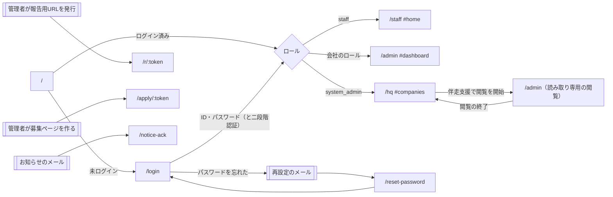
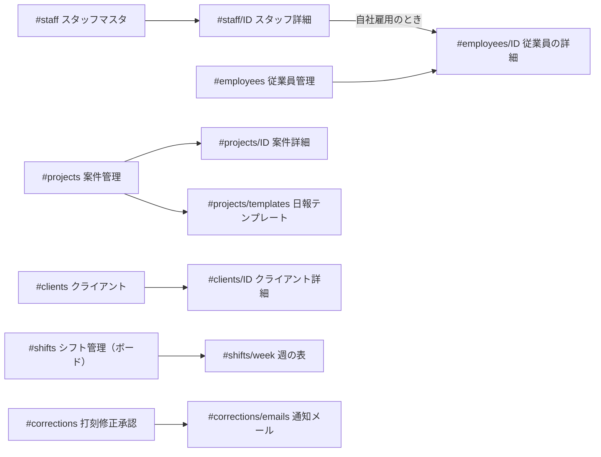

# 画面一覧・画面遷移

Field OS の画面の一覧です。新しく加わる開発者や外部の開発会社が、前提知識なしで読めるように書いています。

- 関連する資料: [DB 設計書](db.md)・[API 一覧](api.md)
- 一覧（ページ・メニュー・ハッシュのルート・使う API）はコードから生成しています。手で直さず、`npm run docs` で作り直してください（作り方は [DB 設計書](db.md) の「この資料の作り方」と同じです）。

## この資料の作り方

生成は、リポジトリの中のファイルだけで行います。本番には接続しません。

1. `src/index.tsx` の `app.get('/…')` を読み、ページごとに読み込む `public/static/*.js` を出します。
2. 管理画面の左のメニューは `src/index.tsx` の `sideNavGroup(…)` と、JS がメニューに足すリンクを読みます。
3. 1つのページの中の画面は、URL のハッシュ（`#staff/12` など）で切り替えます。ハッシュと描画する関数の対応は、各ページの JS の `const routes = { … }`・`routes.x = …`・`function route()` の中の分岐を読んで出します。
4. 「使う API」は、描画する関数と、そこから呼んでいる関数（2段まで）の中にある `/api/…` の呼び出しです。表示のときに読むものと、ボタンの操作で呼ぶものの両方が入ります。関数の中にない呼び出し（`delegate('…', …)` のボタンの処理など）は入りません。JS ごとの呼び出しの数は、下の「6. 画面の JS ごとの API の呼び出し」にあります。

## 1. 画面の作り

- 画面は Vanilla JS（フレームワークなし）です。サーバーは HTML の枠だけを返し、中身は JS が API を呼んで描きます。
- `/staff`・`/admin`・`/hq` は、それぞれ1つのページ（SPA）で、ハッシュが変わると `route()` が描き直します。
- 共通の部品は `public/static/common.js` にあります（HTML のエスケープ `esc`・ボタンの処理をまとめる `delegate`・二重送信を防ぐ `withSubmitLock` など）。画面の文字列に値を入れるときは `esc` を通し、`onclick` などの属性に値を埋め込まず、`data-*` と `delegate` を使います。
- 見た目は Tailwind CSS（`npm run build` で `public/static/style.css` を作ります）と、`card`・`badge`・`btn`・`inp` などのクラスです。
- 外部のライブラリ（axios・dayjs・Chart.js・flatpickr など）は jsDelivr から、版を固定して読み込みます（`src/index.tsx` の `SRI`）。

## 2. ページ（URL）と読み込む JS

「ログイン」の列は、ページを開くときのロールの確かめ方です。ログインしていなければ `/login` に移ります（戻る先を `?next=` に付けます）。

<!-- BEGIN GENERATED: screens-pages -->
| パス | 定義 | ログイン | 読み込む画面の JS |
|---|---|---|---|
| `/sw.js` | [index.tsx:120](../src/index.tsx#L120) |  | `common.js` |
| `/` | [index.tsx:167](../src/index.tsx#L167) |  |  |
| `/login` | [index.tsx:187](../src/index.tsx#L187) |  |  |
| `/reset-password` | [index.tsx:416](../src/index.tsx#L416) |  |  |
| `/verify-email` | [index.tsx:497](../src/index.tsx#L497) |  |  |
| `/notice-ack` | [index.tsx:545](../src/index.tsx#L545) |  |  |
| `/r/:token` | [index.tsx:603](../src/index.tsx#L603) |  | `report-link.js` |
| `/apply/:token` | [index.tsx:617](../src/index.tsx#L617) |  | `apply.js` |
| `/staff` | [index.tsx:631](../src/index.tsx#L631) | `if (u.role !== 'staff') return c.redirect('/')` | `tour.js` `report-form.js` `staff.js` `staff-attendance.js` `staff-profile.js` |
| `/admin` | [index.tsx:679](../src/index.tsx#L679) | `if (u.role === 'staff') return c.redirect('/staff')` | `hq-support.js` `tour.js` `report-form.js` `admin.js` `roster.js` `roster-chat.js` `shift-board.js` `staff-lifecycle.js` `settlement.js` `report-settings.js` `corrections.js` `notifications.js` `attendance-history.js` `recruit.js` `board.js` `security.js` |
| `/hq` | [index.tsx:807](../src/index.tsx#L807) | `if (u.role !== 'system_admin') return c.redirect('/')` | `hq.js` `security.js` |
<!-- END GENERATED: screens-pages -->

| ページ | 使う人 | 入り口 |
|---|---|---|
| `/login` | 全員 | ログインした人のロールで、`/staff`・`/admin`・`/hq` のどれかに移ります（[`homePathFor`](../src/lib/auth.ts)） |
| `/staff` | スタッフ | スマホ向け。下のタブで画面を切り替えます |
| `/admin` | 会社の管理者（4ロール） | PC 向け。左のメニュー（スマホでは上の選択欄）で切り替えます |
| `/hq` | 本部 | 上のメニューで切り替えます |
| `/r/:token` | スタッフ（ログインなし） | 管理者が発行した「報告用URL」。1つのシフトの勤怠・日報だけを報告できます（`public/static/staff-lifecycle.js` で発行） |
| `/apply/:token` | 応募する人（ログインなし） | 募集ページ（`public/static/recruit.js` で URL を作ります） |
| `/reset-password` | 全員（ログインなし） | パスワード再設定のメールのリンク（`/reset-password?token=…`） |
| `/verify-email` | 全員（ログインなし） | ログイン用メールアドレスの確認のメールのリンク |
| `/notice-ack` | スタッフ（ログインなし） | お知らせのメールの「確認しました」のリンク |

## 3. 画面遷移

- 二段階認証が必須なのに登録していない人は、どの画面を開いても `#security` に移ります（`/admin` は [`route`](../public/static/admin.js)、`/hq` は [`route`](../public/static/hq.js) の先頭）。
- 仮のパスワードのままの人は、管理画面では `#account` に移ります（[`route`](../public/static/admin.js)）。スタッフアプリでは、閉じられないパスワードの変更の画面を出します（`public/static/staff-profile.js` の `must_change_password` の処理）。
- 本部の利用者が `/admin` を開けるのは、企業が許可した閲覧の間だけです。閲覧がなければ `/hq#support` に戻ります（`src/index.tsx` の `/admin`）。

### 3.1 管理画面（/admin）の中の移動

一覧から詳細へは、ハッシュに ID を付けて移ります（下の「5. ハッシュのルート」の `#…/<ID>`）。

### 3.2 権限で変わるところ

- 従業員管理（`#employees`）は、会社管理者・事務担当だけです。ほかのロールでは、メニューの項目とスタッフ詳細の「従業員管理」のボタンを消し（`public/static/admin.js` の起動の処理）、開いても鍵の表示だけにします（[`route`](../public/static/admin.js)）。API でも止めます（[API 一覧](api.md) の 2）。
- セキュリティ（`#security`）は全員が開けます（自分の二段階認証・ログイン中の端末）。会社の設定（二段階認証の必須・接続元の制限）・管理者のアカウント・ログインの履歴は、会社管理者のときだけ出します（[`renderSecurity`](../public/static/security.js)）。API でも会社管理者だけに絞っています。
- スタッフアプリから募集に応募する機能（API は `/api/staff/recruit/*`）は、環境変数 `STAFF_APP_RECRUIT` が `1` のときだけ使えます（[`staffAppRecruitEnabled`](../src/notifications.ts)）。

## 4. メニュー

### 4.1 管理画面（/admin）の左のメニュー

見出しを押すと、その中の項目を閉じたり開いたりします（開閉は `localStorage` に覚えます）。中の項目が全部なくなった見出しは隠します。

メニューの右上のボタンで、メニュー全体をアイコンだけの細い列（56px）に畳めます（#9922）。畳んだときは見出しを区切り線にし、項目の名前はマウスを乗せたときに出します。畳んだかどうかは人ごと・端末ごとに `localStorage` に覚えます（キーは `body` の `data-side-key`）。本文と下に固定したバー（`side-offset-left`）の左の余白は、メニューの幅に合わせて動きます。スマホ幅のメニューは変わりません。

<!-- BEGIN GENERATED: screens-adminNav -->
- （見出しなし）
  - `#dashboard` ダッシュボード
  - `#notifications` 通知
- **シフト・勤怠**
  - `#shifts` シフト管理
  - `#availability` 出勤可能日（public/static/admin.js:7060 が足す）
  - `#reports` 日報一覧
  - `#corrections` 打刻修正承認
  - `#report-settings` 案件報告管理
  - `#attendance-history` 履歴・CSV
- **人材**
  - `#staff` スタッフマスタ
  - `#employees` 従業員管理
  - `#partners` 協力会社
  - `#recruit` 募集・応募
  - `#consult` 相談対応
  - `#follow` フォロー履歴
- **案件・取引**
  - `#projects` 案件管理
  - `#clients` クライアント
  - `#board` 案件掲示板
  - `#roster-chat` 企業間チャット
- **お金**
  - `#settlement` 精算（請求・支払）
  - `#billing` 請求前確認
- **お知らせ**
  - `#notices` お知らせ配信
  - `#notice-reports` 既読率レポート
- **分析**
  - `#analytics` 実績分析
- **設定**
  - `#account` アカウント設定
  - `#security` セキュリティ
- （スマホのメニューだけ）`#staff-requests` スタッフの申請（`#corrections` の後ろ。public/static/admin.js:2454 が足す）
<!-- END GENERATED: screens-adminNav -->

### 4.2 本部画面（/hq）の上のメニュー

<!-- BEGIN GENERATED: screens-hqNav -->
- `#companies` 導入企業
- `#templates` テンプレート配信
- `#retention` データ保持・定期処理
- `#mail` メール送信
- `#support` 伴走支援
- `#announcements` 企業へのお知らせ
- `#security` セキュリティ
- `#errors` 障害
- `#offboarding` 解約・データ（public/static/hq.js:2215 が足す）
<!-- END GENERATED: screens-hqNav -->

### 4.3 スタッフアプリ（/staff）の下のタブ

「その他」の中に、打刻履歴・通知・お知らせ・相談・プロフィールなどの画面があります（下の表で、画面の名前があるもの）。

<!-- BEGIN GENERATED: screens-staffNav -->
- `#home` ホーム
- `#shift` シフト
- `#report` 日報
- `#perf` 実績
- `#more` その他
<!-- END GENERATED: screens-staffNav -->

## 5. ハッシュのルート

`<ID>` は数字の ID です。「画面」の名前は、メニューの文字（スタッフアプリは画面の上の見出し）です。

<!-- BEGIN GENERATED: screens-routes -->
### `/staff`（ルートの表: [static/staff.js:2357](../public/static/staff.js#L2357)）

| ハッシュ | 画面 | 描画する関数（定義） | 使う API（描画する関数と、そこから呼ぶ関数を2段まで。ボタンの操作で呼ぶものを含む） |
|---|---|---|---|
| `#attendance` | 打刻履歴・修正申請 | `renderStaffAttendance` [static/staff-attendance.js:28](../public/static/staff-attendance.js#L28) | GET `/api/staff/attendance/timeline` GET `/api/staff/corrections` GET `/api/staff/corrections/:id{[0-9]+}` GET `/api/staff/corrections/attachments/:aid{[0-9]+}` |
| `#availability` | 出勤可能日の提出 | `renderAvailability` [static/staff.js:2432](../public/static/staff.js#L2432) | GET `/api/staff/availability` |
| `#calendar` | カレンダーに追加 | `renderShiftCalendar` [static/staff.js:2605](../public/static/staff.js#L2605) | GET `/api/staff/calendar-token` GET `/api/staff/shifts` GET `/api/staff/shifts/:id/ics` |
| `#consult` | 相談・連絡 | `renderConsult` [static/staff.js:2128](../public/static/staff.js#L2128) | GET `/api/staff/consultation-photo/:id{[0-9]+}` GET `/api/staff/consultations` POST `/api/staff/consultations` POST `/api/staff/consultations/:id{[0-9]+}/photos` POST `/api/staff/consultations/read-replies` GET `/api/staff/emergency-contacts` |
| `#home` | ホーム | `renderHome` [static/staff.js:143](../public/static/staff.js#L143) | POST `/api/staff/attendance` POST `/api/staff/attendance-photo` GET `/api/staff/home` |
| `#manual` | 研修・マニュアル | `renderManual` [static/staff.js:2326](../public/static/staff.js#L2326) | GET `/api/staff/manuals` |
| `#more` | その他 | `renderMore` [static/staff-profile.js:143](../public/static/staff-profile.js#L143) | GET `/api/staff/self/summary` |
| `#my-docs` | 書類の提出 | `renderMyDocs` [static/staff-profile.js:384](../public/static/staff-profile.js#L384) | GET `/api/staff/self/documents` POST `/api/staff/self/documents` GET `/api/staff/self/documents/:id/download` |
| `#my-leave` | 有給・休暇 | `renderMyLeave` [static/staff-profile.js:464](../public/static/staff-profile.js#L464) | GET `/api/staff/self/leave` |
| `#notices` | お知らせ | `renderNoticeDetail` [static/staff.js:1951](../public/static/staff.js#L1951) `renderNotices` [static/staff.js:1927](../public/static/staff.js#L1927) | GET `/api/staff/notices` GET `/api/staff/notices/:id{[0-9]+}` GET `/api/staff/notices/:id{[0-9]+}/attachments/:aid{[0-9]+}` |
| `#notifications` | 通知 | `renderStaffNotifications` [static/staff-attendance.js:499](../public/static/staff-attendance.js#L499) | GET `/api/staff/notifications` POST `/api/staff/notifications/read-all` |
| `#notify-settings` | 通知の設定 | `renderNotifySettings` [static/staff.js:2723](../public/static/staff.js#L2723) | GET `/api/staff/notification-prefs` GET `/api/staff/push/config` |
| `#password` | パスワードの変更 | `renderChangePassword` [static/staff-profile.js:189](../public/static/staff-profile.js#L189) | GET `/api/auth/sessions` GET `/api/staff/self/summary` |
| `#pay` | 勤務時間・支払 | `renderStaffPay` [static/staff-attendance.js:580](../public/static/staff-attendance.js#L580) `renderMore` [static/staff-attendance.js:849](../public/static/staff-attendance.js#L849) | GET `/api/staff/pay` |
| `#perf` | 実績 | `renderPerf` [static/staff.js:1721](../public/static/staff.js#L1721) | GET `/api/staff/performance` |
| `#profile` | マイプロフィール | `renderMyProfile` [static/staff-profile.js:40](../public/static/staff-profile.js#L40) | GET `/api/staff/me/profile` GET `/api/staff/self/summary` |
| `#profile-request` | 登録情報の変更申請 | `renderProfileRequest` [static/staff-profile.js:312](../public/static/staff-profile.js#L312) | GET `/api/staff/self/profile-requests` |
| `#report` | 日報入力 | `renderReportWithHistory` [static/staff.js:1672](../public/static/staff.js#L1672) | POST `/api/staff/daily-report` GET `/api/staff/daily-report/:shiftId` GET `/api/staff/handover/:shiftId` GET `/api/staff/home` GET `/api/staff/my-reports` GET `/api/staff/pending-daily-reports` |
| `#shift` | シフト | `renderShifts` [static/staff.js:1228](../public/static/staff.js#L1228) | GET `/api/staff/availability/summary` GET `/api/staff/shifts` |

### `/admin`（ルートの表: [static/admin.js:7006](../public/static/admin.js#L7006)）

| ハッシュ | 画面 | 描画する関数（定義） | 使う API（描画する関数と、そこから呼ぶ関数を2段まで。ボタンの操作で呼ぶものを含む） |
|---|---|---|---|
| `#account` | アカウント設定 | `renderAccount` [static/admin.js:6733](../public/static/admin.js#L6733) | GET `/api/admin/assignees` GET `/api/admin/settings/photo-required` GET `/api/admin/settings/shift-notify` GET `/api/admin/users` GET `/api/auth/account` |
| `#analytics` | 実績分析 | `renderAnalytics` [static/admin.js:5458](../public/static/admin.js#L5458) | GET `/api/admin/analytics` GET `/api/admin/analytics/csv` |
| `#analytics/<ID>` | 実績分析（詳細） | `renderAnalytics` [static/admin.js:5458](../public/static/admin.js#L5458) | GET `/api/admin/analytics` GET `/api/admin/analytics/csv` |
| `#attendance-history` | 履歴・CSV | `renderAttendanceHistory` [static/attendance-history.js:23](../public/static/attendance-history.js#L23) | GET `/api/admin/corrections/events` GET `/api/admin/corrections/events/export` GET `/api/admin/projects` GET `/api/admin/report-settings/logs` GET `/api/admin/report-settings/logs/export` |
| `#availability` | 出勤可能日 | `renderAvailabilityBoard` [static/admin.js:7074](../public/static/admin.js#L7074) | GET `/api/admin/availability` |
| `#billing` | 請求前確認 | `renderBilling` [static/admin.js:6614](../public/static/admin.js#L6614) | GET `/api/admin/billing-check` |
| `#board` | 案件掲示板 | `renderBoard` [static/board.js:34](../public/static/board.js#L34) | GET `/api/admin/board/posts` GET `/api/admin/board/posts/:id` GET `/api/admin/board/project-template/:projectId` GET `/api/admin/board/proposals` GET `/api/admin/board/saved-searches` GET `/api/admin/board/threads` GET `/api/admin/board/threads/:id` POST `/api/admin/board/threads/:id/messages` GET `/api/admin/board/threads/:id/proposals` POST `/api/admin/board/threads/:id/read` GET `/api/admin/board/unread-count` GET `/api/admin/projects` |
| `#clients` | クライアント | `renderClients` [static/admin.js:3665](../public/static/admin.js#L3665) | GET `/api/admin/assignees/options` GET `/api/admin/clients` |
| `#clients/<ID>` | クライアント（詳細） | `renderClientDetail` [static/admin.js:3836](../public/static/admin.js#L3836) | GET `/api/admin/clients/:id` POST `/api/admin/clients/:id/contacts` GET `/api/admin/clients/:id/documents` GET `/api/admin/clients/:id/ng-staff` PUT `/api/admin/clients/contacts/:contactId` GET `/api/admin/rate-rules` GET `/api/admin/roster/partners/by-client/:cid{[0-9]+}` GET `/api/admin/staff/options` |
| `#consult` | 相談対応 | `renderConsult` [static/admin.js:6506](../public/static/admin.js#L6506) | GET `/api/admin/consultation-photo/:id{[0-9]+}` GET `/api/admin/consultations` |
| `#corrections` | 打刻修正承認 | `renderCorrections` [static/corrections.js:72](../public/static/corrections.js#L72) | GET `/api/admin/attendance-photo/:attendanceId` GET `/api/admin/attendance-punches` GET `/api/admin/attendance-punches/export` GET `/api/admin/clients` GET `/api/admin/corrections` GET `/api/admin/corrections/:id{[0-9]+}` POST `/api/admin/corrections/:id{[0-9]+}/cancel` POST `/api/admin/corrections/:id{[0-9]+}/reject` POST `/api/admin/corrections/:id{[0-9]+}/resubmit` GET `/api/admin/corrections/attachments/:aid{[0-9]+}` GET `/api/admin/corrections/export` GET `/api/admin/corrections/pending-count` GET `/api/admin/corrections/shift-candidates` GET `/api/admin/corrections/shift/:shiftId` GET `/api/admin/projects` GET `/api/auth/me` |
| `#corrections/emails` | 打刻修正承認（emails） | `renderCorrectionEmails` [static/notifications.js:265](../public/static/notifications.js#L265) | GET `/api/admin/email-logs` GET `/api/admin/email-suppressions` GET `/api/admin/notification-emails` GET `/api/admin/notification-emails/export` GET `/api/admin/settings/mail-contact` |
| `#dashboard` | ダッシュボード | `renderDashboard` [static/admin.js:431](../public/static/admin.js#L431) | GET `/api/admin/dashboard` GET `/api/admin/roster-chat/threads` GET `/api/admin/roster-chat/unread-count` GET `/api/admin/settings/photo-required` |
| `#employees` | 従業員管理 | `renderEmployees` [static/admin.js:4082](../public/static/admin.js#L4082) | GET `/api/admin/employees` GET `/api/admin/roster/field-settings` GET `/api/admin/roster/next-code` GET `/api/admin/roster/partners` |
| `#employees/<ID>` | 従業員管理（詳細） | `renderEmployeeDetail` [static/admin.js:4150](../public/static/admin.js#L4150) | GET `/api/admin/employees/:staffId` PUT `/api/admin/employees/:staffId` GET `/api/admin/employees/:staffId/documents` GET `/api/admin/employees/:staffId/history` GET `/api/admin/staff-requests/leave` POST `/api/admin/staff/:id/release-future-shifts` |
| `#follow` | フォロー履歴 | `renderFollow` [static/admin.js:6399](../public/static/admin.js#L6399) | GET `/api/admin/follow-logs` |
| `#notice-reports` | 既読率レポート | `renderNoticeReadReport` [static/admin.js:6248](../public/static/admin.js#L6248) | GET `/api/admin/notice-reports/:fiscalYear` GET `/api/admin/notice-reports/:fiscalYear/csv` |
| `#notices` | お知らせ配信 | `renderNotices` [static/admin.js:5915](../public/static/admin.js#L5915) | GET `/api/admin/notices` GET `/api/admin/notices/recipients` GET `/api/admin/projects` |
| `#notifications` | 通知 | `renderNotificationsInbox` [static/notifications.js:99](../public/static/notifications.js#L99) | GET `/api/admin/corrections/pending-count` GET `/api/admin/notifications` GET `/api/admin/notifications/unread-count` GET `/api/admin/recruit-applications/summary` |
| `#partners` | 協力会社 | `renderPartners` [static/roster.js:853](../public/static/roster.js#L853) | GET `/api/admin/assignees/options` GET `/api/admin/roster/partners` GET `/api/admin/roster/partners/:pid{[0-9]+}` |
| `#projects` | 案件管理 | `renderProjects` [static/admin.js:2784](../public/static/admin.js#L2784) | GET `/api/admin/clients` GET `/api/admin/projects` GET `/api/admin/templates` |
| `#projects/<ID>` | 案件管理（詳細） | `renderProjectDetail` [static/admin.js:3039](../public/static/admin.js#L3039) | GET `/api/admin/projects/:id` GET `/api/admin/settings/lateness` GET `/api/admin/sites` GET `/api/admin/slot-patterns` |
| `#projects/templates` | 案件管理（templates） | `renderAdminTemplates` [static/admin.js:3339](../public/static/admin.js#L3339) | GET `/api/admin/templates` |
| `#recruit` | 募集・応募 | `renderRecruit` [static/recruit.js:35](../public/static/recruit.js#L35) | POST `/api/admin/notifications/read-related` GET `/api/admin/notifications/unread-count` GET `/api/admin/projects` GET `/api/admin/recruit-applications` GET `/api/admin/recruit-applications/summary` GET `/api/admin/recruit-pages` DELETE `/api/admin/recruit-pages/:id` PUT `/api/admin/recruit-pages/:id` GET `/api/admin/recruit-slots` |
| `#report-settings` | 案件報告管理 | `renderReportSettings` [static/report-settings.js:25](../public/static/report-settings.js#L25) | GET `/api/admin/report-settings/logs` GET `/api/admin/report-settings/off-list` GET `/api/admin/report-settings/off-list/export` GET `/api/admin/report-settings/projects` GET `/api/admin/report-settings/projects/:id` GET `/api/admin/report-settings/staff/:staffId` |
| `#reports` | 日報一覧 | `renderReports` [static/admin.js:5232](../public/static/admin.js#L5232) | GET `/api/admin/daily-reports` GET `/api/admin/daily-reports-retention` GET `/api/admin/daily-reports/missing` |
| `#roster-chat` | 企業間チャット | `renderRosterChatList` [static/roster-chat.js:54](../public/static/roster-chat.js#L54) | GET `/api/admin/roster-chat/threads` GET `/api/admin/roster-chat/unread-count` |
| `#roster-notes` | 連携先からの追記（メニューにない画面。見出しから） | `renderRosterHostNotes` [static/roster.js:776](../public/static/roster.js#L776) | GET `/api/admin/roster/host-notes` |
| `#security` | セキュリティ | `renderSecurity` [static/security.js:373](../public/static/security.js#L373) | GET `/api/admin/login-history` GET `/api/admin/security/settings` PUT `/api/admin/security/settings` GET `/api/admin/security/staff` GET `/api/admin/security/users` GET `/api/auth/mfa` GET `/api/auth/sessions` GET `/api/hq/login-history` |
| `#settlement` | 精算（請求・支払） | `renderSettlement` [static/settlement.js:52](../public/static/settlement.js#L52) | GET `/api/admin/pay-requests` GET `/api/admin/settlement` GET `/api/admin/settlement/export` GET `/api/admin/settlement/options` GET `/api/admin/settlement/statement` GET `/api/admin/staff-pay/settings` |
| `#shifts` | シフト管理 | `renderShiftBoard` [static/shift-board.js:193](../public/static/shift-board.js#L193) | GET `/api/admin/clients` GET `/api/admin/projects` GET `/api/admin/settings/shift-notify` GET `/api/admin/shift-board` GET `/api/admin/shift-board/candidates` GET `/api/admin/shift-requests` GET `/api/admin/sites` GET `/api/admin/staff/options` |
| `#shifts/week` | シフト管理（week） | `renderShifts` [static/admin.js:4492](../public/static/admin.js#L4492) | GET `/api/admin/projects` GET `/api/admin/shifts` GET `/api/admin/shifts/price-preview` GET `/api/admin/staff/options` |
| `#staff` | スタッフマスタ | `renderStaff` [static/admin.js:1271](../public/static/admin.js#L1271) | GET `/api/admin/roster/partners` GET `/api/admin/staff` |
| `#staff-requests` | スタッフの申請 | `renderStaffRequests` [static/admin.js:2473](../public/static/admin.js#L2473) | GET `/api/admin/staff-requests/documents` GET `/api/admin/staff-requests/leave` GET `/api/admin/staff-requests/profile` GET `/api/admin/staff-requests/summary` |
| `#staff/<ID>` | スタッフマスタ（詳細） | `renderStaffDetail` [static/admin.js:1871](../public/static/admin.js#L1871) | GET `/api/admin/report-settings/staff/:staffId` GET `/api/admin/roster-chat/:staffId` POST `/api/admin/roster-chat/:staffId` GET `/api/admin/roster/:id/links` GET `/api/admin/roster/:id/share-code` GET `/api/admin/settings/site-contact` GET `/api/admin/staff-affiliations` GET `/api/admin/staff-lookup` GET `/api/admin/staff/:id` PUT `/api/admin/staff/:id` GET `/api/admin/staff/:id/documents` GET `/api/admin/staff/:id/lifecycle` PUT `/api/admin/staff/:id/report-settings` GET `/api/admin/staff/:id/skill-sheet` |

### `/hq`（ルートの表: [static/hq.js:2164](../public/static/hq.js#L2164)）

| ハッシュ | 画面 | 描画する関数（定義） | 使う API（描画する関数と、そこから呼ぶ関数を2段まで。ボタンの操作で呼ぶものを含む） |
|---|---|---|---|
| `#announcements` | 企業へのお知らせ | `renderAnnouncements` [static/hq.js:1728](../public/static/hq.js#L1728) | GET `/api/hq/announcements` |
| `#companies` | 導入企業 | `renderCompanies` [static/hq.js:106](../public/static/hq.js#L106) | GET `/api/hq/companies` |
| `#companies/<ID>` | 導入企業（詳細） | `renderCompanyDetail` [static/hq.js:489](../public/static/hq.js#L489) | GET `/api/hq/companies/:id` |
| `#errors` | 障害 | `renderErrors` [static/hq.js:1985](../public/static/hq.js#L1985) | GET `/api/hq/errors` GET `/api/hq/push/config` |
| `#mail` | メール送信 | `renderHqMail` [static/hq.js:1823](../public/static/hq.js#L1823) | GET `/api/hq/email-logs` GET `/api/hq/email-stats` GET `/api/hq/email-suppressions` |
| `#offboarding` | 解約・データ | `renderOffboardingDetail` [static/hq.js:2358](../public/static/hq.js#L2358) `renderOffboardingList` [static/hq.js:2223](../public/static/hq.js#L2223) | GET `/api/hq/offboarding` GET `/api/hq/offboarding/:cid` GET `/api/hq/offboarding/:cid/record.csv` |
| `#retention` | データ保持・定期処理 | `renderRetention` [static/hq.js:1174](../public/static/hq.js#L1174) | GET `/api/hq/cron/status` GET `/api/hq/retention/logs` GET `/api/hq/retention/schedule` GET `/api/hq/retention/settings` |
| `#security` | セキュリティ | `renderHqSecurity` [static/security.js:404](../public/static/security.js#L404) | GET `/api/admin/login-history` GET `/api/auth/mfa` GET `/api/auth/sessions` GET `/api/hq/companies` GET `/api/hq/login-history` GET `/api/hq/security` |
| `#support` | 伴走支援 | `renderSupport` [static/hq.js:1545](../public/static/hq.js#L1545) | GET `/api/hq/companies` GET `/api/hq/support-requests` GET `/api/hq/view-sessions` |
| `#templates` | テンプレート配信 | `renderTemplates` [static/hq.js:871](../public/static/hq.js#L871) | GET `/api/hq/templates` |
<!-- END GENERATED: screens-routes -->

`/r/:token`（`public/static/report-link.js`）と `/apply/:token`（`public/static/apply.js`）は、ハッシュで切り替えない1枚の画面です。使う API は、下の表と [API 一覧](api.md) の `/api/public/…` にあります。

## 6. 画面の JS ごとの API の呼び出し

<!-- BEGIN GENERATED: screens-files -->
| 画面の JS | 呼び出しの数 | 対応する API の数 | 対応する API が見つからない呼び出し（メソッド パス:行） |
|---|---|---|---|
| `admin.js` | 184 | 150 |  |
| `apply.js` | 5 | 2 |  |
| `attendance-history.js` | 5 | 5 |  |
| `board.js` | 32 | 26 |  |
| `corrections.js` | 26 | 21 |  |
| `hq-support.js` | 8 | 7 |  |
| `hq.js` | 70 | 58 |  |
| `index.tsx` | 8 | 7 |  |
| `notifications.js` | 20 | 19 |  |
| `recruit.js` | 22 | 16 |  |
| `report-link.js` | 7 | 5 |  |
| `report-settings.js` | 20 | 14 |  |
| `roster-chat.js` | 8 | 7 |  |
| `roster.js` | 34 | 27 |  |
| `security.js` | 24 | 21 | `? /api/hq/security/users/:261` |
| `settlement.js` | 55 | 42 |  |
| `shift-board.js` | 64 | 45 |  |
| `staff-attendance.js` | 20 | 18 |  |
| `staff-lifecycle.js` | 37 | 30 |  |
| `staff-profile.js` | 21 | 20 |  |
| `staff.js` | 60 | 50 |  |
| `tour.js` | 7 | 11 |  |
<!-- END GENERATED: screens-files -->

## 本文で参照しているコードの位置

<!-- BEGIN GENERATED: screens-refs -->
| 名前 | 位置 |
|---|---|
| `homePathFor` | [lib/auth.ts:143](../src/lib/auth.ts#L143) |
| `route` | [static/admin.js:7019](../public/static/admin.js#L7019) |
| `route` | [static/hq.js:2171](../public/static/hq.js#L2171) |
| `renderSecurity` | [static/security.js:373](../public/static/security.js#L373) |
| `staffAppRecruitEnabled` | [notifications.ts:1410](../src/notifications.ts#L1410) |
<!-- END GENERATED: screens-refs -->
