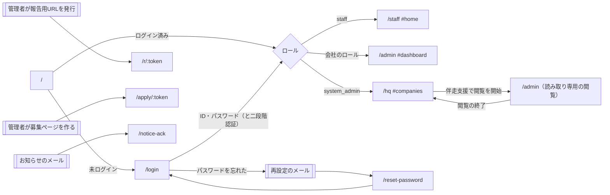
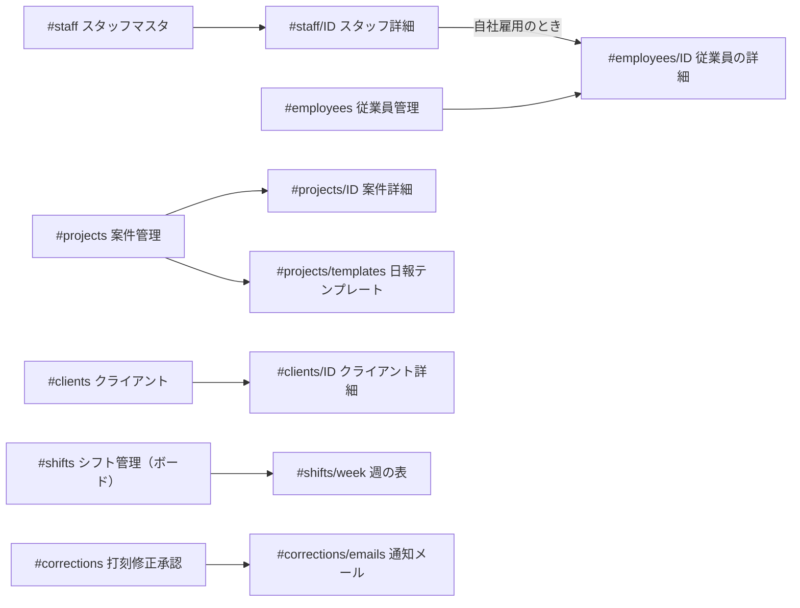

# 画面一覧・画面遷移

Field OS の画面の一覧です。新しく加わる開発者や外部の開発会社が、前提知識なしで読めるように書いています。

- 関連する資料: [DB 設計書](db.md)・[API 一覧](api.md)
- 一覧（ページ・メニュー・ハッシュのルート・使う API）はコードから生成しています。手で直さず、`npm run docs` で作り直してください（作り方は [DB 設計書](db.md) の「この資料の作り方」と同じです）。

## この資料の作り方

生成は、リポジトリの中のファイルだけで行います。本番には接続しません。

1. `src/index.tsx` の `app.get('/…')` を読み、ページごとに読み込む `public/static/*.js` を出します。
2. 管理画面の左のメニューは `src/index.tsx` の `sideNavGroup(…)` と、JS がメニューに足すリンクを読みます。
3. 1つのページの中の画面は、URL のハッシュ（`#staff/12` など）で切り替えます。ハッシュと描画する関数の対応は、各ページの JS の `const routes = { … }`・`routes.x = …`・`function route()` の中の分岐を読んで出します。
4. 「使う API」は、描画する関数と、そこから呼んでいる関数（2段まで）の中にある `/api/…` の呼び出しです。表示のときに読むものと、ボタンの操作で呼ぶものの両方が入ります。関数の中にない呼び出し（`delegate('…', …)` のボタンの処理など）は入りません。JS ごとの呼び出しの数は、下の「6. 画面の JS ごとの API の呼び出し」にあります。

## 1. 画面の作り

- 画面は Vanilla JS（フレームワークなし）です。サーバーは HTML の枠だけを返し、中身は JS が API を呼んで描きます。
- `/staff`・`/admin`・`/hq` は、それぞれ1つのページ（SPA）で、ハッシュが変わると `route()` が描き直します。
- 共通の部品は `public/static/common.js` にあります（HTML のエスケープ `esc`・ボタンの処理をまとめる `delegate`・二重送信を防ぐ `withSubmitLock` など）。画面の文字列に値を入れるときは `esc` を通し、`onclick` などの属性に値を埋め込まず、`data-*` と `delegate` を使います。
- 見た目は Tailwind CSS（`npm run build` で `public/static/style.css` を作ります）と、`card`・`badge`・`btn`・`inp` などのクラスです。
- 外部のライブラリ（axios・dayjs・Chart.js・flatpickr など）は jsDelivr から、版を固定して読み込みます（`src/index.tsx` の `SRI`）。

## 2. ページ（URL）と読み込む JS

「ログイン」の列は、ページを開くときのロールの確かめ方です。ログインしていなければ `/login` に移ります（戻る先を `?next=` に付けます）。

<!-- BEGIN GENERATED: screens-pages -->
| パス | 定義 | ログイン | 読み込む画面の JS |
|---|---|---|---|
| `/api/health` | [index.tsx:104](../src/index.tsx#L104) |  |  |
| `/sw.js` | [index.tsx:180](../src/index.tsx#L180) |  | `common.js` |
| `/` | [index.tsx:227](../src/index.tsx#L227) |  |  |
| `/login` | [index.tsx:247](../src/index.tsx#L247) |  |  |
| `/reset-password` | [index.tsx:476](../src/index.tsx#L476) |  |  |
| `/verify-email` | [index.tsx:557](../src/index.tsx#L557) |  |  |
| `/notice-ack` | [index.tsx:605](../src/index.tsx#L605) |  |  |
| `/r/:token` | [index.tsx:663](../src/index.tsx#L663) |  | `report-link.js` |
| `/apply/:token` | [index.tsx:677](../src/index.tsx#L677) |  | `apply.js` |
| `/staff` | [index.tsx:691](../src/index.tsx#L691) | `if (u.role !== 'staff') return c.redirect('/')` | `tour.js` `report-form.js` `staff.js` `staff-attendance.js` `staff-profile.js` |
| `/admin` | [index.tsx:731](../src/index.tsx#L731) | `if (u.role === 'staff') return c.redirect('/staff')` | `hq-support.js` `tour.js` `report-form.js` `admin.js` `roster.js` `roster-chat.js` `shift-board.js` `staff-lifecycle.js` `settlement.js` `report-settings.js` `corrections.js` `notifications.js` `attendance-history.js` `recruit.js` `board.js` `security.js` |
| `/hq` | [index.tsx:823](../src/index.tsx#L823) | `if (u.role !== 'system_admin') return c.redirect('/')` | `hq.js` `security.js` |
<!-- END GENERATED: screens-pages -->

| ページ | 使う人 | 入り口 |
|---|---|---|
| `/login` | 全員 | ログインした人のロールで、`/staff`・`/admin`・`/hq` のどれかに移ります（[`homePathFor`](../src/lib/auth.ts)） |
| `/staff` | スタッフ | スマホ向け。下のタブで画面を切り替えます |
| `/admin` | 会社の管理者（4ロール） | PC 向け。左のメニュー（スマホでは上の選択欄）で切り替えます |
| `/hq` | 本部 | 上のメニューで切り替えます |
| `/r/:token` | スタッフ（ログインなし） | 管理者が発行した「報告用URL」。1つのシフトの勤怠・日報だけを報告できます（`public/static/staff-lifecycle.js` で発行） |
| `/apply/:token` | 応募する人（ログインなし） | 募集ページ（`public/static/recruit.js` で URL を作ります） |
| `/reset-password` | 全員（ログインなし） | パスワード再設定のメールのリンク（`/reset-password?token=…`） |
| `/verify-email` | 全員（ログインなし） | ログイン用メールアドレスの確認のメールのリンク |
| `/notice-ack` | スタッフ（ログインなし） | お知らせのメールの「確認しました」のリンク |

## 3. 画面遷移

- 二段階認証が必須なのに登録していない人は、どの画面を開いても `#security` に移ります（`/admin` は [`route`](../public/static/admin.js)、`/hq` は [`route`](../public/static/hq.js) の先頭）。
- 仮のパスワードのままの人は、管理画面では `#account` に移ります（[`route`](../public/static/admin.js)）。スタッフアプリでは、閉じられないパスワードの変更の画面を出します（`public/static/staff-profile.js` の `must_change_password` の処理）。
- 本部の利用者が `/admin` を開けるのは、企業が許可した閲覧の間だけです。閲覧がなければ `/hq#support` に戻ります（`src/index.tsx` の `/admin`）。

### 3.1 管理画面（/admin）の中の移動

一覧から詳細へは、ハッシュに ID を付けて移ります（下の「5. ハッシュのルート」の `#…/<ID>`）。

### 3.2 権限で変わるところ

- 従業員管理（`#employees`）は、会社管理者・事務担当だけです。ほかのロールでは、メニューの項目とスタッフ詳細の「従業員管理」のボタンを消し（`public/static/admin.js` の起動の処理）、開いても鍵の表示だけにします（[`route`](../public/static/admin.js)）。API でも止めます（[API 一覧](api.md) の 2）。
- セキュリティ（`#security`）は全員が開けます（自分の二段階認証・ログイン中の端末）。会社の設定（二段階認証の必須・接続元の制限）・管理者のアカウント・ログインの履歴は、会社管理者のときだけ出します（[`renderSecurity`](../public/static/security.js)）。API でも会社管理者だけに絞っています。
- スタッフアプリには募集・応募の画面がありません（D-22。11/9 にスタッフ向けの募集の API も外しました）。登録済みのスタッフも公開の募集ページから応募します。

### 3.3 管理画面（/admin）の本文の幅

本文（`<main id="app">`）の幅は、画面の種類で2つに分けています（#9930）。ハッシュが変わると [`route`](../public/static/admin.js) が `#app` に `data-layout` を付け、`src/input.css` の規則で幅を決めます。本部の閲覧中の表示（`#hq-support-bar`）とヘルプの行（`#tour-help-bar`）も本文と同じ幅です。

| 印（`data-layout`） | 幅 | 画面 |
|---|---|---|
| `full`（幅いっぱい） | 上限なし。左のメニューを畳むと、その分（184px）広がる | ダッシュボード・通知・シフト管理（`#shifts`・`#shifts/week`）・出勤可能日・日報一覧・打刻修正承認（`#corrections`・`#corrections/punches`・`#corrections/emails`）・案件報告管理・履歴・CSV・スタッフマスタ（一覧・詳細）・スタッフの申請・従業員管理（一覧・詳細）・協力会社（一覧・詳細）・募集・応募・相談対応・フォロー履歴・案件管理（一覧・詳細・日報テンプレート）・クライアント（一覧・詳細）・案件掲示板・企業間チャット・連携先からの追記・精算・請求前確認・お知らせ配信・既読率レポート・実績分析・セキュリティ（`#security`。端末・管理者・ログインの履歴の表が多いため） |
| `form`（フォームの幅） | 最大 64rem（1024px。余白を含む）。左に寄せる | アカウント設定（`#account`） |

- 入力フォームが中心の画面だけを `form` にし、一覧とフォームが半々の画面（スタッフ詳細・案件詳細・セキュリティなど）は `full` にします。新しい画面は、何もしなければ `full` です。`form` にするときは `admin.js` の `APP_FORM_TABS` にハッシュの先頭（`/` の前）を足します。
- 幅いっぱいの画面のカードの並びは、画面の幅が 1800px 以上（1920px のモニターなど）で列を増やします（`min-[1800px]:`）。クライアントのカードは 4 列、日報テンプレートのカードは 3 列、スタッフ詳細は 4 列（基本情報 3 列・右のファイルと評価のグラフ 1 列。評価のグラフが大きくなりすぎないように）です。表は列の幅が広がるだけです。
- 会社の設定（写真添付・シフトの通知・緊急連絡先など）は、アカウント設定の中のモーダルで変えます。モーダル・下に固定したバー・トーストの幅は、本文の幅に関係なく変わりません。
- スマホ幅（768px 未満）は、どちらでも画面の幅いっぱいです。本部画面（`/hq`）とスタッフアプリは対象外です（本部画面は今までどおり `max-w-7xl` で中央に寄せます）。

## 4. メニュー

### 4.1 管理画面（/admin）の左のメニュー

見出しを押すと、その中の項目を閉じたり開いたりします（開閉は `localStorage` に覚えます）。中の項目が全部なくなった見出しは隠します。

メニューの右上のボタンで、メニュー全体をアイコンだけの細い列（56px）に畳めます（#9922）。畳んだときは見出しを区切り線にし、項目の名前はマウスを乗せたときに出します。畳んだかどうかは人ごと・端末ごとに `localStorage` に覚えます（キーは `body` の `data-side-key`）。本文と下に固定したバー（`side-offset-left`）の左の余白は、メニューの幅に合わせて動きます。スマホ幅のメニューは変わりません。

<!-- BEGIN GENERATED: screens-adminNav -->
- （見出しなし）
  - `#dashboard` ダッシュボード
  - `#notifications` 通知
- **シフト・勤怠**
  - `#shifts` シフト管理
  - `#availability` 出勤可能日
  - `#reports` 日報一覧
  - `#corrections` 打刻修正承認
  - `#staff-requests` スタッフの申請
  - `#report-settings` 案件報告管理
  - `#attendance-history` 履歴・CSV
- **人材**
  - `#staff` スタッフマスタ
  - `#employees` 従業員管理（権限の表の `hr.manage` を持つロールだけに出す）
  - `#partners` 協力会社
  - `#recruit` 募集・応募
  - `#consult` 相談対応
  - `#follow` フォロー履歴
- **案件・取引**
  - `#projects` 案件管理
  - `#clients` クライアント
  - `#board` 案件掲示板
  - `#roster-chat` 企業間チャット
- **お金**
  - `#settlement` 精算（請求・支払）
  - `#billing` 請求前確認
- **お知らせ**
  - `#notices` お知らせ配信
  - `#notice-reports` 既読率レポート
- **分析**
  - `#analytics` 実績分析
- **設定**
  - `#account` アカウント設定
  - `#security` セキュリティ
<!-- END GENERATED: screens-adminNav -->

### 4.2 本部画面（/hq）の上のメニュー

<!-- BEGIN GENERATED: screens-hqNav -->
- `#companies` 導入企業
- `#templates` テンプレート配信
- `#retention` データ保持・定期処理
- `#mail` メール送信
- `#support` 伴走支援
- `#announcements` 企業へのお知らせ
- `#security` セキュリティ
- `#errors` 障害
- `#offboarding` 解約・データ
<!-- END GENERATED: screens-hqNav -->

### 4.3 スタッフアプリ（/staff）の下のタブ

「その他」の中に、打刻履歴・通知・お知らせ・相談・プロフィールなどの画面があります（下の表で、画面の名前があるもの）。

<!-- BEGIN GENERATED: screens-staffNav -->
- `#home` ホーム
- `#shift` シフト
- `#report` 日報
- `#perf` 実績
- `#more` その他
<!-- END GENERATED: screens-staffNav -->

## 5. ハッシュのルート

`<ID>` は数字の ID です。「画面」の名前は、メニューの文字（スタッフアプリは画面の上の見出し）です。

<!-- BEGIN GENERATED: screens-routes -->
### `/staff`（ルートの表: [static/staff.js:2454](../public/static/staff.js#L2454)）

| ハッシュ | 画面 | 描画する関数（定義） | 使う API（描画する関数と、そこから呼ぶ関数を2段まで。ボタンの操作で呼ぶものを含む） |
|---|---|---|---|
| `#attendance` | 打刻履歴・修正申請 | `renderStaffAttendance` [static/staff-attendance.js:27](../public/static/staff-attendance.js#L27) | GET `/api/staff/attendance/timeline` GET `/api/staff/corrections` GET `/api/staff/corrections/:id{[0-9]+}` GET `/api/staff/corrections/attachments/:aid{[0-9]+}` |
| `#availability` | 出勤可能日の提出 | `renderAvailability` [static/staff.js:2515](../public/static/staff.js#L2515) | GET `/api/staff/availability` |
| `#calendar` | カレンダーに追加 | `renderShiftCalendar` [static/staff.js:2688](../public/static/staff.js#L2688) | GET `/api/staff/calendar-token` GET `/api/staff/shifts` GET `/api/staff/shifts/:id/ics` |
| `#consult` | 相談・連絡 | `renderConsult` [static/staff.js:2197](../public/static/staff.js#L2197) | GET `/api/staff/consultation-photo/:id{[0-9]+}` GET `/api/staff/consultations` POST `/api/staff/consultations` POST `/api/staff/consultations/:id{[0-9]+}/photos` POST `/api/staff/consultations/read-replies` GET `/api/staff/emergency-contacts` |
| `#home` | ホーム | `renderHome` [static/staff.js:133](../public/static/staff.js#L133) | POST `/api/staff/attendance` POST `/api/staff/attendance-photo` GET `/api/staff/home` |
| `#manual` | 研修・マニュアル | `renderManual` [static/staff.js:2395](../public/static/staff.js#L2395) | GET `/api/staff/manuals` |
| `#more` | その他 | `renderMore` [static/staff.js:1844](../public/static/staff.js#L1844) | GET `/api/staff/emergency-contacts` |
| `#my-docs` | 書類の提出 | `renderMyDocs` [static/staff-profile.js:354](../public/static/staff-profile.js#L354) | GET `/api/staff/self/documents` POST `/api/staff/self/documents` GET `/api/staff/self/documents/:id/download` |
| `#my-leave` | 有給・休暇 | `renderMyLeave` [static/staff-profile.js:434](../public/static/staff-profile.js#L434) | GET `/api/staff/self/leave` |
| `#notices` | お知らせ | `renderNoticeDetail` [static/staff.js:2020](../public/static/staff.js#L2020) `renderNotices` [static/staff.js:1996](../public/static/staff.js#L1996) | GET `/api/staff/notices` GET `/api/staff/notices/:id{[0-9]+}` GET `/api/staff/notices/:id{[0-9]+}/attachments/:aid{[0-9]+}` |
| `#notifications` | 通知 | `renderStaffNotifications` [static/staff-attendance.js:489](../public/static/staff-attendance.js#L489) | GET `/api/staff/notifications` POST `/api/staff/notifications/read-all` |
| `#notify-settings` | 通知の設定 | `renderNotifySettings` [static/staff.js:2805](../public/static/staff.js#L2805) | GET `/api/staff/notification-prefs` GET `/api/staff/push/config` |
| `#password` | パスワードの変更 | `renderChangePassword` [static/staff-profile.js:159](../public/static/staff-profile.js#L159) | GET `/api/auth/sessions` |
| `#pay` | 勤務時間・支払 | `renderStaffPay` [static/staff-attendance.js:571](../public/static/staff-attendance.js#L571) | GET `/api/staff/pay` |
| `#perf` | 実績 | `renderPerf` [static/staff.js:1790](../public/static/staff.js#L1790) | GET `/api/staff/performance` |
| `#profile` | マイプロフィール | `renderMyProfile` [static/staff-profile.js:40](../public/static/staff-profile.js#L40) | GET `/api/staff/me/profile` |
| `#profile-request` | 登録情報の変更申請 | `renderProfileRequest` [static/staff-profile.js:282](../public/static/staff-profile.js#L282) | GET `/api/staff/self/profile-requests` |
| `#report` | 日報入力 | `renderReportWithHistory` [static/staff.js:1741](../public/static/staff.js#L1741) | POST `/api/staff/daily-report` GET `/api/staff/daily-report/:shiftId` GET `/api/staff/handover/:shiftId` GET `/api/staff/home` GET `/api/staff/my-reports` GET `/api/staff/pending-daily-reports` |
| `#shift` | シフト | `renderShifts` [static/staff.js:1286](../public/static/staff.js#L1286) | GET `/api/staff/availability/summary` GET `/api/staff/shifts` |

### `/admin`（ルートの表: [admin-menu.ts:37](../src/admin-menu.ts#L37)）

| ハッシュ | 画面 | 描画する関数（定義） | 使う API（描画する関数と、そこから呼ぶ関数を2段まで。ボタンの操作で呼ぶものを含む） |
|---|---|---|---|
| `#account` | アカウント設定 | `renderAccount` [static/admin.js:6936](../public/static/admin.js#L6936) | GET `/api/admin/assignees` GET `/api/admin/contract-usage` GET `/api/admin/settings/photo-required` GET `/api/admin/settings/shift-notify` GET `/api/admin/users` GET `/api/auth/account` |
| `#analytics` | 実績分析 | `renderAnalytics` [static/admin.js:5410](../public/static/admin.js#L5410) | GET `/api/admin/analytics` GET `/api/admin/analytics/csv` GET `/api/admin/analytics/series` |
| `#analytics/<ID>` | 実績分析（詳細） | `renderAnalytics` [static/admin.js:5410](../public/static/admin.js#L5410) | GET `/api/admin/analytics` GET `/api/admin/analytics/csv` GET `/api/admin/analytics/series` |
| `#attendance-history` | 履歴・CSV | `renderAttendanceHistory` [static/attendance-history.js:22](../public/static/attendance-history.js#L22) | GET `/api/admin/corrections/events` GET `/api/admin/corrections/events/export` GET `/api/admin/projects` GET `/api/admin/report-settings/logs` GET `/api/admin/report-settings/logs/export` |
| `#availability` | 出勤可能日 | `renderAvailabilityBoard` [static/admin.js:7291](../public/static/admin.js#L7291) | GET `/api/admin/availability` |
| `#billing` | 請求前確認 | `renderBilling` [static/admin.js:6786](../public/static/admin.js#L6786) | GET `/api/admin/billing-check` |
| `#board` | 案件掲示板 | `renderBoard` [static/board.js:33](../public/static/board.js#L33) | GET `/api/admin/board/posts` GET `/api/admin/board/posts/:id` GET `/api/admin/board/project-template/:projectId` GET `/api/admin/board/proposals` GET `/api/admin/board/saved-searches` GET `/api/admin/board/threads` GET `/api/admin/board/threads/:id` POST `/api/admin/board/threads/:id/messages` GET `/api/admin/board/threads/:id/proposals` POST `/api/admin/board/threads/:id/read` GET `/api/admin/board/unread-count` GET `/api/admin/projects` |
| `#board/<ID>` | 案件掲示板（詳細） | `renderBoard` [static/board.js:33](../public/static/board.js#L33) | GET `/api/admin/board/posts` GET `/api/admin/board/posts/:id` GET `/api/admin/board/project-template/:projectId` GET `/api/admin/board/proposals` GET `/api/admin/board/saved-searches` GET `/api/admin/board/threads` GET `/api/admin/board/threads/:id` POST `/api/admin/board/threads/:id/messages` GET `/api/admin/board/threads/:id/proposals` POST `/api/admin/board/threads/:id/read` GET `/api/admin/board/unread-count` GET `/api/admin/projects` |
| `#clients` | クライアント | `renderClients` [static/admin.js:3582](../public/static/admin.js#L3582) | GET `/api/admin/assignees/options` GET `/api/admin/clients` |
| `#clients/<ID>` | クライアント（詳細） | `renderClientDetail` [static/admin.js:3754](../public/static/admin.js#L3754) | GET `/api/admin/clients/:id` POST `/api/admin/clients/:id/contacts` GET `/api/admin/clients/:id/documents` GET `/api/admin/clients/:id/ng-staff` PUT `/api/admin/clients/contacts/:contactId` GET `/api/admin/rate-rules` GET `/api/admin/roster/partners/by-client/:cid{[0-9]+}` GET `/api/admin/staff/options` |
| `#consult` | 相談対応 | `renderConsult` [static/admin.js:6678](../public/static/admin.js#L6678) | GET `/api/admin/consultation-photo/:id{[0-9]+}` GET `/api/admin/consultations` |
| `#corrections` | 打刻修正承認 | `renderCorrections` [static/corrections.js:72](../public/static/corrections.js#L72) | GET `/api/admin/attendance-photo/:attendanceId` GET `/api/admin/attendance-punches` GET `/api/admin/attendance-punches/export` GET `/api/admin/clients` GET `/api/admin/corrections` GET `/api/admin/corrections/:id{[0-9]+}` POST `/api/admin/corrections/:id{[0-9]+}/cancel` POST `/api/admin/corrections/:id{[0-9]+}/reject` POST `/api/admin/corrections/:id{[0-9]+}/resubmit` GET `/api/admin/corrections/attachments/:aid{[0-9]+}` GET `/api/admin/corrections/export` GET `/api/admin/corrections/pending-count` GET `/api/admin/corrections/shift-candidates` GET `/api/admin/corrections/shift/:shiftId` GET `/api/admin/projects` GET `/api/auth/me` |
| `#corrections/<ID>` | 打刻修正承認（詳細） | `renderCorrections` [static/corrections.js:72](../public/static/corrections.js#L72) | GET `/api/admin/attendance-photo/:attendanceId` GET `/api/admin/attendance-punches` GET `/api/admin/attendance-punches/export` GET `/api/admin/clients` GET `/api/admin/corrections` GET `/api/admin/corrections/:id{[0-9]+}` POST `/api/admin/corrections/:id{[0-9]+}/cancel` POST `/api/admin/corrections/:id{[0-9]+}/reject` POST `/api/admin/corrections/:id{[0-9]+}/resubmit` GET `/api/admin/corrections/attachments/:aid{[0-9]+}` GET `/api/admin/corrections/export` GET `/api/admin/corrections/pending-count` GET `/api/admin/corrections/shift-candidates` GET `/api/admin/corrections/shift/:shiftId` GET `/api/admin/projects` GET `/api/auth/me` |
| `#corrections/emails` | 打刻修正承認（emails） | `renderCorrectionEmails` [static/notifications.js:257](../public/static/notifications.js#L257) | GET `/api/admin/email-logs` GET `/api/admin/email-suppressions` GET `/api/admin/notification-emails` GET `/api/admin/notification-emails/export` GET `/api/admin/settings/mail-contact` |
| `#dashboard` | ダッシュボード | `renderDashboardPage` [static/admin.js:7233](../public/static/admin.js#L7233) | GET `/api/admin/dashboard` GET `/api/admin/roster-chat/threads` GET `/api/admin/settings/photo-required` |
| `#employees` | 従業員管理 | `renderEmployees` [static/admin.js:4004](../public/static/admin.js#L4004) | GET `/api/admin/employees` GET `/api/admin/roster/field-settings` GET `/api/admin/roster/next-code` GET `/api/admin/roster/partners` |
| `#employees/<ID>` | 従業員管理（詳細） | `renderEmployeeDetail` [static/admin.js:4072](../public/static/admin.js#L4072) | GET `/api/admin/employees/:staffId` PUT `/api/admin/employees/:staffId` GET `/api/admin/employees/:staffId/documents` GET `/api/admin/employees/:staffId/history` GET `/api/admin/staff-requests/leave` POST `/api/admin/staff/:id/release-future-shifts` |
| `#follow` | フォロー履歴 | `renderFollow` [static/admin.js:6571](../public/static/admin.js#L6571) | GET `/api/admin/follow-logs` |
| `#notice-reports` | 既読率レポート | `renderNoticeReadReport` [static/admin.js:6420](../public/static/admin.js#L6420) | GET `/api/admin/notice-reports/:fiscalYear` GET `/api/admin/notice-reports/:fiscalYear/csv` |
| `#notices` | お知らせ配信 | `renderNotices` [static/admin.js:6087](../public/static/admin.js#L6087) | GET `/api/admin/notices` GET `/api/admin/notices/recipients` GET `/api/admin/projects` |
| `#notifications` | 通知 | `renderNotificationsInbox` [static/notifications.js:91](../public/static/notifications.js#L91) | GET `/api/admin/badges` GET `/api/admin/notifications` |
| `#partners` | 協力会社 | `renderPartners` [static/roster.js:849](../public/static/roster.js#L849) | GET `/api/admin/assignees/options` GET `/api/admin/roster/partners` GET `/api/admin/roster/partners/:pid{[0-9]+}` |
| `#projects` | 案件管理 | `renderProjects` [static/admin.js:2701](../public/static/admin.js#L2701) | GET `/api/admin/clients` GET `/api/admin/projects` GET `/api/admin/templates` |
| `#projects/<ID>` | 案件管理（詳細） | `renderProjectDetail` [static/admin.js:2956](../public/static/admin.js#L2956) | GET `/api/admin/projects/:id` GET `/api/admin/settings/lateness` GET `/api/admin/sites` GET `/api/admin/slot-patterns` |
| `#projects/templates` | 案件管理（templates） | `renderAdminTemplates` [static/admin.js:3256](../public/static/admin.js#L3256) | GET `/api/admin/templates` |
| `#recruit` | 募集・応募 | `renderRecruit` [static/recruit.js:29](../public/static/recruit.js#L29) | POST `/api/admin/notifications/read-related` GET `/api/admin/projects` GET `/api/admin/recruit-applications` GET `/api/admin/recruit-applications/summary` GET `/api/admin/recruit-pages` DELETE `/api/admin/recruit-pages/:id` PUT `/api/admin/recruit-pages/:id` GET `/api/admin/recruit-slots` |
| `#report-settings` | 案件報告管理 | `renderReportSettings` [static/report-settings.js:24](../public/static/report-settings.js#L24) | GET `/api/admin/report-settings/logs` GET `/api/admin/report-settings/off-list` GET `/api/admin/report-settings/off-list/export` GET `/api/admin/report-settings/projects` GET `/api/admin/report-settings/projects/:id` GET `/api/admin/report-settings/staff/:staffId` |
| `#report-settings/<ID>` | 案件報告管理（詳細） | `renderReportSettings` [static/report-settings.js:24](../public/static/report-settings.js#L24) | GET `/api/admin/report-settings/logs` GET `/api/admin/report-settings/off-list` GET `/api/admin/report-settings/off-list/export` GET `/api/admin/report-settings/projects` GET `/api/admin/report-settings/projects/:id` GET `/api/admin/report-settings/staff/:staffId` |
| `#reports` | 日報一覧 | `renderReports` [static/admin.js:5161](../public/static/admin.js#L5161) | GET `/api/admin/daily-reports` GET `/api/admin/daily-reports-retention` GET `/api/admin/daily-reports/missing` |
| `#roster-chat` | 企業間チャット | `renderRosterChatList` [static/roster-chat.js:58](../public/static/roster-chat.js#L58) | GET `/api/admin/roster-chat/threads` GET `/api/admin/roster-chat/unread-count` |
| `#roster-notes` | 連携先からの追記（メニューにない画面。見出しから） | `openRosterHostNotes` [static/roster.js:816](../public/static/roster.js#L816) | GET `/api/admin/roster/host-notes` |
| `#security` | セキュリティ | `renderSecurity` [static/security.js:377](../public/static/security.js#L377) | GET `/api/admin/login-history` GET `/api/admin/security/settings` PUT `/api/admin/security/settings` GET `/api/admin/security/staff` GET `/api/admin/security/users` GET `/api/auth/mfa` GET `/api/auth/sessions` GET `/api/hq/login-history` |
| `#settlement` | 精算（請求・支払） | `renderSettlement` [static/settlement.js:51](../public/static/settlement.js#L51) | GET `/api/admin/pay-requests` GET `/api/admin/settlement` GET `/api/admin/settlement/export` GET `/api/admin/settlement/options` GET `/api/admin/settlement/statement` GET `/api/admin/staff-pay/settings` |
| `#shifts` | シフト管理 | `renderShiftBoard` [static/shift-board.js:192](../public/static/shift-board.js#L192) | GET `/api/admin/clients` GET `/api/admin/projects` GET `/api/admin/settings/shift-notify` GET `/api/admin/shift-board` GET `/api/admin/shift-board/candidates` GET `/api/admin/shift-requests` GET `/api/admin/sites` GET `/api/admin/staff/options` |
| `#shifts/week` | シフト管理（week） | `renderShifts` [static/admin.js:4415](../public/static/admin.js#L4415) | GET `/api/admin/projects` GET `/api/admin/shifts` GET `/api/admin/shifts/price-preview` GET `/api/admin/staff/options` |
| `#staff` | スタッフマスタ | `renderStaff` [static/admin.js:1275](../public/static/admin.js#L1275) | GET `/api/admin/roster/partners` GET `/api/admin/staff` |
| `#staff-requests` | スタッフの申請 | `renderStaffRequests` [static/admin.js:2390](../public/static/admin.js#L2390) | GET `/api/admin/staff-requests/documents` GET `/api/admin/staff-requests/leave` GET `/api/admin/staff-requests/profile` GET `/api/admin/staff-requests/summary` |
| `#staff/<ID>` | スタッフマスタ（詳細） | `renderStaffDetail` [static/admin.js:1821](../public/static/admin.js#L1821) | GET `/api/admin/report-settings/staff/:staffId` GET `/api/admin/roster-chat/:staffId` POST `/api/admin/roster-chat/:staffId` GET `/api/admin/roster/:id/links` GET `/api/admin/roster/:id/share-code` GET `/api/admin/settings/site-contact` GET `/api/admin/staff-affiliations` GET `/api/admin/staff-lookup` GET `/api/admin/staff/:id` PUT `/api/admin/staff/:id` GET `/api/admin/staff/:id/documents` GET `/api/admin/staff/:id/lifecycle` PUT `/api/admin/staff/:id/report-settings` GET `/api/admin/staff/:id/skill-sheet` |

### `/hq`（ルートの表: [static/hq.js:2302](../public/static/hq.js#L2302)）

| ハッシュ | 画面 | 描画する関数（定義） | 使う API（描画する関数と、そこから呼ぶ関数を2段まで。ボタンの操作で呼ぶものを含む） |
|---|---|---|---|
| `#announcements` | 企業へのお知らせ | `renderAnnouncements` [static/hq.js:1719](../public/static/hq.js#L1719) | GET `/api/hq/announcements` |
| `#companies` | 導入企業 | `renderCompanies` [static/hq.js:95](../public/static/hq.js#L95) | GET `/api/hq/companies` |
| `#companies/<ID>` | 導入企業（詳細） | `renderCompanyDetail` [static/hq.js:478](../public/static/hq.js#L478) | GET `/api/hq/companies/:id` |
| `#errors` | 障害 | `renderErrors` [static/hq.js:1999](../public/static/hq.js#L1999) | GET `/api/hq/errors` GET `/api/hq/monitor` GET `/api/hq/push/config` |
| `#mail` | メール送信 | `renderHqMail` [static/hq.js:1814](../public/static/hq.js#L1814) | GET `/api/hq/email-logs` GET `/api/hq/email-stats` GET `/api/hq/email-suppressions` |
| `#offboarding` | 解約・データ | `renderOffboardingDetail` [static/hq.js:2484](../public/static/hq.js#L2484) `renderOffboardingList` [static/hq.js:2349](../public/static/hq.js#L2349) | GET `/api/hq/offboarding` GET `/api/hq/offboarding/:cid` GET `/api/hq/offboarding/:cid/record.csv` |
| `#retention` | データ保持・定期処理 | `renderRetention` [static/hq.js:1165](../public/static/hq.js#L1165) | GET `/api/hq/cron/status` GET `/api/hq/retention/logs` GET `/api/hq/retention/schedule` GET `/api/hq/retention/settings` |
| `#security` | セキュリティ | `renderHqSecurity` [static/security.js:408](../public/static/security.js#L408) | GET `/api/admin/login-history` GET `/api/auth/mfa` GET `/api/auth/sessions` GET `/api/hq/companies` GET `/api/hq/login-history` GET `/api/hq/security` |
| `#support` | 伴走支援 | `renderSupport` [static/hq.js:1536](../public/static/hq.js#L1536) | GET `/api/hq/companies` GET `/api/hq/support-requests` GET `/api/hq/view-sessions` |
| `#templates` | テンプレート配信 | `renderTemplates` [static/hq.js:860](../public/static/hq.js#L860) | GET `/api/hq/templates` |
<!-- END GENERATED: screens-routes -->

`/r/:token`（`public/static/report-link.js`）と `/apply/:token`（`public/static/apply.js`）は、ハッシュで切り替えない1枚の画面です。使う API は、下の表と [API 一覧](api.md) の `/api/public/…` にあります。

## 6. 画面の JS ごとの API の呼び出し

<!-- BEGIN GENERATED: screens-files -->
| 画面の JS | 呼び出しの数 | 対応する API の数 | 対応する API が見つからない呼び出し（メソッド パス:行） |
|---|---|---|---|
| `admin.js` | 184 | 153 |  |
| `apply.js` | 5 | 2 |  |
| `attendance-history.js` | 5 | 5 |  |
| `board.js` | 32 | 26 |  |
| `corrections.js` | 26 | 21 |  |
| `hq-support.js` | 8 | 7 |  |
| `hq.js` | 74 | 62 |  |
| `index.tsx` | 8 | 7 |  |
| `notifications.js` | 19 | 18 |  |
| `recruit.js` | 22 | 16 |  |
| `report-link.js` | 7 | 5 |  |
| `report-settings.js` | 20 | 14 |  |
| `roster-chat.js` | 8 | 7 |  |
| `roster.js` | 34 | 27 |  |
| `security.js` | 24 | 21 | `? /api/hq/security/users/:261` |
| `settlement.js` | 55 | 42 |  |
| `shift-board.js` | 64 | 45 |  |
| `staff-attendance.js` | 19 | 17 |  |
| `staff-lifecycle.js` | 38 | 30 |  |
| `staff-profile.js` | 18 | 17 |  |
| `staff.js` | 56 | 49 |  |
| `tour.js` | 6 | 11 |  |
<!-- END GENERATED: screens-files -->

## 本文で参照しているコードの位置

<!-- BEGIN GENERATED: screens-refs -->
| 名前 | 位置 |
|---|---|
| `homePathFor` | [lib/auth.ts:145](../src/lib/auth.ts#L145) |
| `route` | [static/admin.js:7242](../public/static/admin.js#L7242) |
| `route` | [static/hq.js:2308](../public/static/hq.js#L2308) |
| `renderSecurity` | [static/security.js:377](../public/static/security.js#L377) |
<!-- END GENERATED: screens-refs -->
